Aujourd’hui je vous propose la review d’un petit set Creator, _31034_, _Le Transport de l’hélicoptère_.

Sorti en 2016, ce petit set comporte 124 pièces pour 9,99 €, soit un ratio de 8 centimes par pièce.

Pas de surprise, la boîte est conforme à la gamme Creator, avec à l’avant le modèle principal, l’hélicoptère et son camion de transport, les logos Lego et Creator, et à droite les deux autres modèles que l’on peut construire, un tracteur et un tout-terrain.

[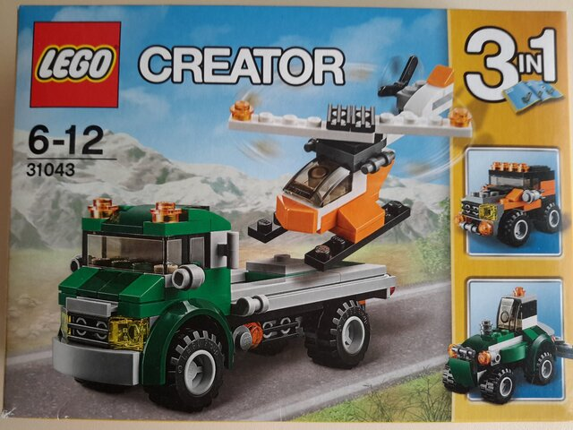](https://www.freelug.org/IMG/jpg/20170709_114744.jpg)

À l’arrière pas de surprise non plus, les trois modèles sont présentés simultanément, avec le logo « 3 in 1 » en haut à droite.

[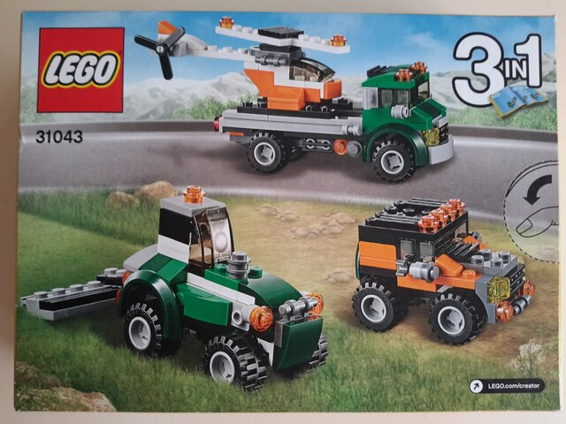](https://www.freelug.org/IMG/jpg/20170709_114752.jpg)

À l’intérieur, quelques sachets, trois notices, et un petit tas de pièces.

[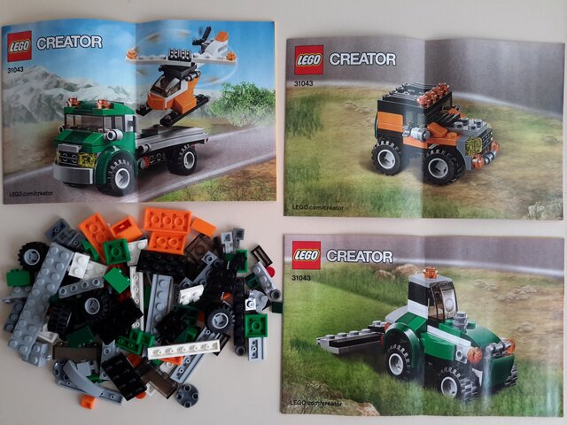](https://www.freelug.org/IMG/jpg/20170709_114712.jpg)

* * *

La construction de l’hélicoptère commence par son corps, juste quelques briques blanc et orange. Le cockpit est une pièce habituelle pour sa fonction.

[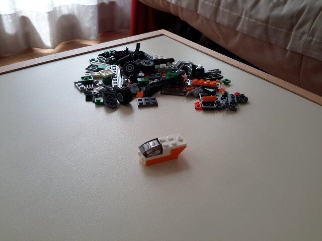](https://www.freelug.org/IMG/jpg/20170709_115641.jpg)

On continue avec la queue, et le rotor principal, une simple pièce tournante. À l’avant deux petites pièces orange pour le nez. La queue, judicieusement bloquée sur le dessus par une pièce à trou décalé, a le support adéquat pour le rotor de stabilisation. Les patins seront simplement deux barres noire attachées par une plaque orange (plus deux pentes orange pour adoucir les contours).

[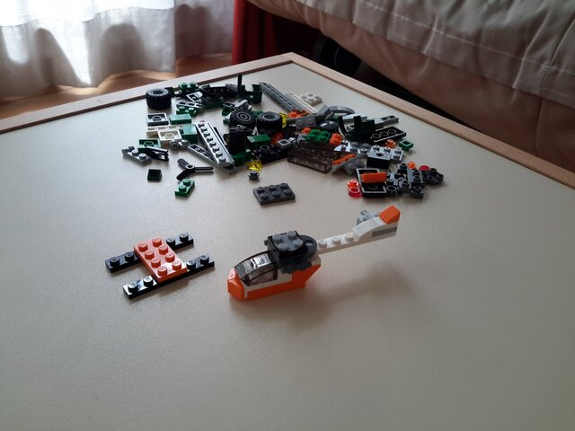](https://www.freelug.org/IMG/jpg/20170709_115907.jpg)

Et voici l’hélicoptère terminé, avec le rotor composé de deux barres blanches sur lesquelles viennent se poser deux grilles, avec des 1x1 rondes orange transparent aux extrémités.

[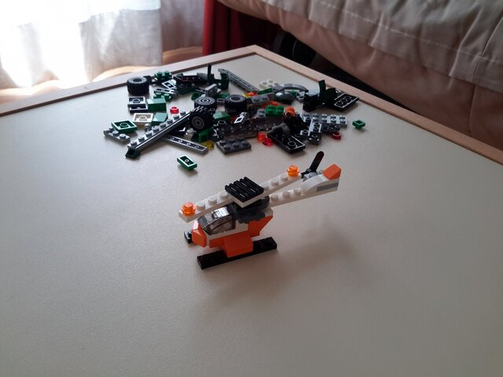](https://www.freelug.org/IMG/jpg/20170709_120009.jpg)

Après l’hélicoptère vient son camion de transport. Sa base est une plaque 2x10 grise, allongée de trois tenons par une plaque 2x3 gris foncé.

[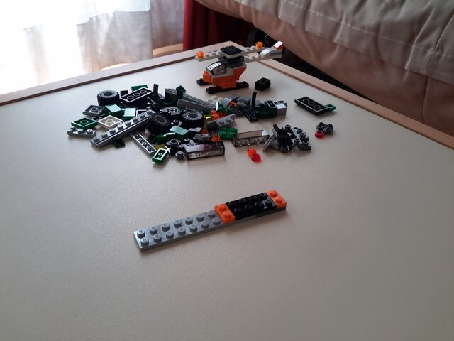](https://www.freelug.org/IMG/jpg/20170709_120046.jpg)

On pose les essieux à l’avant et l’arrière, et on agrémente un peu les côtés avec des lumières et des crochets, pour le style.

[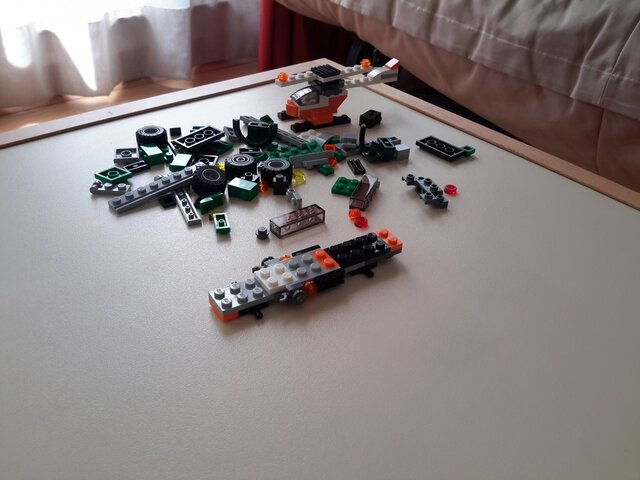](https://www.freelug.org/IMG/jpg/20170709_120259.jpg)

Changement de couleurs avec du vert et du gris pour le plateau sur lequel vient se poser l’hélicoptère. Les glissières latérales sont pour faire joli, elles n’ont aucun rôle particulier. Au centre les plaques 2x2 seront recouvertes d’une plaque à jumper sur laquelle attacher l’engin volant. À l’arrière comme il se doit deux feux rouge.

[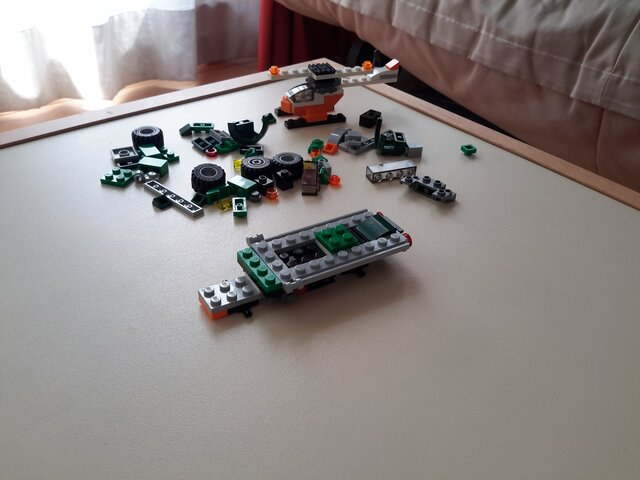](https://www.freelug.org/IMG/jpg/20170709_120440.jpg)

On rajoute quelques plaques lisses pour que l’hélicoptère ne s’accroche pas trop non plus, puis on s’attaque à la cabine du conducteur, en gamme vert et noir. L’avant a deux phares jaunes (pas adaptés à la conduite en France, mais j’imagine que c’est international), et un pare-choc.

[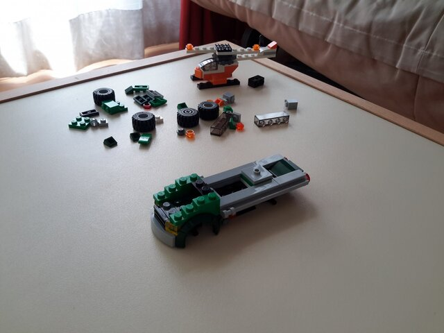](https://www.freelug.org/IMG/jpg/20170709_120651.jpg)

Et voici le camion terminé. Les rétroviseurs sont symbolisés par des anneaux simples, le pare-brise par des briques transparentes. Sur le côté gauche vous pouvez admirer les pièces bonus.

[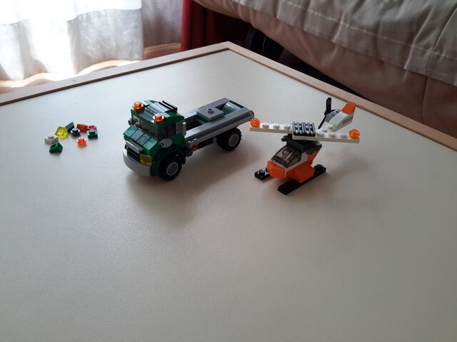](https://www.freelug.org/IMG/jpg/20170709_120851.jpg)

L’hélicoptère monté sur le camion, attaché donc juste par un seul tenon.

[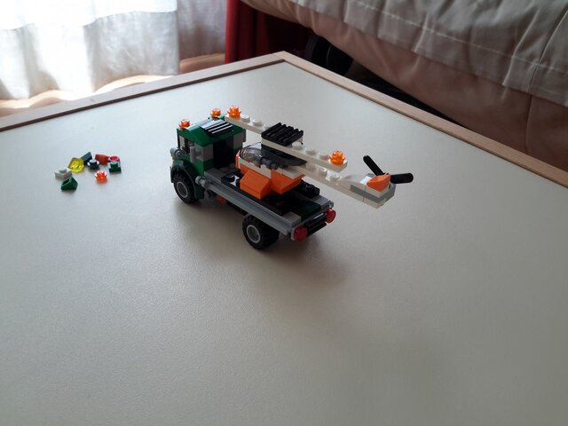](https://www.freelug.org/IMG/jpg/20170709_120900.jpg)

[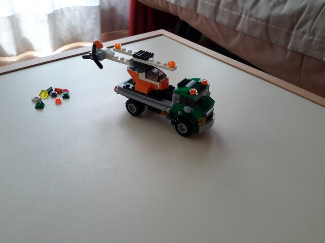](https://www.freelug.org/IMG/jpg/20170709_120905.jpg)

[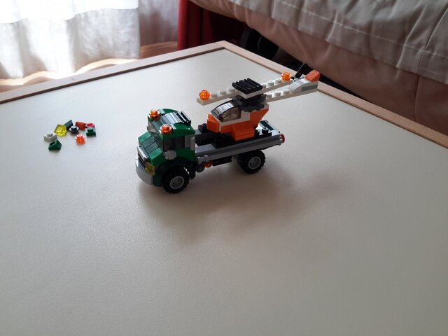](https://www.freelug.org/IMG/jpg/20170709_120910.jpg)

* * *

**Avis :** quelques petites astuces (la pièce à trou décalé pour fixer la queue de l’hélicoptère par exemple), mais rien de très compliqué pour ce modèle. Néanmoins son rendu est sympathique, même si évidemment ce n’est pas à l’échelle minifigurine.

**Bonus un :** le tout-terrain, premier modèle alternatif — j’aime bien la pièce rotative utilisée à l’arrière pour simuler (j’imagine) une roue de secours —,

[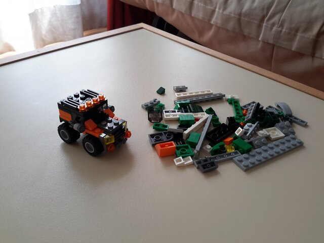](https://www.freelug.org/IMG/jpg/20170709_115214.jpg)

[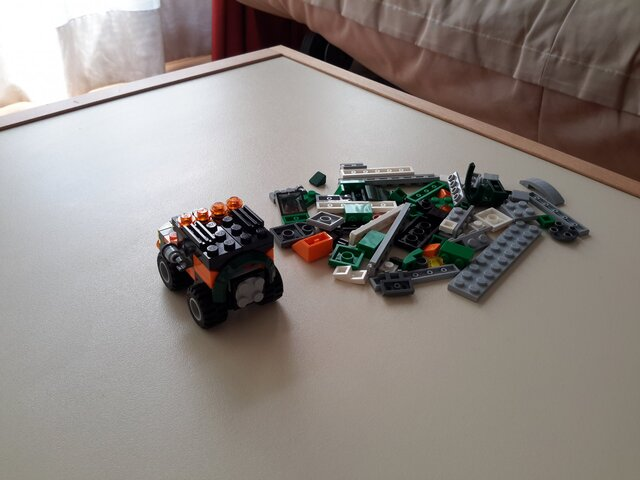](https://www.freelug.org/IMG/jpg/20170709_115219.jpg)

[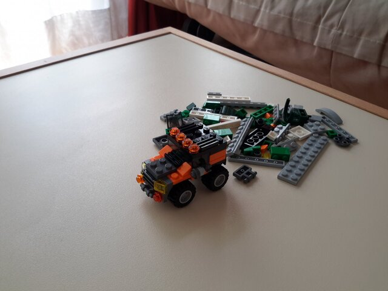](https://www.freelug.org/IMG/jpg/20170709_115233.jpg)

[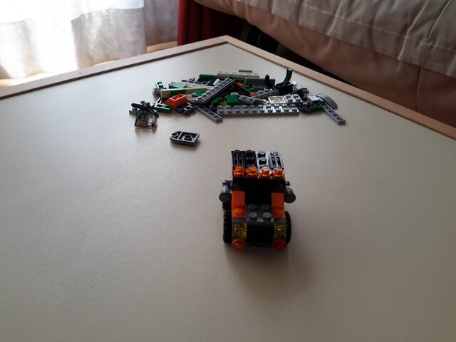](https://www.freelug.org/IMG/jpg/20170709_115245.jpg)

... et le tracteur, second modèle alternatif.

[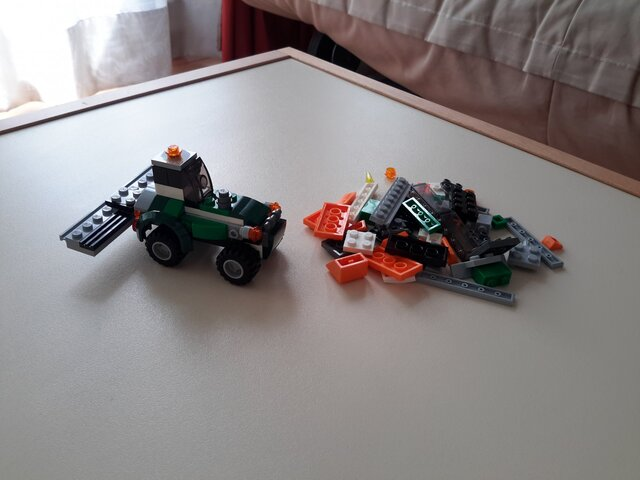](https://www.freelug.org/IMG/jpg/20170709_114329.jpg)

[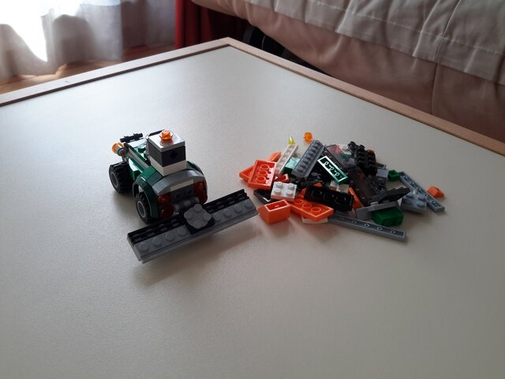](https://www.freelug.org/IMG/jpg/20170709_114337.jpg)

[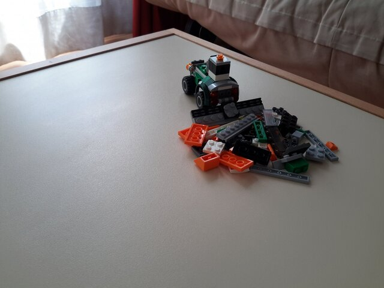](https://www.freelug.org/IMG/jpg/20170709_114347.jpg)

[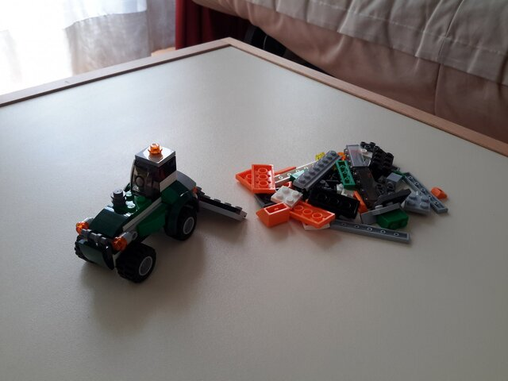](https://www.freelug.org/IMG/jpg/20170709_114354.jpg)

**Bonus deux :** animation de toutes les étapes de construction (cliquer pour lancer)

[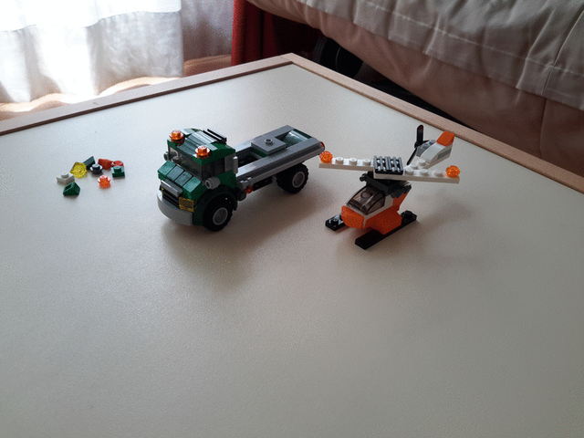](https://www.freelug.org/IMG/gif/31043.gif)
