En cette rentrée, retour sur un petit ensemble daté de 2017 sur la thématique de Noël, l’ensemble 40262 _Train de Noël_ — après tout c’est bientôt Noël !

Sorti donc en 2017, ce petit ensemble de 169 pièces (dont trois figurines) coûtait 9,99 €.

* * *

Sans surprise la boîte présente ce que l’on peut construire, à savoir deux petits stands, un banc avec un lampadaire, une table et bancs, un sapin, et un petit train (de Noël donc !).

La boîte a une zone pour écrire le nom de l’heureux bénéficiaire du cadeau, écrit sur une boule de Noël justement.

[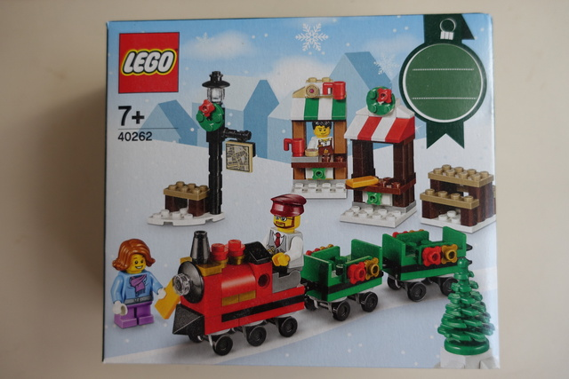](https://www.freelug.org/IMG/jpg/dsc02603.jpg)

Au dos présentation des petites scénettes réalisables avec cette boîte, bon, ça ne va pas très loin...

[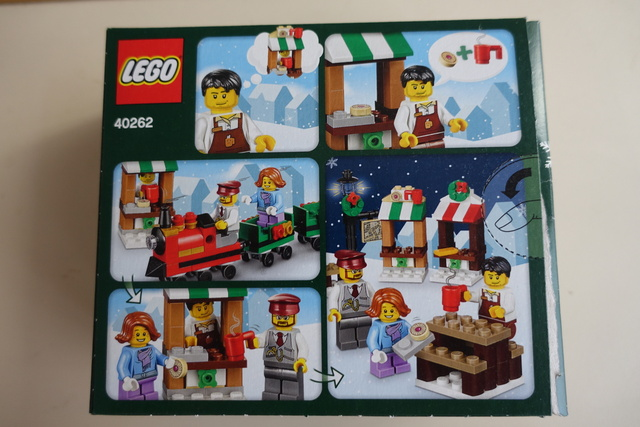](https://www.freelug.org/IMG/jpg/dsc02608.jpg)

* * *

Voici le magnifique petit train. Il est miniature, et la construction n’est pas vraiment compliquée, mais je trouve qu’il rend bien. Il y a même la place d’asseoir un personnage par wagon, c’est dire !

[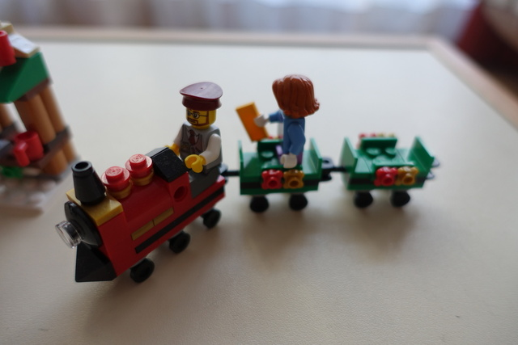](https://www.freelug.org/IMG/jpg/dsc02511.jpg)

[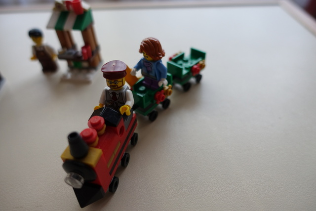](https://www.freelug.org/IMG/jpg/dsc02512.jpg)

Vue sur le petit stand de donuts et café (apparemment pas de photo de la face avant, oubli de ma part... Il est visible sur la photo globale plus bas). Quelques briques pour suggérer la forme, même pas la place de mettre une figurine en position, c’est très limité...

[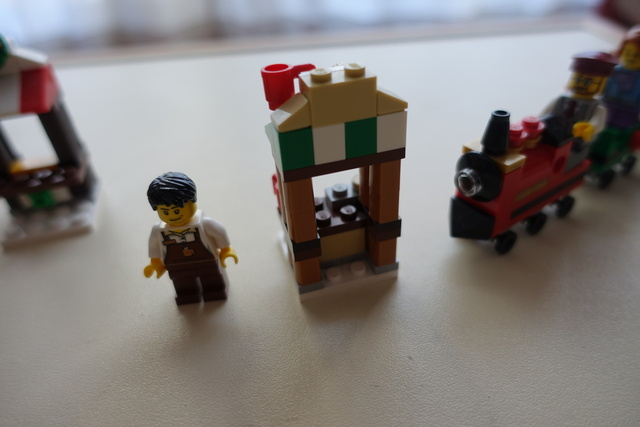](https://www.freelug.org/IMG/jpg/dsc02514.jpg)

Second stand, peut-être la caisse où la petite fille a acheté son billet — la boîte présente en effet un billet sur ce stand...

[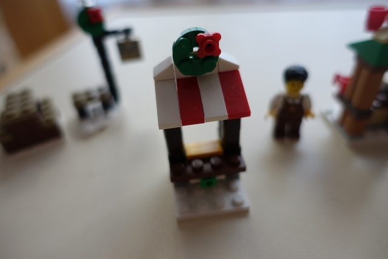](https://www.freelug.org/IMG/jpg/dsc02515.jpg)

Autre construction, un lampadaire avec une couronne de Noël et un plan accroché sur le côté. Un mini banc, sur lequel peut s’installer une figurine, complète la plaque. Le plan est tampographié, pas de sticker dans cette boîte.

[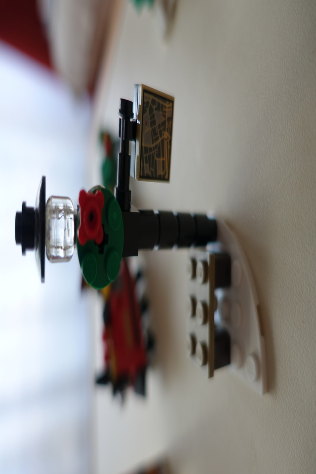](https://www.freelug.org/IMG/jpg/dsc02516.jpg)

Dernière construction, peut-être la plus compliquée, une table avec ses deux bancs. La couleur est cohérente avec le banc précédent, mais impossible d’y asseoir une figurine, pas assez d’espace, bien qu’on puisse poser une figurine à jambes d’enfants...

[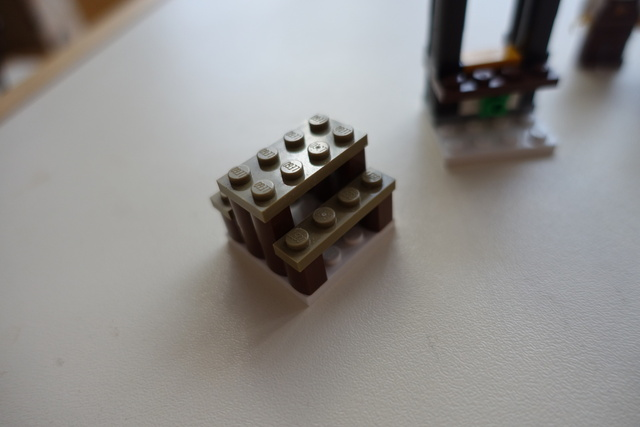](https://www.freelug.org/IMG/jpg/dsc02517.jpg)

Pour terminer, une photo de tout le contenu, dont l’arbre non montré en gros plan. Rien d’extraordinaire, le tout va bien ensemble.

[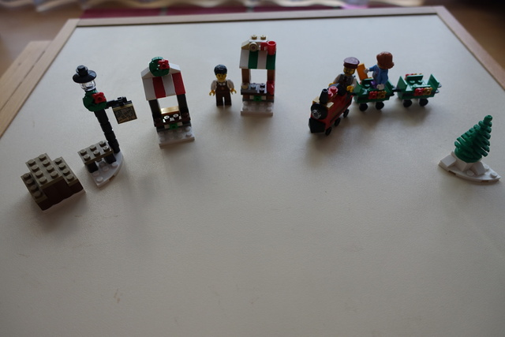](https://www.freelug.org/IMG/jpg/dsc02510.jpg)

Gros plan sur les figurines. Nous avons un vendeur de café et friandises, un conducteur de train, et une petite fille avec une écharpe — seule allusion à l’hiver, les autres sont peu habillés pour le froid... Les torses sont jolis sans être exclusifs (pour autant que je sache), et ont un motif sur le dos également, par contre les jambes sont uniformes, dommage, et pas de visage alternatif non plus.

[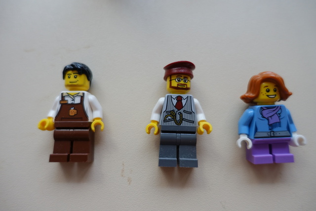](https://www.freelug.org/IMG/jpg/dsc02519.jpg)

[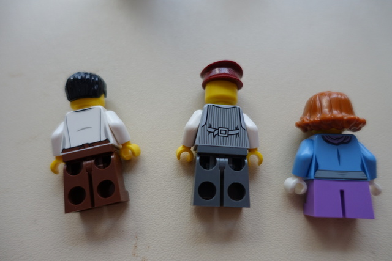](https://www.freelug.org/IMG/jpg/dsc02521.jpg)

* * *

**Avis :** même si cet ensemble est théoriquement consacré à Noël, pour moi c’est plutôt un petit assemblage de stands et décors festifs, sans vraiment de référence à Noël (sauf peut-être les couronnes)...

Au final cette petite boîte apporte quelques éléments, mais mérite à mon avis d’être insérée et étoffée dans un décor plus grand pour vraiment être intéressante — les stands par exemple pourront être fabriqués en plus grand modèle...
