Voici la présentation du set Brickheadz "Go Brick Me !" (traduit maladroitement en français par "La Fabrick à Selfie") permettant de réaliser des brickheadz qui vous ressemblent !

* * *

## Présentation

**quelques informations sur le set :**

-   n°41597
-   Date de sortie : 2 Avril 2018 sur le S@H et dans les LEGO Stores
-   Prix public : 34,99€ pour la France (+5€ par rapport à l’Allemagne)
-   708 pièces

_Première question : devant ce bon ratio prix/pièce (environ 0.05€/pièce), en aurons-nous pour notre argent ?_

**Présentation de la boite :**

[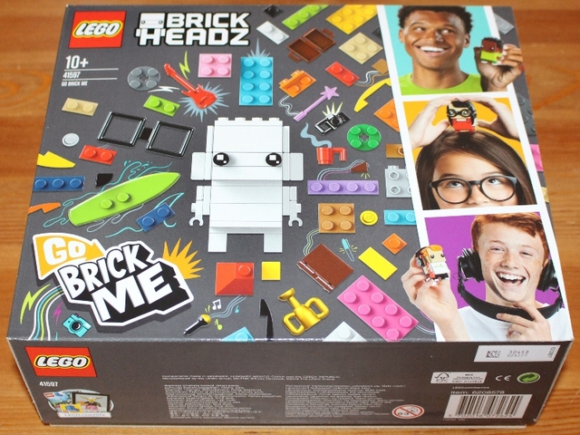](https://www.freelug.org/IMG/jpg/01-5.jpg)

**Face avant**

[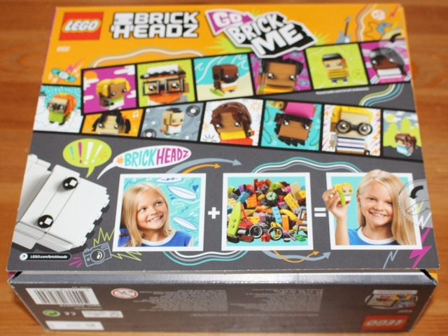](https://www.freelug.org/IMG/jpg/02-6.jpg)

**Face arrière**

Cette boite comporte une présentation très "pop", pleine de couleurs et très bien imagée de ce que la boite permet de faire.  
Cela donne envie. Je trouve personnellement ce packaging très réussi.

_Deuxième question : la promesse de création "sans limite", que suggère ce bel emballage, est-elle au rendez-vous ?_

**Contenu :**

[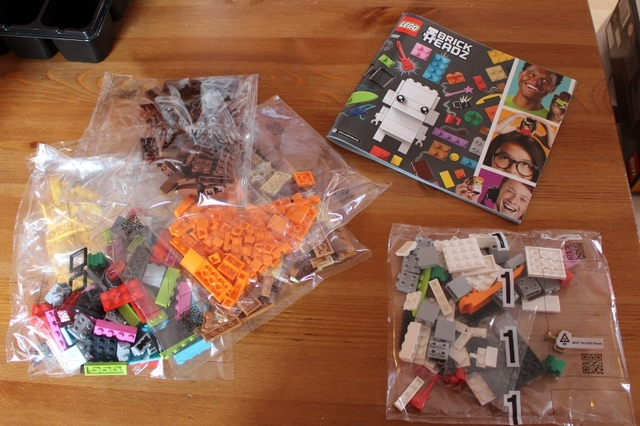](https://www.freelug.org/IMG/jpg/03-5.jpg)

**Contenu**

[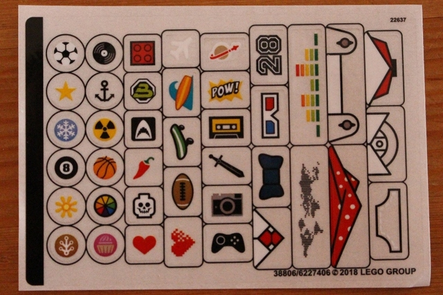](https://www.freelug.org/IMG/jpg/04-4.jpg)

**Une planche de stickers ? Une 1ère pour un brickheadz !**

Outre la notice, et la planche de stickers, il y a 7 sachets de pièces.  
Un seul est numéroté (1) et correspond au premier montage, qui permet de se faire un peu la main et comprendre comment construire une Brickheadz.  
Ce sachet correspond tout simplement à la Brickheadz entièrement blanche.

[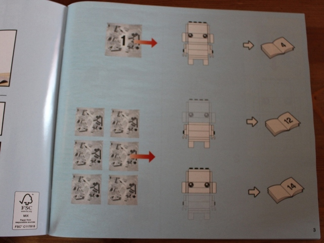](https://www.freelug.org/IMG/jpg/05-2.jpg)

**Rapide aperçu du fonctionnement de la notice**

De son coté, la notice ([version pdf en ligne sur le S@H](https://www.lego.com/biassets/bi/6234197.pdf)) est très bien faite : elle est découpée en plusieurs exemples de corps, puis plusieurs exemples de têtes.  
Un bref aperçu des pages résumées permet de voir de nombreuses possibilités incluses de base dans le set (c’est-à-dire sans avoir à faire preuve de trop d’imagination).

* * *

## Réaliser son auto-portrait à base de briques version Briquheadz :

**Les pièces :**

[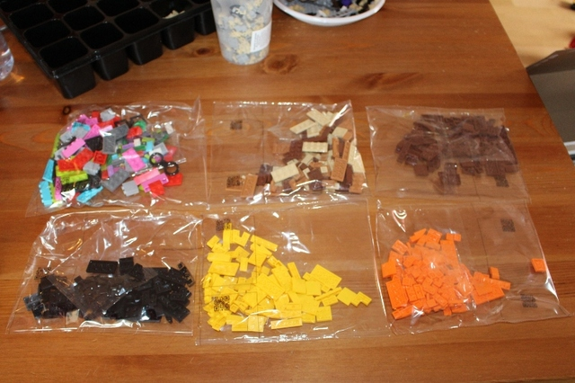](https://www.freelug.org/IMG/jpg/06-3.jpg)

**Les sachets de pièces pour réaliser son auto-portrait**

Concentrons-nous sur les 6 sachets restants :

-   un sachet multicolore avec les pièces pour les corps (et aussi les lunettes)
-   un sachet contenant les couleurs de peaux (Black, Blanc, Beurre enfin Reddish Brown, Tan et Nougat)
-   4 sachets pour les cheveux (chacun sa couleur : blond, roux, noir et châtain, enfin Yellow, Orange, Black et Reddish Brown)

Ce découpage par couleurs et utilisation est très pratique, pas besoin de trier, pas besoin de fouiller trop, les pièces se trouvent facilement (à noter, comme c’est de plus en plus le cas dans les set LEGO, les petites pièces sont dans des petits sachets dans les grands sachets).

[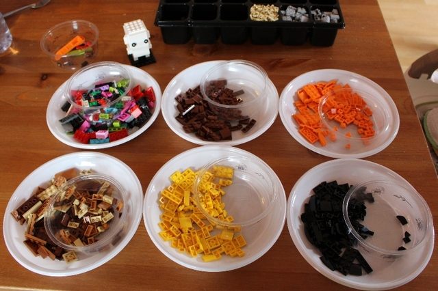](https://www.freelug.org/IMG/jpg/07-2.jpg)

**Enormément de couleurs pour ce set !**

**1ère construction : directement sans la notice !**

Comme les exemples de base ne me correspondaient pas (principalement, les barbes n’étaient pas assez grosses...), je suis parti directement sur de la construction en autonomie.

[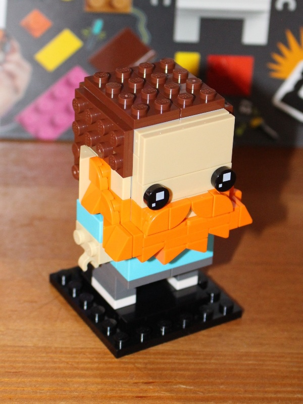](https://www.freelug.org/IMG/jpg/08.jpg)

**Mr Tribolego en Briques et en tenons !**

Je suis très contant du résultat : j’ai ma grosse barbe rousse, en T-shirt et baskets blanches. On me reconnaît bien non ?

**2ème construction : facile pour une novice ?**

[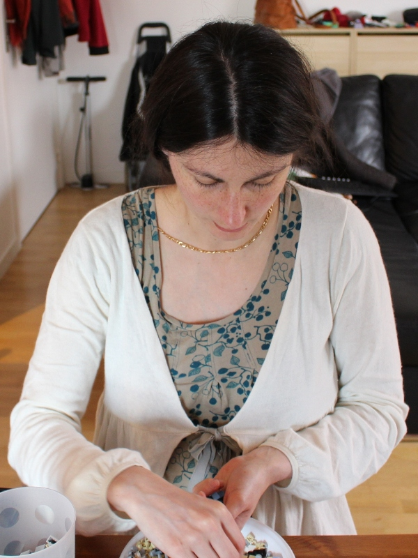](https://www.freelug.org/IMG/jpg/09-2.jpg)

**"Go Brick ME !" au révélateur d’une novice**

J’ai proposé à ma chérie de faire aussi sa Brickheadz, elle-même.  
Cela nous a permis de faire quelques remarques sur le set :

-   il y a assez de pièces de chaque couleur de peau pour faire 2 Brickheadz par couleur !
-   les pièces de cheveux permettent facilement de faire 2 Brickheadz par couleur, mais pas forcement deux cheveux longs
-   j’aurais bien aimé plus de pièces [22885](https://www.bricklink.com/v2/catalog/catalogitem.page?P=22885) car il y en a assez que pour 2 Brickheadz, alors que les pièces permettraient d’en faire facilement 6 ! (j’ai heureusement pu profiter d’une disponibilité au Store de SO-Ouest de vracs de pièces pour remplir un demi grand gobelet de ces pièces)
-   du coup, même remarque pour les yeux qui ne sont que 6 (grâce au deux extra-parts)

[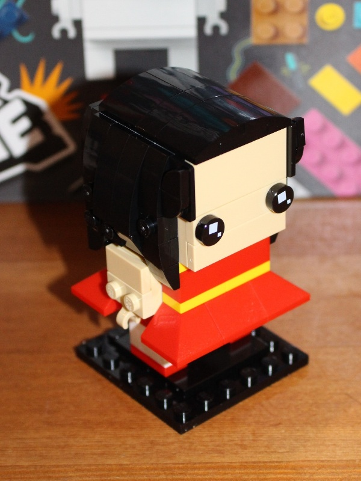](https://www.freelug.org/IMG/jpg/10-4.jpg)

**Madame a réussi son auto-portrait (sans trop dériver toutefois de la notice)**

Le résultat pour madame est sympa. Elle s’est permis une ou deux petites modifications par rapport aux exemples qu’elle suivait, ce qui montre qu’il est facile de s’adapter.

* * *

## Conclusion :

[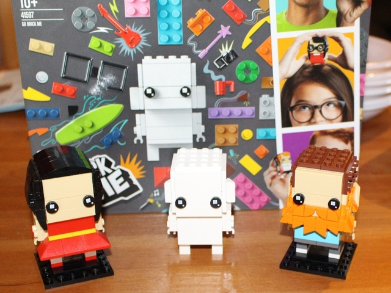](https://www.freelug.org/IMG/jpg/11-3.jpg)

**Mission réussie !**

**Pour moi, la mission est réussie !**  
Nous avons pu faire trois Brickheadz (la Blanche et nos deux auto-portraits, au bémol près de la pièce [22885](https://www.bricklink.com/v2/catalog/catalogitem.page?P=22885) qui n’est dispo qu’en quantité pour en faire 2).  
La quantité de pièces restantes me donne l’impression que je dois pouvoir facilement en faire 4 autres (A suivre ?...).

[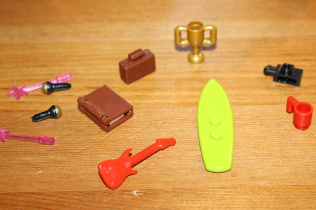](https://www.freelug.org/IMG/jpg/12-4.jpg)

**Quelques accessoires...**

Et si vous voulez, la boite comporte quelques accessoires pour compléter votre Brickheadz !

La planche de stickers est une petite déception pour moi : première brickheadz qui en propose une.  
Disons-le, j’aurais préféré quelques pièces de plus sérigraphiées. Ou alors, la société LEGO aurait au moins pu proposer plusieurs fois la planche de stickers, car la boite donne envie de créer et recréer et ne pas s’arrêter à un seul montage.

Finalement, j’ai pu répondre positivement à mes deux questions en préambule :

-   Avec cette boite, nous en avons largement pour notre argent : beaucoup de pièces, des couleurs variées, quelques accessoires qui, si ils ne trouvent pas leur utilité ici, sauront faire le chemin vers vos minifigs
-   Les possibilités de création sont vraiment énormes. Nous disposons ici de ce qu’il faut pour faire de jolies versions de nous-même façon Brickheadz.

La société LEGO surfe sur la réussite commerciale que sont ses Brickheadz. Pour moi cette boite est vraiment une "brique" de plus dans cette réussite.  
Les quelques limitations de ce set peuvent être vite levées pour un AFOL. C’est certes sans doute moins le cas pour un acheteur lambda.

**Et vous, qu’en pensez vous ?**  
Venez en parler sur notre [tout nouveau forum](https://forum.freelug.org/viewtopic.php?f=11&t=134) !

* * *

## Bonus : Et les enfants alors ?

Construire nos auto-portraits m’a directement donné l’envie de faire une Brickheadz représentant mon fils. Pour cela, je suis allez chercher dans mon stock.  
Ce choix s’est fait pour deux raisons :

-   nous avons utilisé quasi la totalité des pièces Tan pour représenter une peau caucasienne
-   je suis parti dans une création en 3 de large, pour représenter le gabarit réduit d’un petit bonhomme de 2 ans

[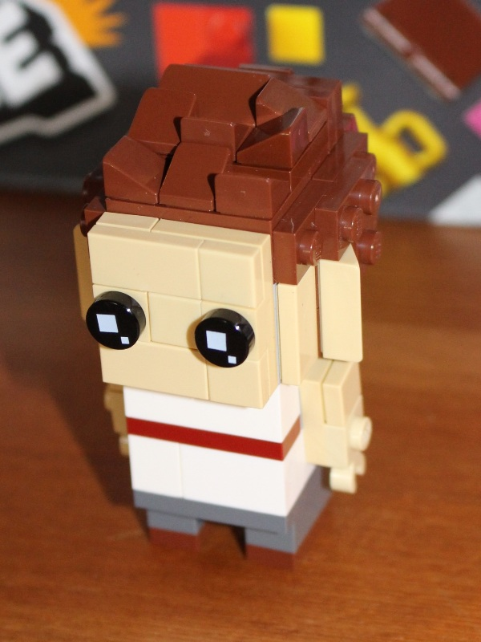](https://www.freelug.org/IMG/jpg/13-2.jpg)

**Enfant Brickheadz vu de face**

[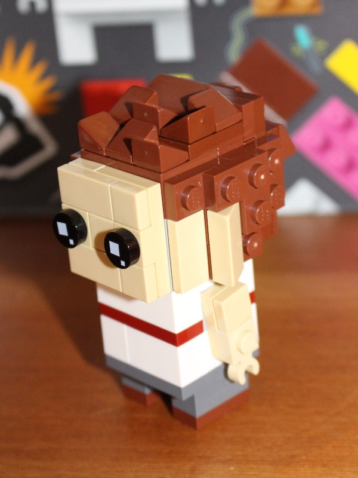](https://www.freelug.org/IMG/jpg/14-3.jpg)

**Enfant Brickheadz vu de 3/4**

* * *

**J’espère que ma Review vous a plu, et nous vous disons à la prochaine !**

[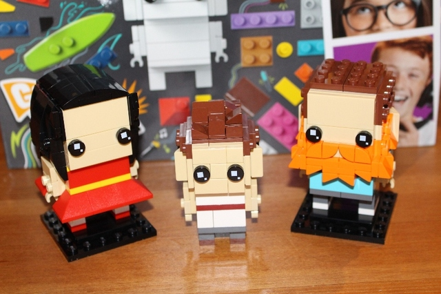](https://www.freelug.org/IMG/jpg/15.jpg)

**Photo de famille**

* * *

Voir en ligne : [Lien vers le S@H](https://shop.lego.com/fr-FR/La-Fabrick-a-Selfie-41597)
