Pas fan de moto, je suis vraiment de très loin cette catégorie de véhicule.  
Mais j’ai trouvé cette reproduction vraiment bien réalisée. Alors dès que j’ai pu me prendre cette boite, j’ai foncé.

Comme je vous l’explique plus haut, je suis plus tourné vers les trains, les voitures et les camions. Mais j’ai vraiment trouvé cette Ducati bien reproduite. Les photos laissent présager un beau modèle et le côté Technic apporte un plus intéressant pour les parties en mouvement.

Les informations principales :  
Année de sortie 2020 ;  
Prix environ 50€, elle n’est plus en vente sur le Shop officiel ;  
5 sachets ;  
646 pièces et pas de minifig, c’est du Technic ;  
Temps de montage environ 3h1/4.

**La boite et son contenu**

La boite présente bien avec une belle photo de la moto terminée. Ca donne envie de vite commencer.

[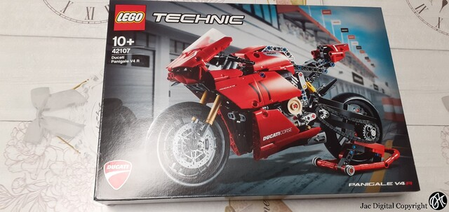](https://www.freelug.org/IMG/jpg/20231101_202950.jpg)

Au dos de la boite quelques photos des détails. On comprend que le carénage est amovible pour pouvoir contempler les parties techniques.

[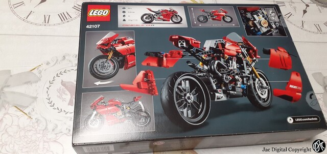](https://www.freelug.org/IMG/jpg/20231101_203011.jpg)

En détail, une photo de la vraie moto avec quelques caractéristiques impressionnantes de ce bolide. 221Ch pour 172Kg, le rapport poids/puissance est impressionnant !

[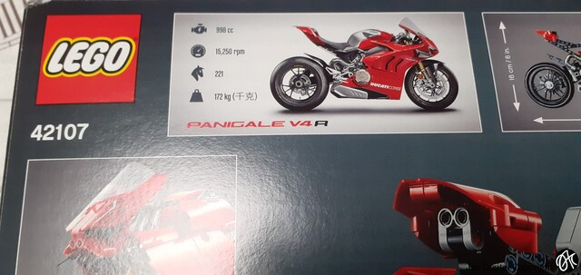](https://www.freelug.org/IMG/jpg/20231101_203019.jpg)

A l’ouverture, on découvre les 5 sachets, deux pneus bien différents, la notice, une belle planche d’autocollants et le pare brise souple. Un montage passionnant en perspective.

[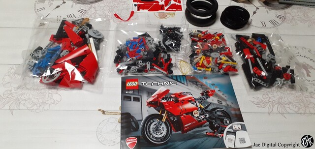](https://www.freelug.org/IMG/jpg/20231101_203133.jpg)

**Le montage**

Après quelques étapes de montage, on peut admirer le beau moteur V4 qui trône au centre du châssis.

[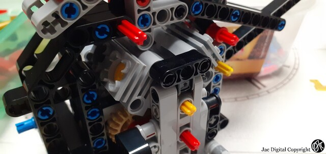](https://www.freelug.org/IMG/jpg/20231102_190942.jpg)

On enchaine ensuite avec le bras arrière. Le disque de frein est énorme et prend bien sa place. Il manque les étriers de frein, mais tant pis on va faire sans. Ce n’est pas une maquette...

[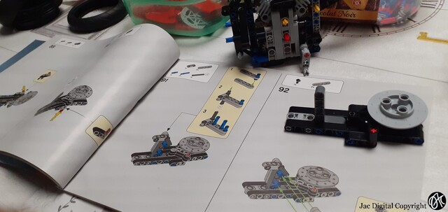](https://www.freelug.org/IMG/jpg/20231102_190948.jpg)

Le châssis moteur est terminé. La notice se charge de nous expliquer le fonctionnement du levier de changement de rapport. On a deux vitesses ici, une lente et une rapide. Il faut bien regarder les pistons pour voir la différence de rotation. On peut même scanner un QR code pour voir une vidéo...

[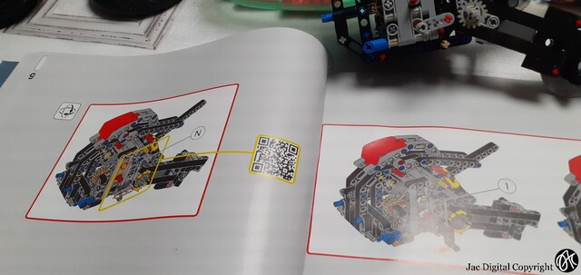](https://www.freelug.org/IMG/jpg/20231102_193405.jpg)

La fourche avant est en place. Pratiquement chaque pièce de carrosserie comporte un autocollant. Les tiges de suspension sont très bien faites et donnent un plus à la moto.

[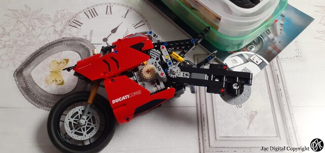](https://www.freelug.org/IMG/jpg/20231110_185424.jpg)

Même le dessous de la moto est détaillée ...

[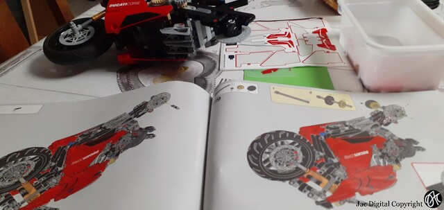](https://www.freelug.org/IMG/jpg/20231110_191140.jpg)

Prenez beaucoup de soin à la mise en place des autocollants. C’est long, mais le résultat en vaut la peine.

[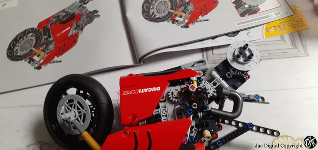](https://www.freelug.org/IMG/jpg/20231113_185221.jpg)

**La conclusion**

Au final, il faut dire quand même que beaucoup de choses ont été simplifiées. Il y a aucun étrier de frein sur les disques, le pot d’échappement est un peu libre à mon gout et on a seulement deux rapports avec le point mort alors que la réelle en a 6. Il manque aussi une marche arrière. Mais bon, le châssis n’est pas très grand et il est déjà bien plein.

Mais tout de même, cette moto a de l’allure, même en pièces LEGO, on ne peut pas vraiment parler de briques ici. Ce n’est pas une maquette, donc je me doutais que la reproduction serait approximative. Sous certains angles, ça fait bizarre, mais la DUCATI est tout de même bien réussie et c’est un régal à construire.

[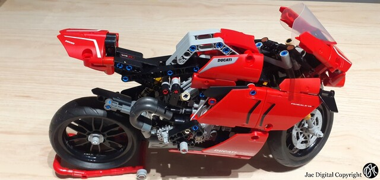](https://www.freelug.org/IMG/jpg/20231120_205416.jpg)
