Review du montage de cette version porte "in board" 2015

Quand j’ai vu cette nouvelle version, dans le catalogue 2015, je me suis dit : "_encore une nouvelle couleur de cette coque !_". Ce n’est pas vraiment intéressant... Et puis à chaque fois que je passe au rayon LEGO, j’examine la boite et son prix sous toutes les coutures. C’est donc que ça me plait. En cette période de Noël les prix sont très attractifs, 20,90 Euros. Donc, voilà, j’ai fini par craquer.

Dans la gamme "LEGO City", cela fait quelques années que l’on transporte des hors-bords. En 1995, nous avions la référence 6596. Puis en 1993, le petit bateau de course 6663. En 1986, c’était avec la référence 6698 et je ne suis pas allé plus loin.

Mais avec l’hydrospeed, on passe à une autre catégorie de bateau de course avec le transport d’un engin "in board", moteur dans le bateau [référence 4643](/articles/le-transport-de-l-hydrospeed-4643/). La semi-remorque est tractée par un camion, comme on peut en trouver sur nos routes européennes. La semi-remorque de cette version 2015 est tractée par un gros 4X4 américain, ils peuvent aussi tracter des semi-remorques. Ce qui change tout au niveau du look final. D’ailleurs les couleurs et les habits des pilotes sont là pour le démontrer.

Prix : de 20 à 30 Euros pour cette boite  
**–** Disponibilité : dans tous les magasins en ce moment.  
**–** Taille de la boîte : 35,5 X 19 X 9 cm  
**–** Nombre de pièces : 291  
**–** Gamme : City  
**–** Contenu : un 4X4 américain, une remorque, un bateau qui flotte et 2 minifigs.  
**–** Temps de montage : environ une heure.

Une très belle boite avec sur le devant une photo du modèle en situation, au dos quelques idées de jeu et une aide pour le chargement du bateau de course.

[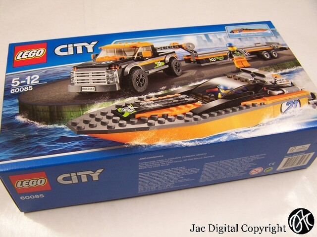](https://www.freelug.org/IMG/jpg/Art-01-58.jpg)

**La boite face principale**

[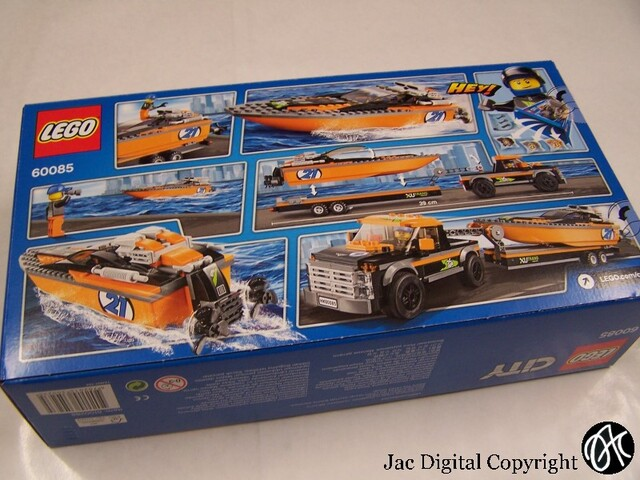](https://www.freelug.org/IMG/jpg/Art-02-55.jpg)

**Le dos de la boite**

La boite est bien pleine. A l’ouverture on trouve 3 sachets, qui correspondent chacun à l’un des trois éléments, la coque, 3 notices et une planche d’autocollants. Je vais les coller pour ce modèle car je les trouve chouettes. Ils terminent bien la construction, comme d’habitude mais c’est aussi parce que ça me rappelle la série "sport extrême" que j’aimais bien.

[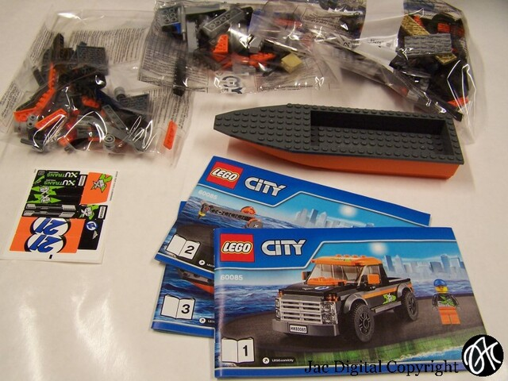](https://www.freelug.org/IMG/jpg/Art-03-44.jpg)

**Le contenu**

Bon, coller un autocollant noir sur une brique noire, ce n’est pas facile ! Enfin, le résultat est satisfaisant alors je m’y colle et m’y recolle !

[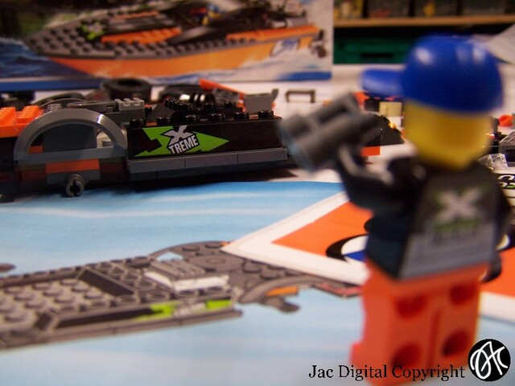](https://www.freelug.org/IMG/jpg/Art-05-23.jpg)

**Les autocollants noirs, aïe !**

Quelques parties vides sur la construction du "camion", ça fait bizarre car on se dit qu’il manque des choses comme un moteur. Mais ça ne se verra plus une fois fini.

[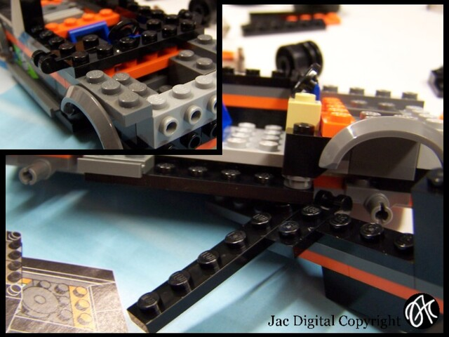](https://www.freelug.org/IMG/jpg/Art-06-18.jpg)

**Les parties creuses...**

Superbe construction déjà, peut être une modification à faire pour placer LA conductrice sur un côté. Oui, vous trouverez un couple de minifigs dans cette boite avec la dame qui conduit ou qui pilote.

[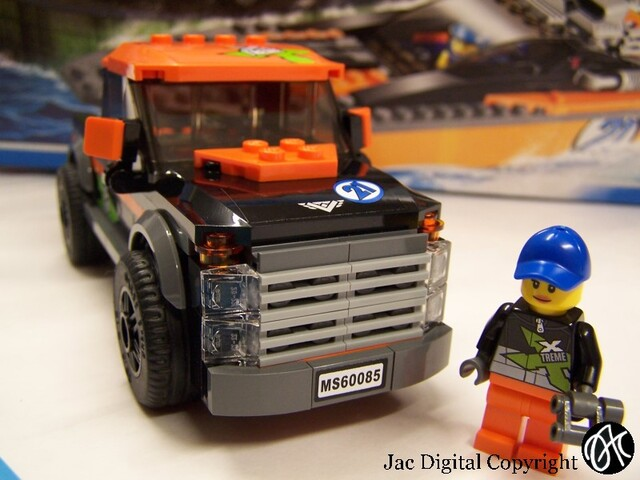](https://www.freelug.org/IMG/jpg/Art-07-13.jpg)

Quelques pièces en rab pour ce premier sachet.

[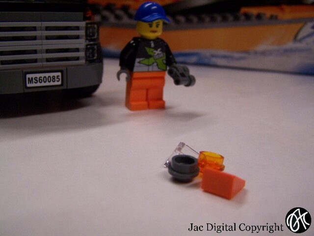](https://www.freelug.org/IMG/jpg/Art-08-8.jpg)

Le contenu du deuxième sachet.

[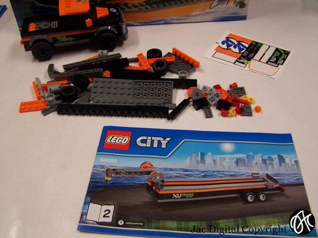](https://www.freelug.org/IMG/jpg/Art-09-9.jpg)

Toujours les mêmes problèmes avec les autocollants noirs...

[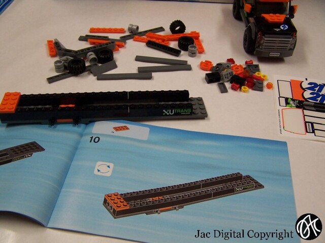](https://www.freelug.org/IMG/jpg/Art-10-8.jpg)

La remorque est assez simple en fait, elle n’a pas de béquille. Le système d’attelage semble une usine à gaz mais il fonctionne, même si l’articulation n’est pas possible dans tout les sens, il s’assemble bien.

[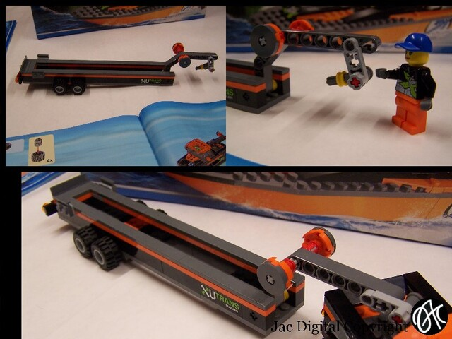](https://www.freelug.org/IMG/jpg/Art-11b.jpg)

Sur cette partie j’ai oublié de prendre en photos les pièces en rab. Mais il y en avait quelques unes, je vous l’assure. Peut-être un peu pressé de jouer...

Contenu du troisième sachet avec la coque puisqu’il s’agit du montage du bateau.

[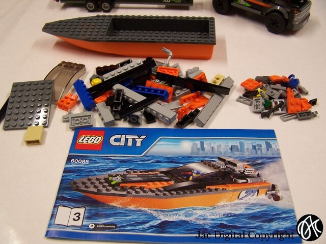](https://www.freelug.org/IMG/jpg/Art-12-5.jpg)

On commence par la construction de la minifig, l’homme !

[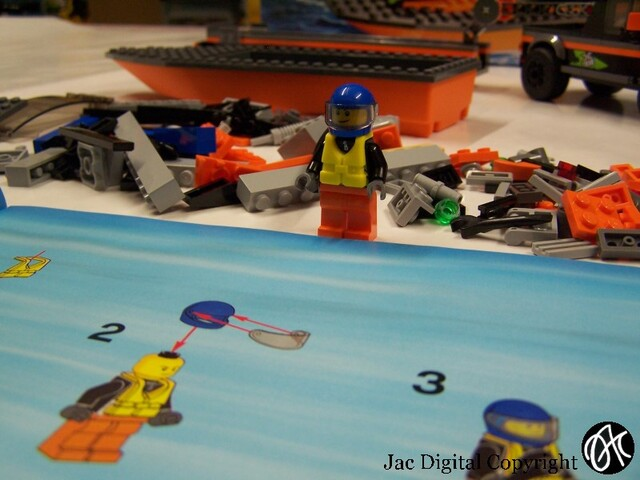](https://www.freelug.org/IMG/jpg/Art-13-6.jpg)

L’assemblage du moteur, monsieur est pressé ! Rien de particulier sur cette partie. C’est bien vide sous les plaques, mais c’est une coque qui flotte, comme indiqué sur la boite. Si on la charge trop on aura un sous-marin au raz de l’eau...

[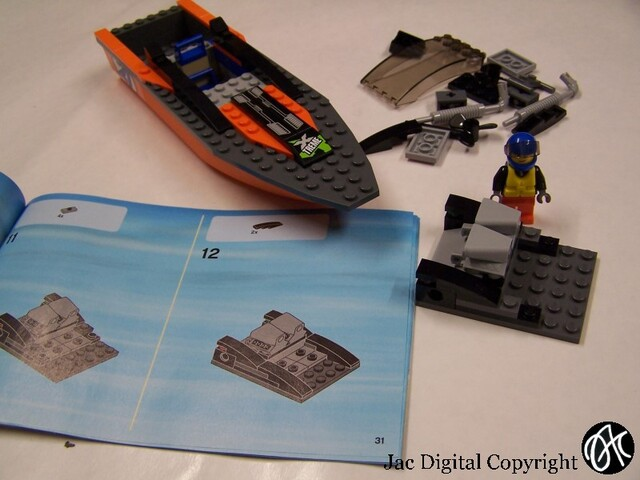](https://www.freelug.org/IMG/jpg/Art-14-4.jpg)

Voilà le bateau terminé...

[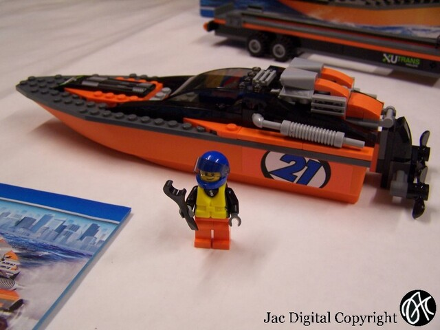](https://www.freelug.org/IMG/jpg/Art-15-3.jpg)

Et les "extra parts" que j’ai pensé à prendre en photo cette fois. Il y a une grille. J’ai cherché sur la notice je n’ai pas oublié de pièces, c’est bizarre mais ça arrive.

[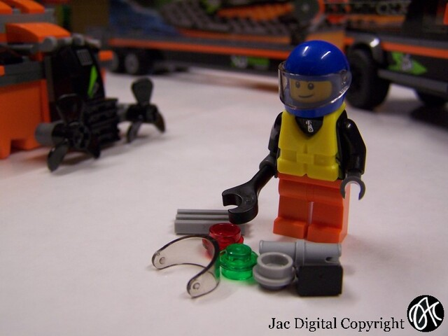](https://www.freelug.org/IMG/jpg/Art-16-2.jpg)

Voilà l’ensemble terminé. Il est très coloré, je trouve avec ces belles bandes orange. On est prêt à aller affronter des vitesses vertigineuses sur des eaux bien trop calmes.

[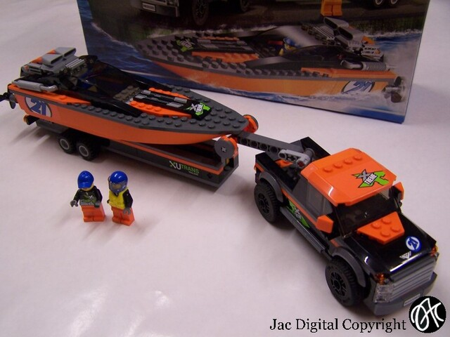](https://www.freelug.org/IMG/jpg/Art-17-2.jpg)

**L’ensemble au complet.**

En conclusion un beau modèle et sympa à construire. Des heures de jeu en perspective pour tout le monde. Je trouve juste dommage de toujours laisser les conducteurs au milieu d’un camion aussi large. La remorque est très simple voire trop. Je ne comprends pas pourquoi on a simulé un treuil de chargement alors que ceux-ci existent dans les stocks de pièces. Cela aurait été un jeu supplémentaire à mon sens.

Mais je ne regrette pas mon achat rien que pour le fun de l’ensemble...

Un lien vers sa galerie pour peut-être un jour des photos de jeu et de test de flottaison.  
**–** [60085](http://photos.freelug.org/main.php/v/JAC/review/60085/)
