LEGO propose, dans certaines gammes notamment City, différents « Starter kits », ou « ensembles de démarrage », comportant quelques personnages dans une petite scénette.

Cette boîte est l’une d’entre elles, sur le thème des pompiers, _60106_ - **Ensemble de démarrage pompiers**.

Sortie en décembre 2015, cette boîte comporte 90 pièces pour 9,99 €, soit un ratio de 11 centimes par pièce, avec quatre figurines.

* * *

La face avant de la boîte met en scène tous les éléments, un incendie sur un ponton avec les pompiers intervenant. En haut à gauche le logo CITY rappelle la gamme dans laquelle s’inscrit la boîte, tandis que le « Starter Kit » en bas à droite la classe comme ensemble de démarrage. Une petite mention enfin signale que l’aéroglisseur ne flotte pas.

[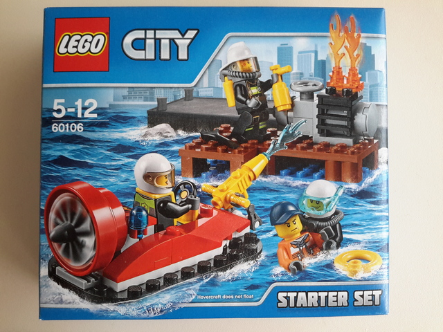](https://www.freelug.org/IMG/jpg/20170709_121422.jpg)

L’arrière présente les quatre personnages de la boîte, avec un rappel de l’incendie, immédiatement attaqué par un pompier.

[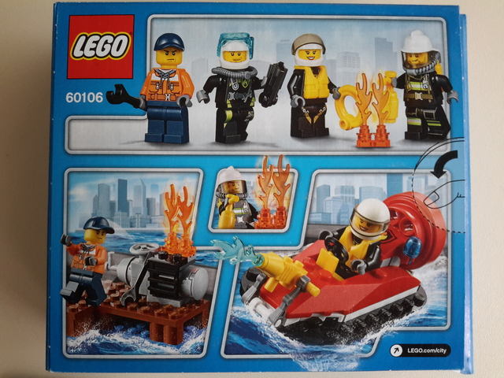](https://www.freelug.org/IMG/jpg/20170709_121434.jpg)

La boîte contient 2 sachets et une notice, faisant un joli petit tas de pièces.

[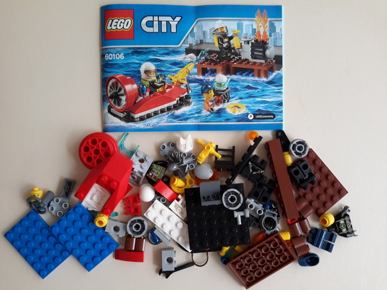](https://www.freelug.org/IMG/jpg/20170709_121408.jpg)

Le premier personnage est l’ouvrier travaillant sur le ponton, avec un magnifique gilet orange et la clé à molette qu’il faut pour être un bon travailleur. Sous le gilet un pull à capuche, qui se prolonge au dos, et un talkie-walkie glissé dans la ceinture. Le visage est sérieux, on sent que le personnage va vivre quelque chose de pas très drôle. En revanche les jambes sont uniformes.

[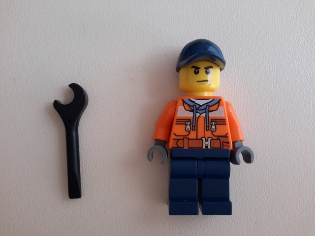](https://www.freelug.org/IMG/jpg/20170709_121908.jpg)

[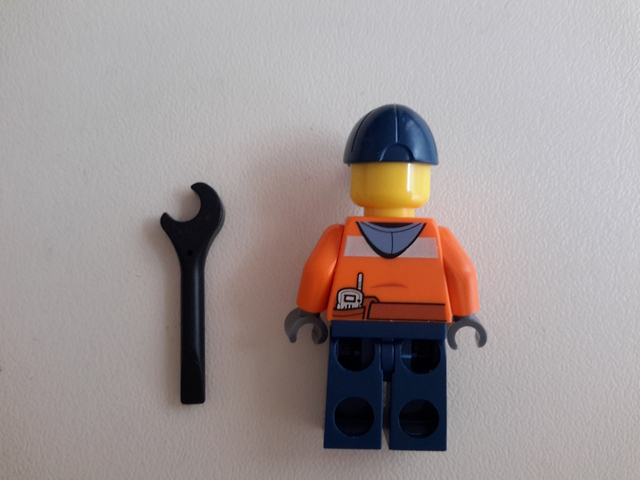](https://www.freelug.org/IMG/jpg/20170709_121928.jpg)

Vient ensuite la première pompière, qui pilotera l’aéroglisseur. Elle portera un gilet de sauvetage, dont les sangles sont sur les jambes et le torse, un casque à visière, avec une lampe de poche dans une poche poitrine, et a un talkie-walkie glissé à l’arrière. Sur le dos un symbole de flamme, indiquant son appartenance au corps de pompiers, sans doute. Le visage est souriant, elle est clairement heureuse.

[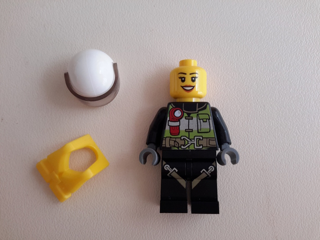](https://www.freelug.org/IMG/jpg/20170709_122043.jpg)

[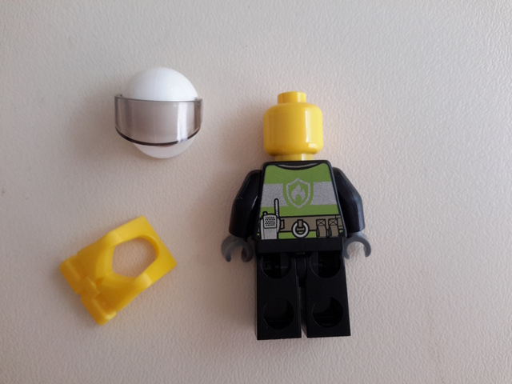](https://www.freelug.org/IMG/jpg/20170709_122055.jpg)

Le troisième personnage est le plongeur, avec sa bouteille, son masque et tuba, les palmes, et la bouée de sauvetage qu’il peut lancer pour sauver les personnes en difficulté. Il a comme il se doit l’indicateur de profondeur, son détendeur, et une ceinture de plomb, avec sur la poitrine le symbole de flamme du corps des pompiers. Son expression est à mon avis dubitative, il a l’air de contempler les événements avec un peu de détachement.

[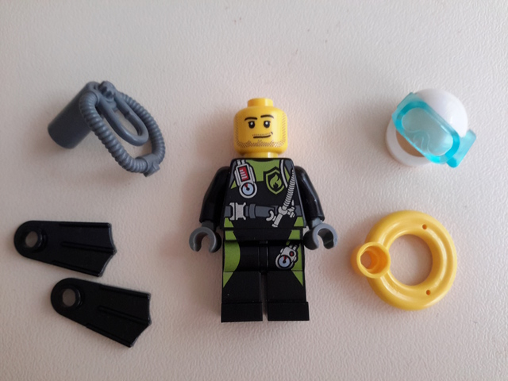](https://www.freelug.org/IMG/jpg/20170709_122208.jpg)

[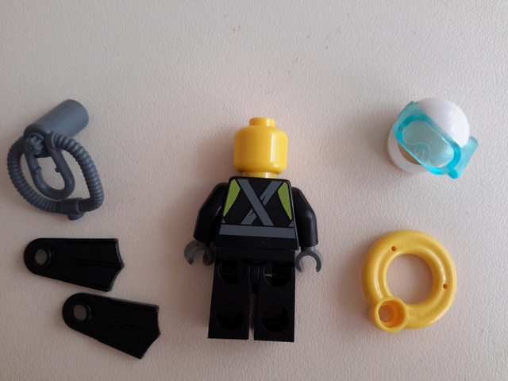](https://www.freelug.org/IMG/jpg/20170709_122222.jpg)

Le dernier personnages est un pompier qui ira combattre directement le feu sur le terrain. Il a un visage déterminé, et veut clairement vaincre ce terrible ennemi ! Bien équipé, il a des bouteilles pour échapper à la fumée, un masque intégral, un casque, et évidemment un extincteur. La combinaison comporte plusieurs sangles et il a un indicateur j’imagine d’air restant dans ses bonbonnes. Enfin au dos quelques sangles et la flamme des pompiers.

[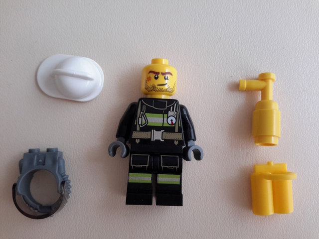](https://www.freelug.org/IMG/jpg/20170709_122246.jpg)

[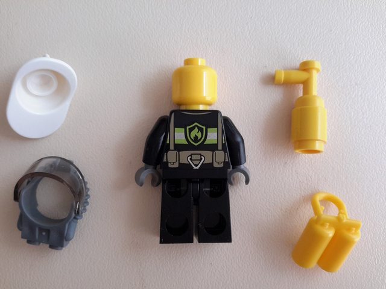](https://www.freelug.org/IMG/jpg/20170709_122257.jpg)

Et voici tous les personnages avec leur équipement, devant le tas de pièces composant le ponton et l’aéroglisseur.

[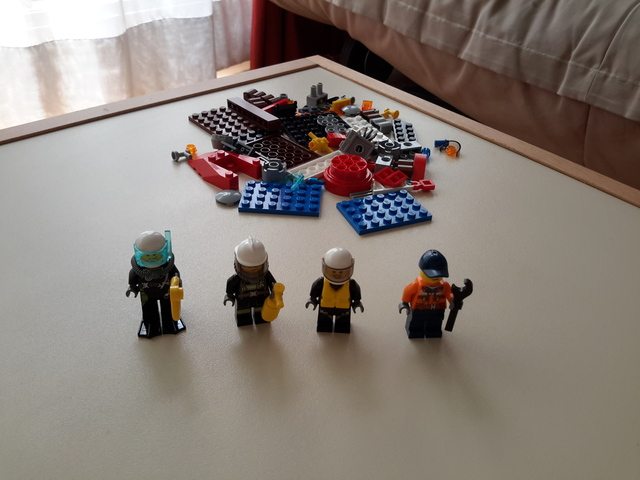](https://www.freelug.org/IMG/jpg/20170709_122449.jpg)

Et aujourd’hui nous avons un invité spécial, Good Cop, qui vient assister par curiosité à cette attraction.

La construction de la scénette commence par l’aéroglisseur, précisément son socle, avec un avant rouge simple. À noter les supports sur lesquelles viendront se fixer deux pinces qui tiendront la lance à eau.

[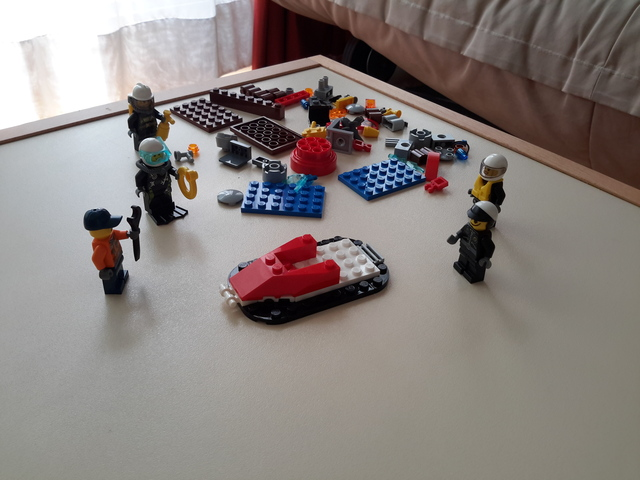](https://www.freelug.org/IMG/jpg/20170709_122813.jpg)

On continue avec le volant jaune, l’hélice arrière, et les gyrophares bleu — non éclairés bien sûr, pas de Power Function ici...

[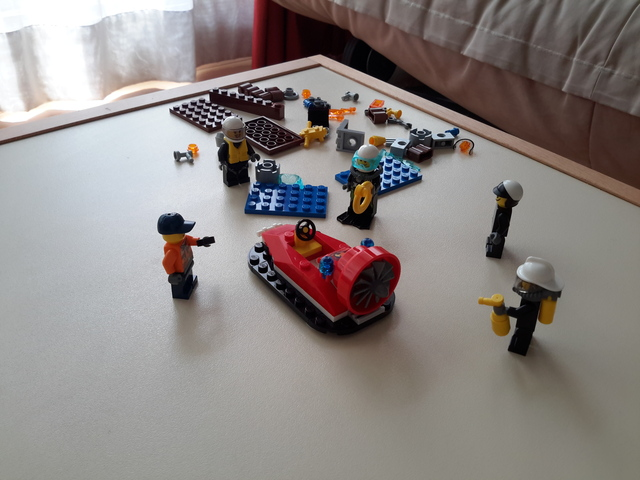](https://www.freelug.org/IMG/jpg/20170709_123105.jpg)

Et pour terminer on installe la lance à eau à l’avant, elle pourra pointer plus ou moins haut. À noter la pièce courbe sérigraphiée avec le logo des pompiers.

[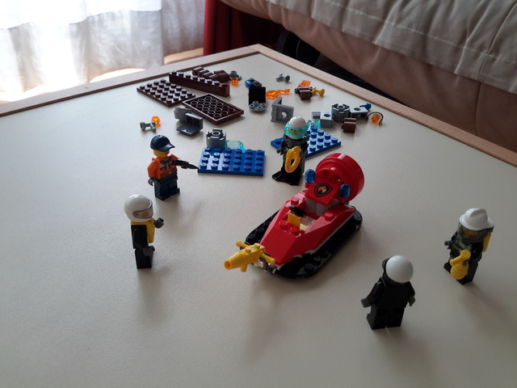](https://www.freelug.org/IMG/jpg/20170709_123147.jpg)

Le ponton pour sa part est avec un support très simple à base de bleu (pour la mer) et de marron (pour le bois j’imagine).

[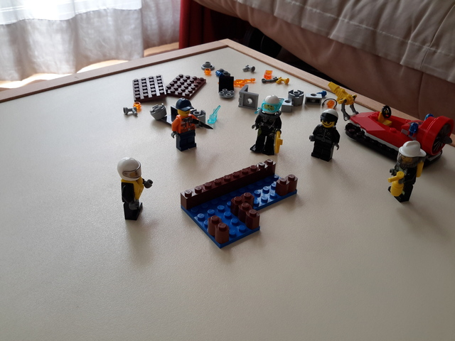](https://www.freelug.org/IMG/jpg/20170709_123351.jpg)

S’y superpose un plancher, marron également. Mais que fait donc ce mystérieux robot derrière l’aéroglisseur ?

[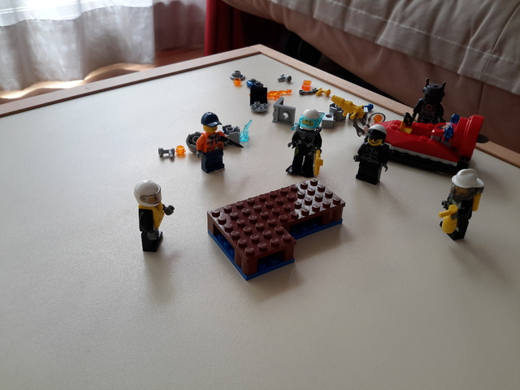](https://www.freelug.org/IMG/jpg/20170709_123417.jpg)

La construction se termine avec le bout de tuyau équipé d’une valve et d’un volant pivotant qui s’installe sur le ponton. Mais... l’espèce de robot lève son bras gauche ?

[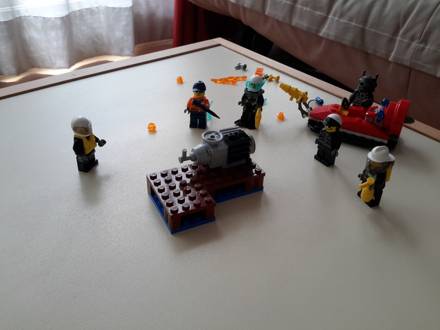](https://www.freelug.org/IMG/jpg/20170709_123710.jpg)

Et alors que l’ouvrier va travailler sur le tuyau, ce robot tire dessus au laser !

[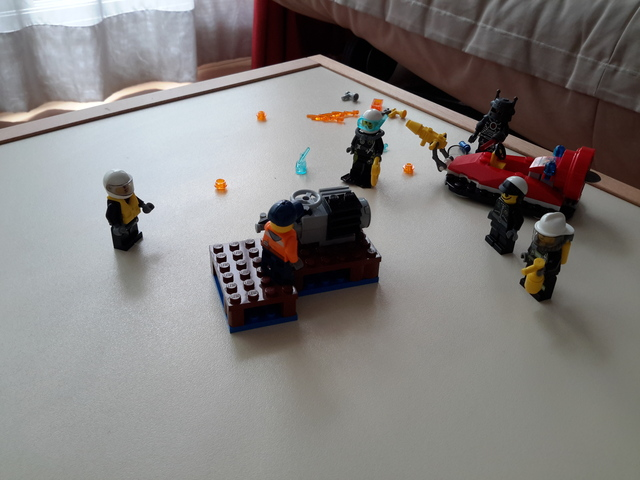](https://www.freelug.org/IMG/jpg/20170709_123748.jpg)

Le tuyau prend feu tandis que le robot s’éclipse, l’ouvrier ne peut que se précipiter à l’eau pour se sauver ! Heureusement le plongeur vient à sa rencontre avec la bouée, l’un des pompiers se dirige vers le feu pour lutter contre, et la pilote d’aéroglisseur se rue vers la machine. Good Cop, énervé, laisse la place à Bad Cop, qui frappe son tabouret (mais d’où l’a-t-il tiré ?)...

[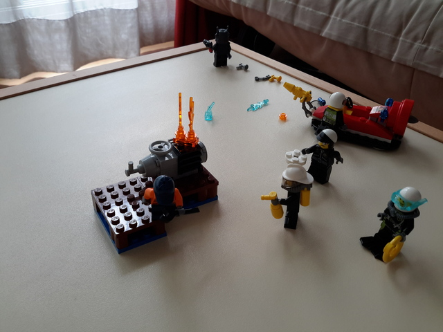](https://www.freelug.org/IMG/jpg/20170709_123933.jpg)

... qui va pile tomber sur le robot, l’assommant très proprement. L’ouvrier est sauvé, et vous pouvez admirer la lance à eau de l’aéroglisseur en pleine action.

[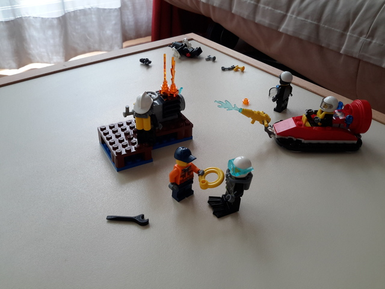](https://www.freelug.org/IMG/jpg/20170709_124053.jpg)

L’incendie est heureusement rapidement maîtrisé, et un yéti touriste ayant photographié le robot, Bad Cop s’empresse de le menotter. Sur la gauche se trouvent les sept pièces bonus, dont un masque de plongée.

* * *

**Avis :** un petit ensemble franchement sympathique, qui se suffit à lui-même pour un peu d’action. Les figurines sont jolies, même si les jambes de certaines mériteraient quelques sérigraphies. L’aéroglisseur rend bien, malgré son peu de pièces.

Bref un petit set amusant.

**Bonus :** animation des différentes étapes de montage (cliquer pour lancer).

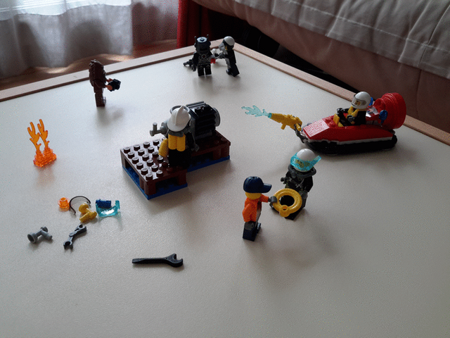
