Comme tous les ans, la société LEGO propose vers Noël des calendriers de l’Avent sur différents thèmes.

Je vous propose donc de jeter un œil sur le calendrier à thématique City de 2017.

Sorti donc en novembre 2017, ce modèle comporte 248 pièces et coûte 19,99 €, soit un ratio de 8 centimes.

Comme il se doit, il y a un cadeau par jour du 1er au 24 décembre (je vous dévoile la fin : le 24 c’est le Père Noël :)). Le couvercle sert de décor pour poser les vingt-quatre constructions.

L’avant met en scène tous les cadeaux. L’on aperçoit 6 figurines, dont le Père Noël, différents jouets, et quelques éléments de décor.

[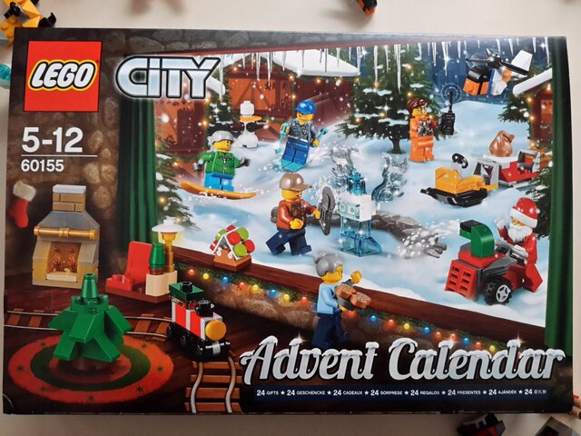](https://www.freelug.org/IMG/jpg/20180218_102850.jpg)

Au dos une présentation du principe du calendrier - un cadeau par jour, disposé sur le support prévu à cet effet. Et, période oblige, un Père Noël tenant une liste de cadeaux LEGO City !

[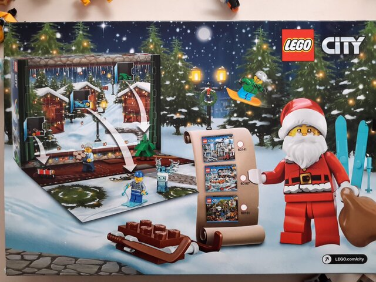](https://www.freelug.org/IMG/jpg/20180218_102921.jpg)

La face verticale du décor, avec les 24 cases contenant un cadeau. Sur le dos du couvercle de chaque case se trouvent les instructions de montage du jour.

[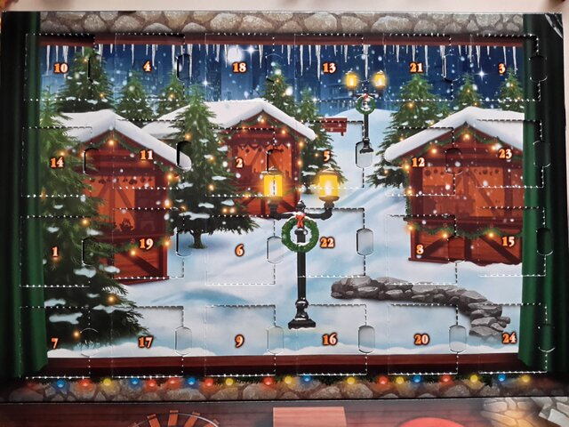](https://www.freelug.org/IMG/jpg/20180218_103046.jpg)

L’intérieur du couvercle de la boîte est donc un décor, sur lequel poser les cadeaux. L’on aperçoit des rails de train, une petite table (avec une ombre), un coin de cheminée à droite, deux lampadaires, des traces de ski, un chemin, quelques arbres. Bref, de l’intérieur et de l’extérieur.

[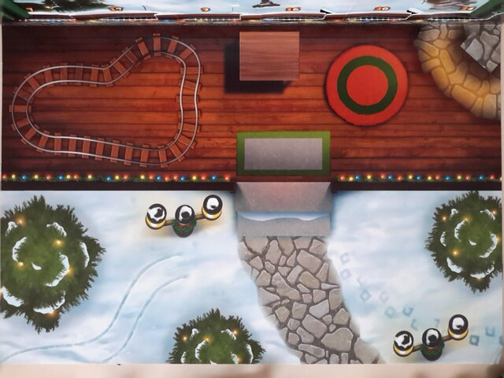](https://www.freelug.org/IMG/jpg/20180218_103121-r180.jpg)

Et voici les 24 cadeaux d’un coup. Ils apparaissent dans le calendrier de gauche à droite et du devant vers le fond.

[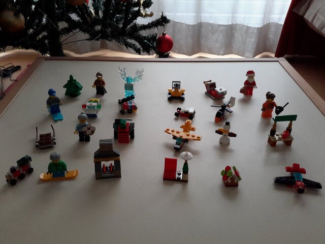](https://www.freelug.org/IMG/jpg/20180218_102523.jpg)

Vue du dessus.

[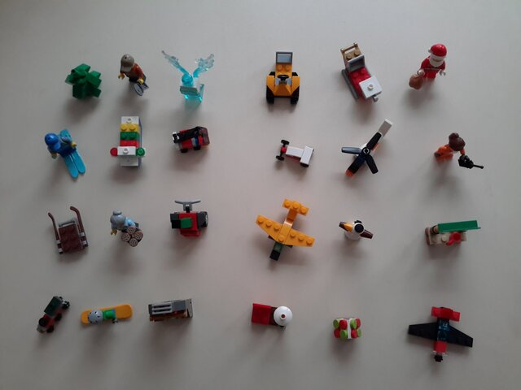](https://www.freelug.org/IMG/jpg/20180218_102541.jpg)

Et de côté.

[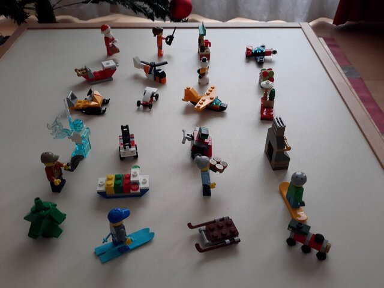](https://www.freelug.org/IMG/jpg/20180218_102626.jpg)

Nous avons donc dans l’ordre :

-   un petit train, qui ira sur les rails du décor, ça tombe bien
-   un enfant en train de faire du surf
-   une cheminée avec un bon feu
-   un petit coin douillet avec fauteuil et lampe
-   une petite maison
-   un avion à hélice
-   une luge
-   une vieille dame qui a fait des cookies
-   une déneigeuse
-   un avion à réaction
-   un bonhomme de neige
-   un stand à café
-   une skieuse
-   un bateau transportant des marchandises
-   un camion de pompiers
-   une voiture de course - à noter que ses roues avant ne touchent pas le sol
-   un hélicoptère radiocommandé
-   une jeune femme télécommandant cet hélicoptère
-   un sapin de Noël
-   un homme avec une scie à la main
-   une statue de glace qu’il est en train de sculpter
-   une moto-neige
-   un traîneau qui s’attache à la moto-neige
-   le Père Noël avec son sac de cadeaux.

Quelques pièces bonus, c’est Noël après tout !

[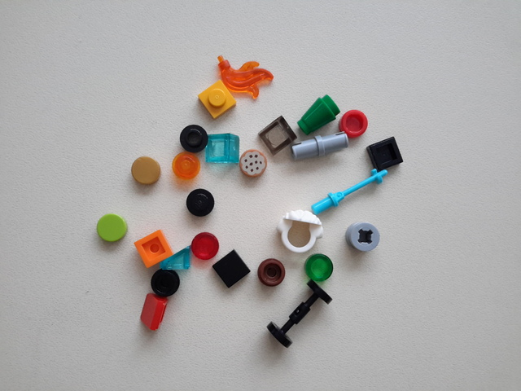](https://www.freelug.org/IMG/jpg/20180225_113246.jpg)

Voici les cadeaux disposés sur le décor, de façon totalement arbitraire — la cheminée n’est pas cohérente avec son emplacement sur le décor.

[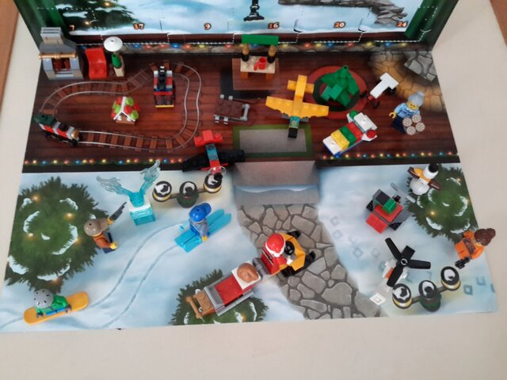](https://www.freelug.org/IMG/jpg/20180218_103403.jpg)

* * *

Je ne vais pas présenter tous les cadeaux, en revanche les figurines sont intéressantes.

Le petit surfeur porte un anorak vert, qui a l’air bien rembourré. Quelques taches de rousseur (c’est un enfant après tout !), et il a un casque, il faut rester prudent sur les pistes. Rien sur les jambes.

[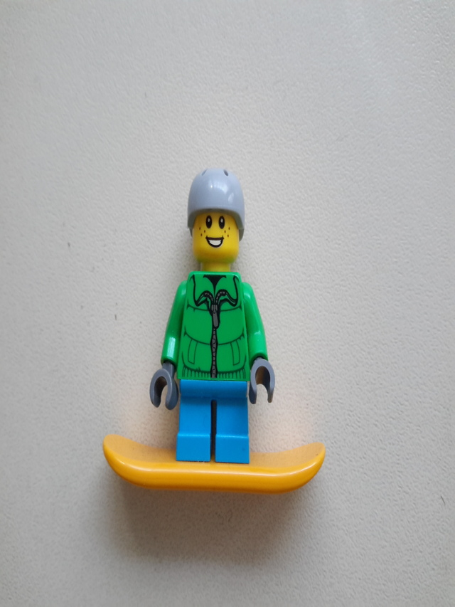](https://www.freelug.org/IMG/jpg/20180225_113406.jpg)

De dos l’anorak se prolonge avec quelques plis.

[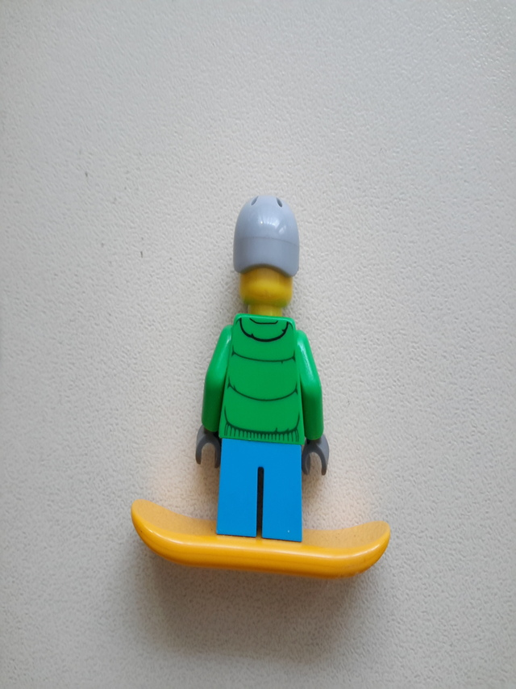](https://www.freelug.org/IMG/jpg/20180225_113711.jpg)

La grand-mère, qui a donc fait des cookies, porte un pull bleu avec de jolis motifs hivernaux. Une chevelure grise et des lunettes, plus quelques plis autour de la bouche montrent clairement qu’elle a un certain âge.

[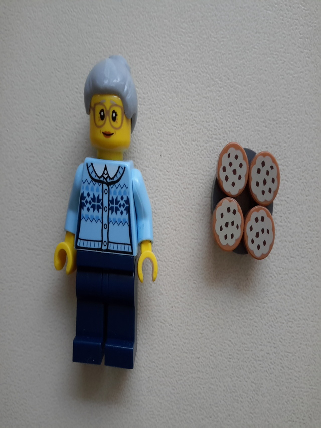](https://www.freelug.org/IMG/jpg/20180225_113445.jpg)

De dos le motif du pull se poursuit bien joliment, avec même le col. Un joli chignon complète la coiffure.

[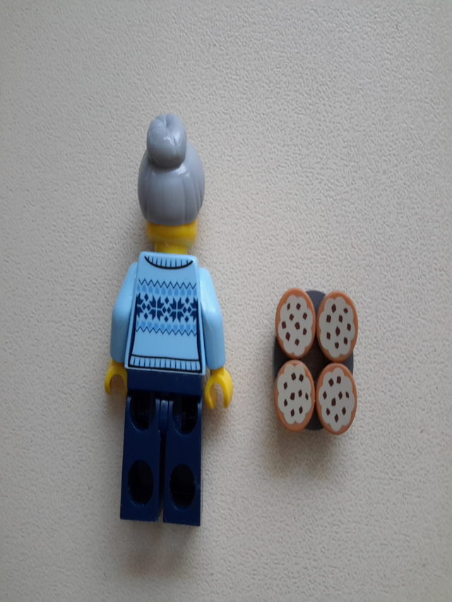](https://www.freelug.org/IMG/jpg/20180225_113732.jpg)

La skieuse est manifestement très réchauffée, car elle est en tenue de garde-côte qui semble peu chaude. Elle a un insigne à gauche, et une belle ceinture qui malheureusement ne se prolonge pas sur les jambes... Elle porte une casquette bleue et a l’air déterminée. Les skis et bâtons sont simples mais jolis.

[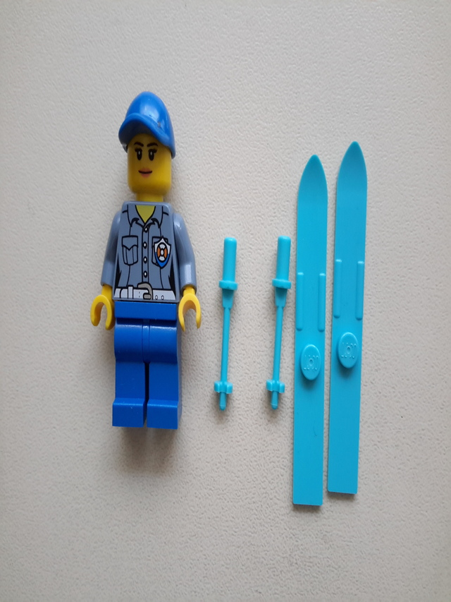](https://www.freelug.org/IMG/jpg/20180225_113349.jpg)

De dos le logo de garde-côte est repris en plus gros, et on aperçoit un talkie-walkie glissé dans la ceinture.

[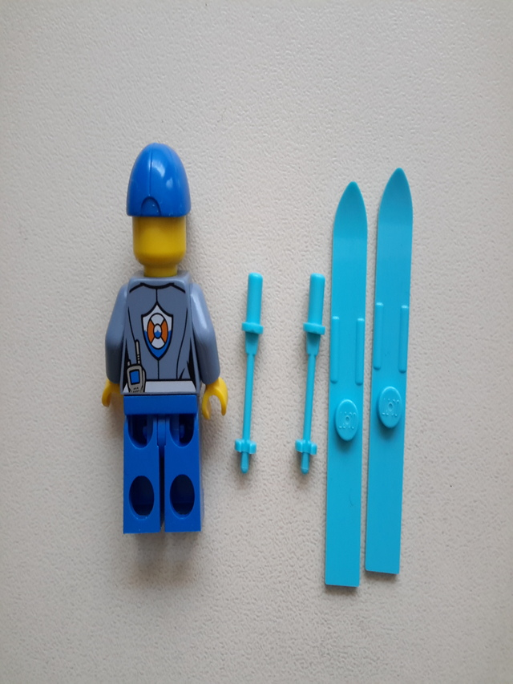](https://www.freelug.org/IMG/jpg/20180225_113704.jpg)

La figurine suivante est une jeune femme tenant une radio-commande pour l’hélicoptère associé. Elle porte de même un insigne de garde-côte, et de nombreux harnais, ainsi qu’une paire de lunettes.

[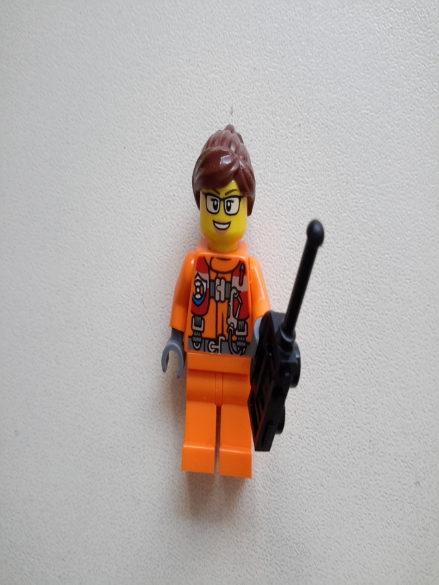](https://www.freelug.org/IMG/jpg/20180225_113419.jpg)

Le harnais se poursuit de dos, les cheveux sont rassemblés en queue de cheval.

[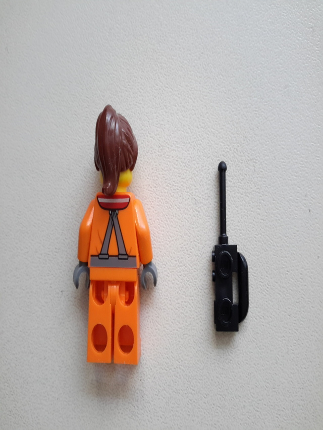](https://www.freelug.org/IMG/jpg/20180225_113724.jpg)

Le personnage suivant est plus lié à la jungle, il fait penser à un explorateur : de nombreuses sacoches, une corde sur l’épaule droite, un micro sur l’épaule gauche. Il a une expression déterminée, presque agressive. Il a une scie, avec laquelle il sculpte une statue de glace.

[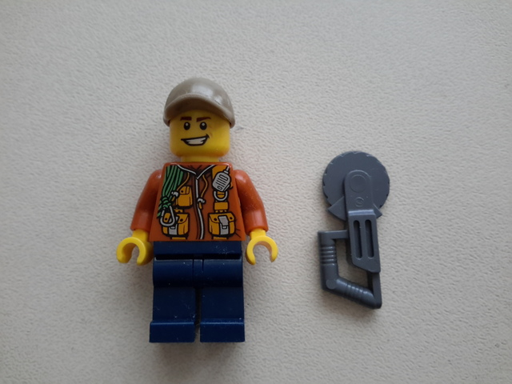](https://www.freelug.org/IMG/jpg/20180225_113255.jpg)

De dos les éléments continuent : harnais, micro et le talkie-walkie qui va avec, et même une capuche.

[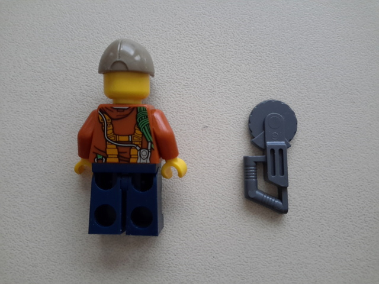](https://www.freelug.org/IMG/jpg/20180225_113611.jpg)

Voici la statue qu’il sculpte, composée de belles pièces bleu transparent du plus bel effet.

[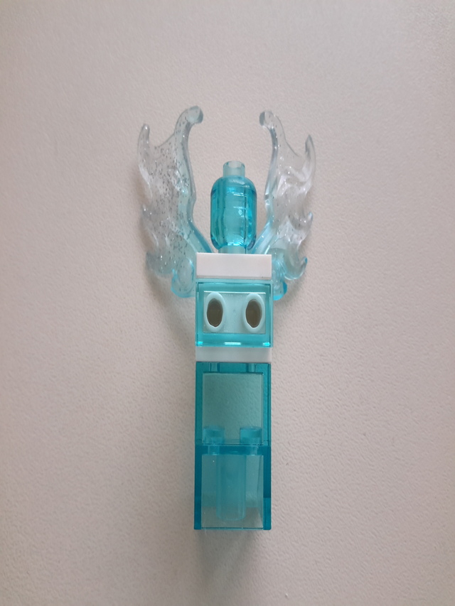](https://www.freelug.org/IMG/jpg/20180225_113340.jpg)

Les ailes, fixées par deux clips, sont de mon avis magnifiques, avec des dégradés de couleur, et des petites taches noires. Le rendu est tout simplement superbe.

[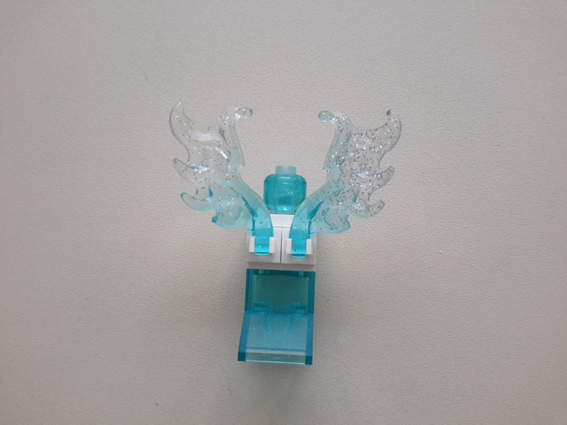](https://www.freelug.org/IMG/jpg/20180225_113645.jpg)

Dernière figurine, comme il se doit, le Père Noël. Lunettes à l’ancienne, des sourcils blancs, une belle barbe, pas de doute, c’est lui ! Un manteau rouge, une ceinture noire, rien à redire.

[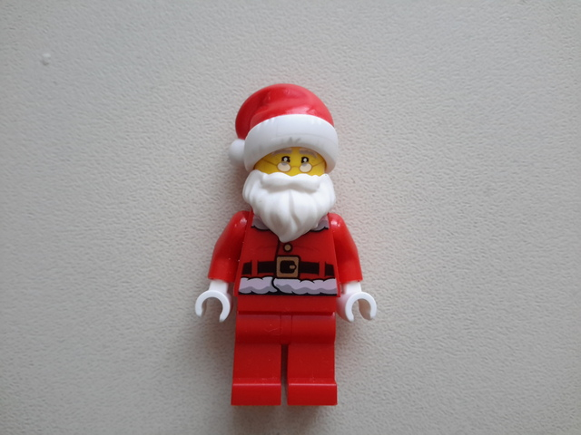](https://www.freelug.org/IMG/jpg/20180225_113317.jpg)

De dos, on aperçoit la ceinture, les bords du manteau, y compris le col, et il a un sucre d’orge glissé dans la ceinture, sans doute en cas d’urgence.

[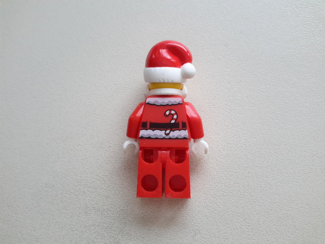](https://www.freelug.org/IMG/jpg/20180225_113638.jpg)

* * *

**Avis :** pas mal d’éléments sympathiques, dont six figurines, des constructions avec peu de pièces mais un bon rendu, quelques pièces qui me semblent rares (celles de la statue de glace notamment).

Les figurines, même si elles ont des jambes unies, sont bien jolies. La société LEGO a clairement voulu mettre en valeur les nouveaux thèmes City sortis récemment, sur les gardes-côtes et les explorateurs de la jungle.

Au final, un bon cru à mon avis.
