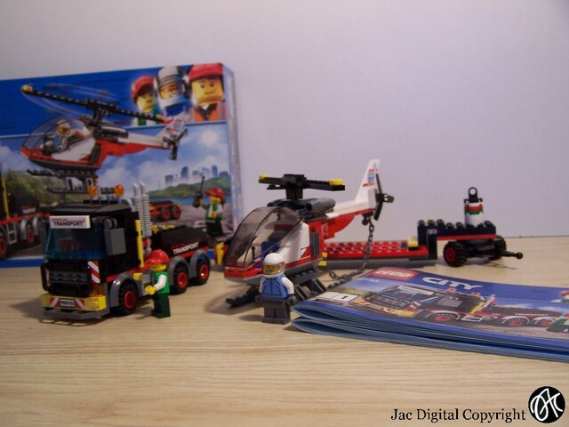
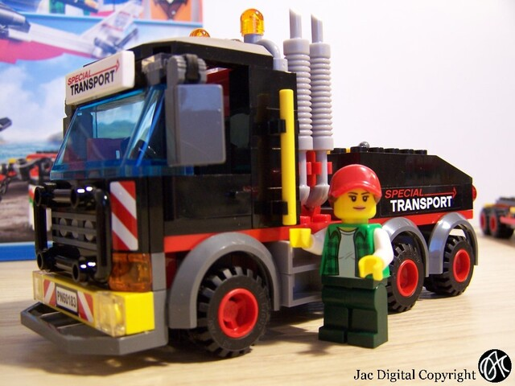
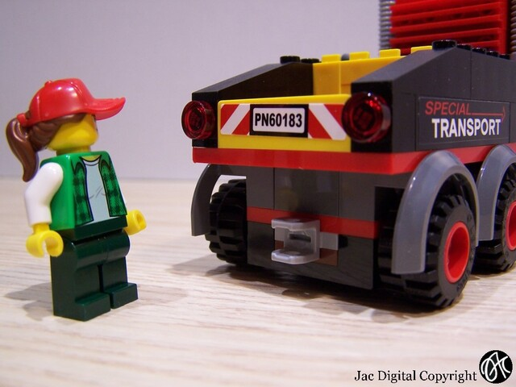
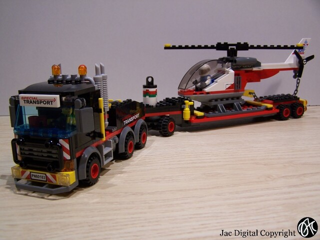

Pour la version 2018, nous avons affaire à un hélicoptère de transport de charge. Ce qui donne droit à la reproduction d’un camion exceptionnel, muni d’un attelage pour y accrocher une remorque. A la place de la sellette nous avons une petite benne avec une caisse à outils.

Cette saison, nous avons droit à deux transports d’hélicoptère au catalogue. Un pour les policiers, référence 60244, et celui que je vous présente, pour hélicoptère de transport de charges lourdes.

Pour changer, je ne vais pas vous étaler le montage de cette boite. Comme c’est un cadeau que l’on m’a fait, je l’ai monté sans prendre suffisamment de photos. C’est donc le modèle monté que je vais analyser.

Voilà tout de même les valeurs principales :

-   Année de sortie 2018
-   Nombre de pièces : 301
-   Nombre de minifigs : 2
-   Temps de montage : un peu plus d’une heure

A la firme LEGO, on aime bien transporter les hélicoptères à toutes les échelles. Cela permet de faire un ensemble un peu exceptionnel très jouable. Je dis un peu car il faut le ramener à la taille LEGO, c’est-à-dire un peu réduite par rapport à ce que devrait réellement être un tel ensemble. Sauf peut-être pour le Model Team 5590.

Alors, reprenons l’ordre des choses. En 1988, nous avions au catalogue un porte hélicoptère de 4 tenons de large référence 6357. C’est justement à ce modèle que je compare la très belle version sortie en 2009, référence 7686 ([revue dans cet article](/articles/les-portes-helicoptere-lego/))

Entre les deux nous avions eu du "Jackstone" 4607, un ensemble "Cap Cosmos" 6336-1, un autre ensemble pour la police 6328-1 et le fameux ["Model Team" 5590](https://www.bricklink.com/v2/catalog/catalogitem.page?S=5590-1#T=S&O={{ '{%' }}22iconly%22:0}).

Ce nouvel ensemble est plus puissant puisque l’hélicoptère à transporter est destiné au transport de charge. Une longue chaîne terminée par un crochet permet d’attraper un fût de carburant Octan ou d’autres trucs plus lourds au choix.

Pour se faire on a un tracteur routier de conception différente de ceux que l’on croise régulièrement sur nos routes. Le châssis est une configuration 6X4. La cabine est protégée par un imposant pare-buffle et un grand pare-choc en porte à faux avant. La technique de construction est intéressante. Elle est aussi prolongée d’un bloc moteur imposant muni de deux pots d’échappement vertical. J’en ai juste rajouté 2. Et oui, je ne peux pas m’empêcher de faire des modifications.

Ce tracteur est magnifique, mais je note tout de même un défaut bizarre. L’arrière est vide. C’est-à-dire que les deux derniers gardes boue ne tiennent rien. Je pense qu’il manque une longueur de pièce, c’est dommage. Les roues sont un peu petites aussi par rapport aux vrais véhicules. Mais c’est une critique habituelle de ma part.

Dans cette boîte nous avons un couple de minifigs, avec l’homme aux commande de l’hélicoptère et la dame à la manœuvre du camion. J’aime bien cette mixité des genres que l’on trouve maintenant dans les sets.

La remorque porte-char est posée sur un bissel à un essieu que l’on attelle au tracteur. Il manque des suspensions aux essieux arrières. LEGO nous l’avait fait dans le set référence 6594 et j’avais bien aimé ça. D’ailleurs, j’insère le principe dans tout mes véhicules. Là, quand on fait rouler l’ensemble, les roues avant ne touchent parfois pas le sol et le pivot ne fonctionne plus.

L’hélicoptère est très simple de conception, mais sympathique à assembler. Il n’est pas très gros, mais on sait qu’il est assez puissant pour soulever les charges que l’on veut. Il y a de quoi bien s’amuser avec.

Il se place très bien sur la remorque. C’est très bien prévu.

Pour conclusion, c’est vraiment un bel ensemble. Je l’avais mis sur ma liste de souhait dès sa sortie. Tant pis pour tout ce qui ne convient pas. LEGO nous sort tout de même de beaux ensembles avec des parties intéressantes à monter. Par contre, plutôt que de faire des modifications interminables sur le set original, il vaut mieux partir de rien. Mais ce n’est que mon avis.

[Pour voir toutes les photos](https://photos.freelug.org/main.php/v/JAC/review/60183/)
