Petite étude sur le fonctionnement du nouveau système de télécommande bluetooth des trains. Le père Noël m’a déposé une belle boite auprès du sapin.

Ce train fait partie de la nouvelle gamme sortie pour le deuxième semestre 2018. Nous l’avons analysée sous toutes les coutures et fait des tests pour connaître ses capacités avec quelques membres de l’association. C’était lors de notre rencontre estivale (REF) annuelle en juillet. Mais pour ma part, qu’en est-il vraiment ? Comment conduire mes locomotives avec ces nouvelles commandes ? C’est ce que je vais un peu approfondir avec cette revue.

Puis j’ai aussi l’envie de franciser un peu cette locomotive. Quelques photos passaient sur la toile au moment de sa sortie. Je vais essayer de modifier mon train, comme d’habitude !

**–** Prix environ 200 euros, ce qui donne un rapport de 16cts/pièces. Mais on peut trouver la boite moins chère. Il faut aussi tenir compte de la présence du moteur de train.  
**–** Disponibilité : Depuis juillet 2018, il est encore en vente à l’heure où j’écris cet article.  
**–** Nombre de pièces : 1202  
**–** Nombre de minifigs : 6  
**–** Temps de montage : environ 2h30.

La boite est bien pleine. Les sachets bougent beaucoup moins qu’avant dans les boites. On arrive quand même à savoir que ce sont des briques LEGO même avec un papier cadeaux autour.

Sur la face avant, une photo du train, la nouvelle télécommande, l’inventaire des rails et une idée de circuit possible, en encart. Ça donne envie de jouer mais d’abord il faut construire. Quoique ça fait partie du jeu !

[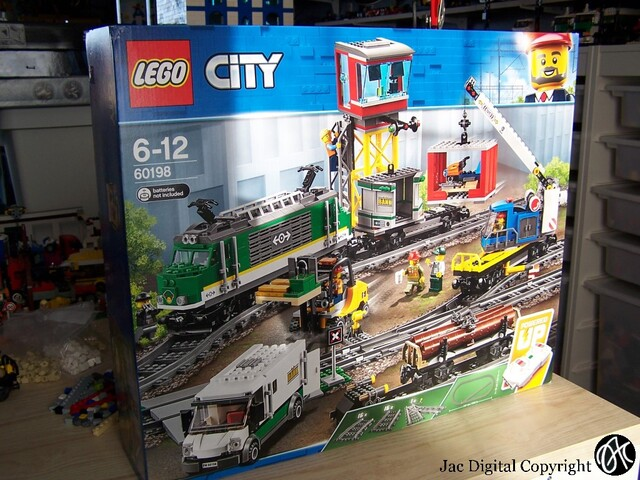](https://www.freelug.org/IMG/jpg/photo_1_-3.jpg)

Au dos quelques idées de jeux. Là, LEGO a vu très juste avec beaucoup de possibilités, la grue intégrée au train permettra de charger et décharger les wagons à volonté, on va voir cela après le montage. Dans ma précipitation, j’ai oublié de prendre une photo du dos, tant pis...

A l’ouverture de la boite, on compte 12 sachets numérotés plus quelques-uns contenant les grosses pièces ainsi que les différents rails du circuit. Une pochette contient toutes les notices et la planche de stickers. Ça évite de tout ramasser abîmé au fond de la boite. Effectivement il y a pas mal d’autocollants à coller, mais comme je l’écris souvent rien est obligatoire, surtout quand on connait leur durée de vie sur les briques. Par contre, l’unique aiguillage de la boite n’est pas emballé.

[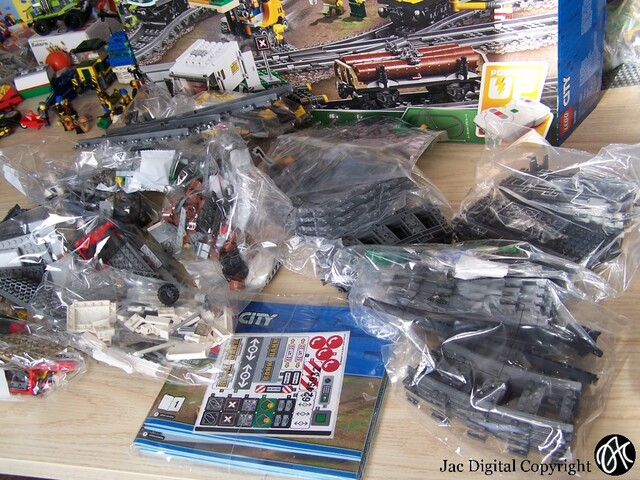](https://www.freelug.org/IMG/jpg/photo_2_-3.jpg)

Il y a une différence de taille entre la télécommande PFS et la nouvelle. Mais sera-t-elle autant pratique ? On le saura à l’usage.

[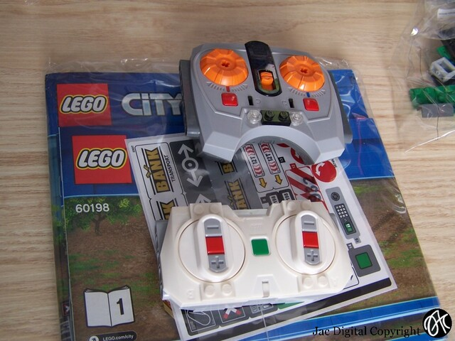](https://www.freelug.org/IMG/jpg/photo_4_-3.jpg)

Le montage débute par le chariot élévateur. C’est le plus petit modèle de la boîte. A chaque partie que l’on va assembler on trouvera le personnage qui correspond dans le sachet. C’est bien, on peut de suite le mettre aux commandes et commencer à jouer. On apprend tout d’abord à manipuler le démonte brique fourni. Ça aide bien en cas d’erreur de montage.

[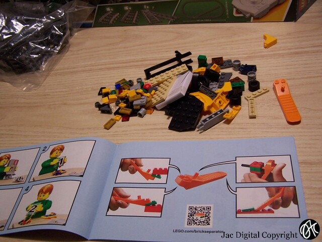](https://www.freelug.org/IMG/jpg/photo_7_-2.jpg)

Une belle palette bien chargée en or et en billets va fournir du travail à ce premier ensemble.

[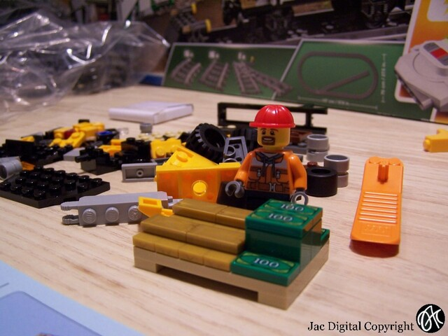](https://www.freelug.org/IMG/jpg/photo_8_-2.jpg)

On poursuit avec le châssis du chariot élévateur et le premier collage réussi d’un autocollant. Je trouve l’utilisation des pièces à articulations crantées très bien pensée.

[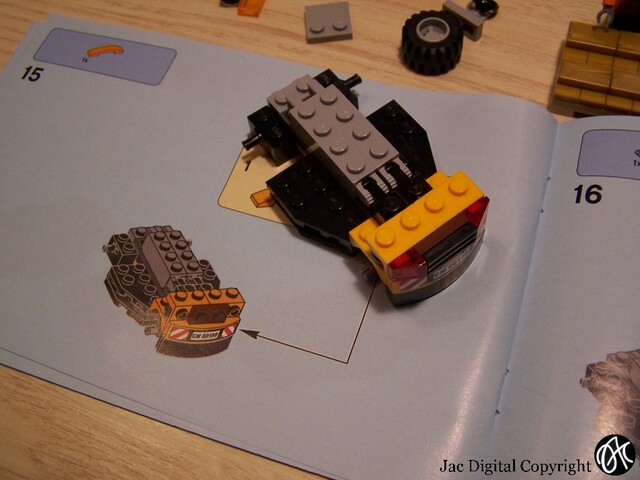](https://www.freelug.org/IMG/jpg/photo_9_-3.jpg)

Et voilà le premier véhicule terminé avec son conducteur. 4 petites pièces en rabe pour ce premier sachet. Le personnage est bien sympa. On pourrait reprocher le fonctionnement toujours en l’air qui déstabilise le chariot élévateur, surtout en charge. Mais au final et après test avec des petites mains, c’est bien pensé ce système. Et puis on est là pour jouer, pas pour dire que, en réalité c’est pas du tout comme ça.

[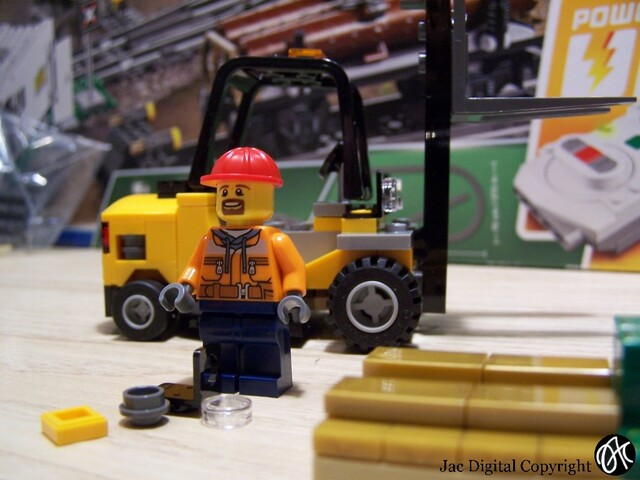](https://www.freelug.org/IMG/jpg/photo_11_-2.jpg)

On change de livret pour attaquer la construction du fourgon de transport des fonds pas blindé du tout, mais sympa à construire.

[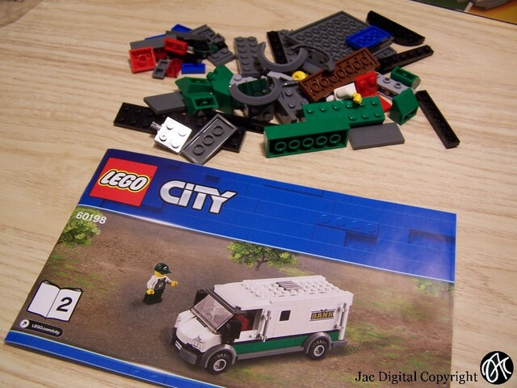](https://www.freelug.org/IMG/jpg/photo_13_-3.jpg)

Il faudra ouvrir 2 sachets pour finaliser le véhicule et on commence par l’employé sûrement formé au transport de "précieux".

[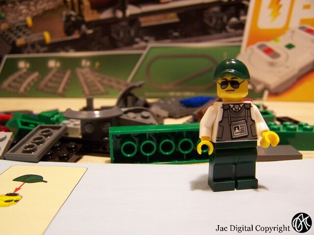](https://www.freelug.org/IMG/jpg/photo_14_-2.jpg)

Il faut poser la plaque d’immatriculation qui contient les initiales du designer. Je colle un peu d’autocollants maintenant, car c’est vrai que ça modifie beaucoup les modèles et ça apporte un plus. Des fois ils sont en travers mais d’autres non vous verrez... Mais on peut dire tout de même que le système de repérage sur la planche est bien pensé.

[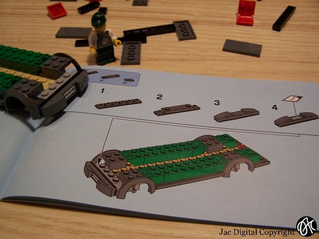](https://www.freelug.org/IMG/jpg/photo_16_.jpg)

Le deuxième sachet permet de terminer la construction du fourgon.

[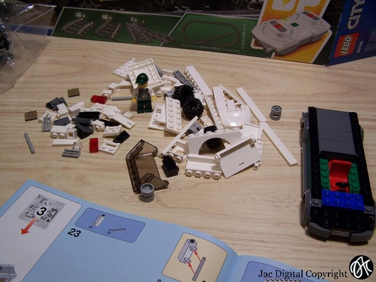](https://www.freelug.org/IMG/jpg/photo_18_.jpg)

On se rend compte qu’il n’est pas facile de rentrer la palette par l’arrière du véhicule. Heureusement, le flanc s’ouvre pour permettre un accès latéral. C’est un vrai plus pour jouer avec le chariot élévateur. Voilà ce que l’ensemble donne après un ou deux autocollants en travers...

[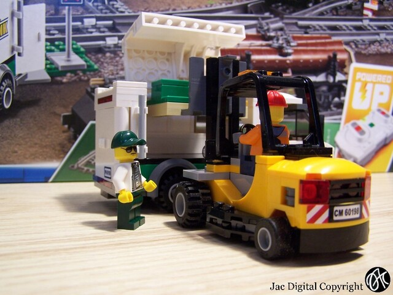](https://www.freelug.org/IMG/jpg/photo_23_.jpg)

Ici, la notice nous demande de sortir tous les rails pour la construction du circuit. Mais je ne vais pas encombrer mon plan de travail déjà bien chargé. Je vais sortir juste le nécessaire pour l’étape suivante, c’est-à-dire le passage à niveau. Avec 3 rails ça suffira. J’ai toujours en tête que l’on peut construire comme on le veut, même avec une notice. Ici, le circuit de train est imposé. Il n’y a pas le choix sur plusieurs solutions. Alors que c’est possible même avec un seul aiguillage. Pas de rails flexible dans cette boîte. Il faudra se procurer une boîte de rails complémentaires si c’est nécessaire, référence 60205.

[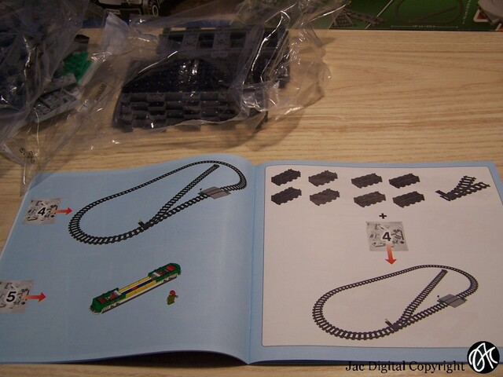](https://www.freelug.org/IMG/jpg/photo_25_.jpg)

Le passage à niveau est on ne peut plus simple, malgré les panneaux. Mais c’est pour un chantier de chargement, du coup, pas besoin des barrières.

[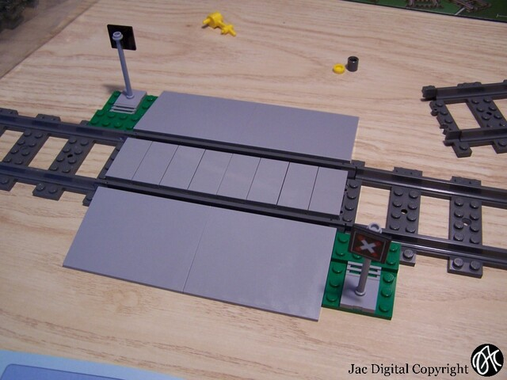](https://www.freelug.org/IMG/jpg/photo_26_.jpg)

Le heurtoir est très bien pensé. Je vais surement reprendre le principe pour mettre des butées au bout de mes voies de garages.

[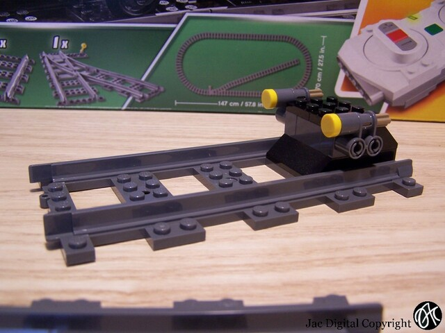](https://www.freelug.org/IMG/jpg/photo_27_.jpg)

Contenu du premier sachet à ouvrir pour la construction de la locomotive. Le châssis est à prendre dans un sachet à part. Je me suis trompé d’ailleurs, ce n’est pas le bon sur la photo. Mais on s’en rend vite compte, ils n’ont pas tous la même longueur et la même couleur.

[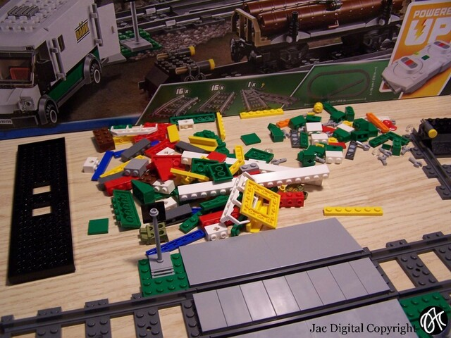](https://www.freelug.org/IMG/jpg/photo_28_.jpg)

On commence là aussi par la construction de la minifig. Le conducteur pourra ainsi superviser la construction de la locomotive électrique. Il affiche un beau sourire, sûrement parce que cette version lui plait déjà. Il est très bien fait avec un beau gilet orange et un très gros logo dans le dos. Par contre, on ne s’habille pas forcément comme ça pour la conduite, sauf pour les trains de chantier. Mais bon, vu que l’on va transporter une grue, pourquoi pas.

[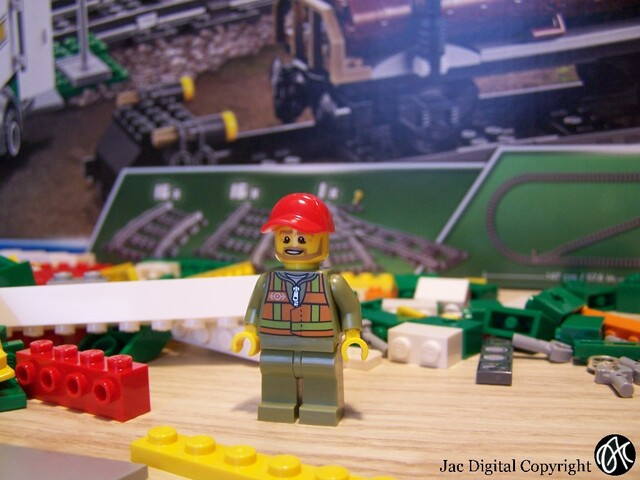](https://www.freelug.org/IMG/jpg/photo_29_.jpg)

[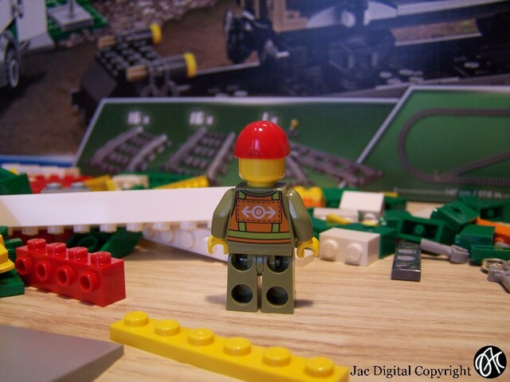](https://www.freelug.org/IMG/jpg/photo_30_.jpg)

Contenu du sachet suivant, ici on découvre le nouveau moteur, avec une différence notable, les broches de connexion qui n’ont plus rien à voir avec le système PFS. On le branche directement sur le boitier de pile, ce qui simplifie grandement les choses. Par contre, on ne peut plus empiler les prises.

[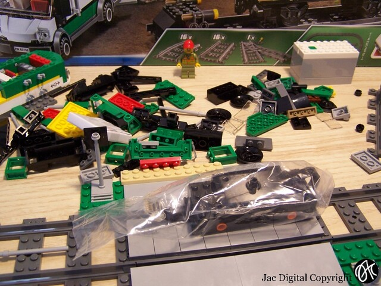](https://www.freelug.org/IMG/jpg/photo_33_.jpg)

Ouverture du dernier sachet. Il contient beaucoup de grilles à placer sur les flans de la locomotive.

[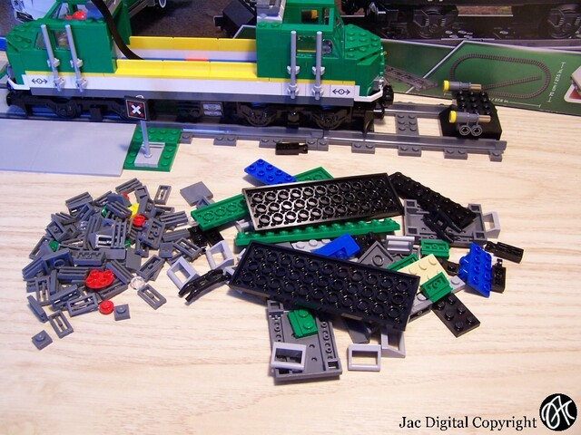](https://www.freelug.org/IMG/jpg/photo_38_.jpg)

Et voilà la locomotive terminée avec un essai en ligne sur mon réseau extérieur. Je la trouve très réussie. Elle fait penser à certaines diesel des réseaux européen. Les grilles sur le côté donnent plus un aspect français. Ca donne des idées pour une modification.

L’essai est très concluant, le moteur semble puissant malgré une alimentation à pile. La locomotive avale très bien la montée placée sur une partie du réseau. Les commandes passent très bien, même à une bonne distance ou en plein soleil.

Je mettrai un bémol tout de même sur ce principe tout nouveau de commande. Comme je l’ai dit, on ne peut pas empiler les fiches de connexion. Du coup si on veut rajouter l’éclairage ou un autre moteur, il faut rajouter des boitier de pile. Avec la commande, on peut en commander plusieurs en même temps, mais ça rallonge la locomotive.

[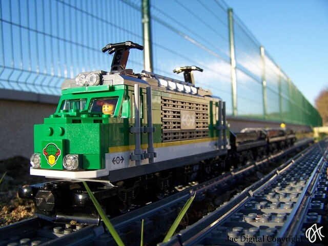](https://www.freelug.org/IMG/jpg/photo_40_.jpg)

On peut maintenant commencer le montage des wagons marchandises et de la grue embarquée.

[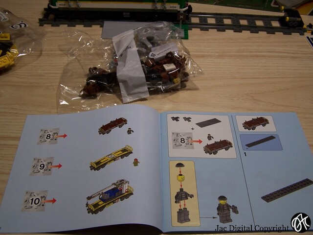](https://www.freelug.org/IMG/jpg/photo_41_.jpg)

Contenu du wagon qui transporte les grumes. On en aura trois sur ce petit 2 essieux, mais ça fait beaucoup de rondins marrons.

[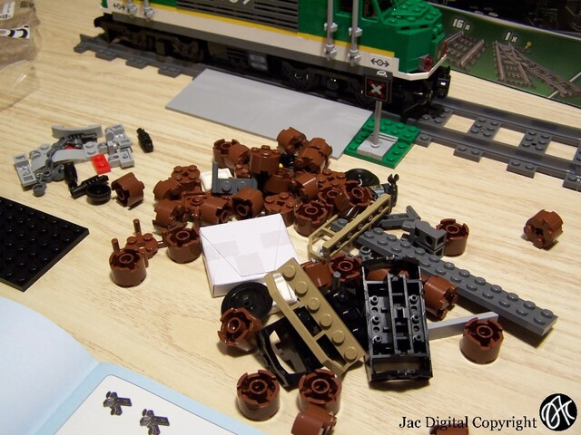](https://www.freelug.org/IMG/jpg/photo_42_.jpg)

On commence par la minifig qui est censée surveiller le chargement, même si on a plutôt l’impression qu’elle va dévaliser le fourgon de transport de fond construit au début. Alors faites attention où vous l’avez rangé !

[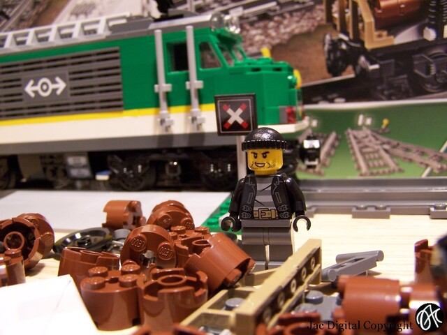](https://www.freelug.org/IMG/jpg/photo_43_.jpg)

Le wagon est simple mais bien rendu, pour un chargement très jouable avec la grue. Il reste une chaînette en rab. Mais on pourrait surement assembler toutes les grumes avec.

[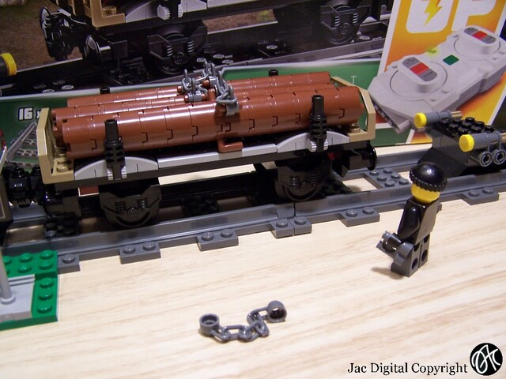](https://www.freelug.org/IMG/jpg/photo_45_.jpg)

Passons au montage de la grue avec un premier sachet qui comporte une minifig pour les commandes et le châssis.

[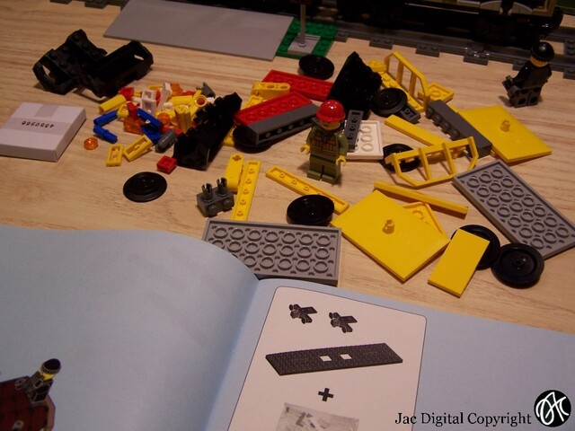](https://www.freelug.org/IMG/jpg/photo_46_.jpg)

Pour les commandes de la grue, les designers de chez LEGO nous proposent une minifig féminine. Il n’y a pas de règle sur le genre des métiers. J’aime bien ça. Elle porte le même gilet orange que le conducteur. Le casque intègre une très belle queue de cheval.

[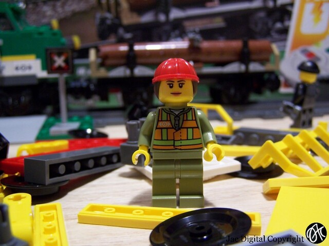](https://www.freelug.org/IMG/jpg/photo_47_.jpg)

[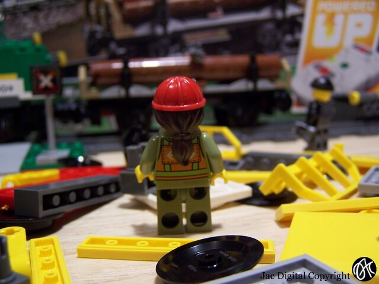](https://www.freelug.org/IMG/jpg/photo_48_-2.jpg)

Une fois le châssis du wagon grue terminé, il nous reste 3 petites pièces à rajouter aux extra. On peux ouvrir le sachet numéro 10.

[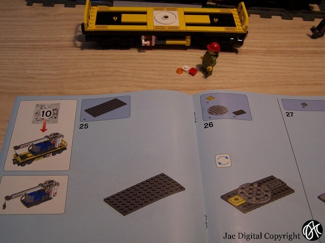](https://www.freelug.org/IMG/jpg/photo_50_.jpg)

Avec ce contenu nous allons terminer l’assemblage de la grue.

[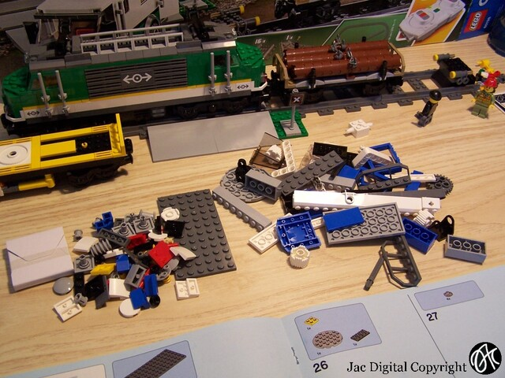](https://www.freelug.org/IMG/jpg/photo_51_.jpg)

Une belle grue au final avec une portée suffisante pour pouvoir décharger tout le train. Les pieds situés sous le châssis du wagon permettent de bien stabiliser l’ensemble. C’est bien amusant, même si on a toujours droit aux mêmes fonctions. Mais que rajouter d’autres, elles sont suffisantes.

[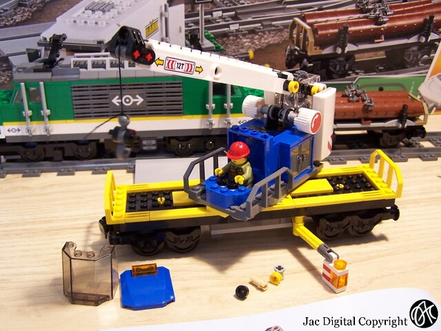](https://www.freelug.org/IMG/jpg/photo_55_-2.jpg)

J’aime bien mettre aux commandes des véhicules ou autres engins que je construit les minifigs. Pour les grues justement, il y a normalement des manettes que je m’efforce de leur mettre dans les pinces. Mais là, quelle ne fut pas ma surprise, c’est quoi ces pièces ? Comment je fais pour commander la grue moi ?

[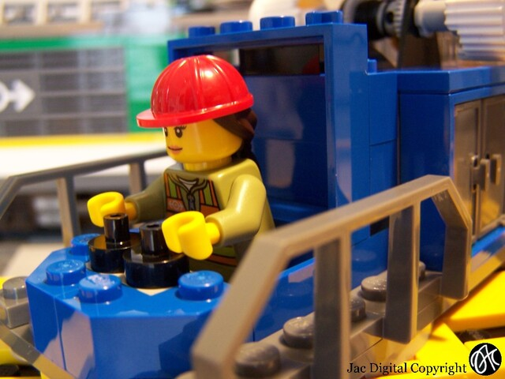](https://www.freelug.org/IMG/jpg/photo_56_-2.jpg)

Ouverture du sachet numéro 11 pour commencer le montage du dernier wagon. On découvre une belle petite pièce sérigraphiée. La petite moto neige que le train de marchandises va transporter correspond à la gamme "Exploration arctique".

[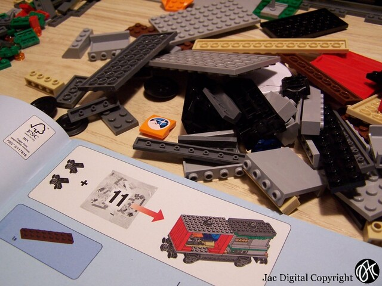](https://www.freelug.org/IMG/jpg/photo_58_-2.jpg)

C’est un wagon de transport de container. On peut en placer 2 sur son plateau. Il est assez simple de conception mais suffisant. C’est là que le jeu devient intéressant. On peut charger la moto neige dans sa caisse avec le chariot élévateur et mettre le tout sur le wagon. Puis faire pareil avec le deuxième. Par contre, ne pas prendre directement le container avec le chariot. Ca fait un peu lourd, croyez moi, j’ai fait le test.

[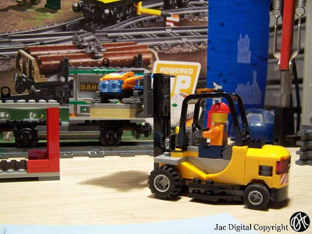](https://www.freelug.org/IMG/jpg/photo_60_.jpg)

Il est temps d’ouvrir le dernier sachet pour le montage du poste d’aiguillage. On pourra le fixer en bordure des rails grâce à des pièces plates prévues à cet effet. Ca évite qu’il navigue un peu trop loin surtout qu’il permet de commander le départ des trains avec un feu à deux position à commande manuelle. On a le choix entre rouge ou vert. Y’a pas plus mais pour le jeu ça suffit.

[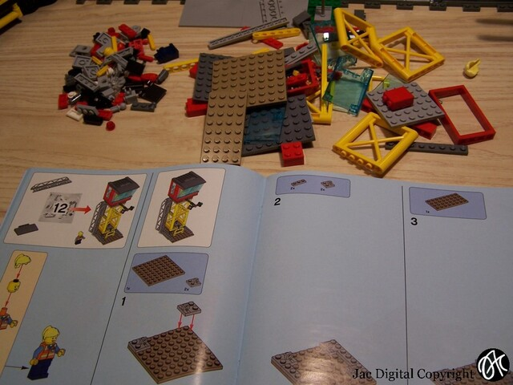](https://www.freelug.org/IMG/jpg/photo_64_.jpg)

Voilà notre minifig prête à passer aux commandes des voies. Le torse est décoré devant et derrière mais les jambes sont unies.

[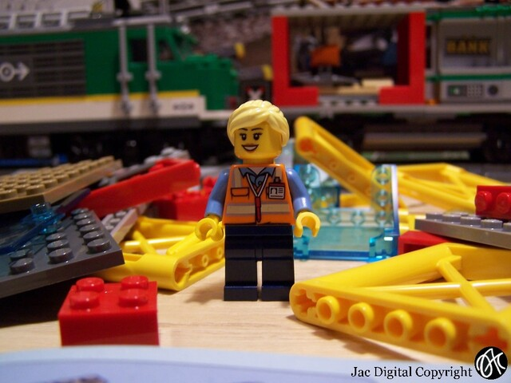](https://www.freelug.org/IMG/jpg/photo_65_.jpg)

[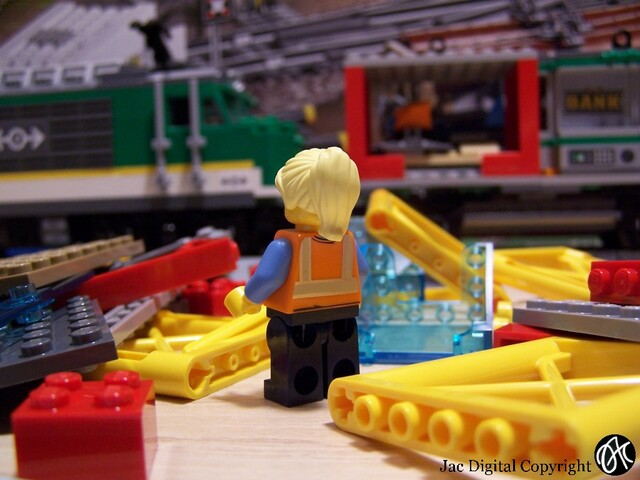](https://www.freelug.org/IMG/jpg/photo_66_.jpg)

Le poste est assez simple et vite monté. L’employée des trains devra savoir monter à l’échelle verticale pour accéder à son poste de travail.

[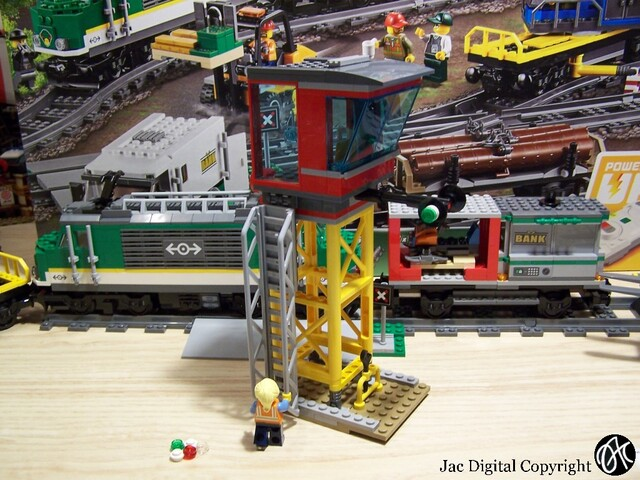](https://www.freelug.org/IMG/jpg/photo_67_.jpg)

Voilà le total des pièces en extra pour cette boite.

[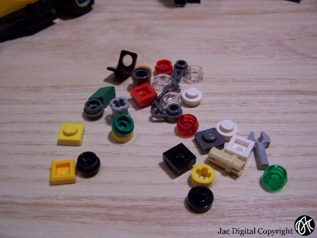](https://www.freelug.org/IMG/jpg/photo_69_.jpg)

L’ensemble enfin totalement monté. Il n’y a plus qu’à s’amuser avec toutes les fonctions possible de cet ensemble.  
Alors reprenons, le train arrive, avec sa propre grue embarquée...

[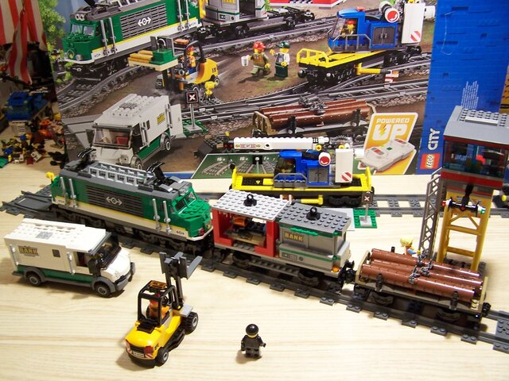](https://www.freelug.org/IMG/jpg/photo_71_.jpg)

Comme vous avez pu le constater au fil du montage, le train est très varié et il offre pas mal de possibilités de jeux. Je me demande tout de même si un seul aiguillage suffit pour vraiment varier le jeu.

Il n’est pas facile de faire une critique constructive lorsqu’on a l’habitude d’utiliser un système de commande qui est de plus très efficace mais qui a aussi ses limites. Voici les quelques points qui m’ont le plus marqué :

-   Avec le système "PFS", on doit placer dans sa construction un boitier de piles, un récepteur et les éléments commandés, moteur ou lumières. Il existe aussi des boîtiers d’accumulateur très performants. Ici on a seulement un boitier de piles (peut-être pour l’instant) et les éléments à brancher directement dessus. C’est beaucoup plus simple.
-   Avec le "PFS", si on ne dirige pas la télécommande sur le capteur, l’information ne passe pas ou très mal, enfin, la réaction du train n’est pas garantie. Ça peut poser quelques problème lors des passages sous les ponts, ou pire sous les tunnels. Avec les nouvelles télécommandes "bluetooth", il n’y a pas de soucis de liaisons. L’information passe très bien, tout le temps. Sauf que, si on s’éloigne un peu trop du train, il s’arrête complètement. C’est-à-dire qu’il faut reprogrammer les commandes. Je ne trouve pas ça pratique. Mais d’un autre côté, lors du test ma fille étant partie avec la télécommande, ça voulait dire qu’elle ne regardait plus le train tourner... Ca fait des économies !
-   Le système de branchement des broches "PFS" permet l’empilage. C’est grâce à cela que j’ai pu équiper mes locomotives de 2 moteurs et des lumières avant et arrière. Ici les broches ne sont pas empilables. Le boitier de piles contient seulement deux prises. Pire, la locomotive n’est pas prévue pour recevoir les lumières. Il faudra modifier la conception de la face avant.
-   Il existe des éléments complémentaire pour le système "PFS" qui permettent d’apporter beaucoup de fonctions à nos montages. Pas en "bluetooth" mais peut-être qu’ils sont en préparation.
-   Le "PFS" a sa télécommande qui est différente pour les trains et les Technics. Avec le "bluetooth" on a la possibilité de commander nos trains avec son téléphone grâce à une application à télécharger. C’est peut-être là que l’on trouvera plus de fonctions.
-   Avec le "PFS", une fois que tout est connecté, on met en marche et ça tourne. Avec la nouvelle télécommande, si on ne programme pas les deux éléments, il n’y a rien qui se passe. C’est simple mais pas très évident à faire. Il y a un jeu de couleur à faire correspondre. Il faut bien suivre la notice et la garder à portée de main pour le début, avant d’avoir mémorisé le processus.

Vous aurez sûrement compris que je reste un fan du système "PFS", surtout pour mon réseau extérieur. Mais je me souviens que, au moment de l’abandon du 9V, nous avons aussi été très réticents à la venue d’un nouveau mode de commande de nos trains. C’est peut-être parce que aujourd’hui, la technologie va plus vite, on a à peine le temps de s’adapter.

-   Durée du système de commande en 9V, de 1991 à 2007 : 16 ans
-   Durée du système de commande "PFS" de 2006 à 2018 : 12 ans. En sachant tout de même que pour l’instant les pièces sont encore disponible sur le s@h.

Toutes les photos et plus dans la galerie de montage :  
[https://photos.freelug.org/main.php/v/JAC/review/train/60198/](https://photos.freelug.org/main.php/v/JAC/review/train/60198/)
