Aujourd’hui, je vous présente un joli set de la gamme Ninjago, _Le temple de l’Airjitzu_, de référence _70751_.

Sorti en 2015 et maintenant indisponible chez LEGO, ce set affiche fièrement ses 2028 pièces, pour un prix évidemment en rapport avec ce nombre de briques de 199,99 €, ce qui donne un coût d’un peu moins de 10 centimes par pièce.

* * *

L’avant de la boîte présente l’habillage classique : les logos LEGO, Ninjago, l’âge etc. Le temple est présenté à contre-jour, éclairé par l’arrière, et la mention « batteries included » confirme la présence d’une brique lumineuse. La boîte est fermée par du scotch, ce qui permet de la plier proprement sans l’abîmer — habituel pour les grosses boîtes. Le temple est présenté dans son intégralité, avec tous les personnages et lieux.

[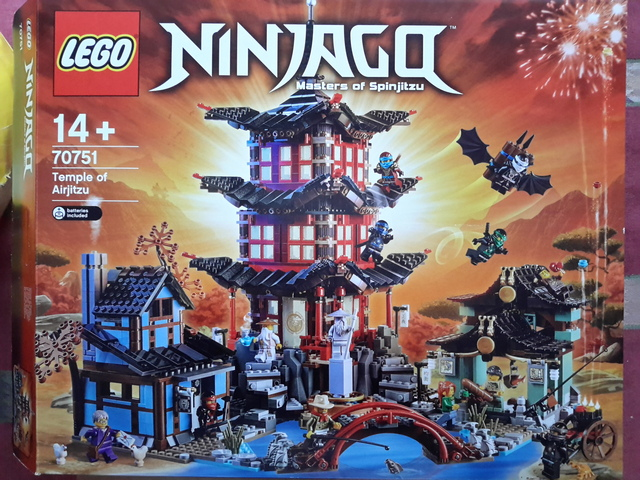](https://www.freelug.org/IMG/jpg/20181014_100159.jpg)

Au dos une vue de l’arrière du temple, avec les personnages assistant à une projection — j’y reviendrai plus tard. De nombreux détails du set sont présentés à droite et au centre, tandis qu’en bas à gauche sont indiqués toutes les figurines incluses — à l’exception de la statue de maître Yang devant le temple.

[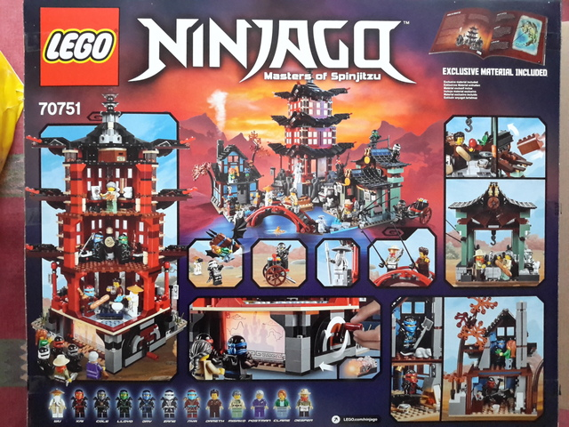](https://www.freelug.org/IMG/jpg/20181014_100228.jpg)

La boîte contient treize sachets numérotés, la plupart contenant un voire deux sous-sachets, un sachet non numéroté qui propose 4 plaques 16x16 et les pièces souples pour le pont, plus deux blocs de montagne, et la feuille souple servant d’écran à la projection d’ombres chinoises.

Voici l’imposant manuel de construction. Il commence par quelques pages d’introduction par les designers du set, présentant leur concept et différents points de conception, et enchaîne sur toute la construction. Ce petit manuel fait quand même 284 pages !

[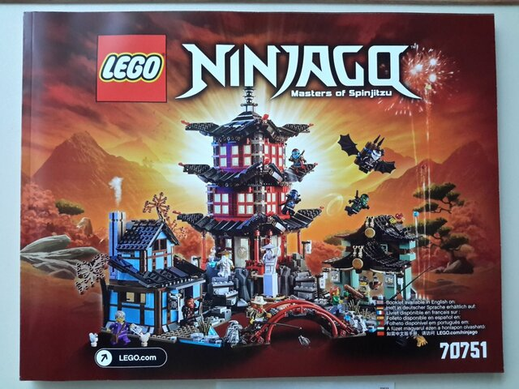](https://www.freelug.org/IMG/jpg/20181014_094724-r270.jpg)

Voici la planche — utilisée — d’autocollants. 14 au total, non négligeable, mais cela améliore énormément la construction.

[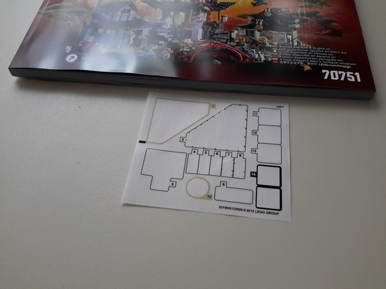](https://www.freelug.org/IMG/jpg/20181014_094734.jpg)

* * *

Tout d’abord, présentons les personnages fournis avec le temple. Ils sont au nombre de douze, sans compter la statue de Sensei Yang.

Les six premiers, de gauche à droite, sont Kai, Lloyd, Jay, Zane, Cole, maître Wu (j’ai triché, j’ai regardé sur la boîte). Les ninjas sont similaires, avec masque, armure, sabre(s) dans le dos, décorations sur tout le corps (mais pas sur l’arrière des jambes ou les bras). Ces décorations sont différentes, avec des variations sur la position des bouts de ceinture, le symbole au centre du harnais, les armes ou objets passés à la ceinture, etc. Maître Wu porte un chapeau chinois doré, rien d’étonnant ici, a une belle barbe, et une veste ouverte dont les pans se prolongent sur les jambes.

[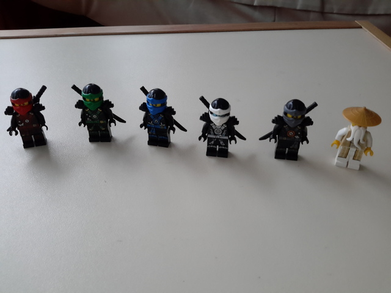](https://www.freelug.org/IMG/jpg/20181014_095031.jpg)

De dos, on aperçoit le motif sur Maître Wu. Bon, ok, on ne voit pas grand-chose pour les autres personnages...

[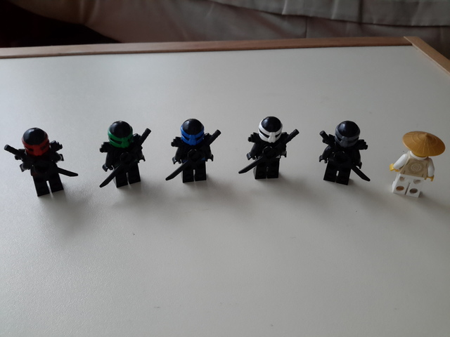](https://www.freelug.org/IMG/jpg/20181014_095135.jpg)

Donc les voici sans casque et équipement. Chacun aborde son propre motif et sa propre couleur, en accord avec le masque. Seul Zane a un visage alternatif.

[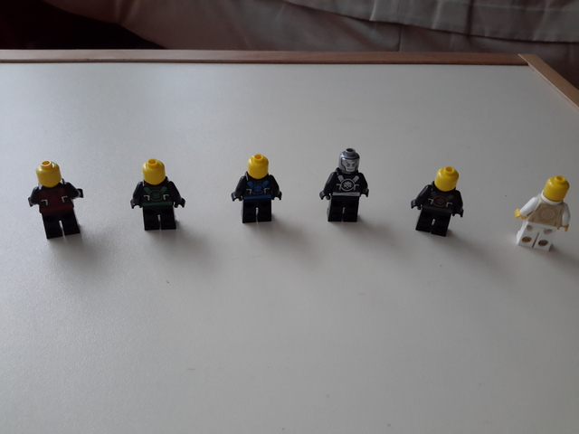](https://www.freelug.org/IMG/jpg/20181014_095338.jpg)

[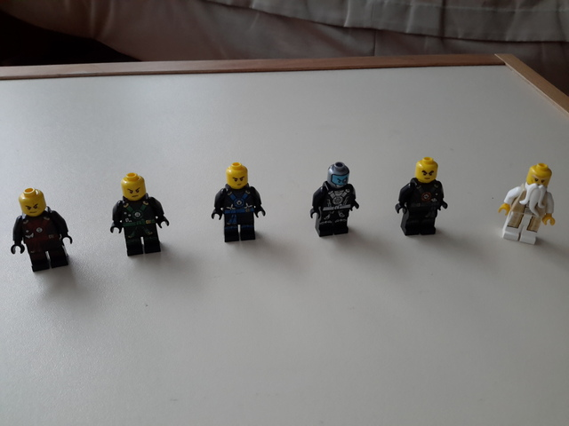](https://www.freelug.org/IMG/jpg/20181014_095406.jpg)

Je ne vais pas présenter tous les personnages, donc il faudra se contenter d’un gros plan sur Zane. Le visage est bleu pâle, en accord avec sa force de glace me semble-t-il. Belle sérigraphie sur le torse, se prolongeant sans décalage (peut-être minime) sur les jambes, et des nœuds aux pieds.

[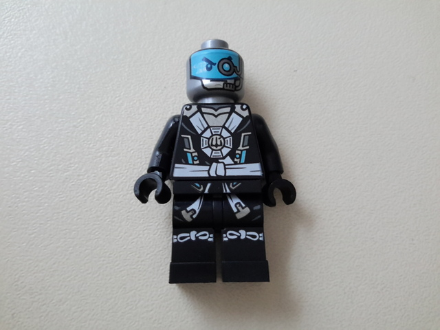](https://www.freelug.org/IMG/jpg/20181014_095421.jpg)

Sur l’arrière il a son symbole au centre de son dos. Le visage alternatif est plus calme et détendu que la face avant.

[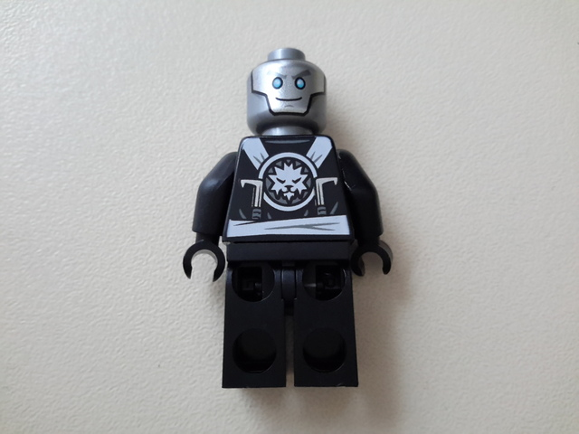](https://www.freelug.org/IMG/jpg/20181014_095438.jpg)

Enfin les six autres personnages, de gauche à droite, sont Misako, Nya, Claire, Dareth, le postier et Desper. Seuls Nya et Desper ont droit à des motifs sur les jambes, les autres sont unies. Le postier a comme il se doit un sac de courrier en bandoulière. Les sérigraphies sont propres. Seule Misako a un visage alternatif.

[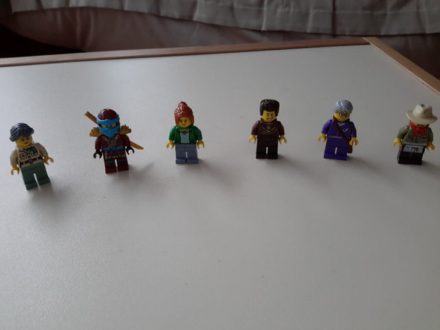](https://www.freelug.org/IMG/jpg/20181014_095755.jpg)

[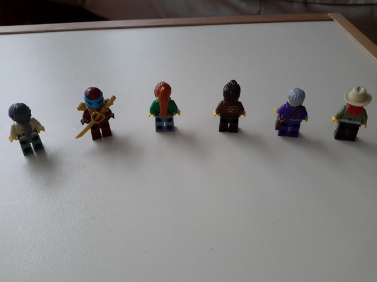](https://www.freelug.org/IMG/jpg/20181014_095830.jpg)

[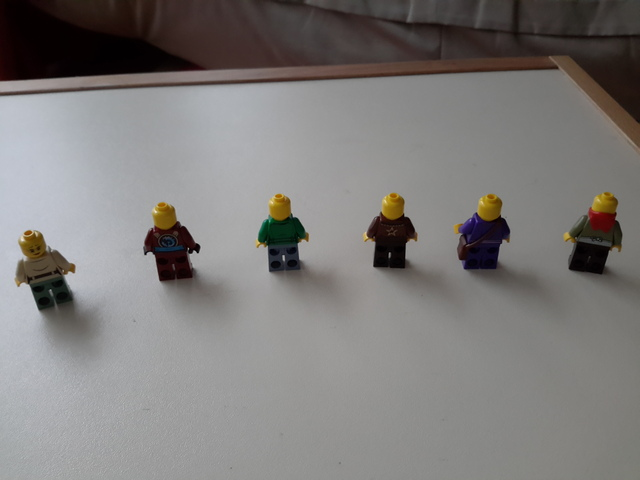](https://www.freelug.org/IMG/jpg/20181014_095923.jpg)

[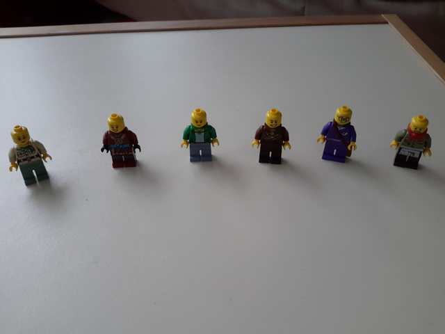](https://www.freelug.org/IMG/jpg/20181014_095943.jpg)

* * *

Les personnages présentés, passons aux bâtiments. Voici une vue d’ensemble du petit domaine. J’ai disposé les personnages au petit bonheur la chance. La tour principale domine comme il se doit. Sur la gauche se trouve une forge et à droite un magasin de contrebandiers, enfin devant un pont relie ces deux maisonnettes. Au centre devant la tour se trouve une statue de Sensei Yang, figurine toute grise. Sur la droite une petite charrette de feux d’artifices.

[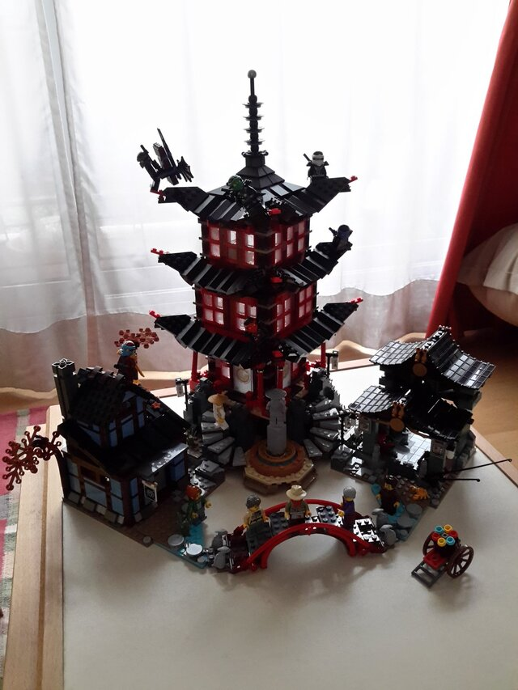](https://www.freelug.org/IMG/jpg/20181014_092653-r90.jpg)

Vu d’un peu de côté, le rendu est bien sympathique aussi.

[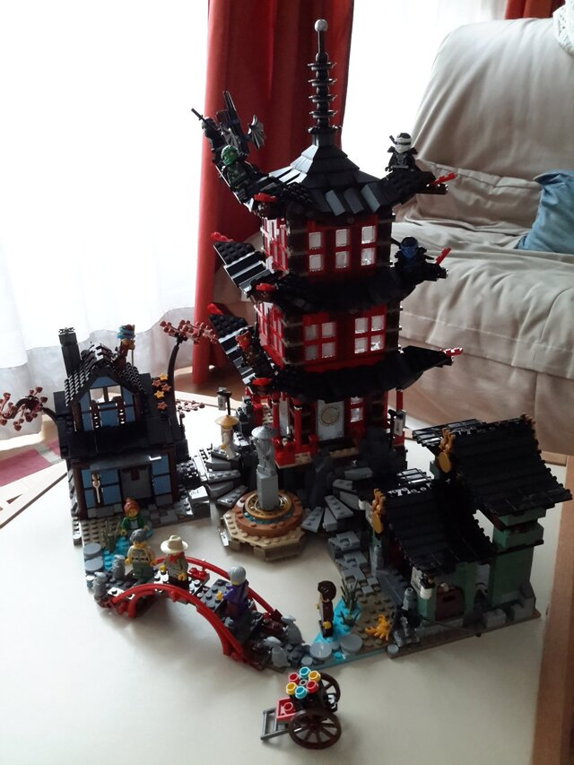](https://www.freelug.org/IMG/jpg/20181014_092932-r90.jpg)

Et voici l’arrière du temple, ouvert sur deux côtés. La tour a trois étages, que je décris plus loin. Au sous-sol se trouve une manivelle qui permet de faire tourner une scénette et d’allumer la brique lumineuse.

[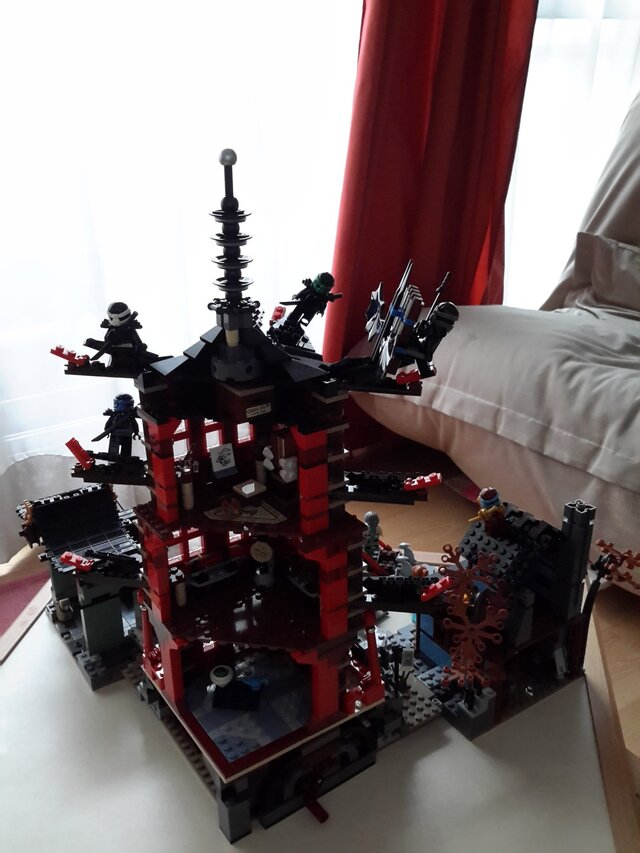](https://www.freelug.org/IMG/jpg/20181014_093044-r90.jpg)

[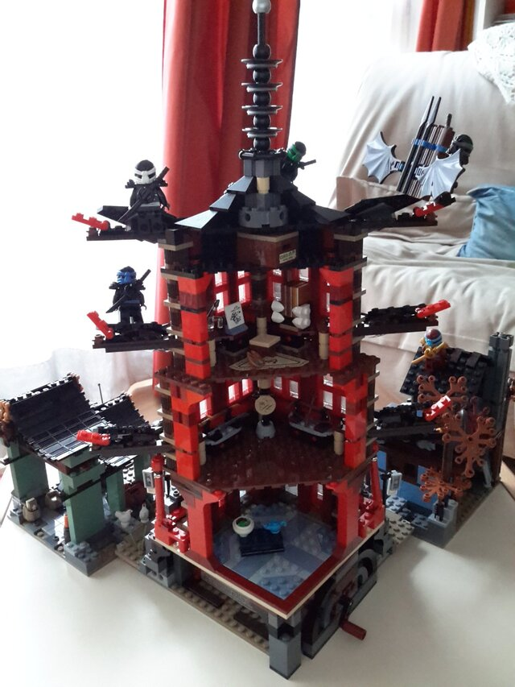](https://www.freelug.org/IMG/jpg/20181014_093103-r90.jpg)

Voyons en détail cet écran de projection d’un magnifique film en ombre chinoise. Le mécanisme est très astucieux : quand on veut tourner la manivelle, il faut appuyer un peu le mur vers la gauche pour enclencher les engrenages, ce qui allume la brique lumineuse (j’en reparle plus loin).

[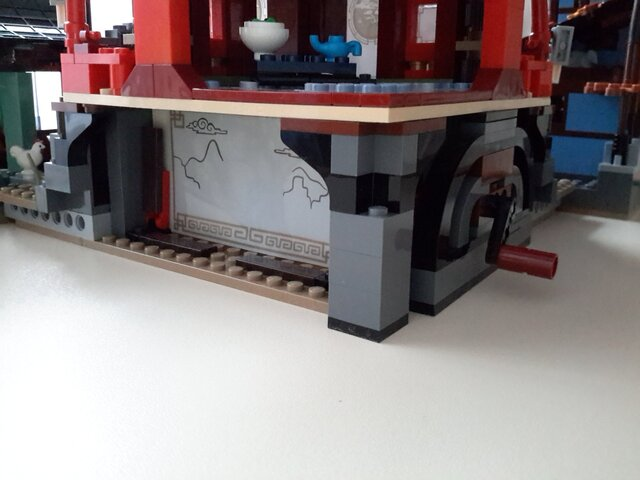](https://www.freelug.org/IMG/jpg/20181014_093113-r180.jpg)

L’écran allumé. Deux silhouettes se tournent autour, avec un serpent au premier plan. Le plateau tourne avec la manivelle, animant l’ensemble. Je regrette un peu que le mouvement soit simplement circulaire, une petite ellipse aurait été plus amusante, mais bon, il faut faire avec.

[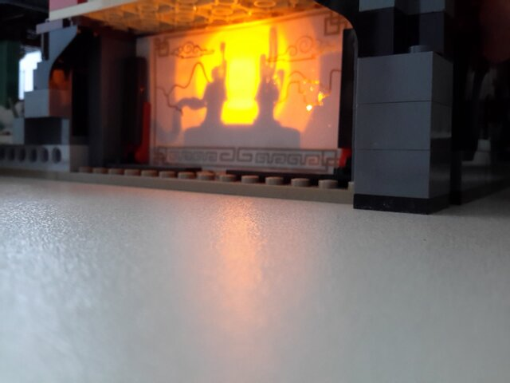](https://www.freelug.org/IMG/jpg/20181014_093134-r180.jpg)

Le premier étage de la tour est une salle de thé, avec un plateau comprenant une théière et un bol avec des gâteaux verts du plus bel effet. Le sol est bicolore, avec gris pâle et plus foncé, les pièces en diagonale se complètent très bien. Au fond on aperçoit les deux panneaux coulissants donnant sur l’avant.

[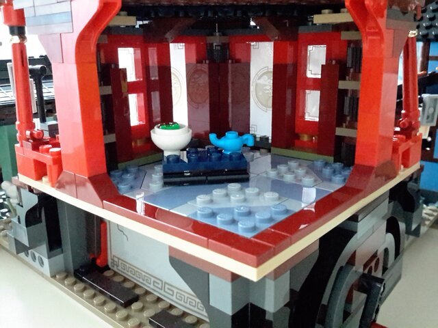](https://www.freelug.org/IMG/jpg/20181014_093147-r180.jpg)

Le second étage est consacré à l’entraînement aux armes. Deux katanas, un arc, une cible bien abîmée, pas de doute, ce dôjô sert ! Sur le sol un autocollant donne un petit côté bois.

[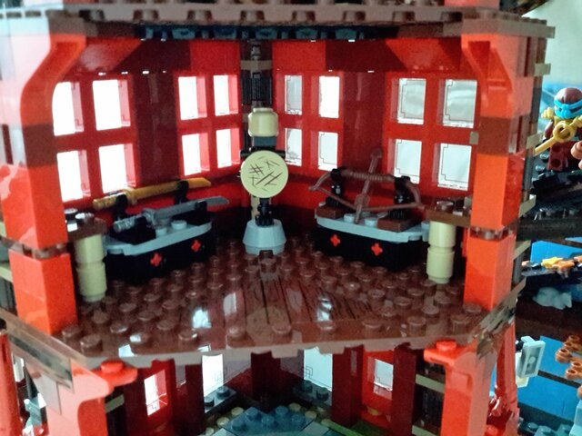](https://www.freelug.org/IMG/jpg/20181014_093222-r180.jpg)

Le troisième et dernier étage est dédié à la peinture, avec une toile en cours de réalisation. Un pinceau est posé dans un gobelet, tandis que la palette n’est pas fixée mais posée sur le tabouret (ici elle est à côté). Cela me semble assez rare dans les montages officiels d’avoir ainsi une pièce ballottant ici et là. Une étagère contient trois livres, dans lesquels on trouve quelques pièces (non photographiées). Le sol a également un autocollant, brun pâle, avec de jolis motifs.

[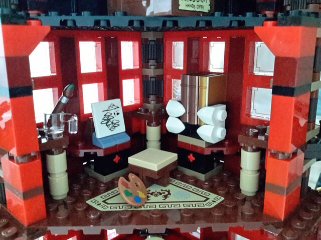](https://www.freelug.org/IMG/jpg/20181014_093236-r180.jpg)

Enfin sous le toit est cachée une caisse appartenant à Cole, comme l’indique l’inscription. Dedans un appareil photo et une brosse à cheveux, j’ignore à quoi cela se rattache.

[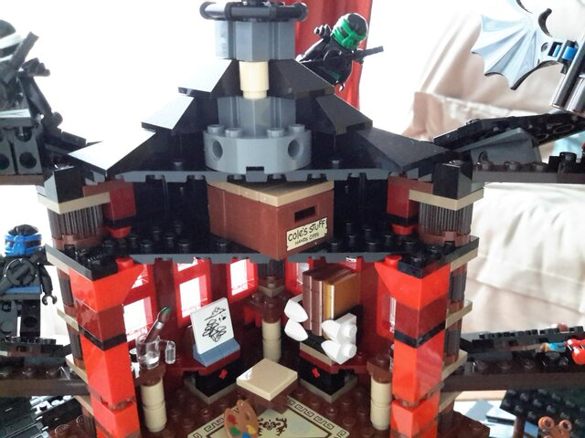](https://www.freelug.org/IMG/jpg/20181014_093304-r180.jpg)

Petite vue plongeante sur les trois étages. Ils sont de plus en plus étroits à mesure que l’on monte, c’est assez logique, et le rendu est sympathique. J’ai retourné le tabouret pour montrer sa construction, simple mais efficace.

[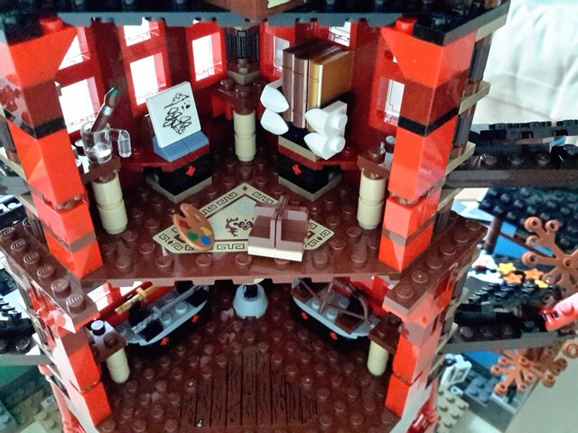](https://www.freelug.org/IMG/jpg/20181014_093320-r180.jpg)

L’ensemble se détache (et se construit) en plusieurs éléments, afin d’être facilement manipulable : la tour, la forge, le marché des contrebandiers, et le pont.

Quelques aperçus de la tour, notamment de la statue à son pied et avec les panneaux ouverts. Toutes les vitres ont des motifs géométriques.

[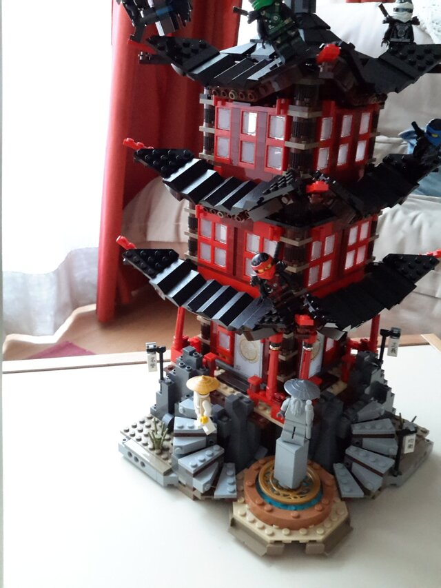](https://www.freelug.org/IMG/jpg/20181014_093506-r270.jpg)

[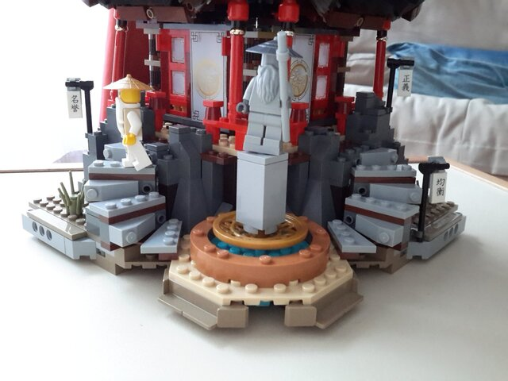](https://www.freelug.org/IMG/jpg/20181014_093457-r180.jpg)

[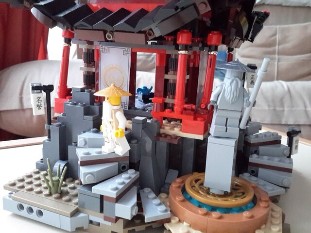](https://www.freelug.org/IMG/jpg/20181014_093523-r180.jpg)

Les toits sont simplement fixés via des briques Technic dans les emplacements prévus à cet effet sur les murs, avec des plaques dépassant en diagonale — construction très amusante.

[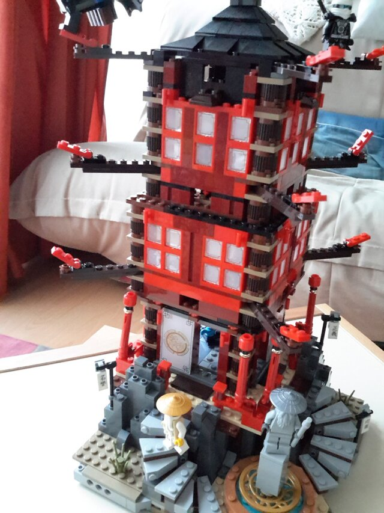](https://www.freelug.org/IMG/jpg/20181014_093609-r270.jpg)

Voici les différents morceaux de toit, d’un assemblage similaire pour les trois niveaux. Les côtés pivotent pour donner l’aspect « remontant » au niveau des barres.

[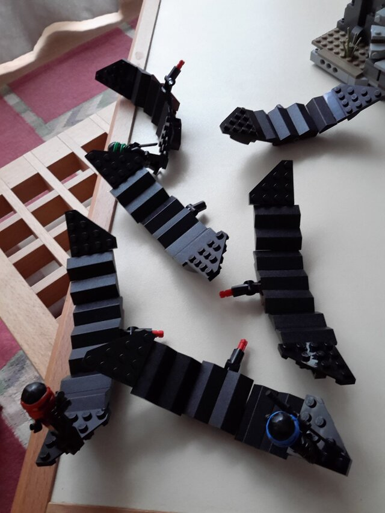](https://www.freelug.org/IMG/jpg/20181014_093620-r270.jpg)

[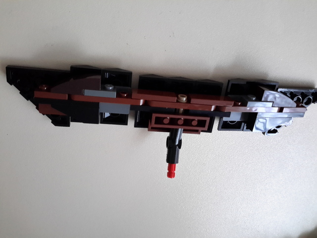](https://www.freelug.org/IMG/jpg/20181014_093634.jpg)

Le sous-sol est donc la salle aux ombres chinoises. Au centre se trouve une pièce Technic ronde sur laquelle sont posées deux mini figurines et des flammes. Elle tourne sous l’action de l’élastique, via l’engrenage connecté à la manivelle. Le morceau de mur avec celle-ci est monté sur une plaque sur une pièce pivotante (en bleu-gris sur la première photo, entre la pièce rouge percée et le mur), avec une autre pièce orthogonale liée à la brique lumineuse. C’est génialement astucieux : en position repos, les deux engrenages ne sont pas connectés, et la brique lumineuse n’est pas allumée, l’ensemble pivotant étant légèrement décalé. Quand on pousse la manivelle afin de faire tourner la pièce Technic centrale, cela fait appuyer la pièce rouge en pente sur la brique lumineuse, qui s’allume donc ! Bonus, elle est facilement démontable, pour changer simplement sa pile. L’écran est une feuille de papier semi-rigide, avec des motifs asiatiques, il est coincé par des charnières.

[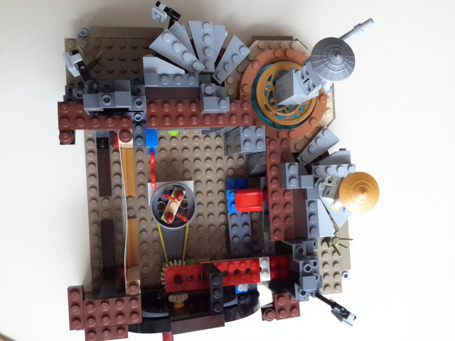](https://www.freelug.org/IMG/jpg/20181014_093825.jpg)

[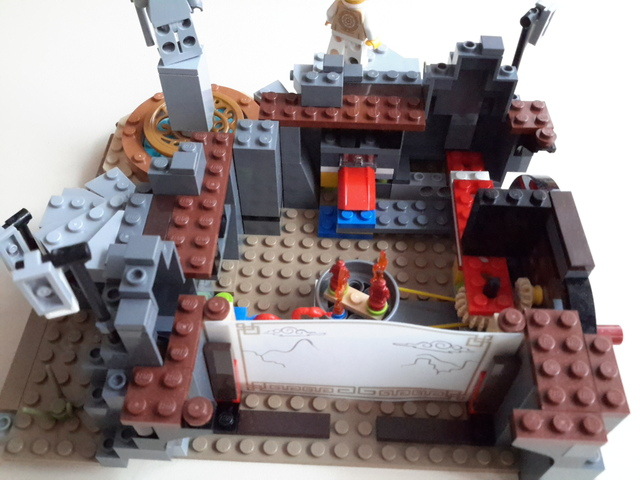](https://www.freelug.org/IMG/jpg/20181014_093841.jpg)

* * *

Sur la gauche de la tour se positionne une forge, d’une belle couleur bleu et marron. Le bâtiment est propre, avec un petit autocollant sur la porte et l’enseigne. Le toit incliné est mobile via deux pièces Technic. De façon surprenante, la fenêtre sur la gauche n’est pas alignée verticalement sur les pièces marron sous elle, je me demande pourquoi. Le second étage se démonte pour donner accès au rez-de-chaussée. En bas à droite de la photo on voit une pièce 2x3 foncée avec une charnière. Dépliée, avec son symétrique sur le marché des contrebandiers, elle permet de caler parfaitement le pont entre les deux bâtiments — un joli calcul de dimensions de la part des concepteurs !

[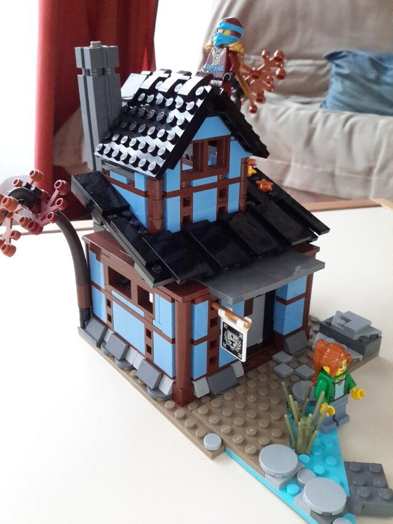](https://www.freelug.org/IMG/jpg/20181014_094132-r90.jpg)

[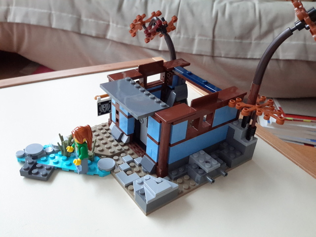](https://www.freelug.org/IMG/jpg/20181014_094244.jpg)

De dos, on voit les indispensables instruments du bon forgeron : une pelle, une enclume, un seau. La forge est une brique montée verticalement avec deux portes pour faire la hotte autour du feu.

[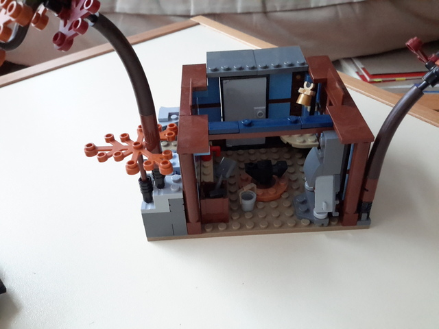](https://www.freelug.org/IMG/jpg/20181014_094216.jpg)

[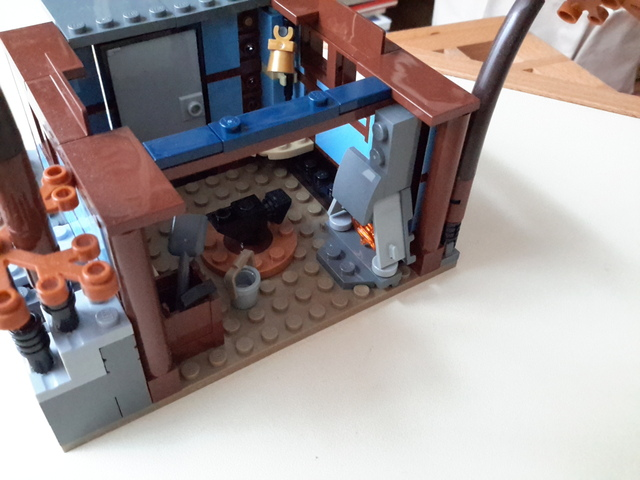](https://www.freelug.org/IMG/jpg/20181014_094232.jpg)

Le second étage est vide, avec quelques pétales de fleur marron ou jaune, sans doute pour symboliser des feuilles sèches, ici et là. Le toit est fait avec deux plaques inclinées et des pièces courbes pour faire la jonction.

[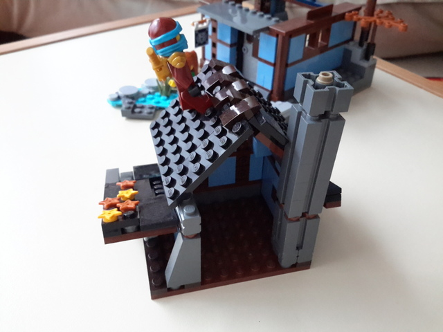](https://www.freelug.org/IMG/jpg/20181014_094303.jpg)

[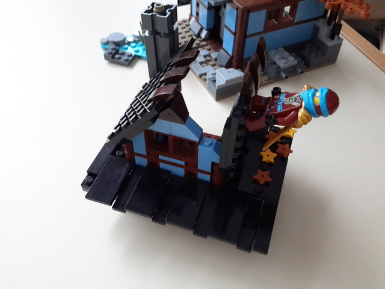](https://www.freelug.org/IMG/jpg/20181014_094326.jpg)

Le marché des contrebandiers, quant à lui, est de teinte vert, avec des toits typiquement asiatiques. Un magnifique exemple de détournement des pièces de volet de garage ! Deux statues de part et d’autre de l’entrée montent la garde, deux enseignes indiquent qu’il s’agit d’une boutique de nourriture. J’aime bien la combinaison du sabre et des pièces blanches pour faire des lanternes de chaque côté.

[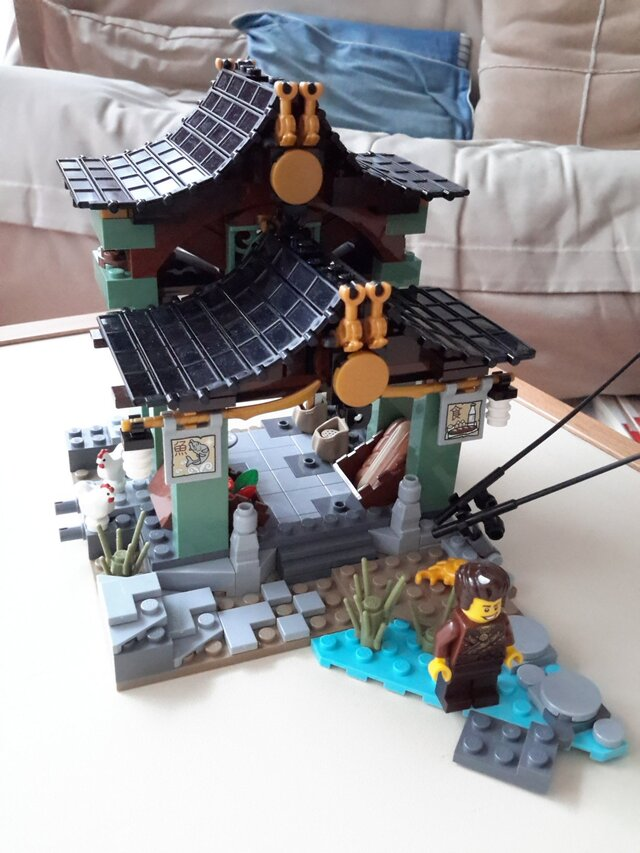](https://www.freelug.org/IMG/jpg/20181014_094410-r270.jpg)

De côté, on aperçoit les caisses de nourriture. Elles sont fixées, mais inclinées via des pièces tournantes.

[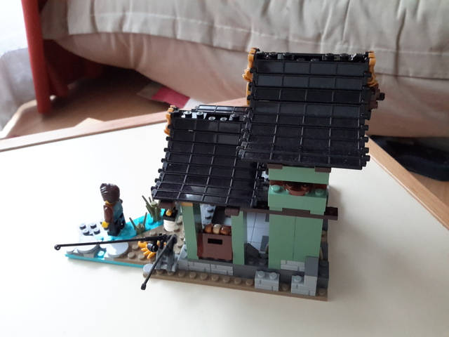](https://www.freelug.org/IMG/jpg/20181014_094430.jpg)

[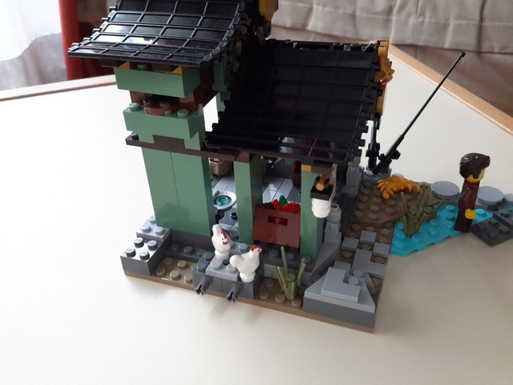](https://www.freelug.org/IMG/jpg/20181014_094507.jpg)

L’arrière du magasin est ouvert et permet d’accéder simplement à l’intérieur. On y aperçoit caisses et sacs de nourriture, un robinet et son évier.

[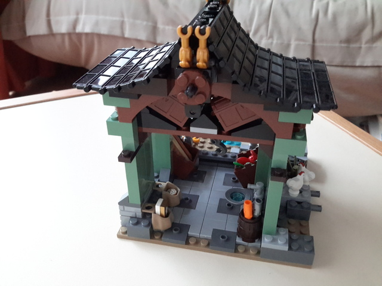](https://www.freelug.org/IMG/jpg/20181014_094449.jpg)

Deux pièces portent de beaux autocollants, j’ignore ce qu’ils représentent.

[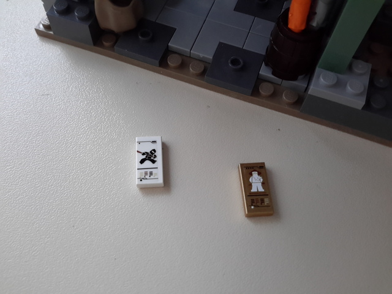](https://www.freelug.org/IMG/jpg/20181014_094548.jpg)

Enfin sous le toit se cachent des caisses de matériel, shuriken et sabres.

[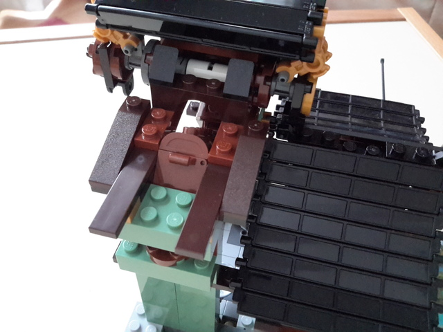](https://www.freelug.org/IMG/jpg/20181014_094524.jpg)

* * *

Dernier petit bâtiment, le pont. Il est symétrique, mais de facture très raisonnable. Les barres souples lui confèrent un aspect réaliste, peut-être plus que des briques. De part et d’autre des petits dragons encadrent les deux zones où viennent se placer les pièces 2x3 foncées de la forge et du marché des contrebandiers quand on assemble le tout.

[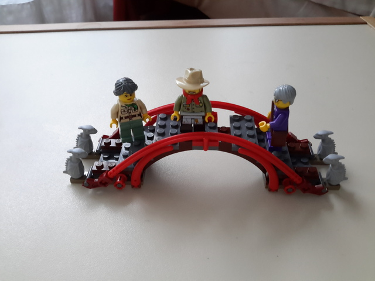](https://www.freelug.org/IMG/jpg/20181014_094037.jpg)

[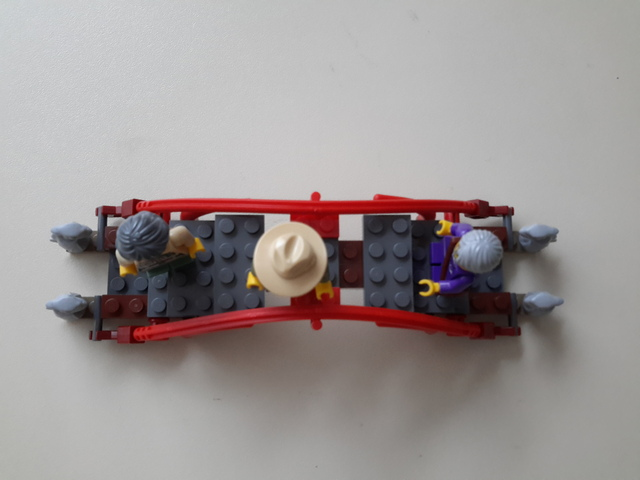](https://www.freelug.org/IMG/jpg/20181014_094045.jpg)

* * *

En plus des bâtiments on trouve un petit chariot permettant de lancer des feux d’artifice. Rien de spécial sur les pièces, le lanceur est assez répandu je crois.

[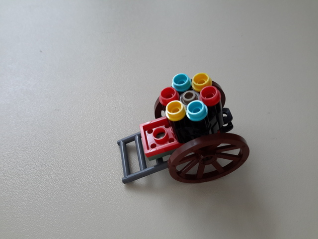](https://www.freelug.org/IMG/jpg/20181014_094108.jpg)

Pour compléter la panoplie du parfait ninja, quoi de mieux qu’un planeur ? Une pièce à poignées permet à un personnage de le saisir, et deux lances à l’arrière fournissent des armes en cas de besoin. Rien d’exceptionnel dans la construction, mais avec les ailes, le rendu est amusant.

[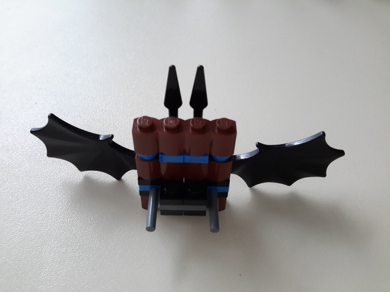](https://www.freelug.org/IMG/jpg/20181014_095045.jpg)

[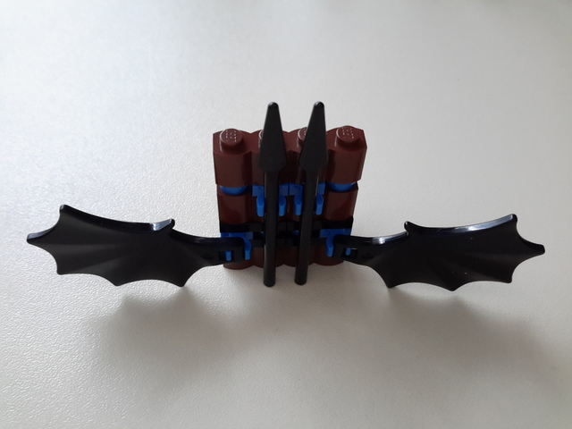](https://www.freelug.org/IMG/jpg/20181014_095057.jpg)

* * *

La construction, que je ne vais pas détailler plus (il y a trop d’étapes !), se fait ainsi :  
**–** sachets 1 et 2 pour le marché des contrebandiers  
**–** sachets 3 et 4 pour la forge  
**–** sachets 5 et 6 pour la salle aux ombres chinoises  
**–** sachet 7 pour une partie du premier étage  
**–** sachet 8 pour le second étage et la fin du premier  
**–** sachet 9 pour le second étage et le début du troisième  
**–** sachet 10 pour la suite du troisième  
**–** sachet 11 pour le toit et la pointe (mais pas les toits inclinés)  
**–** sachet 12 pour les toits inclinés  
**–** sachet 13 pour le pont, le planeur et le chariot de feux d’artifice.

Il y a un peu de répétition de construction, pour les piliers ou les toits, mais rien de dramatique.

Les figurines sont réparties par deux, dans les sachets 1, 3, 5, 7, 12 et 13.

* * *

**Avis :** si mon ton dans cet article n’a pas vendu la mèche, j’avoue volontiers adorer ce temple !

Certes il y a pas mal d’autocollants, j’ai quelques doutes sur la résistance à long terme de l’écran de projection (il était un peu plié quand j’ai ouvert la boîte, peut-être à cause de mon entreposage), la construction était un peu répétitive, la tour est très symétrique. Et comme disait un vendeur, il faudrait presque une seconde boîte pour compléter le bâtiment.

Mais j’apprécie vraiment le rendu final. Il y a plein de petits détails, visuellement les formes sont très jolies, les bâtiments de styles variés, et il y a pas mal de techniques intéressantes durant la construction. Le tout s’intégrera très bien dans une ville je pense (au moins la tour principale).

Bref, je me suis vraiment amusé à le monter, et je n’ai pas du tout été déçu du résultat final !
