Après la sortie du film The LEGO Movie, différents sets sont sortis autour de ce dessin animé.

Le set que je vous propose aujourd’hui fait partie de ceux-ci, il s’agit du _70818_, _Double-Decker Couch_, le canapé à deux étages d’Emmet.

Sorti en 2015, cette boîte comporte 197 pièces, et était à 16,99 €, soit un ratio de presque 0,09 € par pièce.

* * *

L’avant, comme toutes les boîtes liées au film, comporte le logo LEGO à gauche, avec à ses côtés « The LEGO Movie » stylisé comme le titre dans le générique. En bas à droite apparaissent les cinq personnages : Emmet, Vitruvius, Unikitty, Benny et Lord Business (avec son visage alternatif) — une belle sélection de personnages principaux. Le reste de l’image représente le fameux canapé à deux étages, avec à gauche une voiture. Benny est en apesanteur, une saucisse à la main.

[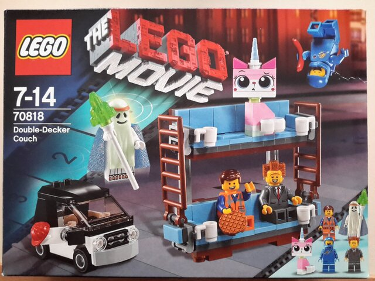](https://www.freelug.org/IMG/jpg/20180218_121747.jpg)

L’arrière reprend, disposés comme sur une pellicule, différents éléments du set, avec les visages alternatifs d’Emmet, de Benny et d’Unikitty. Il est bien indiqué que le corps de Vitrivius est phosphorescent.

[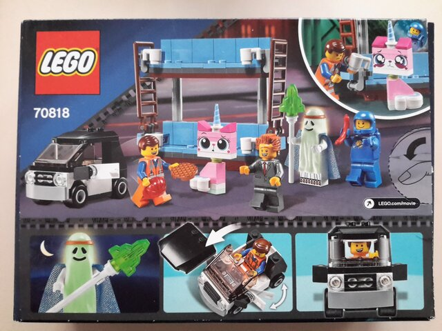](https://www.freelug.org/IMG/jpg/20180218_121736.jpg)

À l’intérieur, une notice et un petit tas de pièces.

[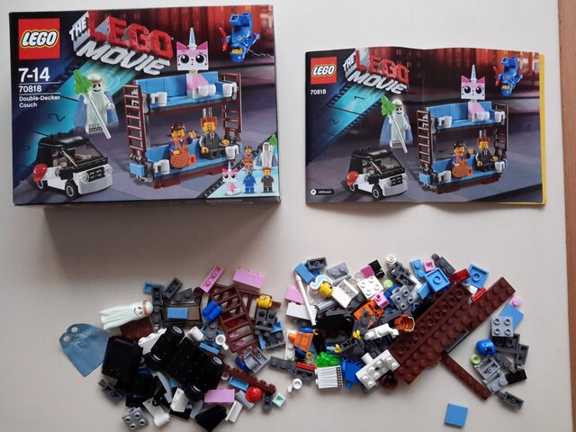](https://www.freelug.org/IMG/jpg/20180218_123527.jpg)

Certaines pièces sont sérigraphiées — il manque l’espèce de gaufre que tient Emmet... - et il y a une cape étoilée pour Vitrivius. Les sérigraphies sont très belles, avec les deux visages tristes d’Unikitty ainsi que les sourcils associés, et la cape a un bel aspect. La radio ira dans la voiture, et la toge fera les pieds de Vitrivius.

[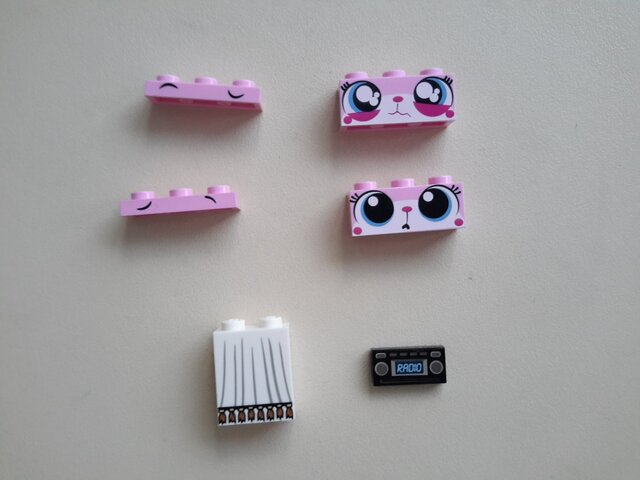](https://www.freelug.org/IMG/jpg/20180218_123304.jpg)

Voici les personnages présents dans la boîte.

Honneur à Emmet, l’inventeur de ce superbe canapé à deux étages. Il est comme à son habitude en tenue de chantier, avec son badge, et il sourit. Deux poches, un stylo dans l’une, une ceinture et deux bandes sur les jambes, en revanche les bras sont unis.

[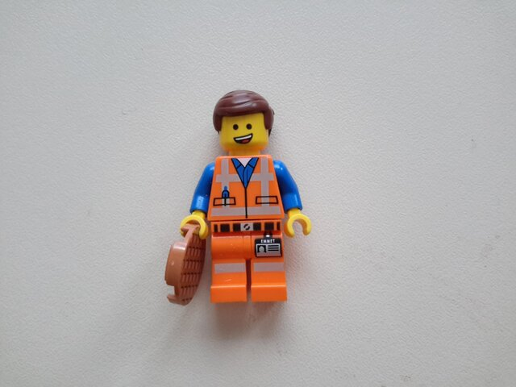](https://www.freelug.org/IMG/jpg/20180218_122009.jpg)

De dos service minimal, juste les bandes réfléchissantes du torse, rien sur les jambes.

[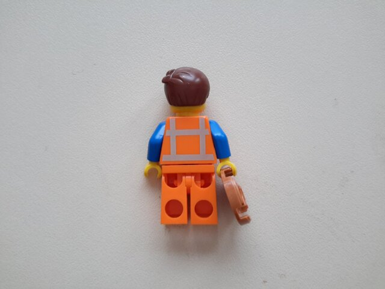](https://www.freelug.org/IMG/jpg/20180218_122018.jpg)

Le visage alternatif est triste, une expression inhabituelle pour Emmet.

[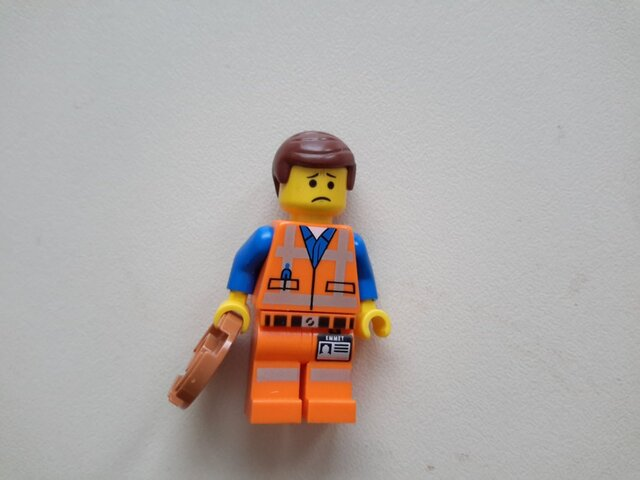](https://www.freelug.org/IMG/jpg/20180218_122243-r270.jpg)

Le second personnage est Benny, l’astronaute Space Classic. Comme il se doit, il a le casque fêlé, et le logo à moitié effacé, signe qu’il n’est pas de la première jeunesse ! Il arbore un grand sourire, et tient, pour je ne sais plus quelle raison, une saucisse à la main. Pas de décoration particulière sauf le logo, ce qui est en parfaite harmonie avec les minifigurines de la période.

[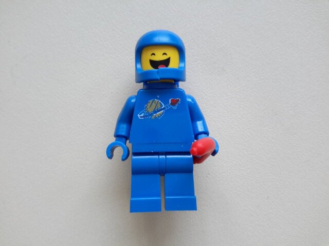](https://www.freelug.org/IMG/jpg/20180218_122142-r270.jpg)

De dos rien de spécial, il porte ses bouteilles d’oxygène.

[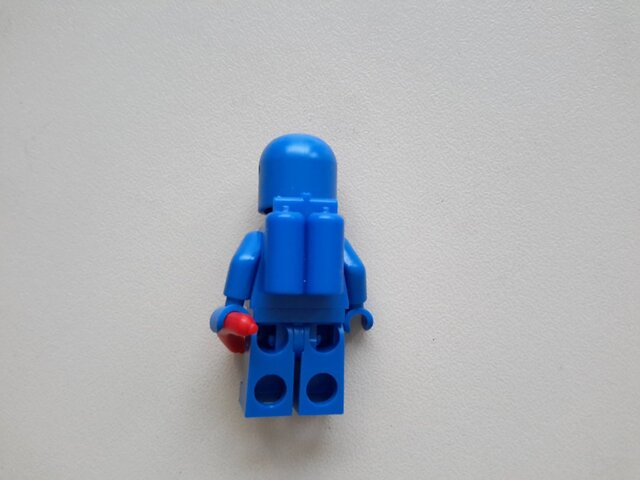](https://www.freelug.org/IMG/jpg/20180218_122151-r270.jpg)

Le visage alternatif le montre avec un air navré.

[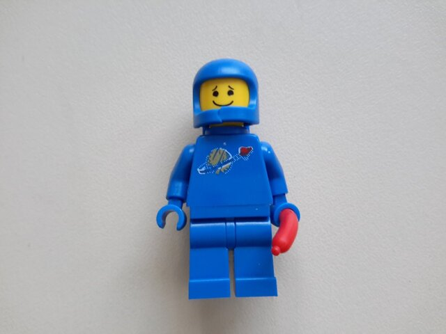](https://www.freelug.org/IMG/jpg/20180218_122304-r270.jpg)

On continue avec Lord Business. Complet cravate, veste, coiffure au carré, pas de doute, c’est un homme d’affaires. Son grand sourire ravi contredit son rôle de méchant. Les jambes sont simples, unies.

[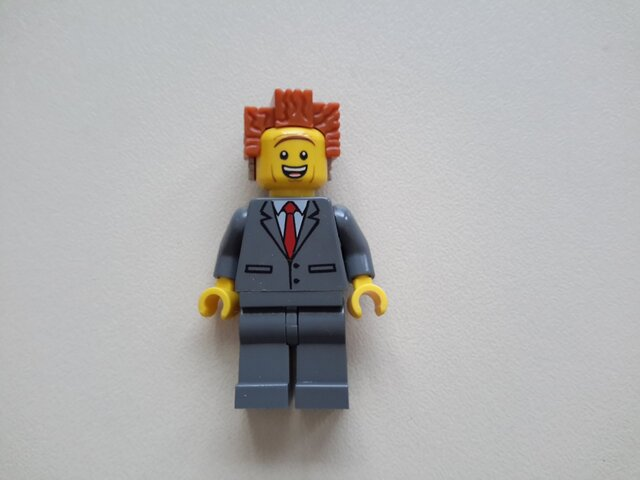](https://www.freelug.org/IMG/jpg/20180218_122032.jpg)

Le dos est uni, rien à signaler. En revanche les cheveux ont une bande gris clair, quelques cheveux blancs donc pour montrer son âge.

[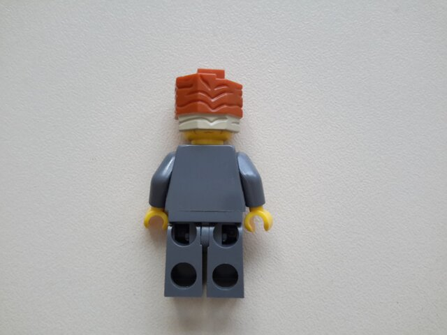](https://www.freelug.org/IMG/jpg/20180218_122051.jpg)

Son visage alternatif le présente perplexe, se demandant peut-être ce qu’Emmet veut dire ?

[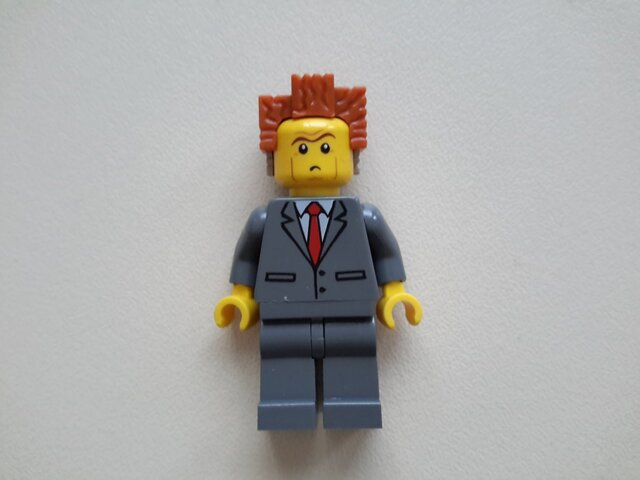](https://www.freelug.org/IMG/jpg/20180218_122255-r270.jpg)

Le quatrième personnage, qui n’est pas à proprement parler une minifigurine, est Unikitty. Le visage et les sourcils, sérigraphiés, sont bien rendus. La queue est également sérigraphiée, avec une bande bleue. La construction est simple, mais avec un bon rendu.

[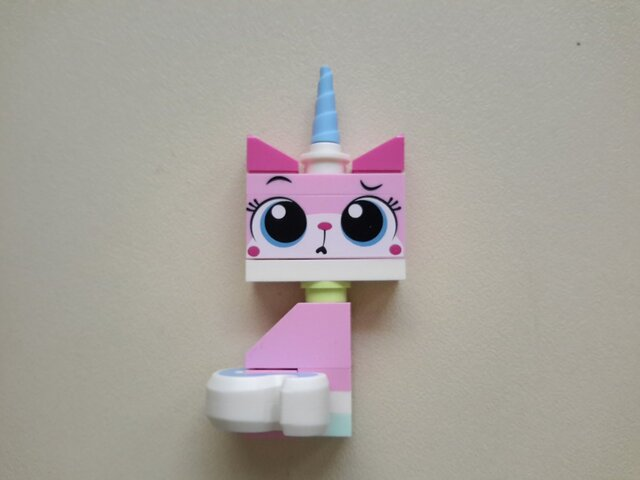](https://www.freelug.org/IMG/jpg/20180218_122119-r270.jpg)

De dos pas de sérigraphie particulière.

[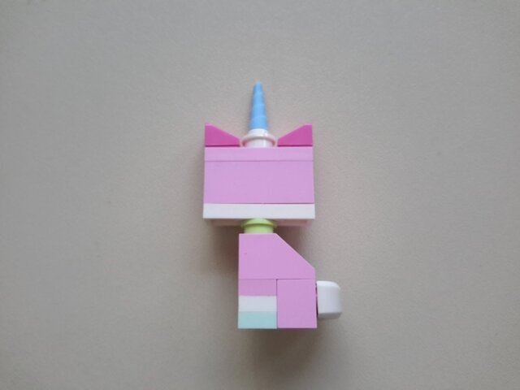](https://www.freelug.org/IMG/jpg/20180218_122234-r270.jpg)

Le visage alternatif, construit avec deux autres pièces, montre de magnifiques yeux prêts à déverser des torrents de larmes, avec les sourcils associés.

[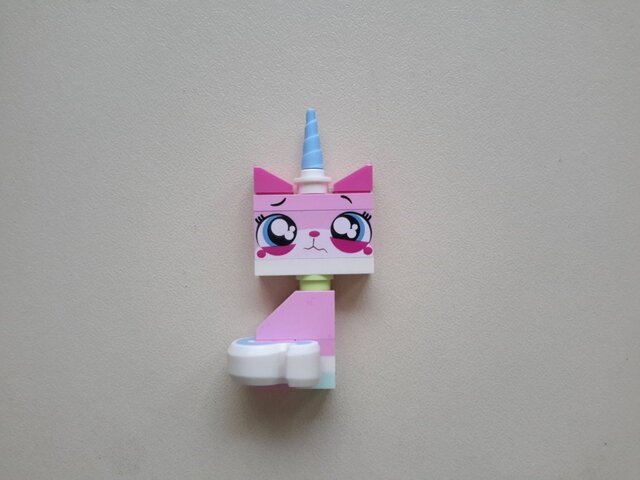](https://www.freelug.org/IMG/jpg/20180218_122403-r270.jpg)

Dernier personnage, figurine au torse uni blanc recouverte d’un voile, est Vitrivius, sous forme de fantôme. Il porte une magnifique cape étoilée, tient un sceptre d’un joli vert transparent, a une robe à pompons, et un bandana sur le front. La tête sous-jacente est noire, d’où les yeux et la bouche de cette couleur. La pièce principale est phosphorescente, donnant une légère lueur dans l’obscurité.

[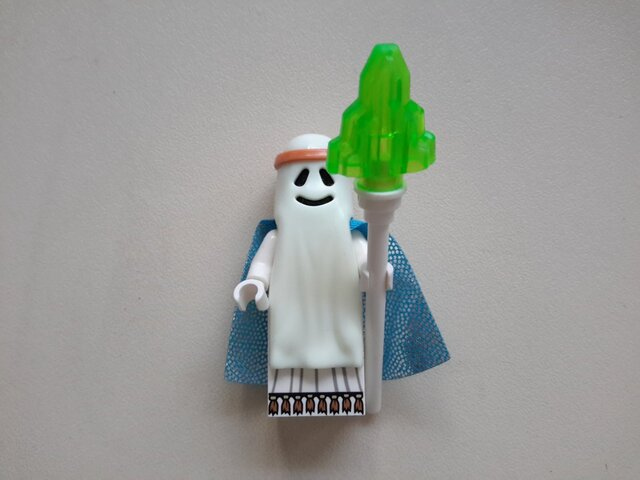](https://www.freelug.org/IMG/jpg/20180218_122129-r270.jpg)

* * *

La première étape de construction est en réalité de construire Unikitty, qui comporte une quinzaine de pièces. Quelques plates 1x1, une accroche sur le côté, les pièces sérigraphiées, une corne et deux pièces en pente, et le compte est bon.

[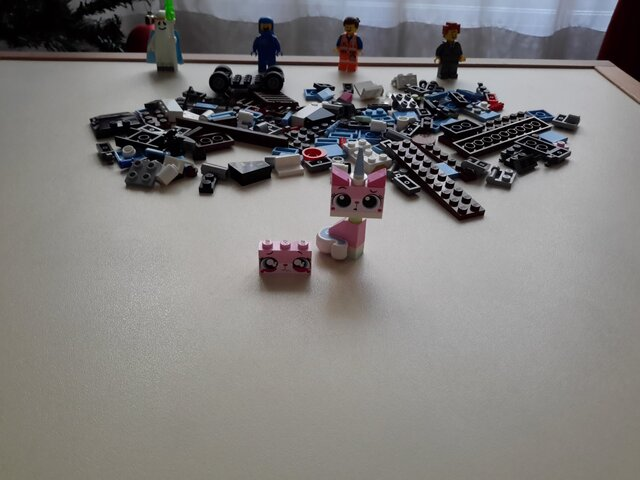](https://www.freelug.org/IMG/jpg/20180218_124038.jpg)

La seconde construction est la petite voiture d’Emmet. Elle se monte sur une base d’essieux 7x4 noire, on y ajoute un volant, deux portes, et c’est presque fini.

[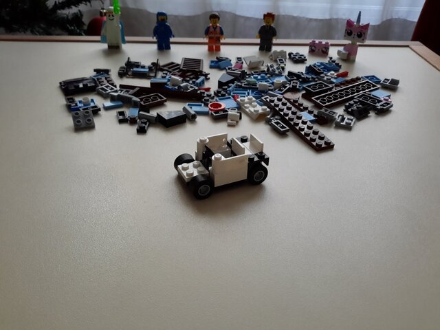](https://www.freelug.org/IMG/jpg/20180218_124212.jpg)

La pièce « radio » vient sur le tableau de bord, tandis que les rétroviseurs sont symbolisés par trois pièces chacun. À l’arrière deux pièces fines forment un coffre, à l’avant on prépare le pare-choc.

[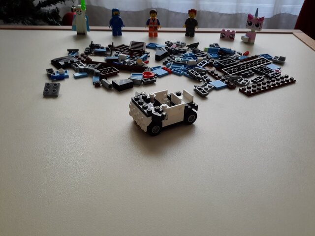](https://www.freelug.org/IMG/jpg/20180218_124417.jpg)

Et voici la voiture terminée, avec son toit et le pare-brise. Une petite grille sur l’avant et deux phares, plus le pare-choc, et on est paré.

[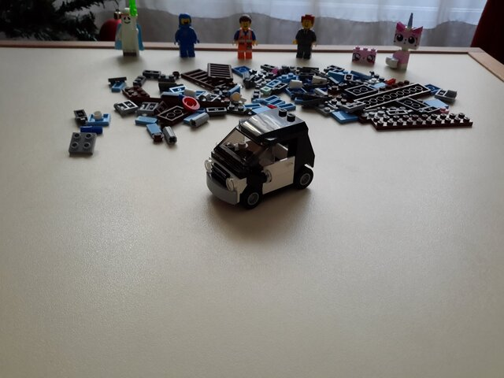](https://www.freelug.org/IMG/jpg/20180218_124543.jpg)

Dans le simili-coffre vient se glisser une casquette rouge.

[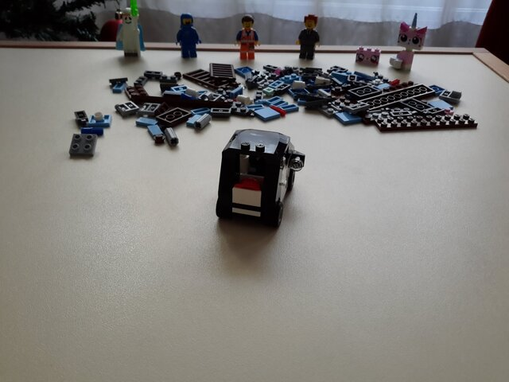](https://www.freelug.org/IMG/jpg/20180218_124551.jpg)

Enfin commence la construction du canapé à deux étages lui-même. Précisément le dossier du haut, basé sur une plate 2x10 recouverte de plates bleues. Les deux pièces trouées serviront à accrocher les montants, les charnières pour poser l’assise supérieure.

[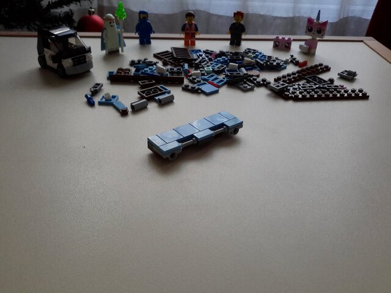](https://www.freelug.org/IMG/jpg/20180218_124800.jpg)

On ajoute les montants verticaux, faits avec des pièces Technic, et on passe à l’assise elle-même. Des charnières permettent de faire les accoudoirs, très astucieux à mon avis. À noter les clips pour tenir les tasses. Deux plaques 2x1 serviront à accrocher des personnages, au milieu de plates pour lisser.

[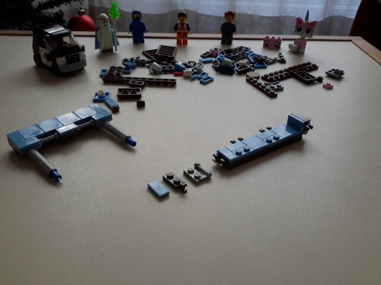](https://www.freelug.org/IMG/jpg/20180218_125203.jpg)

L’assise installée, on passe au dossier inférieur, sur le même principe. Les pièces trouées sont orientées vers l’arrière et non visibles ici.

[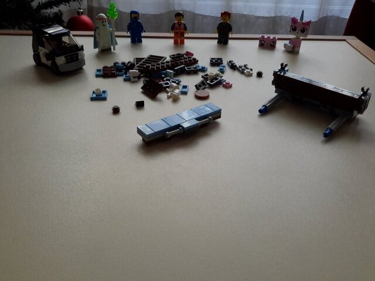](https://www.freelug.org/IMG/jpg/20180218_125449.jpg)

De la même façon, l’assise inférieure se construit sur une plaque 2x10, recouverte de plates bleues, et les accoudoirs sont avec une charnière.

[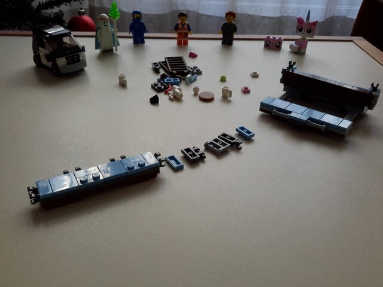](https://www.freelug.org/IMG/jpg/20180218_125753.jpg)

On assemble les dossiers et assises...

[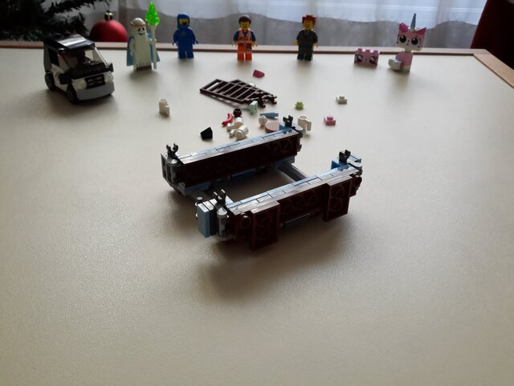](https://www.freelug.org/IMG/jpg/20180218_125926.jpg)

... puis on rajoute une échelle de chaque côté, pour permettre de monter et descendre du canapé.

[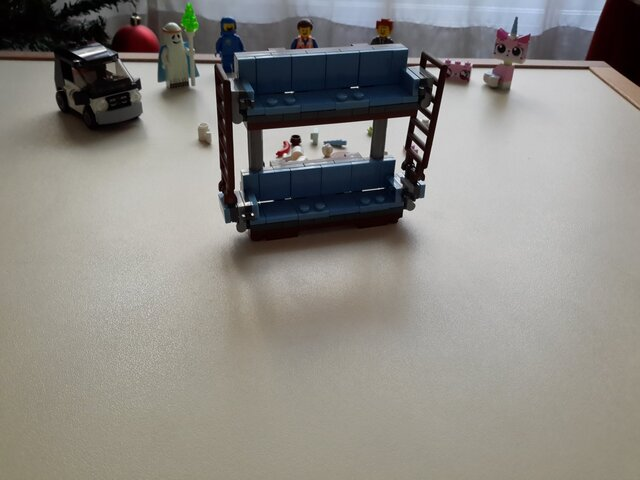](https://www.freelug.org/IMG/jpg/20180218_125949.jpg)

Pour terminer, on rajoute les tassés à café, et on pose les figurines. Benny ne peut malheureusement pas voler à ma connaissance, donc on le pose aussi sur le canapé. Emmet mange une gaufre, et tout le monde semble ravi, sauf Unikitty avec son visage triste.

[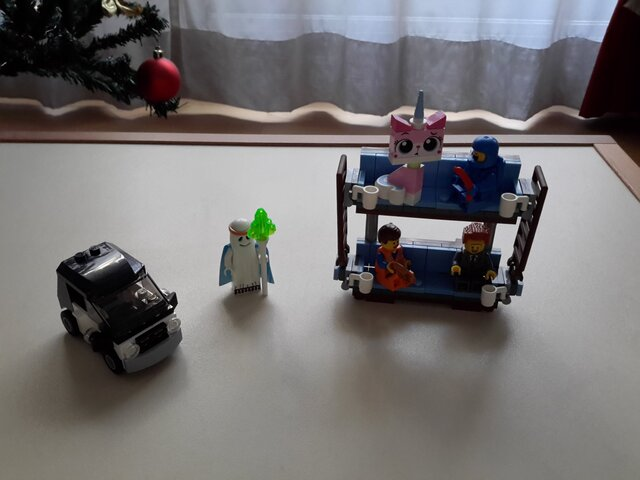](https://www.freelug.org/IMG/jpg/20180218_121710.jpg)

Une vue un peu rapprochée. Vitrivius veille sur les pièces bonus, et à gauche se trouve le visage alternatif de Unikitty.

* * *

**Avis :** un petit modèle pas trop compliqué, mais excellent. Plusieurs personnages principaux du film sont présents (même si Lord Business et Vitrivius détonnent un peu par rapport au contexte dans le film — peu importe !), avec des figurines simples mais efficaces.

Bref, une réjouissance.

**Bonus :** une animation de toutes les étapes de la construction (cliquer pour lancer).

[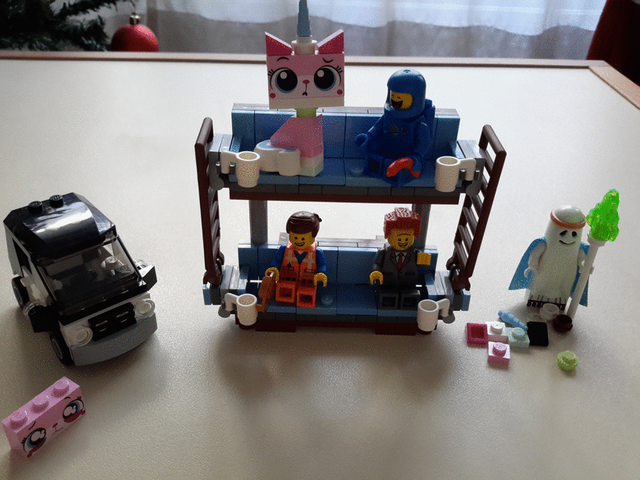](https://www.freelug.org/IMG/gif/70818.gif)
