Aujourd’hui je vous propose la review du set 71201 dans la gamme _LEGO Dimensions_ : **Back to the Future**.

Ce set sorti en 2015 au prix de 29,99 € est composé de 94 pièces, soit un ratio prix/pièce de 31 centimes d’€.

Ce set est un _Level Pack_ du jeu _**[LEGO Dimensions](https://fr.wikipedia.org/wiki/Lego_Dimensions)**_ sorti cette année.

[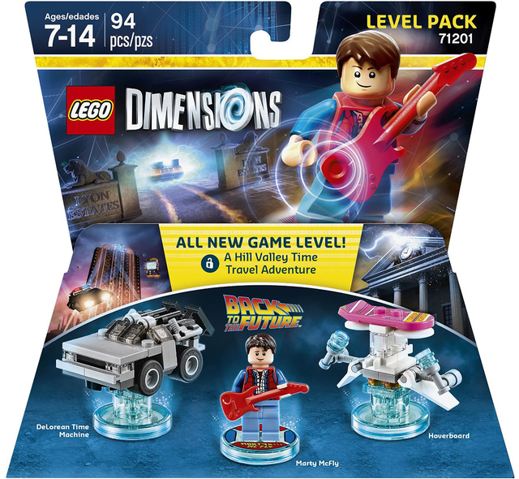](https://www.freelug.org/IMG/jpg/DimensionsBttF_Box.jpg)

Avant de commencer, il faut savoir qu’il n’y a pas de notice de construction dans les _Level Pack_, le livret fournit sont les instructions rudimentaires du fonctionnement des socles à puce RFID.

Vous pouvez vous rendre sur le site LEGO à _**[cette adresse](https://wwwsecure.us.lego.com/fr-fr/service/buildinginstructions/search#?search&theme=10000-20229)**_ , avec le numéro du set (ici 71201) afin de récupérer les instructions de montage. Enfin sachez que chaque modèle de ce _Level Pack_ ont trois versions de construction différentes.

J’ai choisi pour cette review de construire les versions classiques de la _DeLorean Time Machine_ et de l’_HoverBoard_ (les modèles que l’on voit sur la boite).

De plus je n’ai pas le jeu _LEGO Dimensions_, l’achat de ce pack est dû à la présence de Marty McFly, minifigure que je ne possédais pas.

Ce _Level Pack_ contient deux sachets de briques et une notice d’instruction pour le jeu _LEGO Dimensions_.

[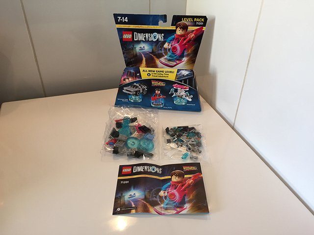](https://www.freelug.org/IMG/jpg/DimensionsBttF_01_mini.jpg)

La minifigure de Marty McFly avec sa guitare électrique sur son socle RFID sérigraphié à son nom.

[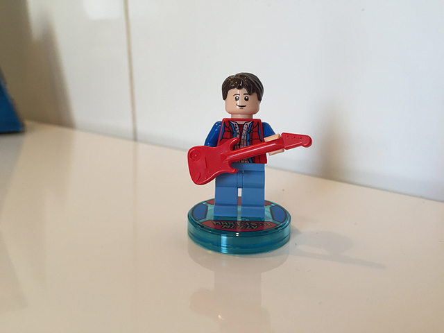](https://www.freelug.org/IMG/jpg/DimensionsBttF_02_mini.jpg)

Marty sans sa guitare, ce qui nous permet de voir la très belle sérigraphie du torso de la célèbre doudoune sans manches (un gilet de sauvetage dixit Lorraine).

[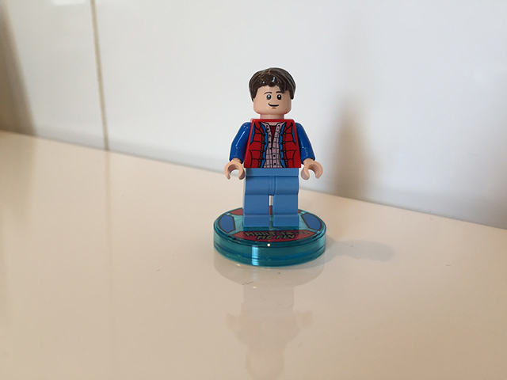](https://www.freelug.org/IMG/jpg/DimensionsBttF_03_mini.jpg)

Le dos du torso lui aussi joliment fini et le visage alternatif de Marty

[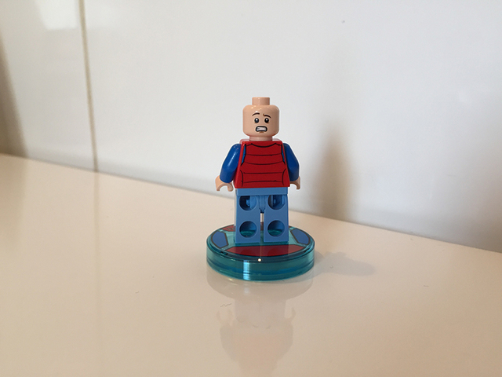](https://www.freelug.org/IMG/jpg/DimensionsBttF_04_mini.jpg)

On commence la mini DeLorean.

[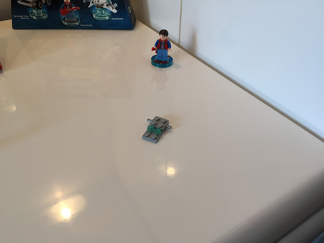](https://www.freelug.org/IMG/jpg/DimensionsBttF_05_mini.jpg)

Les quatre essieux sont en place.

[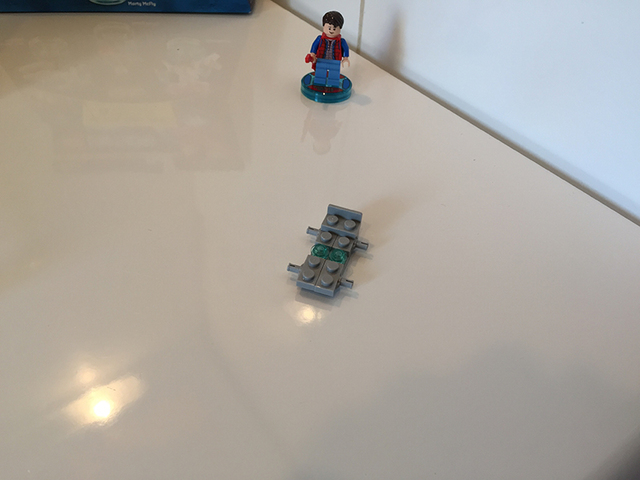](https://www.freelug.org/IMG/jpg/DimensionsBttF_06_mini.jpg)

Pare-choc, phares et moteur.

[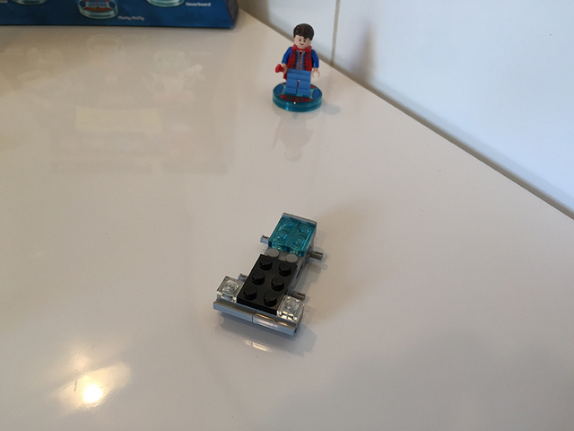](https://www.freelug.org/IMG/jpg/DimensionsBttF_07_mini.jpg)

Le capot d’une des plus célèbre voiture du cinéma est posé.

[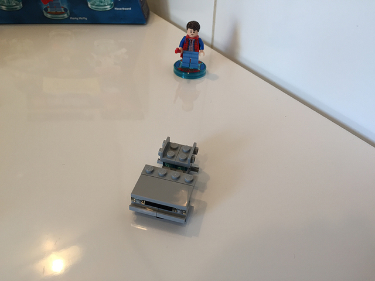](https://www.freelug.org/IMG/jpg/DimensionsBttF_08_mini.jpg)

On installe le pare-brise.

[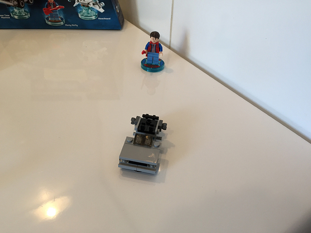](https://www.freelug.org/IMG/jpg/DimensionsBttF_09_mini.jpg)

Une des deux portes papillon, ainsi que les radiateurs du moteur nucléaire à l’arrière.

[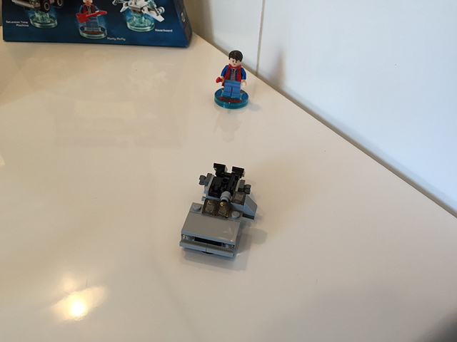](https://www.freelug.org/IMG/jpg/DimensionsBttF_10_mini.jpg)

La deuxième porte et les quatre roues sont installées.

[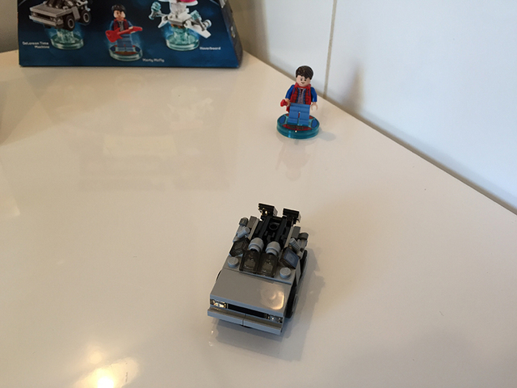](https://www.freelug.org/IMG/jpg/DimensionsBttF_11_mini.jpg)

La DeLorean finalisée sur son socle RFID.

[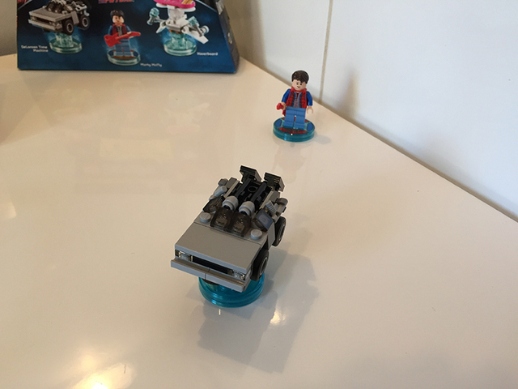](https://www.freelug.org/IMG/jpg/DimensionsBttF_12_mini.jpg)

Sous un autre angle avec les portes papillon ouvertes.

[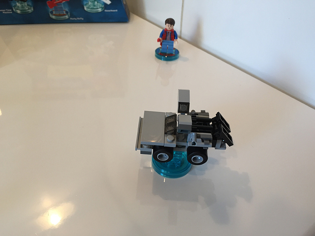](https://www.freelug.org/IMG/jpg/DimensionsBttF_13_mini.jpg)

On commence l’Hoverboard par sa base RFID.

[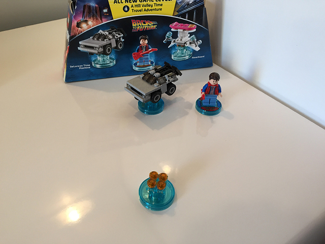](https://www.freelug.org/IMG/jpg/DimensionsBttF_14_mini.jpg)

On continu de monter le socle, que LEGO a agrémenté de quelques fioritures afin de ne pas présenter juste la planche de l’HoverBoard, ce qui aurait fait vraiment dépouillé.

[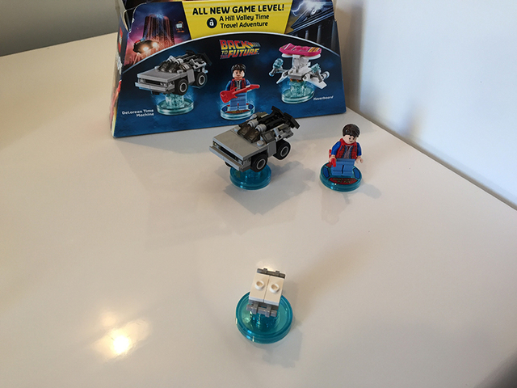](https://www.freelug.org/IMG/jpg/DimensionsBttF_15_mini.jpg)

Deux espèces de bras articulés.

[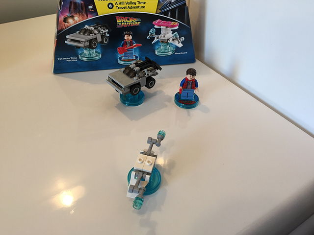](https://www.freelug.org/IMG/jpg/DimensionsBttF_16_mini.jpg)

Finalisation du socle.

[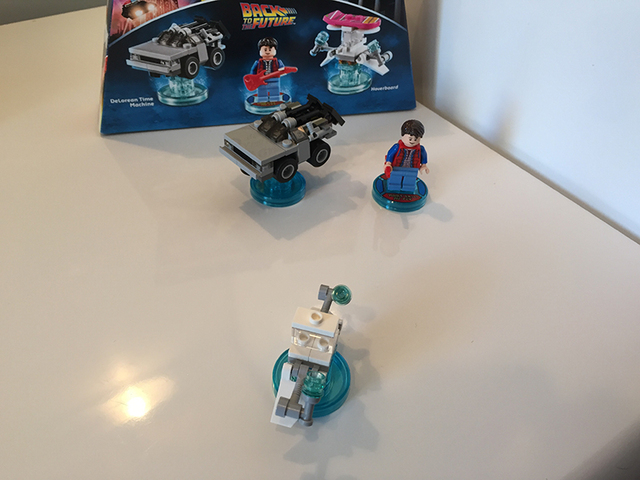](https://www.freelug.org/IMG/jpg/DimensionsBttF_17_mini.jpg)

Voilà enfin le moment d’installer l’HoverBoard.

[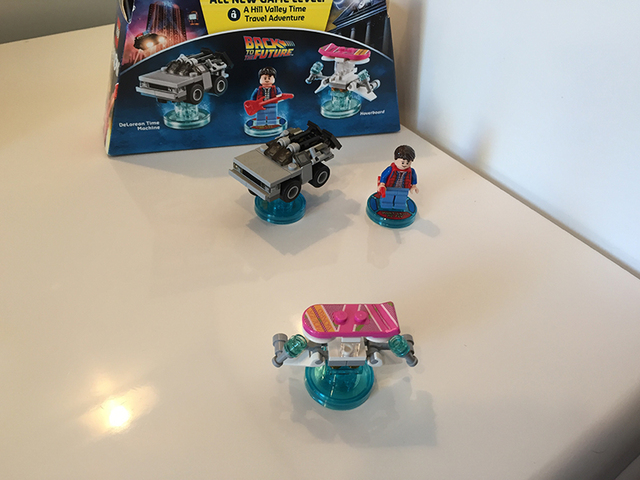](https://www.freelug.org/IMG/jpg/DimensionsBttF_18_mini.jpg)

Voilà les trois modèles du set.

[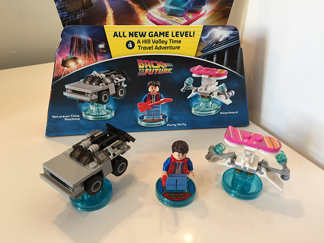](https://www.freelug.org/IMG/jpg/DimensionsBttF_19_mini.jpg)

**Avis :**

Soyons franc, sans avoir le jeu, l’achat de ce pack ne peux être qu’un coup de cœur pour la fig de Marty McFly. Ce qui au final la rend hors de prix. Malgré ça, je suis content de l’avoir enfin dans ma collection.

_Bonus :_

Voici un GIF animé réalisé avec les nombreuses photos prises pour cette review.

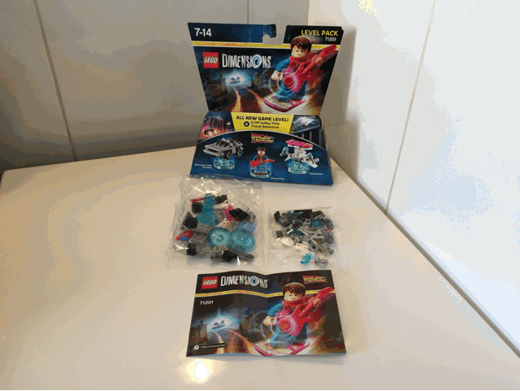
