Aujourd’hui je vous propose la review du set 71203 dans la gamme _LEGO Dimensions_ : **Portal 2**.

Ce set sorti en 2015 au prix de 29,99 € est composé de 85 pièces, soit un ratio prix/pièce de 35 centimes d’€.

Ce set est un _Level Pack_ du jeu _**[LEGO Dimensions](http://www.lego.com/fr-fr/dimensions)**_ sorti cette année.

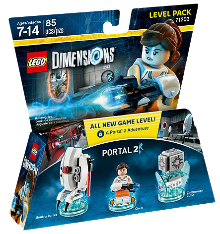

Avant de commencer, il faut savoir qu’il n’y a pas de notice de construction dans les Level Packs, le livret fourni sont les instructions rudimentaires du fonctionnement des socles à puce RFID. Vous pouvez vous rendre sur le site LEGO à [cette adresse](https://wwwsecure.us.lego.com/fr-fr/service/buildinginstructions/search#?search&theme=10000-20229), avec le numéro du set (ici 71203) afin de récupérer les instructions de montage. Enfin sachez que chaque modèle de ce _Level Pack_ a trois versions de construction différentes.

J’ai choisi pour cette review de construire les versions présentées sur le devant du pack, à savoir _Sentry Turret_ et _Companion Cube_.

De plus je n’ai pas le jeu _LEGO Dimensions_, l’achat de ce pack est dû à la présence de _Chell_, minifigure exclusive à ce set.

Ce _Level Pack_ contient deux sachets de briques et une notice de d’instruction pour le jeu _LEGO Dimensions_.

[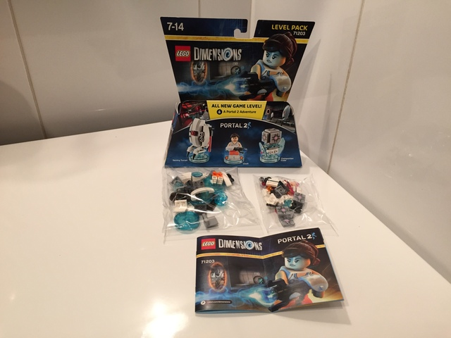](https://www.freelug.org/IMG/jpg/Portal2_01.jpg)

La minifigure de _Chell_ avec le _Portal Gun_ sur son socle RFID sérigraphié au nom d’ _**[Aperture](https://fr.wikipedia.org/wiki/Aperture_Science)**_ .

[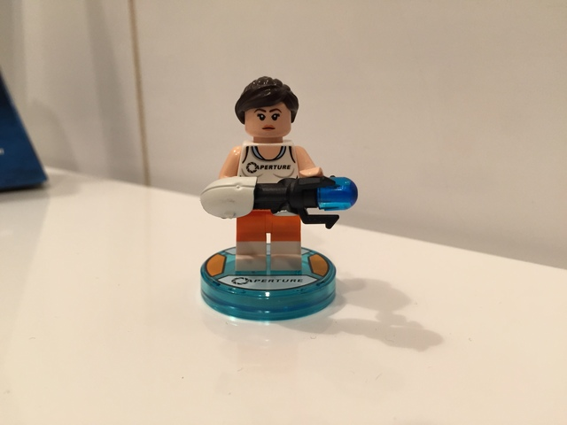](https://www.freelug.org/IMG/jpg/Portal2_05.jpg)

_Chell_ sans le _Portal Gun_, ce qui nous permet de voir la sérigraphie du torso arborant le logo d’_Aperture_. Les jambes non sérigraphiées, profitent quand même de la bi-injection de matière.

[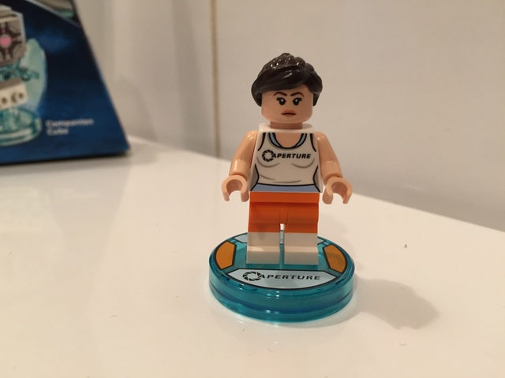](https://www.freelug.org/IMG/jpg/Portal2_02.jpg)

Le dos du torso lui aussi joliment sérigraphié et le visage alternatif de _Chell_.

[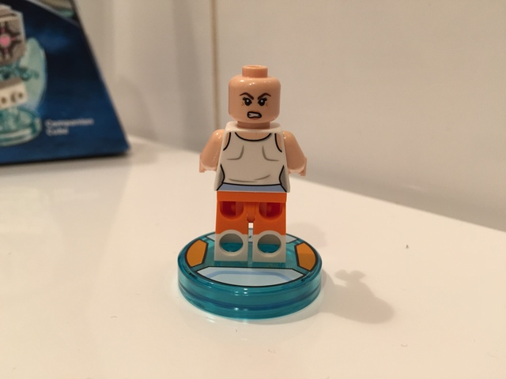](https://www.freelug.org/IMG/jpg/Portal2_03.jpg)

Gros plan sur le _Portal Gun_ moulé d’une seule pièce dans un plastique un peu mou (très galère à faire prendre en main aux minifigures).

[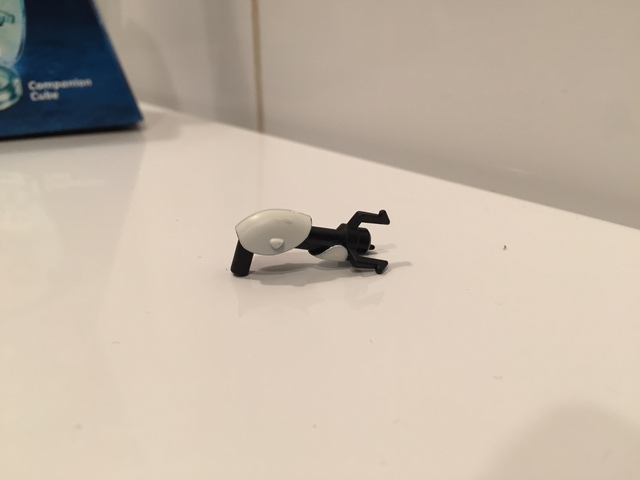](https://www.freelug.org/IMG/jpg/Portal2_04.jpg)

Voici les trois versions de construction de chaque modèle.

[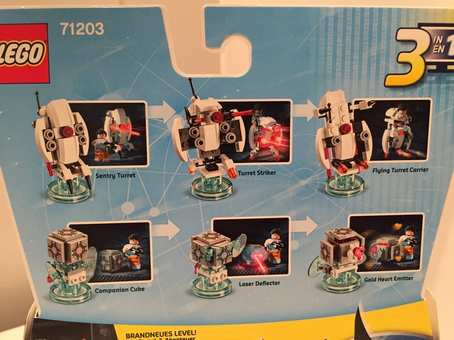](https://www.freelug.org/IMG/jpg/Portal2_06.jpg)

On commence par monter le _Companion Cube_.

[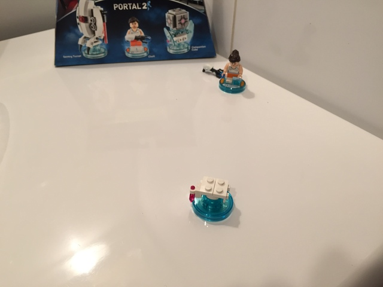](https://www.freelug.org/IMG/jpg/Portal2_08.jpg)

Une fois le socle fini, on s’attaque aux parois internes du cube.

[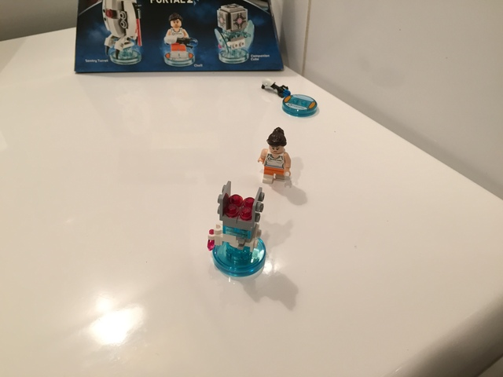](https://www.freelug.org/IMG/jpg/Portal2_10.jpg)

Les parois sont en place.

[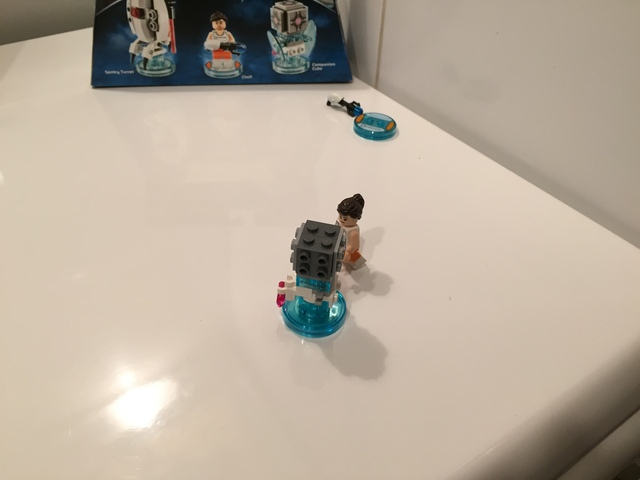](https://www.freelug.org/IMG/jpg/Portal2_11.jpg)

On finalise le cube avec les parois externes, au passage on voit les tiles 2x2 magnifiquement sérigraphiées.

[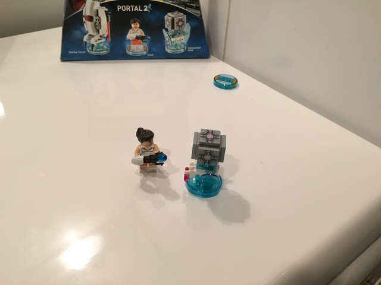](https://www.freelug.org/IMG/jpg/Portal2_12.jpg)

Au tour de la _Sentry Turret_.

[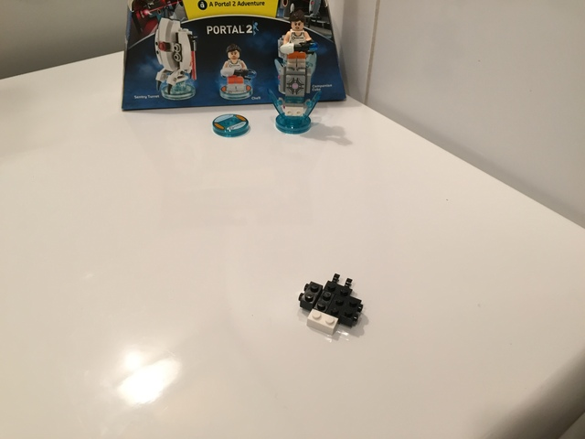](https://www.freelug.org/IMG/jpg/Portal2_13.jpg)

On installe la barre qui permettra de fixer la célèbre tourelle à son socle RFID.

[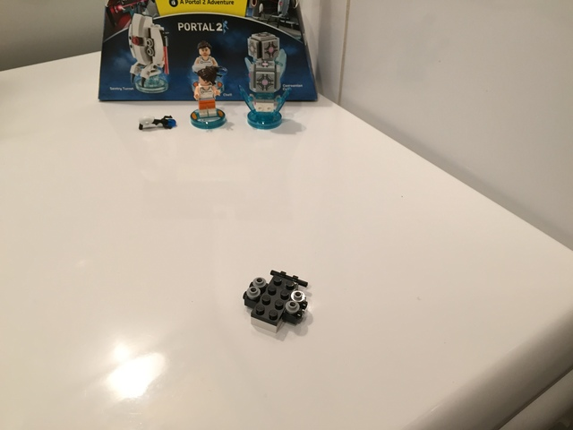](https://www.freelug.org/IMG/jpg/Portal2_15.jpg)

La carcasse commence à prendre forme.

[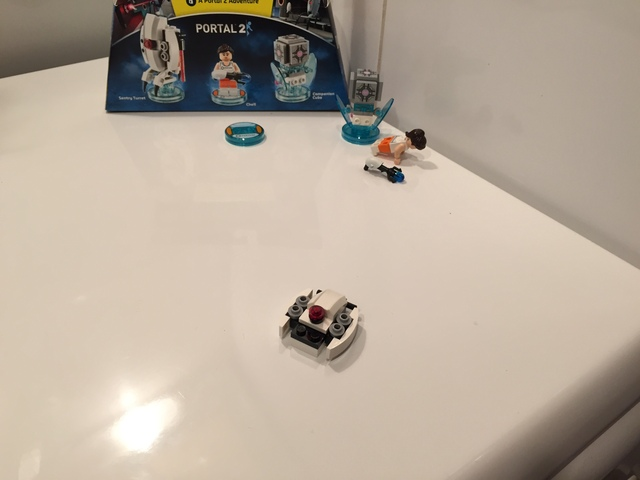](https://www.freelug.org/IMG/jpg/Portal2_16.jpg)

Les pieds avant sont en place.

[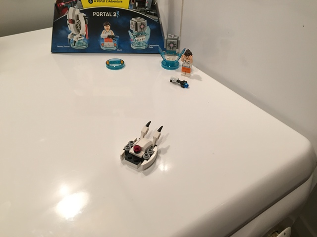](https://www.freelug.org/IMG/jpg/Portal2_17.jpg)

On passe à l’arrière de la tourelle.

[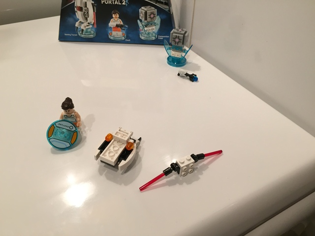](https://www.freelug.org/IMG/jpg/Portal2_18.jpg)

Le troisième pied est maintenant installé.

[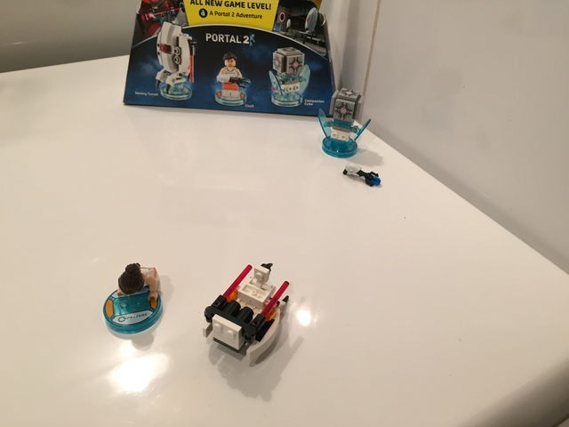](https://www.freelug.org/IMG/jpg/Portal2_19.jpg)

La tourelle enfin sur son socle.

[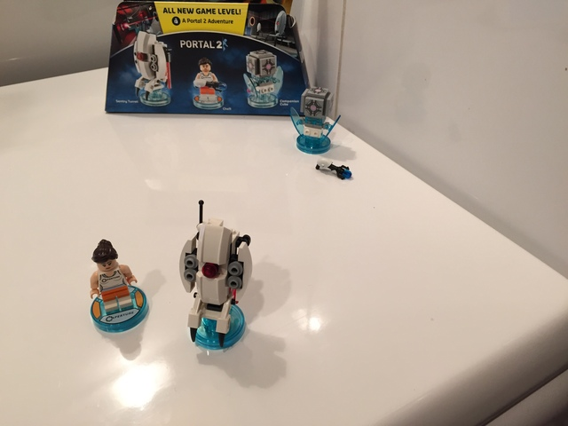](https://www.freelug.org/IMG/jpg/Portal2_20.jpg)

Voilà les trois modèles du set.

[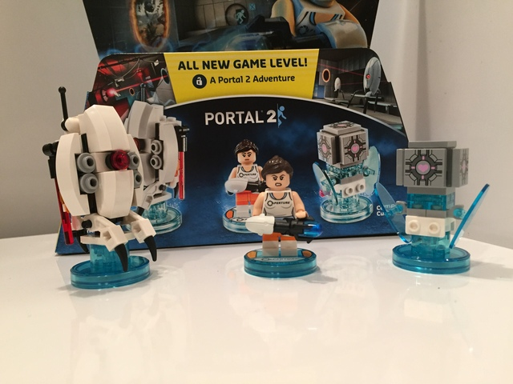](https://www.freelug.org/IMG/jpg/Portal2_21.jpg)

**Avis :**

Soyons franc, sans avoir le jeu, l’achat de ce pack ne peux être qu’un coup de cœur pour la fig de _Chell_, et il faut l’avouer, pour la tourelle et le cube qui ont un très bon rendu final.

Malgré un prix un peu élevé, je suis content de posséder la minifigure exclusive d’un jeu vidéo que j’adore.

_Bonus :_

Voici un GIF animé réalisé avec les nombreuses photos prises pour cette review.

