Aujourd’hui je vous propose la review du set 75088 dans la gamme _Star Wars_ : **Senate Commando Troopers**.

Ce set sorti en 2015 au prix de 16,99 € est composé de 106 pièces, soit un ratio prix/pièce de 16 centimes d’€.

Il fait partie de ce qu’on appelle communément un _Battle Pack_, c’est à dire un petit set avec quatre minifigures et quelques pièces qui permettent de faire un petit modèle (un véhicule le plus souvent).

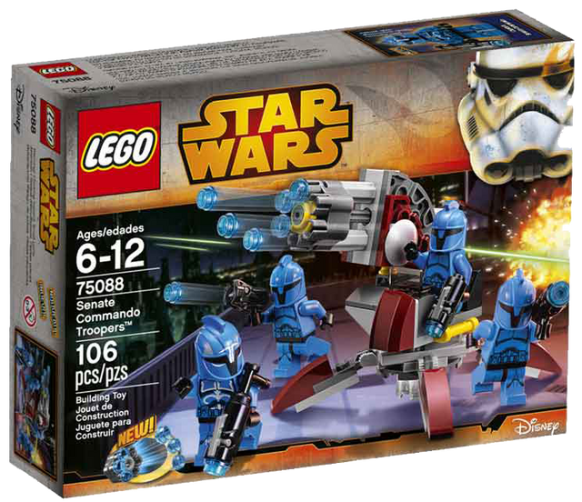

Le set contient deux sachets de briques et une notice de construction.

[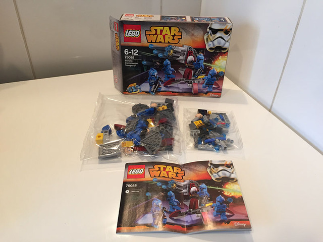](https://www.freelug.org/IMG/jpg/SCT_01_mini.jpg)

Sur les quatre figs présentent dans la boîte, trois sont des _Senate Commando_. Torsos imprimés recto/verso, jambes imprimées recto et trois mêmes visages grimaçants. Les casques sont bien réalisés.

[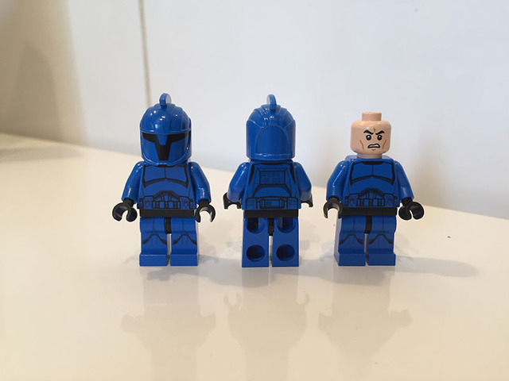](https://www.freelug.org/IMG/jpg/SCT_02_mini.jpg)

La quatrième minifig est un _Senate Commando Captain_, il s’agit de la même figurine agrémentée de sérigraphies blanches du plus bel effet au niveau du casque, torso (recto) et jambes.

[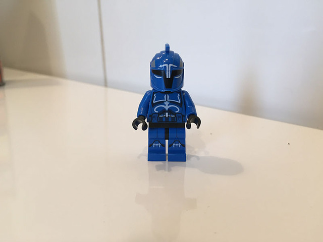](https://www.freelug.org/IMG/jpg/SCT_03_mini.jpg)

Pour le différencier des troupes, LEGO a opté pour un visage à l’expression différente.

[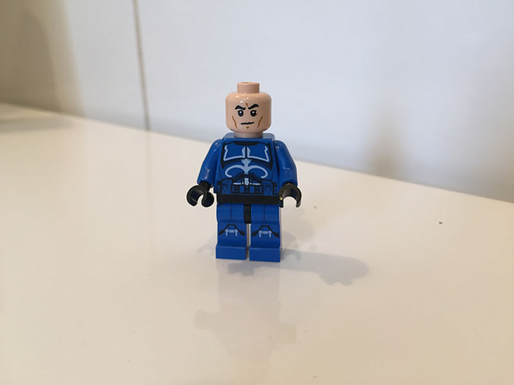](https://www.freelug.org/IMG/jpg/SCT_04_mini.jpg)

De dos, rien ne différencie le _Senate Commando Captain_ des _Senate Commando_ "classiques".

[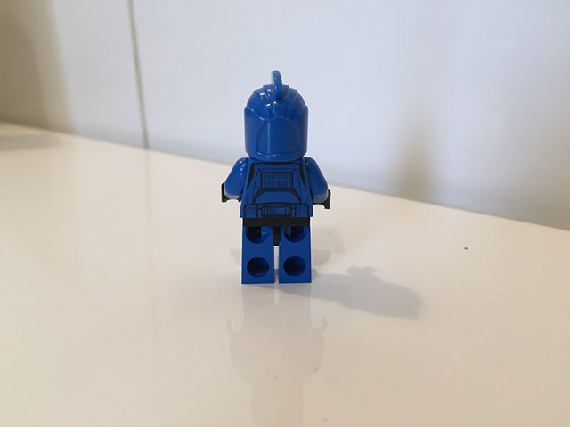](https://www.freelug.org/IMG/jpg/SCT_05_mini.jpg)

On commence la construction de la base de la plateforme du canon Gatling.

[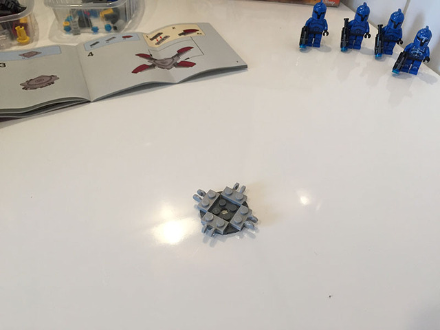](https://www.freelug.org/IMG/jpg/SCT_06_mini.jpg)

Construction des quatre pieds.

[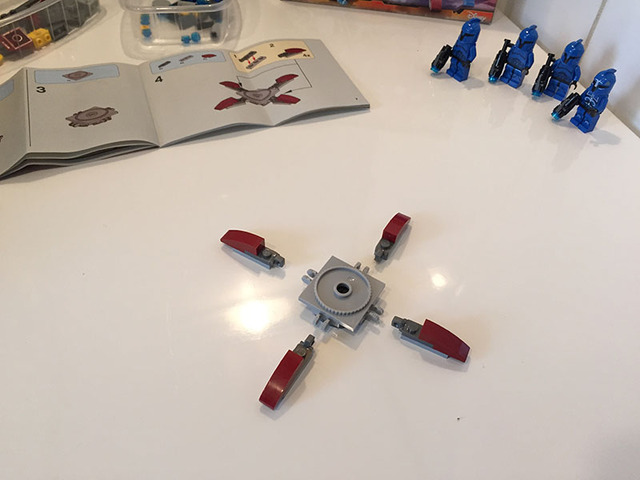](https://www.freelug.org/IMG/jpg/SCT_07_mini.jpg)

Un petit socle transparent pour bien maintenir la plateforme.

[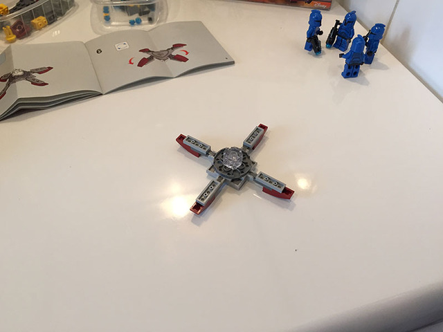](https://www.freelug.org/IMG/jpg/SCT_08_mini.jpg)

La base finie, on commence la plateforme.

[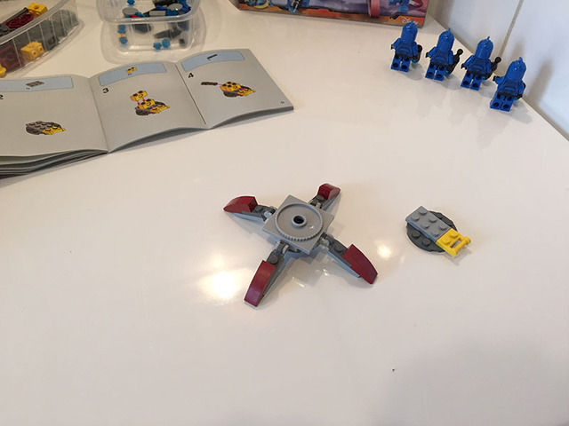](https://www.freelug.org/IMG/jpg/SCT_09_mini.jpg)

Pose de l’axe qui permettra de faire pivoter la Gatling.

[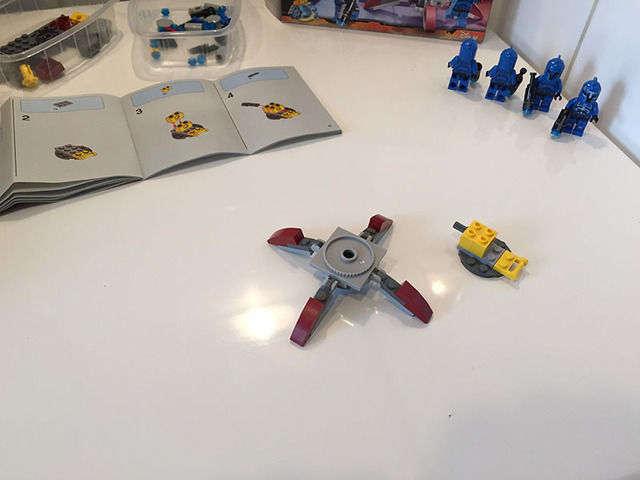](https://www.freelug.org/IMG/jpg/SCT_10_mini.jpg)

On ajoute de l’habillage.

[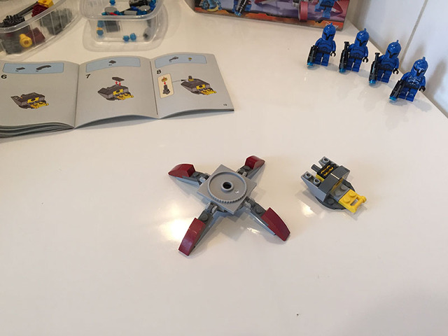](https://www.freelug.org/IMG/jpg/SCT_11_mini.jpg)

Le mât où sera posée la Gatling.

[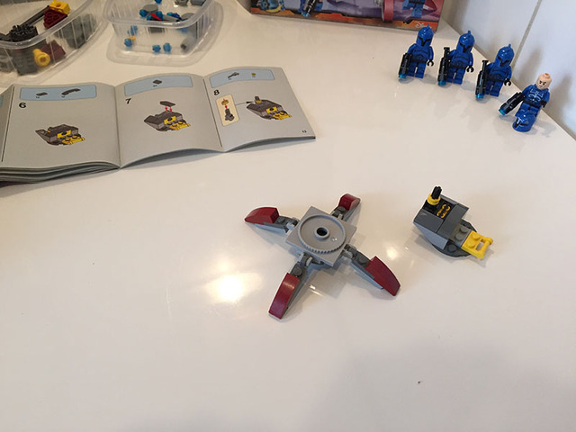](https://www.freelug.org/IMG/jpg/SCT_12_mini.jpg)

On commence la construction du poste de tir.

[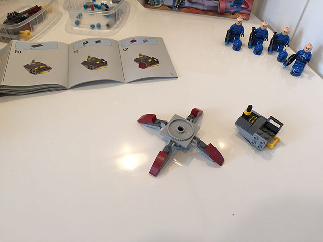](https://www.freelug.org/IMG/jpg/SCT_13_mini.jpg)

Le poste de tir et la plateforme sont maintenant posés sur la base. On commence la construction de la Gatling.

[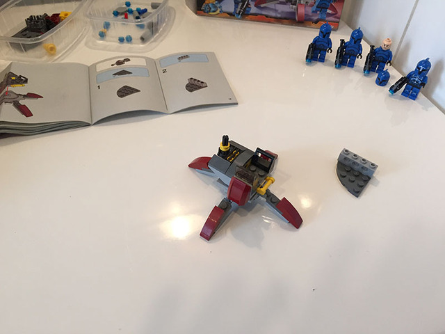](https://www.freelug.org/IMG/jpg/SCT_14_mini.jpg)

Les deux barres Technic, qui font office de fûts de canons, où sera fixé le barillet.

[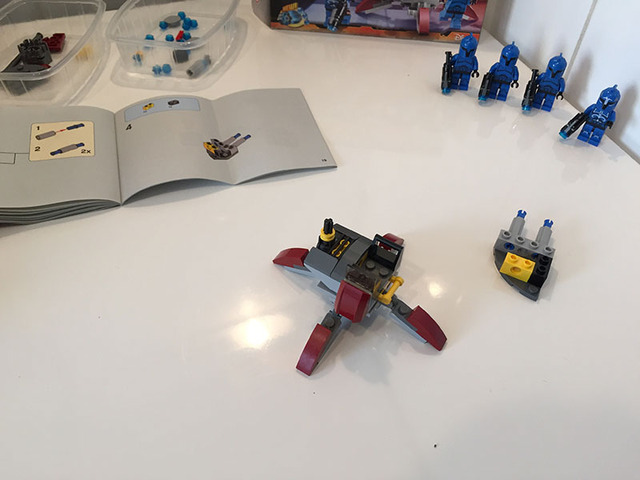](https://www.freelug.org/IMG/jpg/SCT_15_mini.jpg)

Le barillet est maintenant en place.

[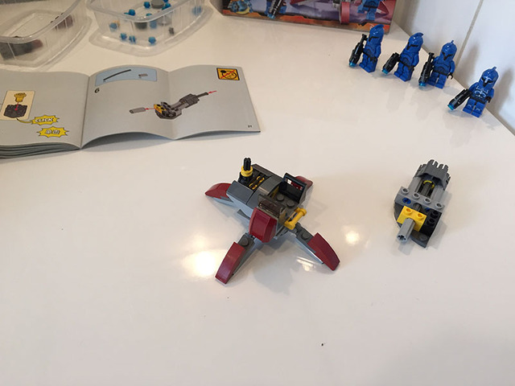](https://www.freelug.org/IMG/jpg/SCT_16_mini.jpg)

On habille un peu d’un côté...

[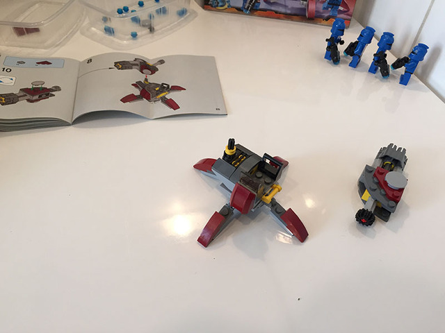](https://www.freelug.org/IMG/jpg/SCT_17_mini.jpg)

puis de l’autre.

[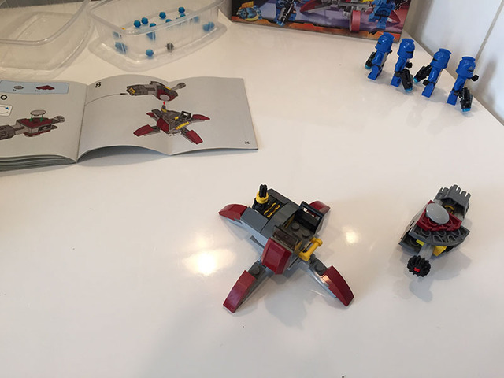](https://www.freelug.org/IMG/jpg/SCT_18_mini.jpg)

La Gatling est opérationnelle.

[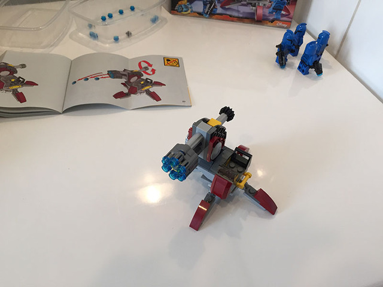](https://www.freelug.org/IMG/jpg/SCT_19_mini.jpg)

Voici le set avec les minifigures.

[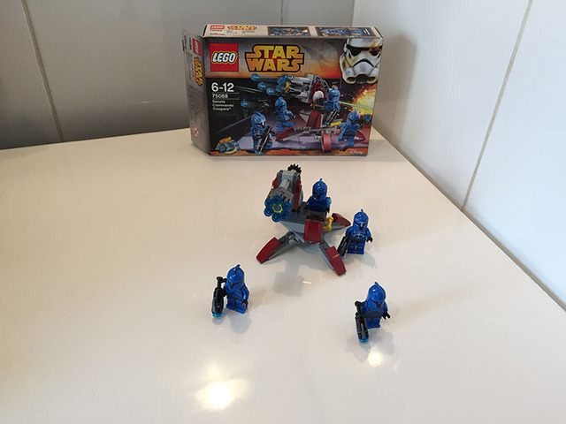](https://www.freelug.org/IMG/jpg/SCT_20_mini.jpg)

**Avis :**

Comme d’habitude avec les _Battle Packs_, celui-ci est pauvre en pièces, quoiqu’au final le rendu n’en fait pas le pire de ce genre de set.

Mais soyons réalistes, ces boîtes sont faites avant tout pour les quatre minifigures qu’elles contiennent à chaque fois.

_Bonus :_

Voici un GIF animé réalisé avec les nombreuses photos prises pour cette review.

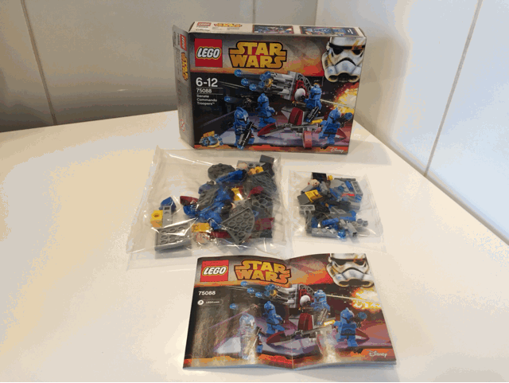
