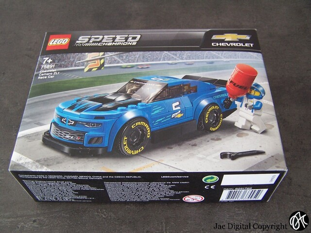
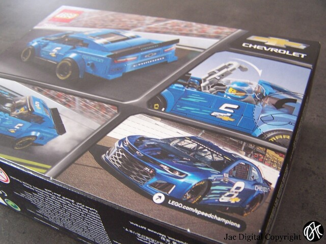
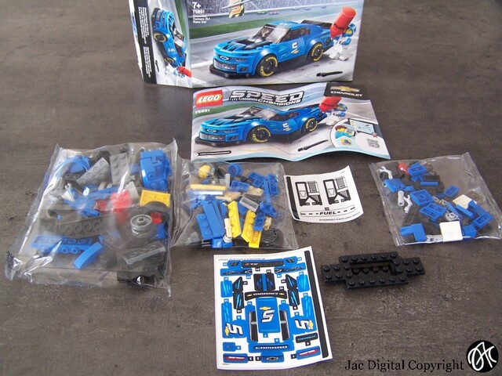
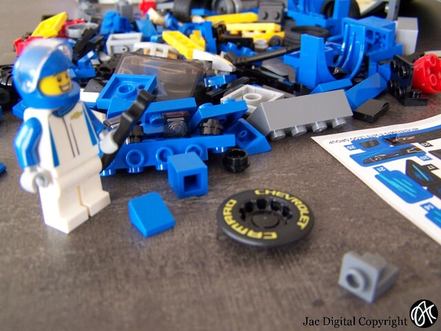
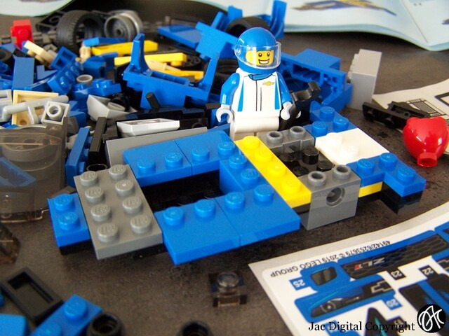
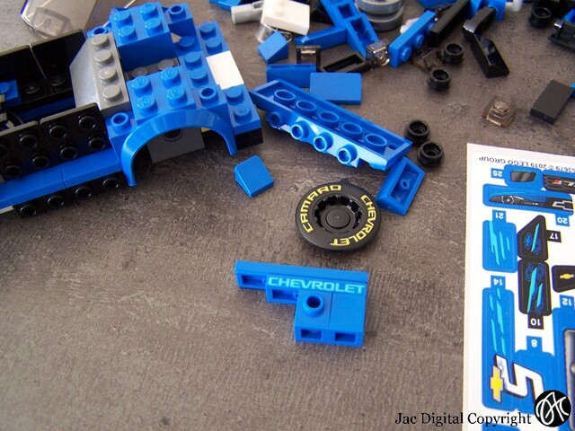
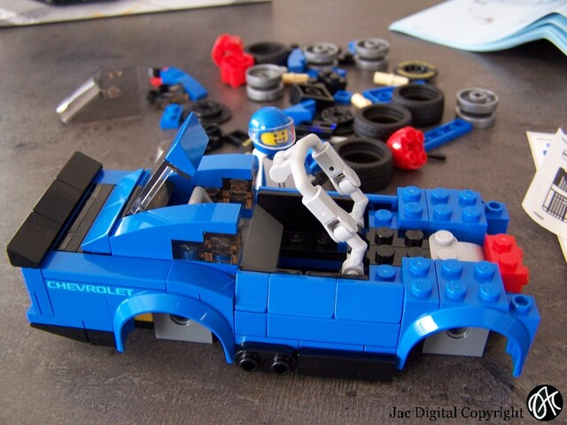
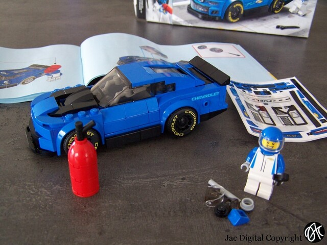
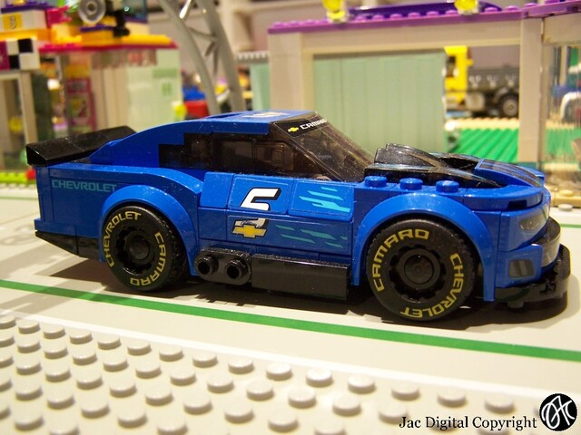
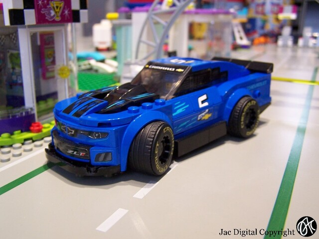

Chevrolet prépare des "Camaros" spéciales pour les courses de stock cars aux Etats-Unis. Encore une belle voiture reproduite dans cette gamme.

Les courses de stock car aux Etats Unis, ce n’est pas la même chose qu’en France. Ici, les courses ont lieu sur de la terre avec des voitures très simplifiées. Mais là bas, c’est sur un circuit très simple comme un anneau, que l’on va faire concourir les pilotes à des vitesses phénoménales. Il y a beaucoup de concurrents, il y a toujours un risque de carambolage. Je me souviens de ces courses avec Tom Cruise dans _Jours de tonnerre_ et puis il y a eu les dessins animés _Cars_. Mais c’est surtout le jeu _Daytona_ sur Saturn de SEGA qui m’a marqué.

**–** Disponibilité : elle fait partie des nouveautés début 2019. Elle est donc encore en vente à l’heure où j’écris cet article, au prix de 14,99€.  
**–** Nombre de pièces : 193  
**–** Nombre de minifigs : 1  
**–** Temps de montage : environ une demi-heure.

Les sets "Speed Champions sont montés assez vite. Le plus long étant de poser les autocollants.

Ce modèle est particulier, il comporte de beaux enjoliveurs de roues sérigraphiés. Ce n’est d’ailleurs pas les seules pièces déjà marquées dans cette boite.

Sur le devant de la boite, le pilote fait le plein aux stands. Ce n’est pas lui qui le fait normalement, mais ce n’est pas interdit pour nos minifigs.

Au dos, le modèle est présenté en course. C’est très bien fait. On a aussi une vue sur le principe de l’arceau, puis une belle photo du modèle réel. C’est ce que l’on trouve en général sur les boites de cette collection.

A l’ouverture de la boite, on découvre 3 sachets qui se répartissent les pièces suivant leur taille, la notice et deux planches d’autocollants. C’est grâce à ces boites que je me suis mis à les coller. Sans eux, le modèle est franchement fade. Vous trouverez la preuve plus loin. D’ailleurs, pour ce bolide il faut aussi se charger de décorer le pare brise et les vitres des portières. Pas de numéro sur les sachets, mais il n’y en a pas beaucoup.

On commence le montage par le pilote et sa clef qui permet de démonter les enjoliveurs de roues. Le torse est exclusif à cette boite. Le reste non, les jambes blanches et le casque sont assez courants.

J’ai aussi mis sur cette photo un des superbes enjoliveurs et une pièce que je n’ai pas encore dans mon stock. C’est une découverte 2019.

Je les appelle enjoliveurs, mais en fait c’est une pièce qui permet de marquer le flan du pneu et en même temps de représenter la jante. Donc, c’est largement plus que ça.

On passe au montage de la voiture. C’est un assemblage de pièces parfois un peu (trop) colorées mais bien dissimulées, sauf pour les faces avant, arrières et pour les portes, souvent en SNOT. Le pilote s’impatiente, mais hé ho, une demi heure, ce n’est pas non plus si long que ça !

Les quelques pièces sérigraphiées, au moins celles-là ne seront pas de travers. Je n’ai pas réussi à mettre tout les autocollants d’aplomb, malheureusement. Mais dans l’ensemble, c’est cohérent. D’ailleurs, c’est pas toujours facile de faire correspondre les dessins qui prennent plusieurs pièces.

Mise en place de l’arceau. Notre minifig est bien protégée. Il faudra bien l’aider à s’installer aux commandes du bolide ! Ca passe, mais il n’y a pas la place pour beaucoup d’autres choses. En même temps, c’est une voiture de course.

Prochaine étape, mise en place des autocollants. Comme vous le voyez, sans eux, ça manque de ressemblance...

Voilà une photo de ma stock car terminée. Elle est prête à prendre sa place dans le peloton. Pour l’instant elle est seule, mais rien n’empêche d’en créer d’autres sur le même principe.

Il reste les quelques petites pièces habituelles, à la fin du montage.

Voilà ma version finale avec les trains de roues élargis. Ca rajoute une stabilité supplémentaire je trouve à la voiture de course et ça me rappelle certains bolides du jeu _Daytona_. Une photo en plein drift juste pour impressionner un peu !

En conclusion, on reste sur une construction Speed Champion, assez vite assemblée et très jouable, comme une vraie voiture. C’est simple et solide. On est encore envahi d’autocollants, il faut s’y coller ! L’arceau est bien prévu, il reste bien en place et se relève pour sortir la minifig. On ne fait pas le plein à chaque instant, si, ah bon.

[Toutes les photos](https://photos.freelug.org/main.php/v/JAC/review/SpeedChampion/75891/)
