Voici la revue du set 76053 dans la gamme DC comics : Gotham City Cycle Chase (La poursuite en moto de Gotham City). Il est sorti en 2016 au prix de 26,99 euros pour 224 pièces. Soit un ratio de 12,0 centimes par pièce avec 3 minifigs

La boite montre une poursuite entre Batman et Harley Quinn en moto ainsi que Deadshot.

[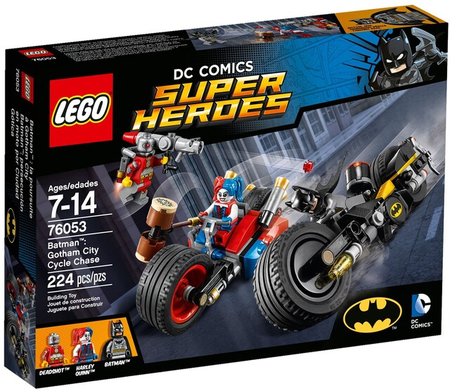](https://www.freelug.org/IMG/jpg/76053_alt1.jpg)

Dans la boîte on trouve 2 livrets, 2 sachets et une planche d’autocollants.

[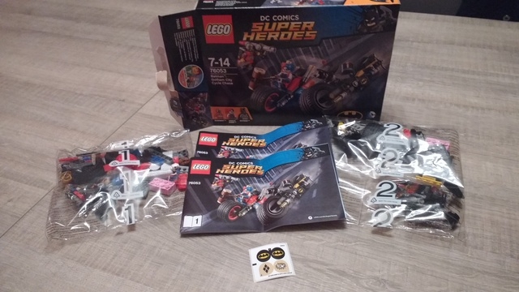](https://www.freelug.org/IMG/jpg/IMG_20160924_240531800.jpg)

Voici les minifigs

[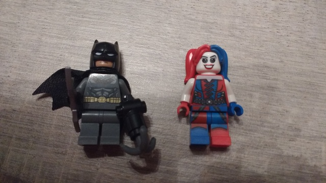](https://www.freelug.org/IMG/jpg/IMG_20160924_240807027.jpg)

[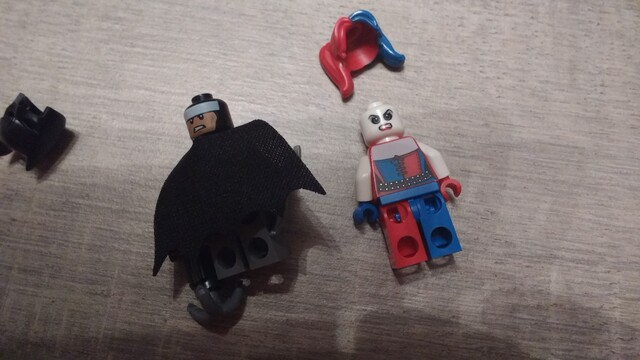](https://www.freelug.org/IMG/jpg/IMG_20160924_240821442.jpg)

[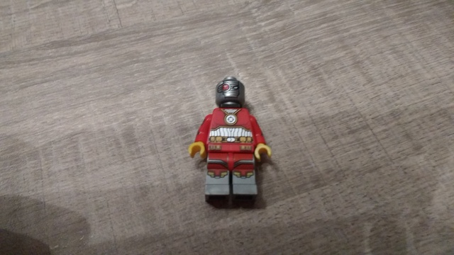](https://www.freelug.org/IMG/jpg/IMG_20160924_242151078.jpg)

On retrouve Deadshot avec ses accessoires

[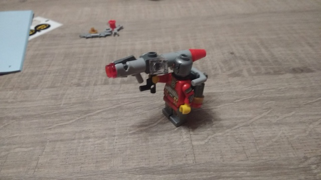](https://www.freelug.org/IMG/jpg/IMG_20160924_242539239.jpg)

Les motos sont montées surbaissées

[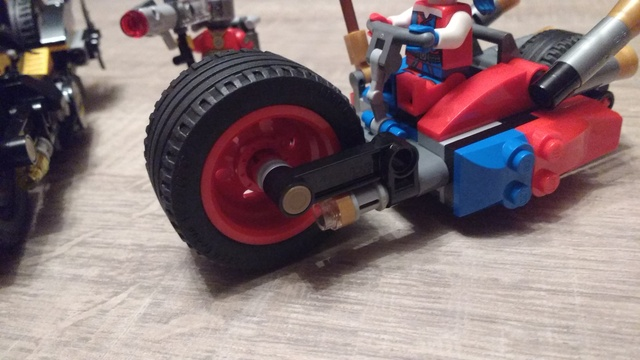](https://www.freelug.org/IMG/jpg/IMG_20160924_243942827.jpg)

Les échappements sur la moto de Harley Quinn

[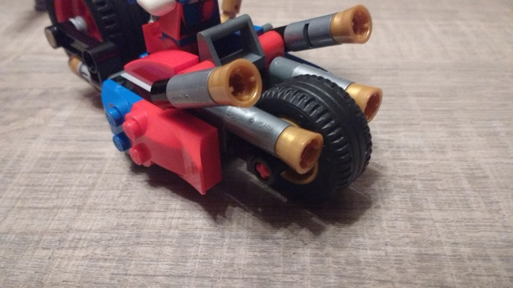](https://www.freelug.org/IMG/jpg/IMG_20160924_243951925.jpg)

Le montage de la moto de Batman

[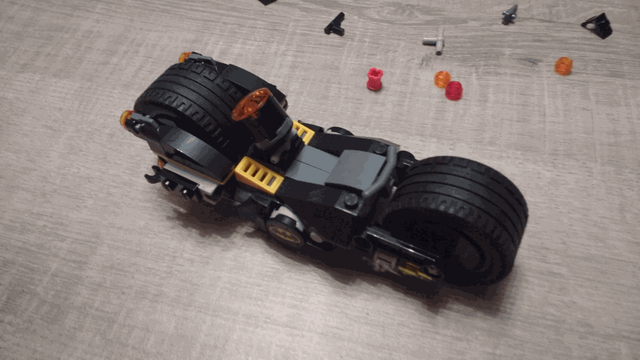](https://www.freelug.org/IMG/gif/Batman.gif)

Celui de HarleyQuinn

[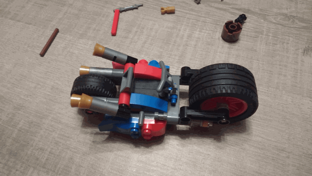](https://www.freelug.org/IMG/gif/harleyQuinn.gif)

Voici l’ensemble monté

[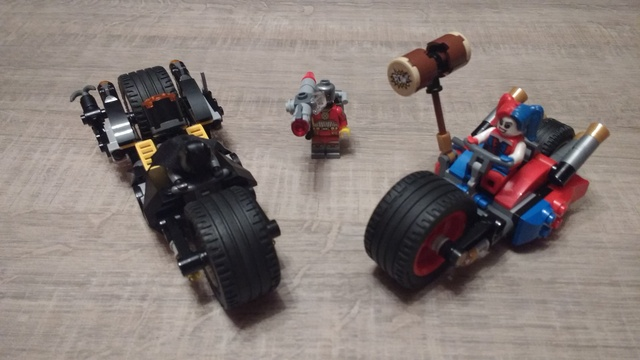](https://www.freelug.org/IMG/jpg/IMG_20160924_243930620.jpg)

Et pas mal de pièces additionnelles à la fin

[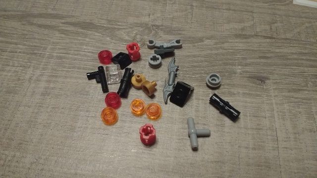](https://www.freelug.org/IMG/jpg/IMG_20160924_243907683.jpg)
