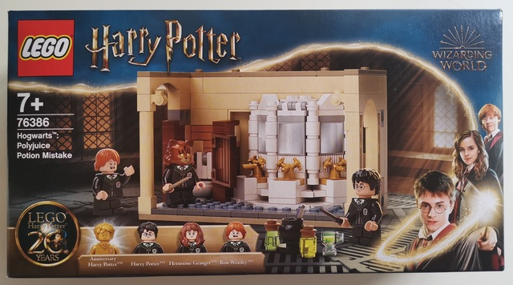
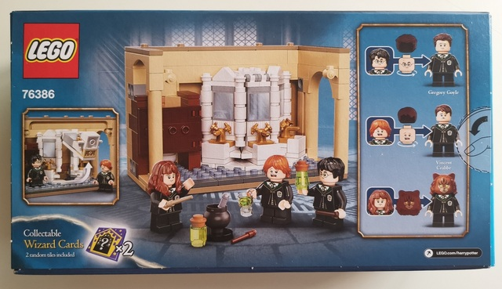
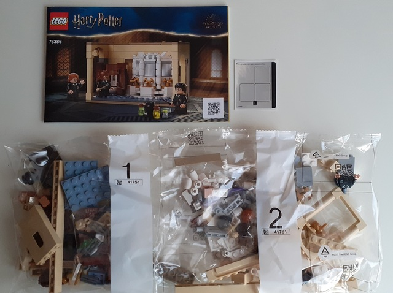
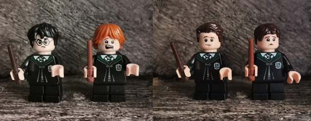
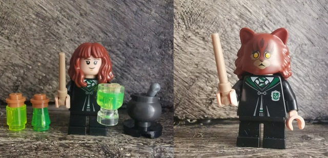
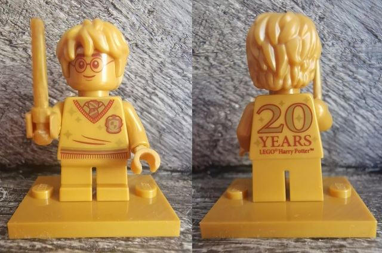
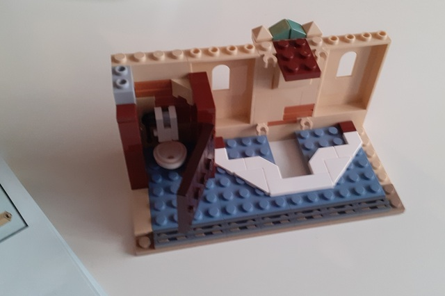
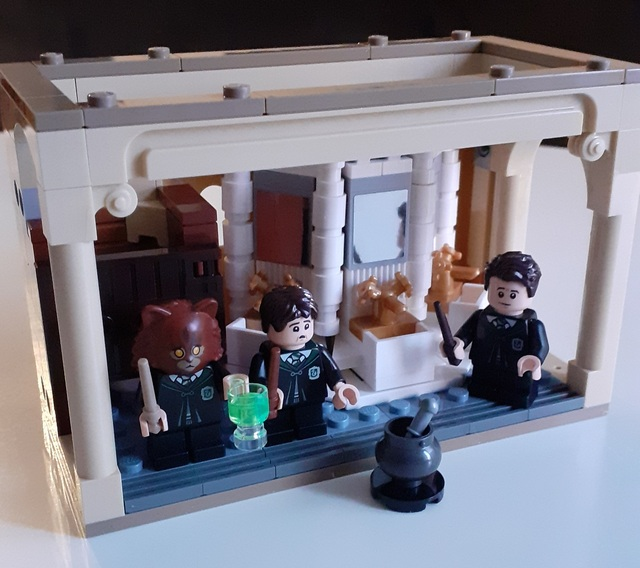
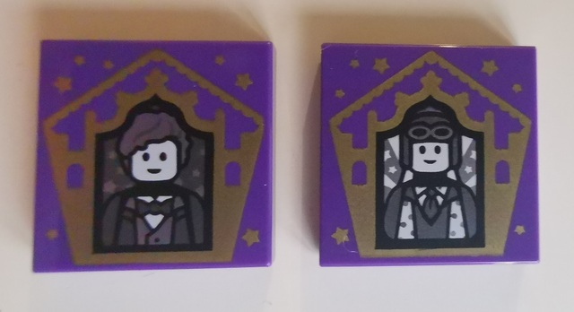

Cette boite permet de reconstituer une scène tirée du livre _Harry Potter et la Chambre des Secrets_ lorsque Hermione prépare une potion de polynectar pour permettre aux trois héros de la saga de s’introduire chez Serpentard.

**Résumé :**  
**–** nom : _Poudlard : l’erreur de la potion Polynectar_  
**–** nombre de pièces : 217  
**–** nombre de minifigs : 4  
**–** prix : 19,99 €  
**–** sortie : juin 2021

## La boite

Classiquement, le recto de la boite présente le modèle et la liste des figurines présentes.

Au dos, la seule fonctionnalité de la construction, l’ouverture des lavabos, est illustrée dans un encart. Également, est présentée la transformation des trois personnages grâce au polynectar.  
En bas, on découvre que la boite contient 2 cartes sorciers, mention qui n’apparait pas sur la face.  
Enfin, notons que le modèle n’est pas présenté complet, il manque une brique 1x14 qui sert de poutre mais qui peut gêner à la jouabilité.

Côté contenu, les briques sont réparties entre 2 sachets, et on trouve une planche d’autocollants "miroir".

## Les minifigs

La boite contient 3 minifigs "jeu" et une minifig spécial anniversaire 20 ans de la gamme Harry Potter.

Les 3 personnages sont les 3 héros du film, Harry Potter, Hermione Granger et Ron Weasley. Les trois portent une tenue Serpentard puisqu’ils s’apprêtent à se faire passer pour des écoliers de cette maison pour soutirer des informations.

Harry et Ron portent respectivement en visage alternatif de leur tête ceux de Gregory Goyle et Vincent Crabbe, avec les coiffes correspondantes.

Hermione vient avec une coiffe alternative en tête de chat, correspondant à l’erreur de potion de polynectar, lorsqu’elle utilise un poil de chat alors qu’elle croit utiliser un cheveu de Millicent Bulstrode.

En accessoire, on trouve les classiques baguettes magiques, mais également une coupe contenant le nectar, le chaudron dans lequel Hermione le prépare et deux fioles.

Côté célébration de la gamme, cette boite contient Harry Potter, en version dorée, avec socle et baguette. Au dos, le logo spécial anniversaire.

## Le montage

Le sachet numéro un permet d’assembler le fond du décor et la cabine des toilettes dans laquelle Hermione se cache de honte après sa transformation.

Le sachet numéro deux permet d’assembler les lavabos, dont une partie s’ouvre pour laisser accès à une trappe, qui lorsqu’on assemble les différentes boites permet d’accéder à la Chambre des Secrets.

La brique 1x14 avec rainure [^1] est optionnelle : on l’enlève si on veut simplement jouer pour avoir accès aux éléments, on l’ajoute si on installe un autre module par dessus.

## Les cartes de sorciers

Autre nouveauté de cette gamme anniversaire, l’apparition de cartes de sorciers à collectionner. Il s’agit de tiles 2x2 violettes. Au nombre total de 16, cette boite en contient 2. Celles-ci sont réparties aléatoirement dans les boites, donc même en achetant la gamme complète, rien ne garantit de toutes les obtenir. Cela annonce quelques échanges entre collectionneurs à venir. On mettra un système au sein de FreeLUG pour faciliter l’échange entre adhérents.  
Pour ma part, la boite contenait Newt Scamander et Jocunda Sykes.

## Conclusion

On retrouve les éléments de la scène dans cette boite, et le fait d’avoir les personnages dans leurs différentes versions est un plus. Cela permet aussi d’avoir 2 des personnages de la maison Serpentard qu’on a rarement l’occasion d’avoir dans d’autres boites.

Cependant, lorsqu’on pense aux toilettes des filles qui donnent accès à la Chambre des Secrets, on pense plutôt spontanément au personnage de Mimi Geignarde qui hante les lieux. On pourrait alors regretter son absence, dans cette boite ou dans les autres.

[^1]: Cette pièce n’a été disponible qu’une seule fois en couleur tan dans la boite [NinjaGo 70596](https://brickset.com/sets/70596-1/Samurai-X-Cave-Chaos) sortie en 2016
