La "Koenigsegg Jesko" fait partie des nouveautés de 2021. Elle est en 8 tenons de large, comme toute la gamme depuis 2020.

Ce bolide profilé fait partie de la gamme du constructeur suédois. Je vous avoue que je ne le connaissais pas, avant que notre marque de brique préférée décide de reproduire la Jesko. Vous trouverez des informations la concernant sur internet, sur [wikipédia](https://fr.wikipedia.org/wiki/Koenigsegg_Jesko) entre autre. Pour ma part, je vais plutôt me consacrer à l’analyse de son montage.

Avant de passer à l’assemblage de cette voiture de sport, voilà tout d’abord quelques informations :

-   Année de sortie 2021 ;
-   Prix 19,99 €, sur le Shop, à l’heure où j’écris ces lignes ;
-   2 sachets numérotés plus les enjoliveurs ;
-   275 pièces et une minifig ;
-   Temps de montage environ 1h.

La boite vue de devant, avec une belle photo qui nous présente la voiture en pleine vitesse.

[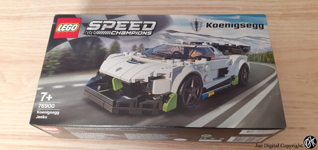](https://www.freelug.org/IMG/jpg/photo_1_-10.jpg)

Au dos, nous avons trois vues supplémentaires. Avec la photo arrière, on a l’impression que la voiture est passée. Une belle image de la voiture réelle, pour pouvoir comparer avec la reproduction en briques. Une photo détaillée de l’avant permet de se rendre compte de l’utilisation particulière du hachoir vert. Pour s’en resservir il faudra démonter la voiture, il n’y en a qu’un dans les sachets.

[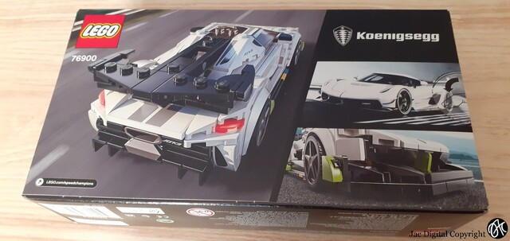](https://www.freelug.org/IMG/jpg/photo_2_-10.jpg)

A l’ouverture de la boite, on découvre 3 sachets (l’un d’eux contient les enjoliveurs), la notice et une belle planche d’autocollants.

[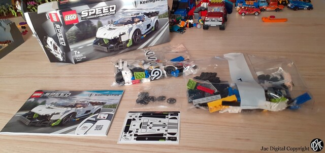](https://www.freelug.org/IMG/jpg/photo_3_-9.jpg)

Avec le contenu du premier sachet, on va pouvoir construire la minifig, le châssis et l’arrière de la voiture.

[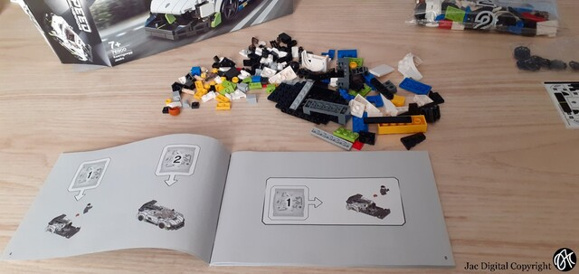](https://www.freelug.org/IMG/jpg/photo_4_-8.jpg)

Voilà deux pièces que je ne connaissais pas. Enfin, du moins, je ne les avais pas encore dans mon stock. Pour la "bracket" (76394) avec 2 tenons vers le haut, c’est normal, elle est très récente. Elle va être bien pratique. Le "slope inverted" 1X4 (32802) est un peu moins récent, mais tout autant utilisé dans les nouveaux sets.

[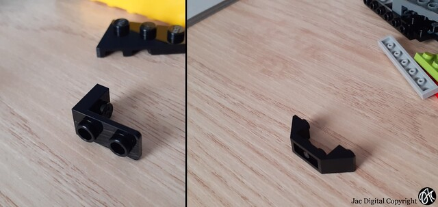](https://www.freelug.org/IMG/jpg/photo_5-6_.jpg)

Le corps de la minifig est spécifique à cette boite, puisqu’il porte la marque de la voiture. Le devant et le dos sont détaillés, sauf pour les jambes qui sont décorées seulement d’un côté. La tête, qui n’est pas exclusive, est bien sympa, avec la petite marque sous le menton.

[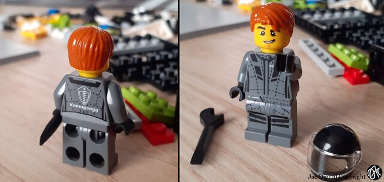](https://www.freelug.org/IMG/jpg/photo_7-8_.jpg)

La minifig est montée. Pour assembler la voiture, on commence par une étape très simple. Il faut juste trouver la métapièce "châssis", dans le premier lot de pièces. Ce n’est pas la chose la plus difficile de cette boite.

[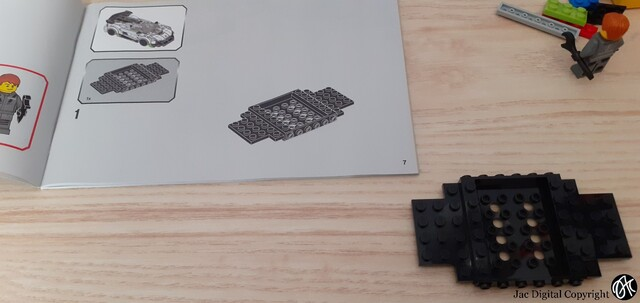](https://www.freelug.org/IMG/jpg/photo_9_-8.jpg)

Non non, monsieur le pilote, il ne s’agit pas du moteur et la clef fournie ne sert pas à ça. Cette pièce est là pour représenter l’échappement. Le rendu est excellent d’ailleurs, une fois la voiture terminée. Pour ce qui est du V8 qui anime ce bolide, il faudra vous en passer. Car comme dans tous les sets "speed champions", certaines parties sont un empilage de briques simples.

[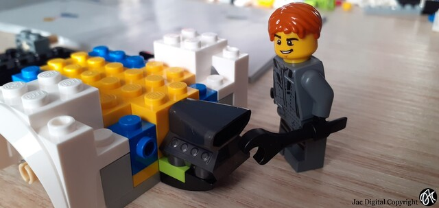](https://www.freelug.org/IMG/jpg/photo_11_-8.jpg)

Petite déception, j’aurais pensé que les feux arrière étaient transparents, c’est dommage.

[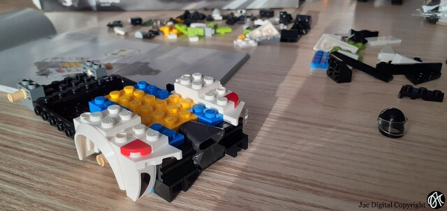](https://www.freelug.org/IMG/jpg/photo_12_-4.jpg)

Heureusement, certaines toutes petites pièces sont sérigraphiées. Ici il s’agit du nom de la voiture. Il est inscrit sur le coté d’une plate 1X1. Comme pour le logo Ferrari pour la F40, ça simplifie grandement les choses. Par contre, attention de ne pas mettre cette pièce par mégarde à un autre endroit. Même s’il y a eu qu’une fois besoin de cette pièce, vous risquez de devoir recommencer votre construction. Par chance, ces pièces là sont toujours en double au cas où.

[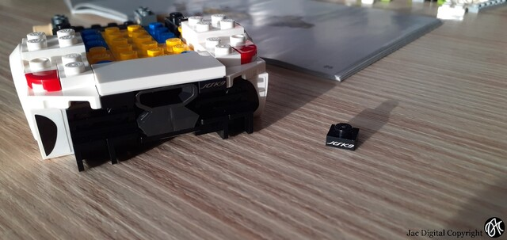](https://www.freelug.org/IMG/jpg/photo_13_-7.jpg)

Voilà une des parties les plus difficiles pour moi, coller les autocollants correctement. Je préfère y mettre un peu de temps même si ça rallonge le temps de montage. Je me suis servi d’une grande pince à épiler ! Ici, la planche est conséquente mais ce n’est pas la plus grande de la collection.

[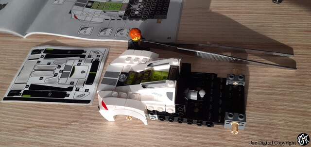](https://www.freelug.org/IMG/jpg/photo_15_-7.jpg)

Le deuxième sachet va nous permettre de terminer la construction de la voiture. Il reste encore des autocollants à placer avec précautions si on veut que les lignes se suivent. On remarque avec bonheur que le pare brise est tampographié.

[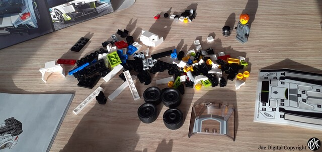](https://www.freelug.org/IMG/jpg/photo_17_-3.jpg)

Grosse déception, finies les roues en deux parties que l’on pouvait modifier, remodeler selon ses gouts. C’est maintenant une métapièce, avec bande de roulement lisse. C’est bien dommage. Heureusement, sur Bricklink on peut trouver la roue complète pour 0,50€/pièce environ.

[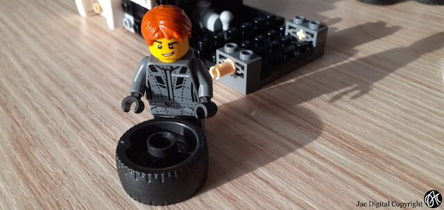](https://www.freelug.org/IMG/jpg/photo_18_-4.jpg)

Il est temps de mettre en place la partie avant particulière de cette voiture de sport. La petite hache verte prend place astucieusement sous la calandre. Le montage est invisible lorsque la voiture est terminée.

[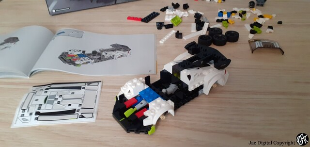](https://www.freelug.org/IMG/jpg/photo_20_-2.jpg)

Dernière phase de mise en place des stickers. Je ne les mettais pas avant, de peur de les mettre en travers et aussi pour pouvoir réutiliser les pièces librement ensuite. Mais c’est vrai que avec, c’est plus joli. Même mieux, certains marquages servent aussi pour des MOCs.

[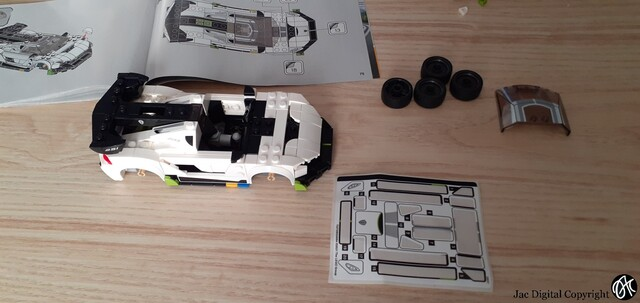](https://www.freelug.org/IMG/jpg/photo_21_-4.jpg)

Le pilote impatient m’aide à mettre en place la dernière pièce. Chose agréable, il peut tenir aux commandes du bolide avec ses cheveux, pas obligé de mettre le casque.

[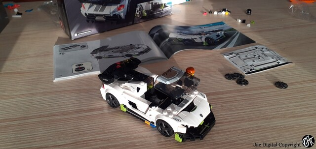](https://www.freelug.org/IMG/jpg/photo_22_.jpg)

Il reste un beau lot de pièces en extra à la fin et je n’en ai pas oublié, j’ai vérifié...

[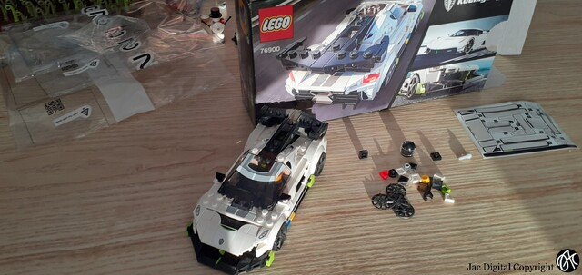](https://www.freelug.org/IMG/jpg/photo_25_-4.jpg)

Une belle vue pour le plaisir !

[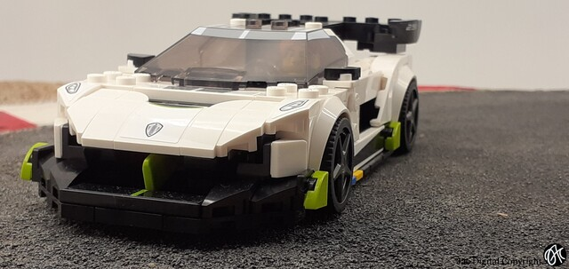](https://www.freelug.org/IMG/jpg/photo_27_-6.jpg)

Une très belle voiture au final, profilée et qui reproduit au mieux la version réelle. A part quelques détails dû au fait que ce sont des briques LEGO, c’est plaisant à admirer. Je vais encore me plaindre pour les roues en un seul bloc et pas assez larges à mon gout. C’est dommage.

Toutes les photos dans ma galerie :  
[https://photos.freelug.org/index.ph...](https://photos.freelug.org/index.php/JAC/review/SpeedChampion/76900)
