Lego avait le choix entre plusieurs teinte. Ca aurait été pas mal en blanc aussi. Mais il y avait déjà la Countach cette même année.

Cette fois, on parle de Lotus, la petite marque anglaise qui s’est fait connaitre avec la belle LOTUS Esprit dans Moonwalker. D’ailleurs, j’ai connu la voiture avant de voir le film...

Pas mal d’année sépare L’Evija de l’Esprit. Du coup, les lignes sont beaucoup plus ronde et douce. C’est plus difficile à reproduire en brique, mais pas impossible, surtout avec quelques nouvelles pièces.

Les informations principales :  
Année de sortie 2022 ;  
Prix 19,99 €, sur le Shop, à l’heure où j’écris cet article ;  
2 sachets numérotés plus les enjoliveurs ;  
242 pièces et une minifig ;Retour ligne automatique  
Temps de montage environ 1h.

**La boite et son contenue**

On est au format Speed Champion avec une vue principale de la voiture en pleine action. Son nom est bien visible sur cette face.

[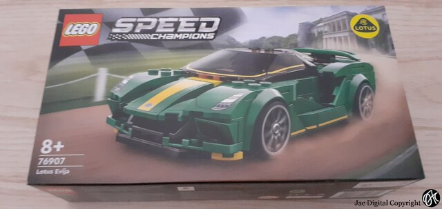](https://www.freelug.org/IMG/jpg/20230105_143611.jpg)

Au dos de la boite, quelques photos version LEGO pour se donner une idée et toujours une vue de la vrai voiture. Car elle existe vraiment et elle a servie de modèle.

[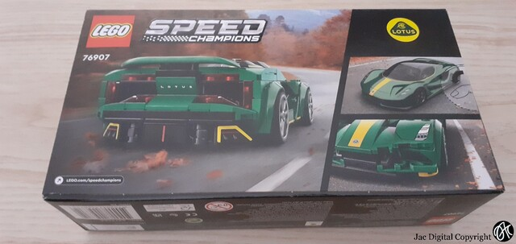](https://www.freelug.org/IMG/jpg/20230105_143623.jpg)

J’aime bien les détails avec le logo de la marque.

[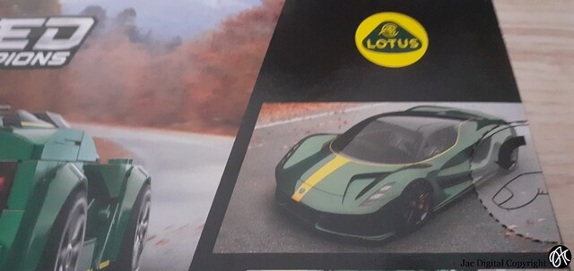](https://www.freelug.org/IMG/jpg/20230105_143631.jpg)

Dans la boite, on a nos 2 sachets habituel, plus un pour les enjoliveurs. Le châssis est libre dans la boite avec la notice et une belle planche d’autocollants. Il y a du travail de précision en vue.

[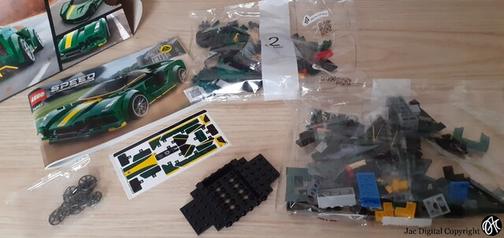](https://www.freelug.org/IMG/jpg/20230105_144234.jpg)

**Le montage**

Dans les grands sachets on trouve d’autres plus petits contenant les petites pièces. C’est pratique, ça permet de séparer un peu. On découvre en même temps les nouvelles pièces et un cockpit tampographié magnifique. Enfin, de mon point de vue.

[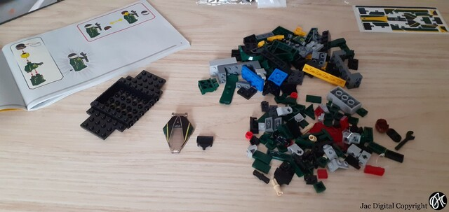](https://www.freelug.org/IMG/jpg/20230105_144459_0_.jpg)

On commence par assembler le pilote, c’est bien utile.

[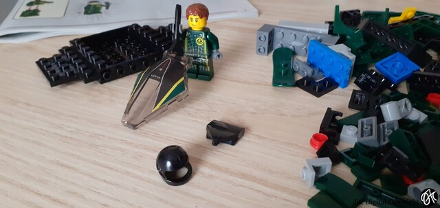](https://www.freelug.org/IMG/jpg/20230105_144647.jpg)

Mince, je n’avais pas repéré toutes les nouvelles pièces...

[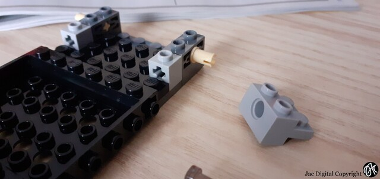](https://www.freelug.org/IMG/jpg/20230105_144914.jpg)

Première pose d’autocollant réussie.

[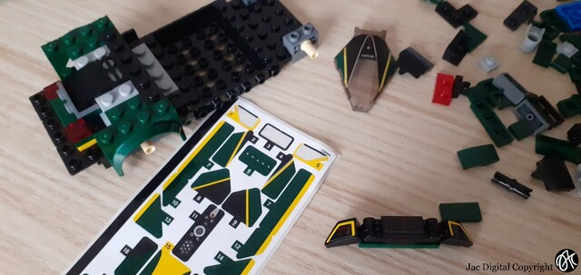](https://www.freelug.org/IMG/jpg/20230105_150109.jpg)

Là, il y en a beaucoup plus. Mais la notice est très claire, ça évite les erreurs.

[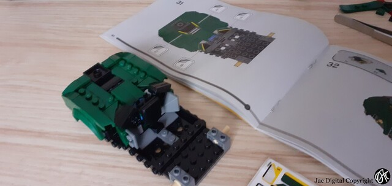](https://www.freelug.org/IMG/jpg/20230105_151608.jpg)

Fin de la première partie. Voilà l’inconvénient de monter la minifig du pilote en premier, il est pressé de s’installer au commande. Même s’il n’y a pas de siège ! Quelques petites pièces en plus au cas où on les perd.

[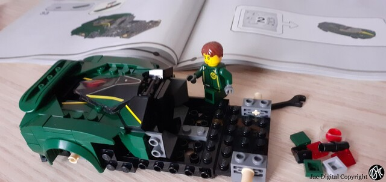](https://www.freelug.org/IMG/jpg/20230105_152001.jpg)

Le deuxième sachet est ouvert. On est prêt pour la partie finale du montage.

[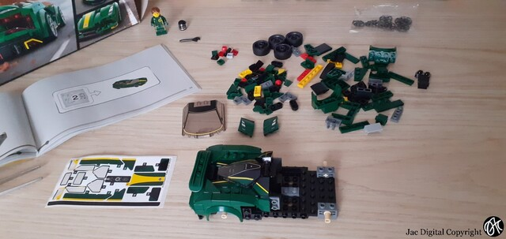](https://www.freelug.org/IMG/jpg/20230105_152306.jpg)

Le montage du capot avant est bien pensé. On a l’effet plongeant très réussi.

[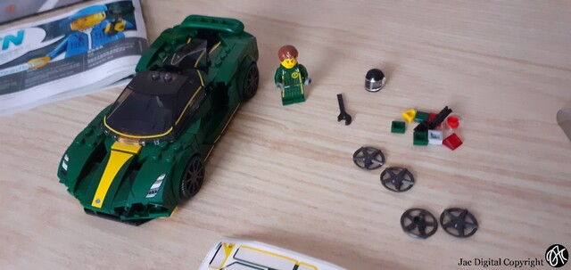](https://www.freelug.org/IMG/jpg/20230105_154604.jpg)

Avec la vitre du cockpit imprimée on a vraiment un super effet.

[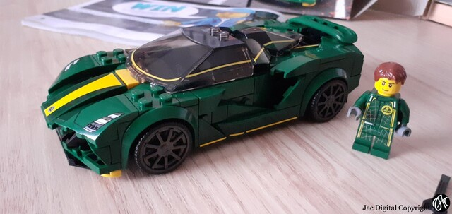](https://www.freelug.org/IMG/jpg/20230105_154614.jpg)

**La conclusion**

La ligne de cette nouvelle Lotus est vraiment réussi, même en brique LEGO. Mais comment parler de briques avec toutes ces pièces arrondie ? En tout cas, ces montages avec des pièces dans tout les sens permettent de vraiment s’approcher des courbes réelles. La construction finale est magnifique. Il faut juste s’habituer aux nouvelles roues toutes montées, dommage !

[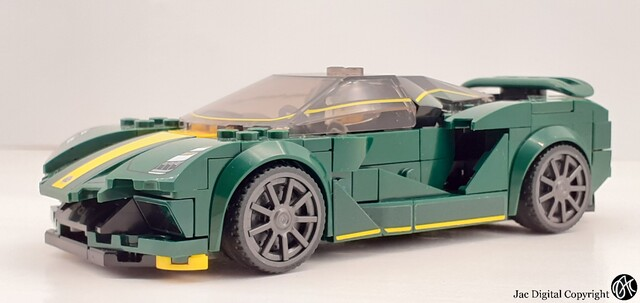](https://www.freelug.org/IMG/jpg/20230119_073514.jpg)
