Voici la revue du set 9398 dans la gamme Technic : Le 4x4 crawler. Il est sorti en 2012 au prix de 169,99 euros pour 1327 pièces. Soit un ratio de 12,8 centimes par pièce.

Je vous propose aujourd’hui la revue du 4x4 crawler 9398 sorti en 2012. J’en avais acheté deux et ouvert la deuxième boite pour le servomoteur et les moteurs (histoire de faire la version ultimate et SBrick de la grue MK2). Puis à l’occasion de la REF je monte mon deuxième en faisant la revue.

La boite montre le 4x4 en action avec la télécommande et dans la partie droite le détail des éléments Power Function : 1 servomoteur, 2 moteurs L, la télécommande, le boitier de piles et le récepteur IR.

Voici le détail de la partie transmission avec la direction (servomoteur en position centrale).

[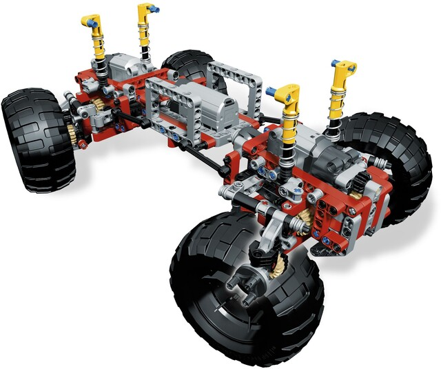](https://www.freelug.org/IMG/jpg/9398_alt2.jpg)

Le montage se fait en trois livrets, il y a une planche d’autocollants pour décorer le 4x4 et plusieurs sachets numérotés 1 pour le châssis ou 2 pour la carrosserie.

[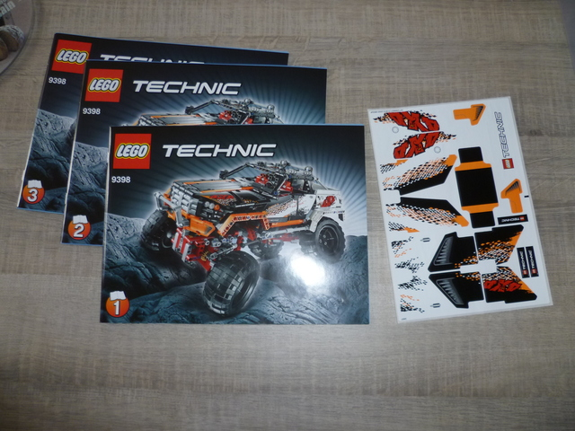](https://www.freelug.org/IMG/jpg/P1080403.jpg)

## Etape 1 : Le châssis

Voici les pièces,

[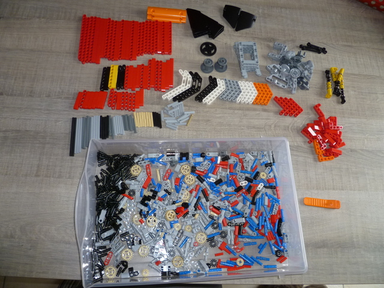](https://www.freelug.org/IMG/jpg/P1080404.jpg)

On commence par le montage du berceau avec le servomoteur.

[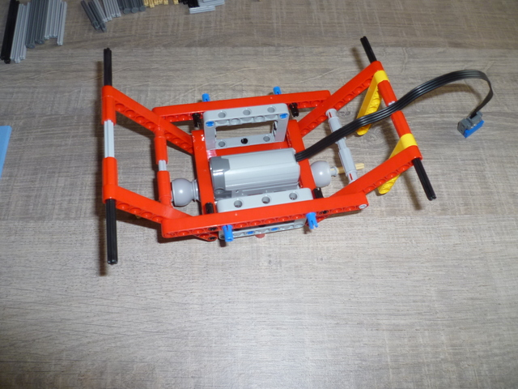](https://www.freelug.org/IMG/jpg/P1080418.jpg)

Après on attaque les deux blocs moteur ‘suspendus’, ils sont quasiment identiques à un détail près : la position du détrompeur pour le différentiel. Ce détrompeur permet d’être sûr que les moteurs iront dans le même sens. Dans le modèle ils sont faits l’un après l’autre. Moi je les ai faits en même temps.

[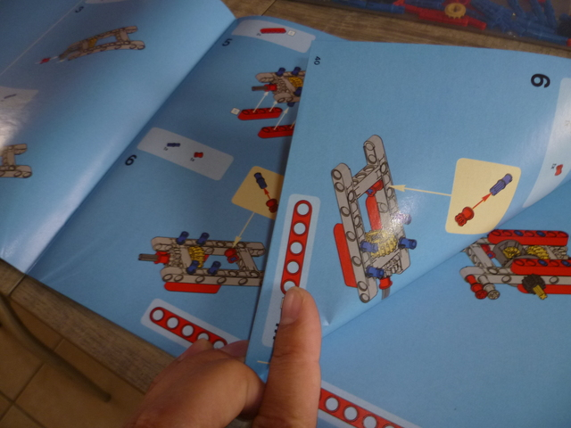](https://www.freelug.org/IMG/jpg/P1080423.jpg)

On se demande des fois à quoi servent certaines pièces comme cette pièce noire à cette position.

[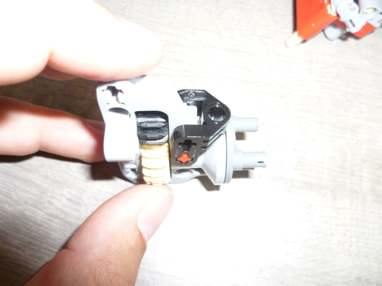](https://www.freelug.org/IMG/jpg/P1080433.jpg)

Puis on se rend compte qu’elle sert à éviter que l’axe qui passe dans l’engrenage noir sorte pendant le montage du cardan.

[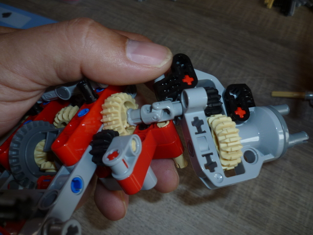](https://www.freelug.org/IMG/jpg/P1080437.jpg)

Certaines pièces sont là pour faciliter le montage et pour servir de détrompeur comme sur les blocs moteur (ce qui évite que les moteurs partent dans des sens opposés).

Il y a aussi toute une procédure pour le montage de la direction pour être sûr d’être bien droit. Ils utilisent les pièces pas encore utilisées pour maintenir les roues droites.

[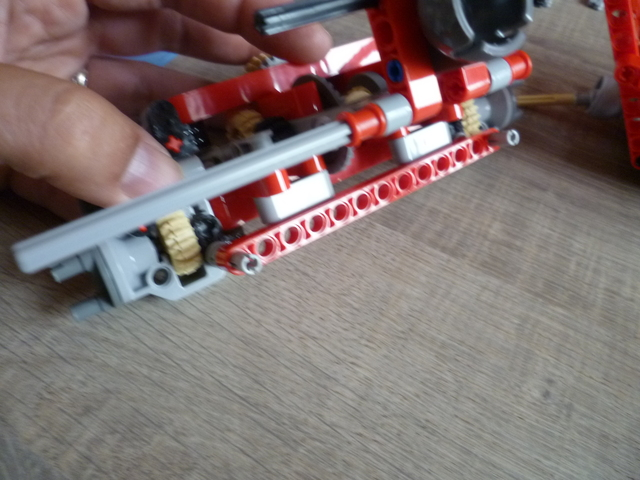](https://www.freelug.org/IMG/jpg/P1080440.jpg)

[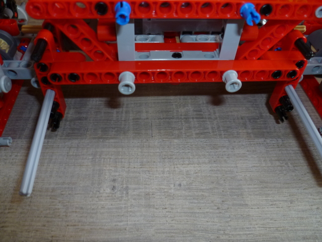](https://www.freelug.org/IMG/jpg/P1080442.jpg)

[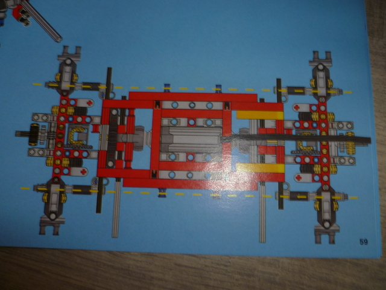](https://www.freelug.org/IMG/jpg/P1080445.jpg)

[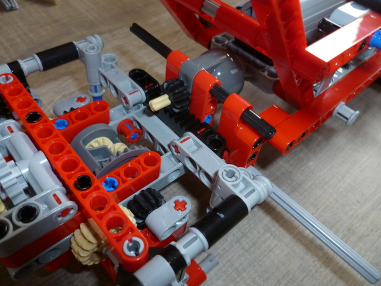](https://www.freelug.org/IMG/jpg/P1080446.jpg)

On peut faire sans en faisant attention à la position centrale de l’engrenage de direction lors de l’assemblage. Toutefois je le déconseille si on n’a pas l’habitude.

Voici le résultat à la fin du montage du châssis.

[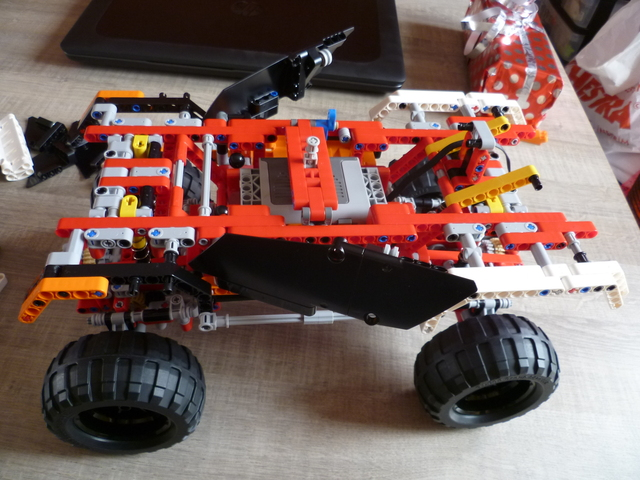](https://www.freelug.org/IMG/jpg/P1080480.jpg)

## Etape 2 : La carrosserie

Voici les pièces,

[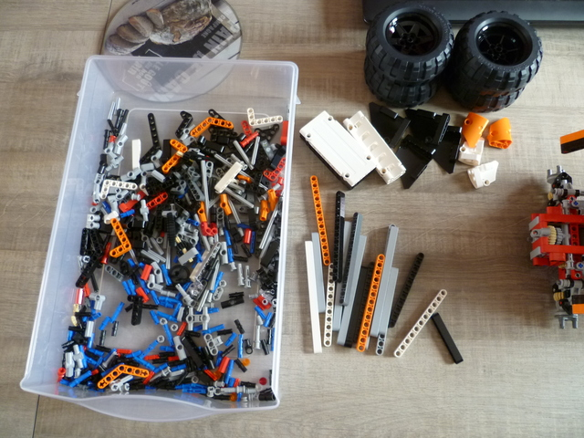](https://www.freelug.org/IMG/jpg/P1080479.jpg)

La carrosserie ne présente pas de particularités ni de difficultés de montage. On commence par la calandre,

[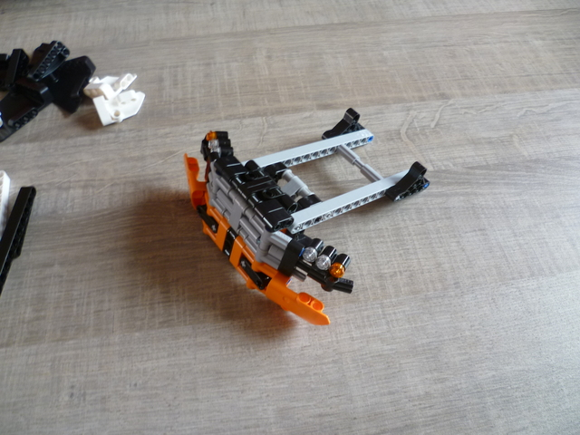](https://www.freelug.org/IMG/jpg/P1080494.jpg)

Puis on remonte vers l’habitacle,

[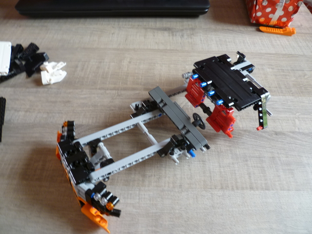](https://www.freelug.org/IMG/jpg/P1080506.jpg)

Ensuite on continue jusqu’à l’arrière,

[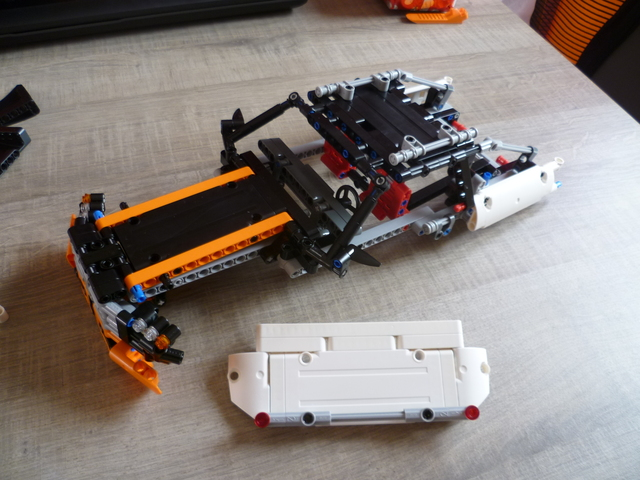](https://www.freelug.org/IMG/jpg/P1080520.jpg)

Et on finit le capot.

[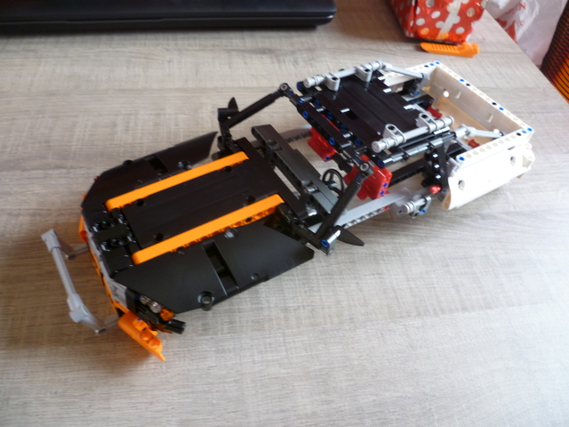](https://www.freelug.org/IMG/jpg/P1080523.jpg)

A la fin on assemble l’ensemble sur le châssis,

[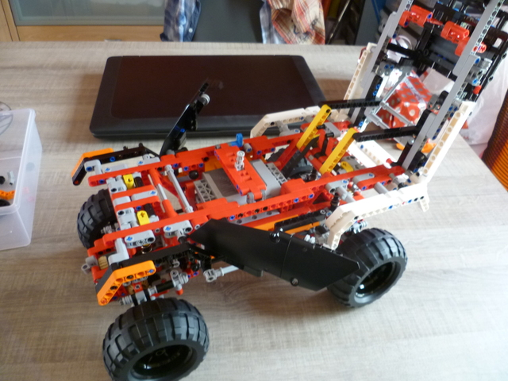](https://www.freelug.org/IMG/jpg/P1080524.jpg)

Le tout est articulé pour pouvoir changer les piles.

[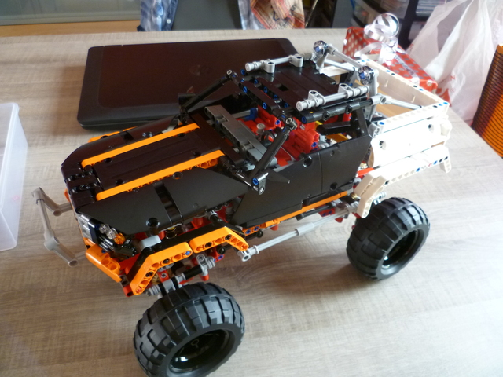](https://www.freelug.org/IMG/jpg/P1080527.jpg)

## Conclusions

Ce modèle reste lourd et lent. On peut toujours inverser des engrenages pour le rendre plus rapide, mais c’est au détriment de la capacité de franchissement. Les deux moteurs ont du mal lorsque les piles commencent à faiblir. Ce modèle reste très intéressant à monter et pour jouer avec. Si vous avez des duplo, rien de plus facile pour faire un parcours de franchissement.

Le seul petit bémol est la télécommande infrarouge qui ne permet pas de gradation, c’est tout ou rien. Toutefois, vu la vitesse du véhicule ce n’est pas bien grave.

## Modifications

**Changement de vitesse**

Voici les premières modifications faites sur le modèle pour pouvoir jouer rapidement sur la vitesse

[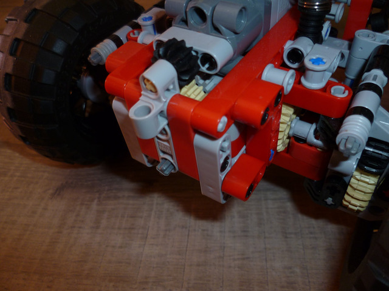](https://www.freelug.org/IMG/jpg/Copy_of_P1090138.jpg)

On retire les deux pièces rouges ‘Liftarm 1x2’ ainsi que les pièces de fixations noires et bleues qu’on ne remontera pas.

[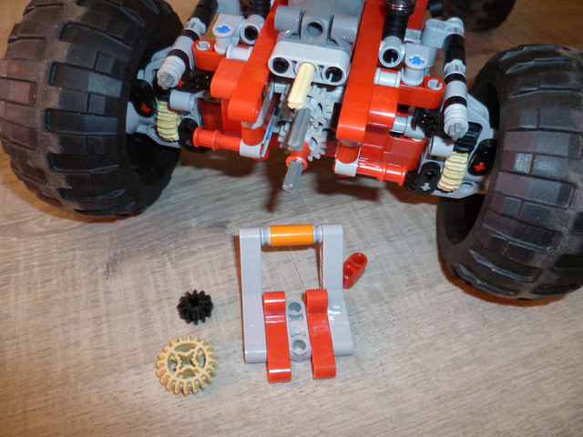](https://www.freelug.org/IMG/jpg/Copy_of_P1090136.jpg)

On sort l’axe de 5 pour accéder aux engrenages que l’on inverse.

[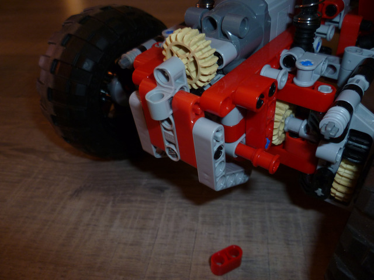](https://www.freelug.org/IMG/jpg/Copy_of_P1090135.jpg)

On remplace les pièces de maintien bleues par des rouges et l’axe de 5 par un axe de 5 mais avec une butée dans le but de pouvoir les tirer à la main.

[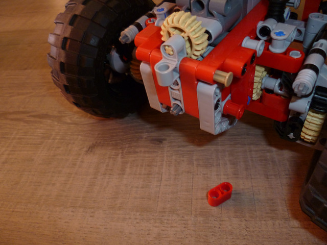](https://www.freelug.org/IMG/jpg/Copy_of_P1090134.jpg)

Et voilà, maintenant on peut faire passer de lent à rapide en moins de 5 minutes et facilement !

**Batterie rechargeable**

Changement du boitier à pile et remplacement par une batterie rechargeable.

[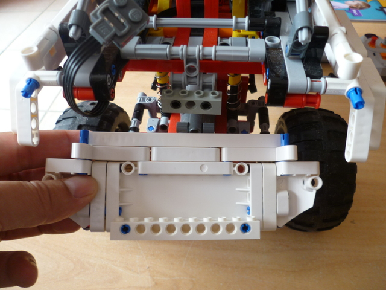](https://www.freelug.org/IMG/jpg/P1090193.jpg)

[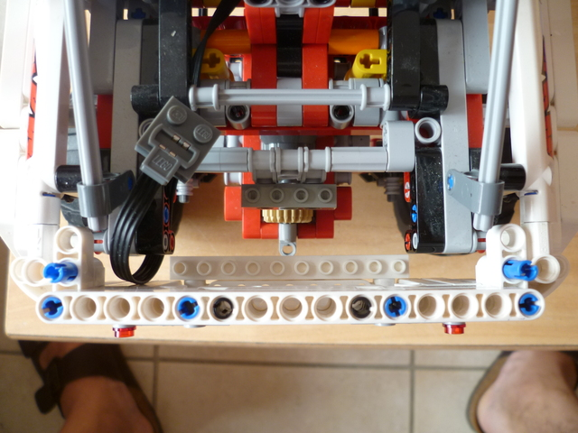](https://www.freelug.org/IMG/jpg/P1090194.jpg)

La position est la plus pratique pour accéder facilement au bouton ON et à la recharge.

[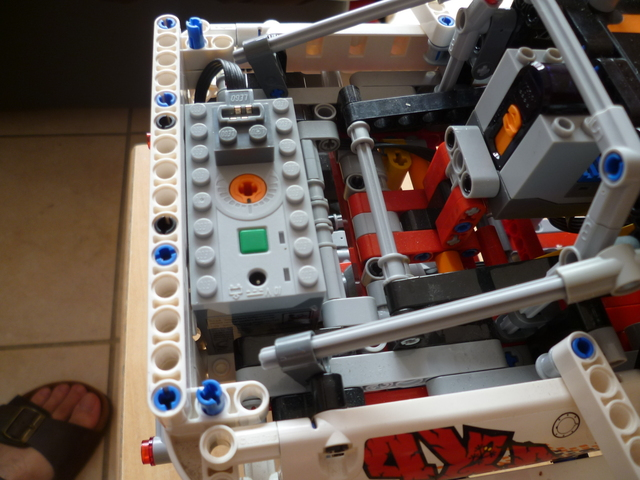](https://www.freelug.org/IMG/jpg/P1090195.jpg)

**Carrosserie**

Voici une carrosserie colorée pour bien différencier les deux 4x4.

[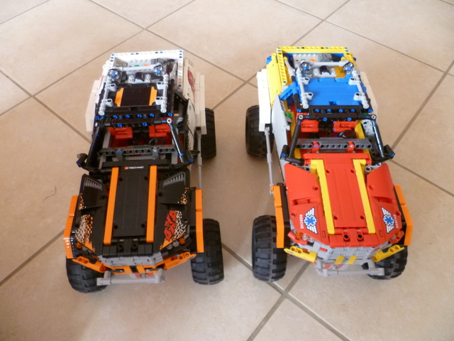](https://www.freelug.org/IMG/jpg/P1090196.jpg)

[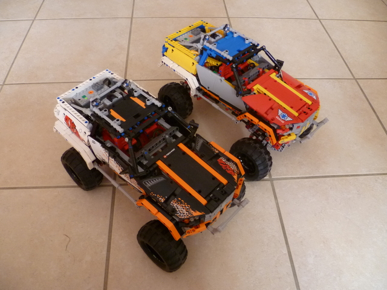](https://www.freelug.org/IMG/jpg/P1090198.jpg)

**Animations de montage** (Cliquez pour lancer l’animation)

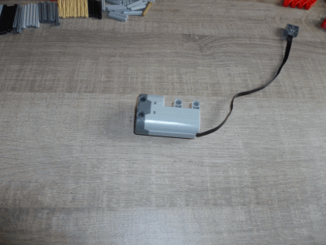
