Pour changer un peu des sets LEGO officiels, intéressons-nous à celui-ci créé dans le cadre du BrickLink AFOL Designer Program.

**Présentation**

Lancé à la fin du 3è trimestre 2018, le BrickLink AFOL Designer Program proposait aux personnes de plus de 18 ans de créer un set grâce au logiciel Studio de 200 à 2000 pièces (sans licence).  
A la fin de la phase de création, un panel de designers de la firme LEGO a sélectionné 16 projets qui ont ensuite été soumis à une phase de financement participatif (crowdfunding). Seuls les modèles comptant suffisamment de précommandes étaient produits.  
De ce fait, ce sont finalement treize projets qui ont été mis en production et mis en vente jusqu’au 1er Juillet 2019.  
Parmi ces treize sets, nous retrouvons le Hot Shot Carnival (Stand de tir) créé par BRIXONATOR vendu au prix de 57,99 US$ (52,01€ lors du retrait sur mon compte auxquels s’est ajoutée une commission pour le paiement CB à l’international de 1,45€ - c’est selon les banques - soit un total de 53,46€). Il contient 591 pièces (dont 149 références différentes), soit une moyenne de 9ct par pièce.

**La découverte**

La livraison des précommandes était prévue en mai 2019, mais c’est finalement aujourd’hui, le 8 juin que j’ai enfin reçu mon graal.

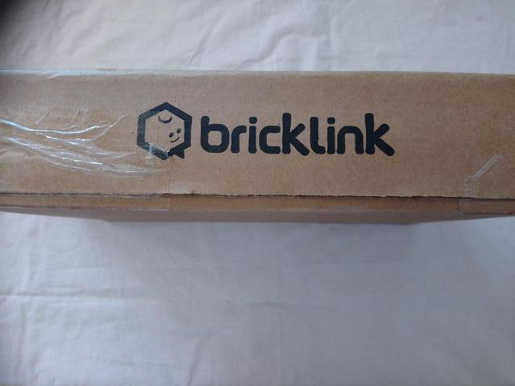

_Ça fait bizarre de recevoir un carton BrickLink – j’ai eu une seconde de flottement quand je l’ai vu_

Impatiente de découvrir le contenu, je m’arme de ciseaux et ni une, ni deux, entreprends de cisailler tout ce scotch. Et là…

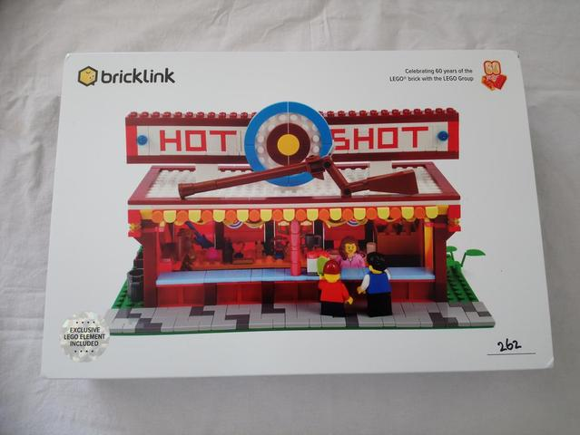

_Tadam !!_

Je trouve une boîte soigneusement enveloppée d’un habillage en carton souple présentant le produit. Voilà un emballage sympa, même s’il est plutôt simple comparé aux boîtes LEGO. Au centre, nous retrouvons bien entendu une photo du modèle prise de face. En haut à gauche trône fièrement le logo BrickLink, en haut à droite le logo du label « 60th Years Anniversary », en bas à gauche un autocollant brillant indiquant que la boîte contient une pièce LEGO exclusive et en bas à droite, le numéro de l’exemplaire du set. A noter qu’en dessous se trouve une photo de l’arrière du stand de tir. C’est sobre, sans chichi et franchement, ça me suffit ; je trouve que ça a une certaine classe.  
A l’arrière de cet habillage, on a un décor de fête foraine pour ceux qui veulent mettre en scène leur stand de tir sans forcément l’intégrer à un diorama, c’est sympa (pour moi, ça sera donc inutile, mais l’initiative est intéressante).

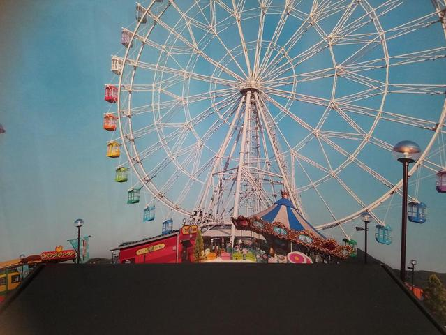

_C’est la fête !_

Et ce n’est pas la boîte en elle-même qui me fera changer d’avis, car en retirant l’habillage, je tombe sur ça :

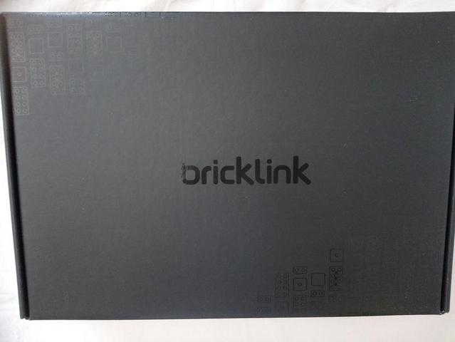

_Pas facile de trouver le bon angle pour la photo_

La boîte est en carton épais et réutilisable sans souci. On y retrouve le nom de BrickLink, ainsi que des dessins de briques, le tout en noir brillant sur noir mat, donc visible selon la lumière. Moi qui ai pris l’habitude de (attention, sacrilège) jeter mes boîtes LEGO, là, impossible ; je la garde en tant que boîte de rangement pour mon petit bazar d’exposition (badges, cartes de visite, briques d’expo, etc.).

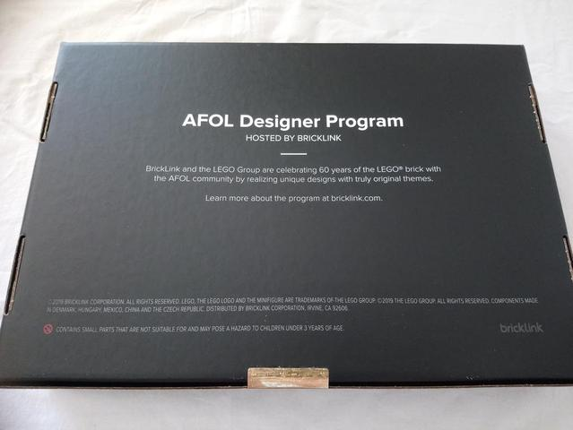

_Et dessous…_

En dessous, outre les mentions légales et les rappels de sécurité, on retrouve une petite phrase sur l’AFOL Designer Program nous invitant à nous rendre sur BrickLink pour y trouver davantage d’informations.

Bon, trêve de bavardages. Si j’ai acheté ce set, ce n’est pas pour le garder en boîte, donc on passe à plus intéressant : la découverte du contenu !!

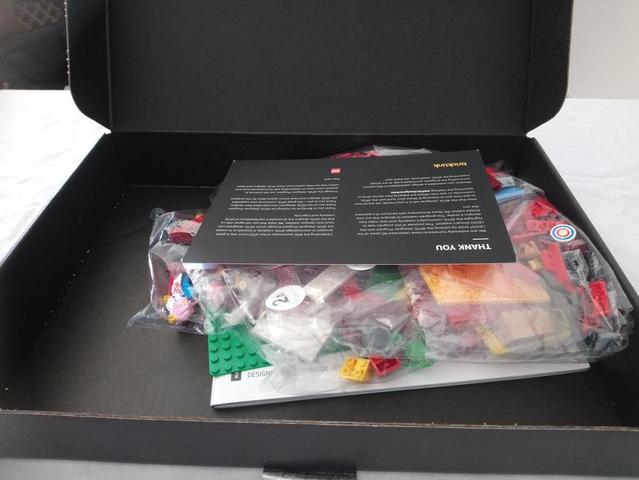

_Excitation niveau maximal_

On retrouve donc en vrac :

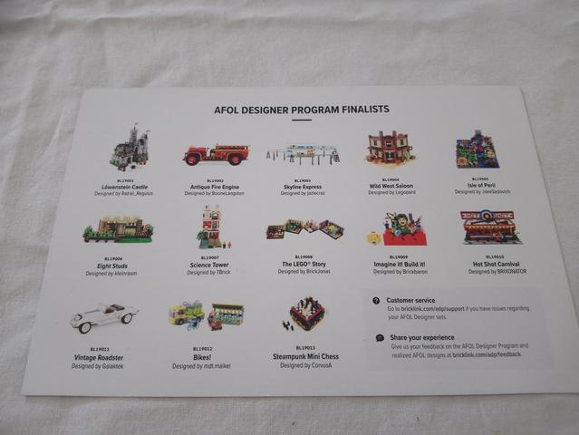

_Un récapitulatif des sets proposés à la vente dans le cadre du programme_

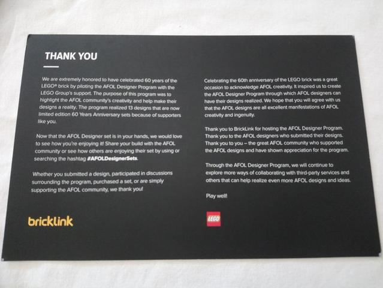

_Une carte de remerciements signée conjointement de BL et LEGO_

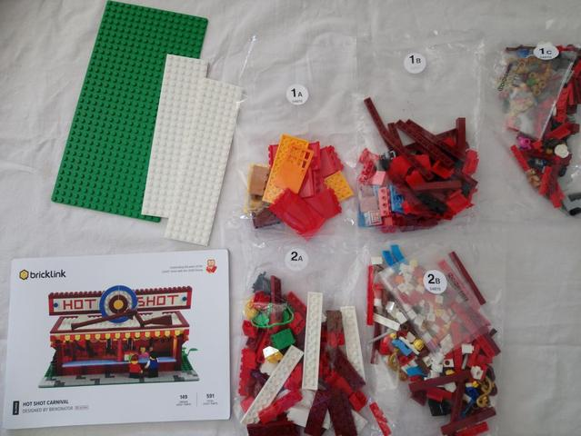

_La notice et les pièces bien sûr !!_

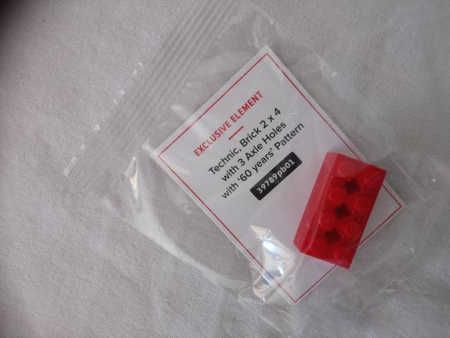

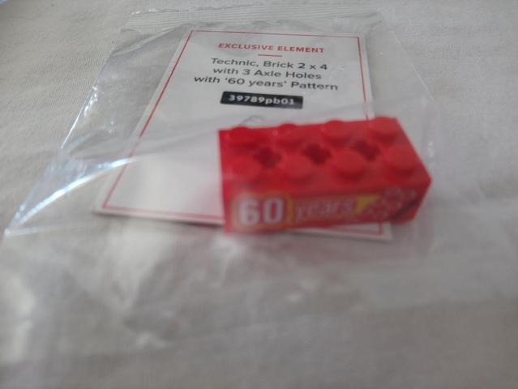

_Et la brique exclusive_

La brique exclusive est une brique 2x4 Technic avec 3 trous en croix aux couleurs du 60è anniversaire. Une gentille petite attention.

Mais revenons plutôt à notre notice… La couverture est identique à l’habillage en carton souple dans lequel se glissait la boîte.

A l’intérieur, on retrouve :

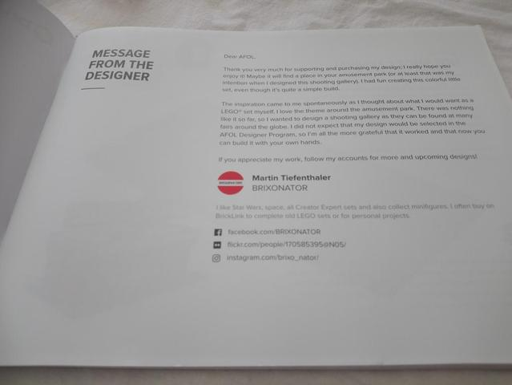

_Un petit speech du designer du set, ainsi que les liens vers ses pages Facebook, FlickR et Instagram._

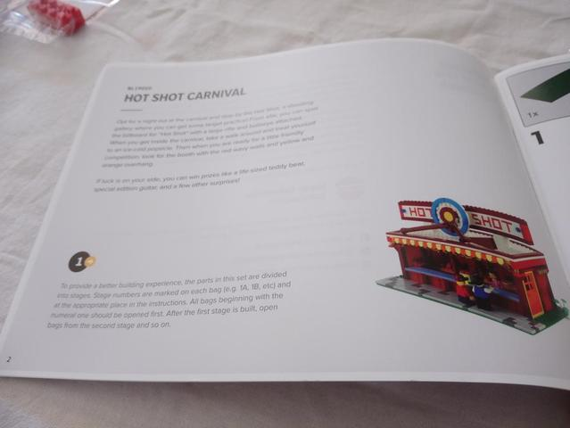

_Une présentation rapide du set (et les sempiternels conseils concernant l’ouverture des sachets par étape)._

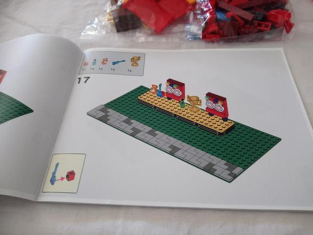

_Les étapes sont détaillées comme sur les notices officielles. J’ai juste trouvé les couleurs peut-être moins vives, mais personnellement, ça ne m’a pas du tout dérangée._

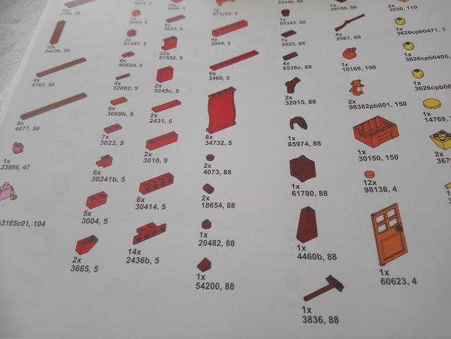

_A la fin du livret, comme sur les notices LEGO, les références de toutes les pièces composant le modèle, ainsi que leur visuel._

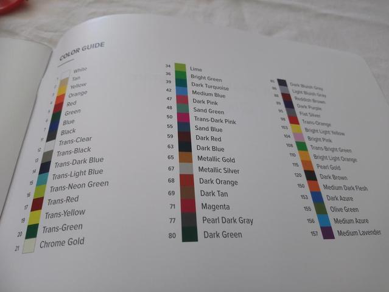

_Et enfin, ça j’ai vraiment apprécié, un petit guide des couleurs._

**Le montage**

C’est enfin parti pour l’étape la plus intéressante : le montage !  
On prend donc la notice et les sachets n°1.

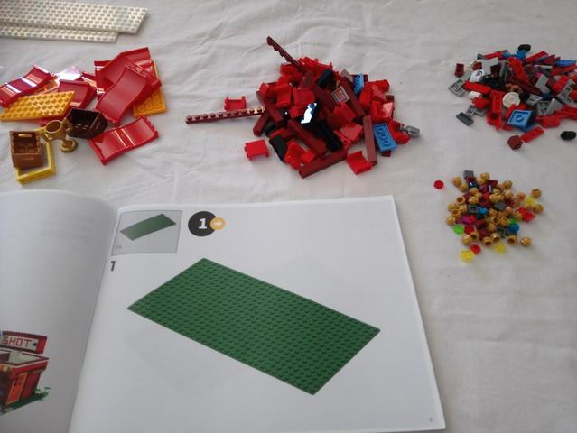

_L’étape 1, fidèle à elle-même…_

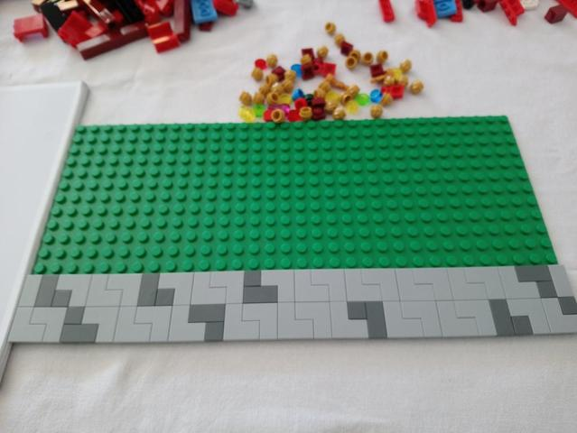

_Fin de l’étape 3 ; c’est un set résolument orienté AFOL, les étapes sont moins détaillées et c’est très bien comme ça._

Une demi-heure après, les sachets n°1 sont vides :

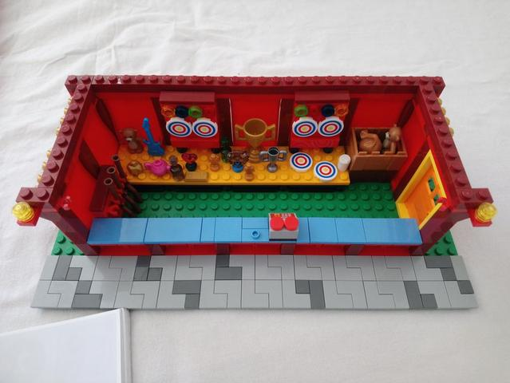

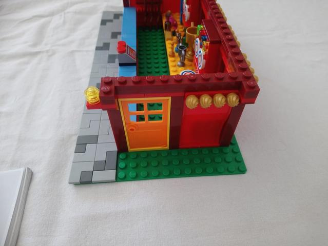

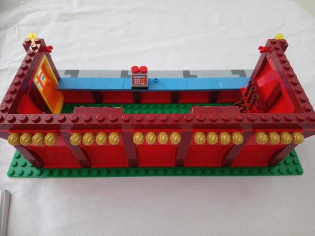

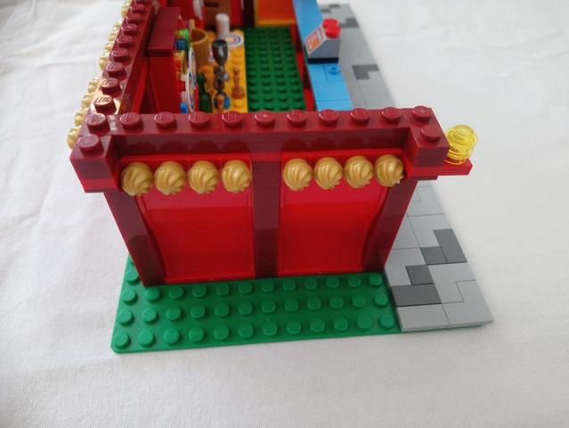

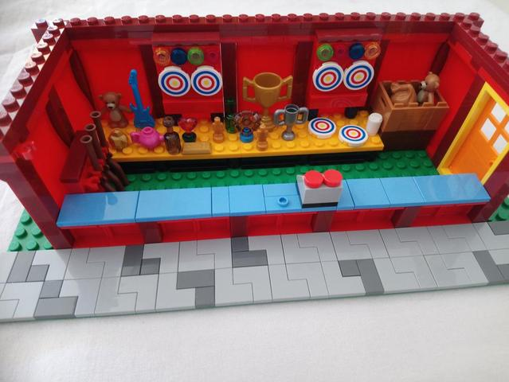

Le montage de cette première partie a été rapide (j’ai pris des photos entre temps, d’où la demi-heure) et plutôt agréable. Même les tiles du sol ne m’ont pas ennuyée. Je trouve le rendu à mon goût, du coup, je suis impatiente de passer aux sachets n°2 !

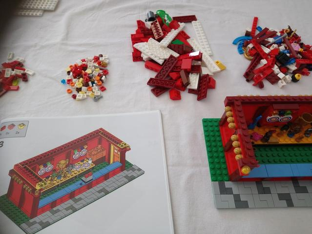

Pour cette deuxième partie du montage, j’avoue n’avoir eu aucune envie de prendre des photos intermédiaires. Pourquoi ? Parce que le montage de l’enseigne m’a tapé sur les nerfs… En les lettres sont montées par blocs de plate 2x1, voir 1x1, et franchement, ce n’est pas ce que j’apprécie le plus. Minutie et patience sont indispensables et je manque cruellement de ce dernier trait de caractère. Ceci dit, la technique est intéressante et le rendu franchement joli.

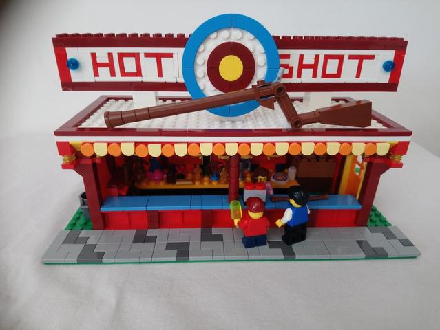

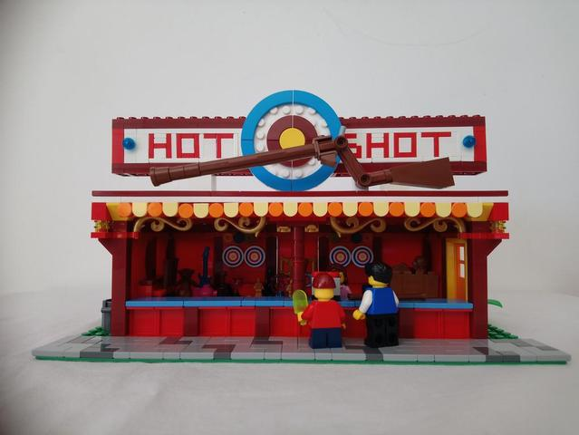

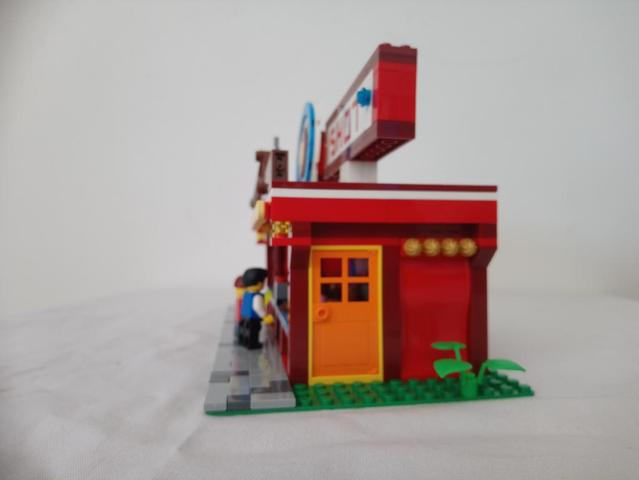

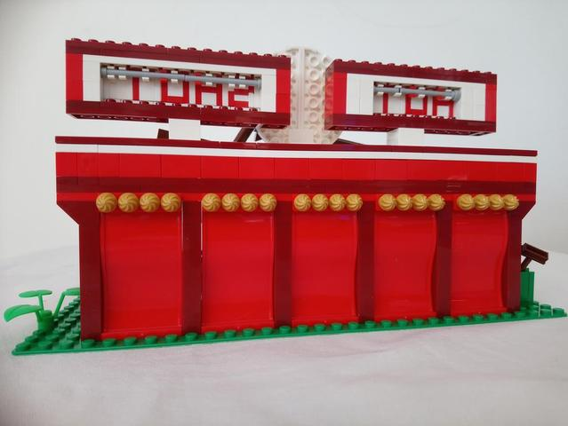

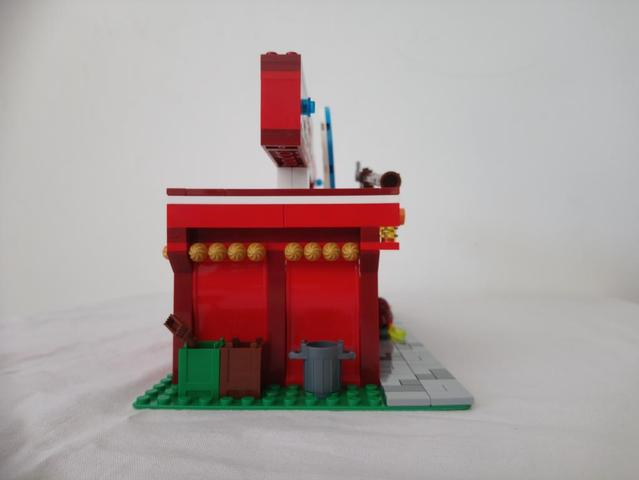

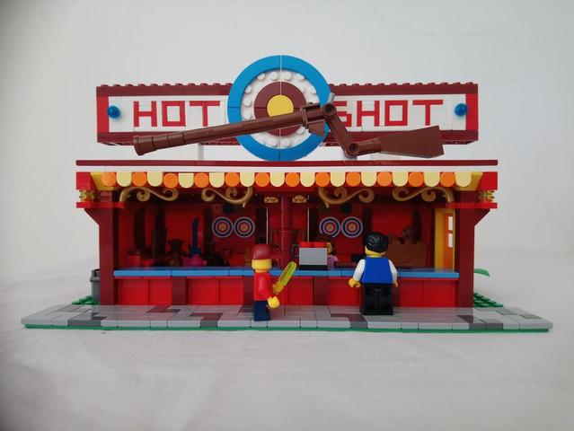

Petite critique également sur la cible géante au centre de l’enseigne ; les pièces tiennent mal ensemble, car le croisement des arcs de cercle n’est pas possible. Du coup, je pense ajouter un renfort à l’arrière, car celui du support est, à mon goût, insuffisant.  
Par contre, je suis en admiration devant le fusil géant. Bonne idée !  
On notera également la présence de 3 minifigs : une femme, un homme et un petit garçon. On a donc plus d’un exemplaire par tranche de 250 pièces, contrairement aux restrictions annoncées au début du programme.

**Le mot de la fin**

Bien que certaines étapes m’aient paru rébarbatives, j’ai apprécié le montage rapide de ce set (1h15 au final – photos comprises, sauf les finales). Le rendu final me plait énormément, mais ce n’est, à mon sens, pas un modèle à exposer seul. Je trouve qu’il manque de vie. En revanche, dans un diorama, il aura tout à fait sa place. Certes, le prix est un peu élevé, mais je rappelle que 10% du montant total des ventes sont reversés au designer (contre 1% pour les LEGO Ideas, mais elles ne sont pas limitées à 2500 exemplaires).  
Et pour ceux qui se posent la question des extra-parts… Il n’y en avait aucune !
