FreeLUG vous propose un review du nouveau set 75099 "Rey’s Speeder" issue de la nouvelle gamme LEGO Star Wars The Force Awakens.

Voici une review du set 75099 "Rey’s Speeder". Le plus petit set de la franchise Star Wars 7 à l’heure actuelle.

[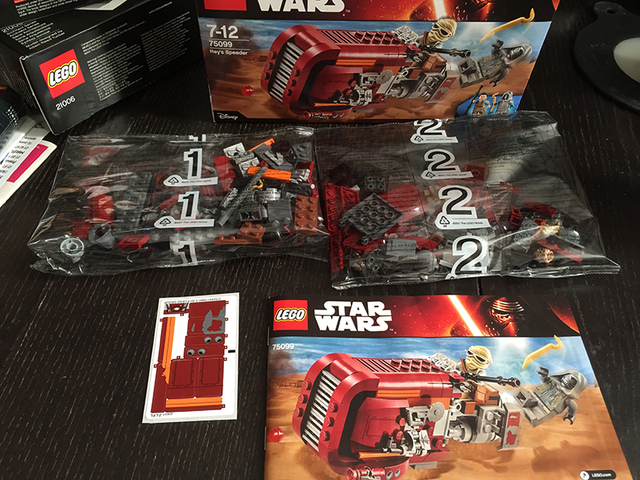](https://www.freelug.org/IMG/jpg/ReySpeeder02mini.jpg)

La boite, les deux sachets, la planche d’autocollants et la notice.  
Le sachet 1 contient le corps du Speeder et la minifigure de Unkar’s Thug, le sachet 2 quand à lui contient la carrosserie du Speeder et la minifigure de Rey.

[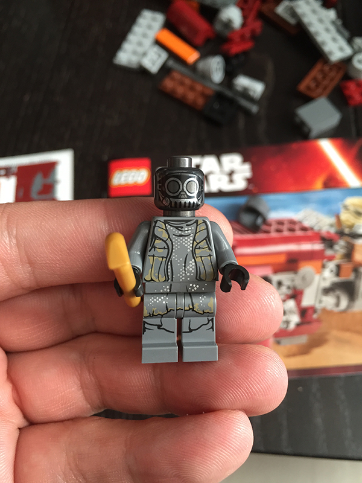](https://www.freelug.org/IMG/jpg/ReySpeeder03mini.jpg)

Unkar’s Thug de face sans sa cagoule, on peut admirer le travail d’impression.

[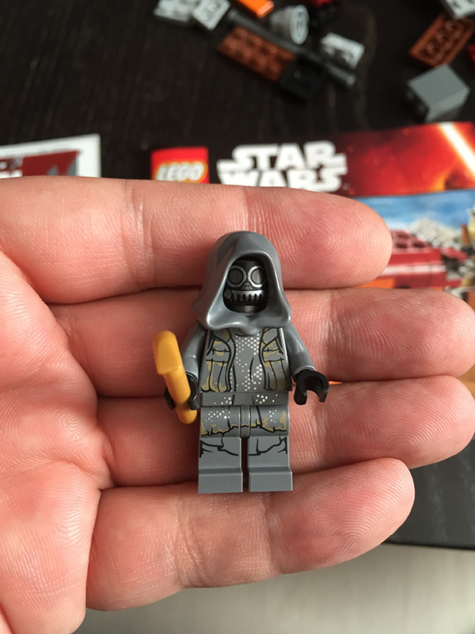](https://www.freelug.org/IMG/jpg/ReySpeeder04mini.jpg)

Unkar’s Thug de face avec sa cagoule.

[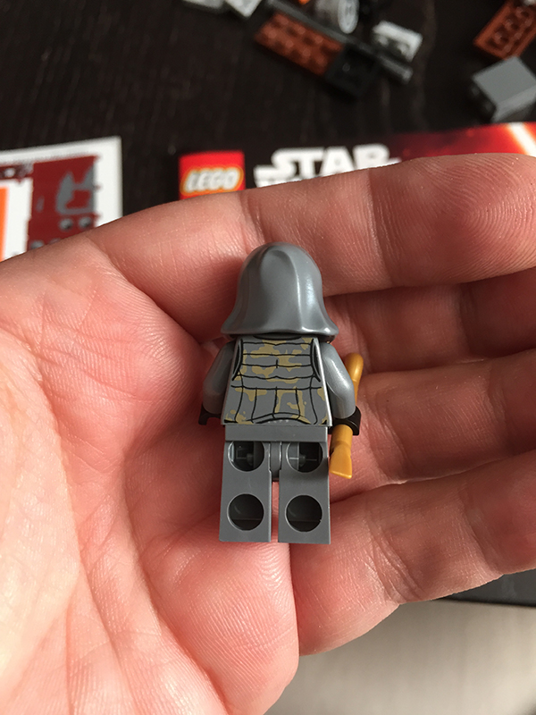](https://www.freelug.org/IMG/jpg/ReySpeeder05mini.jpg)

Unkar’s Thug de dos avec sa cagoule, là aussi richement décoré.

[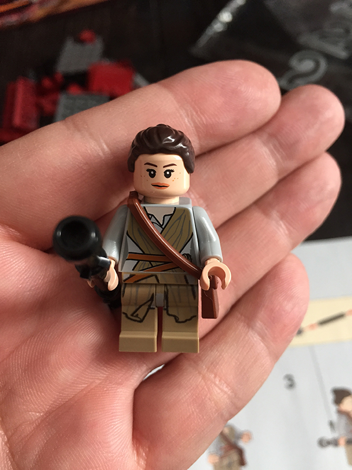](https://www.freelug.org/IMG/jpg/ReySpeeder06mini.jpg)

Rey de face avec cheveux, là aussi l’impression est magnifique.

[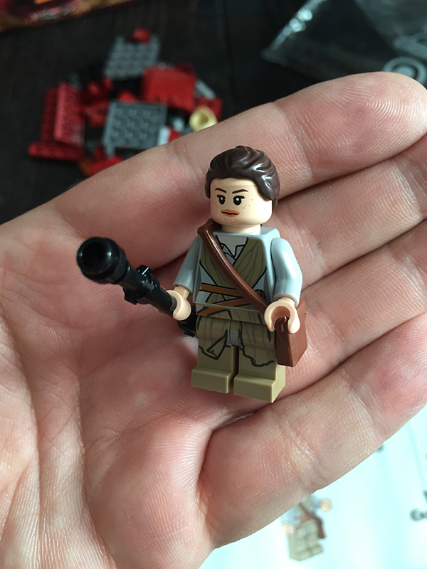](https://www.freelug.org/IMG/jpg/ReySpeeder07mini.jpg)

Rey de trois quart avec cheveux, on peut mieux voir son bâton et sa besace.

[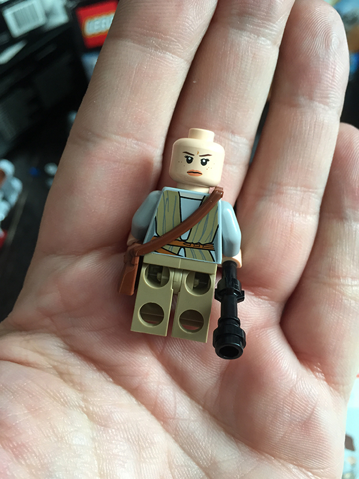](https://www.freelug.org/IMG/jpg/ReySpeeder08mini.jpg)

Rey de dos, sans cheveux qui permet de voir le visage alternatif.

[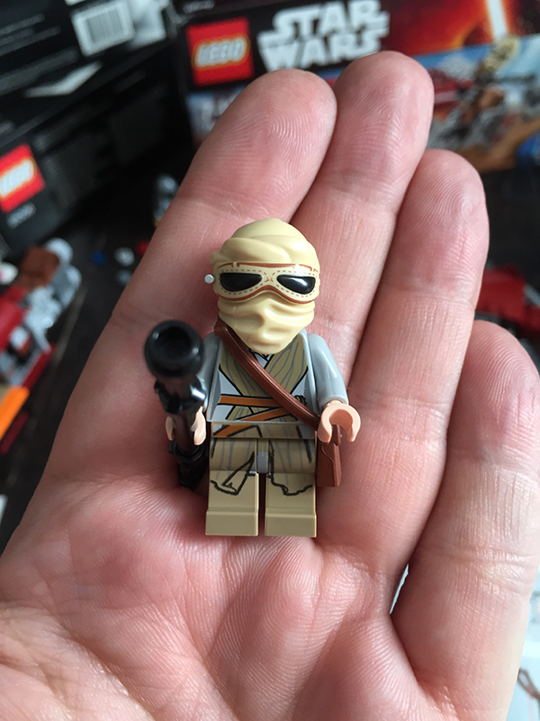](https://www.freelug.org/IMG/jpg/ReySpeeder09mini.jpg)

Rey de face avec son foulard et ses lunettes de protection.

[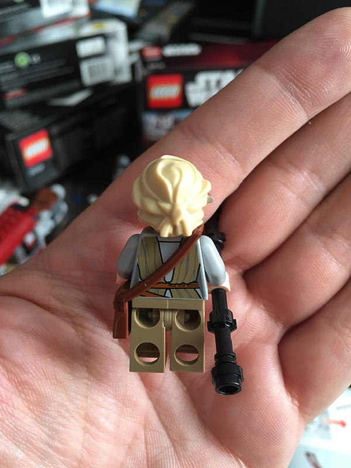](https://www.freelug.org/IMG/jpg/ReySpeeder10mini.jpg)

Rey de dos avec le foulard, les plis et le nœud sont très bien réalisés.

[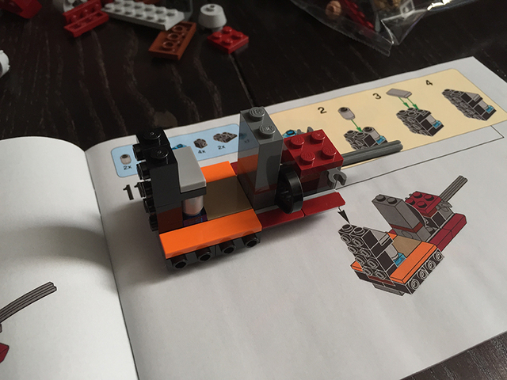](https://www.freelug.org/IMG/jpg/ReySpeeder11mini.jpg)

Début de construction du Speeder.

[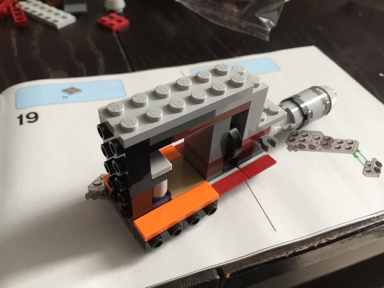](https://www.freelug.org/IMG/jpg/ReySpeeder12mini.jpg)

Ça avance, le moteur est placé.

[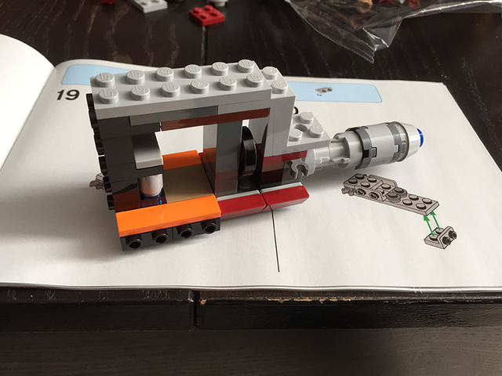](https://www.freelug.org/IMG/jpg/ReySpeeder13mini.jpg)

Sous un autre angle. Le réacteur sert à faire bouger la pièce noire dans le corps du Speeder. Cette pièce permettra d’ouvrir facilement les plaques latérales.

[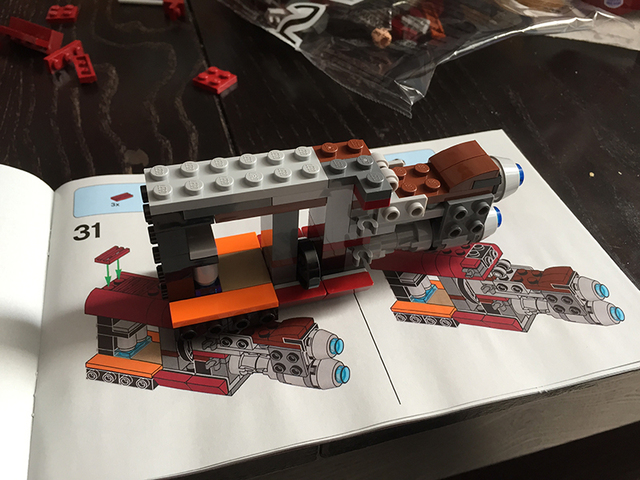](https://www.freelug.org/IMG/jpg/ReySpeeder14mini.jpg)

La selle est maintenant en place.

[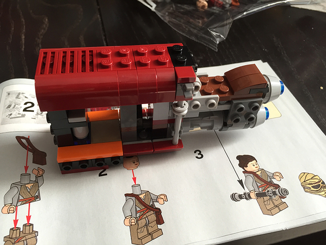](https://www.freelug.org/IMG/jpg/ReySpeeder15mini.jpg)

Me voilà déjà à la fin du sachet 1. Comme je le disais plus haut on obtient l’ossature du Speeder.

[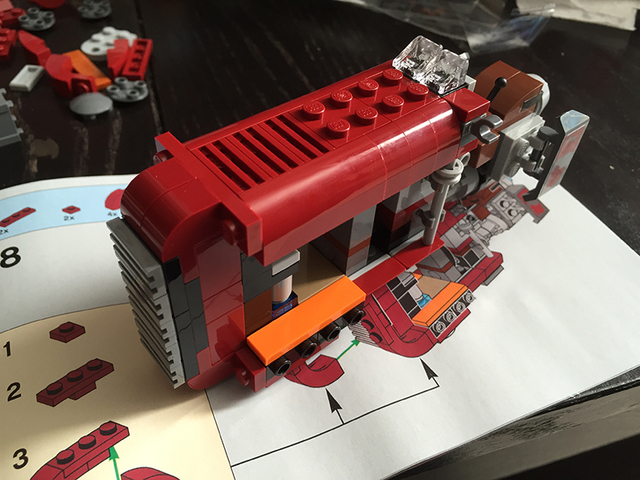](https://www.freelug.org/IMG/jpg/ReySpeeder16mini.jpg)

Les ailerons arrières et de nouveaux éléments de carrosserie sont installés.

[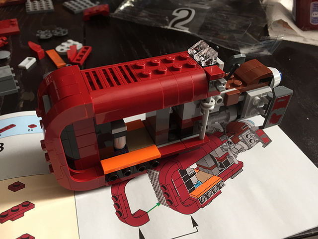](https://www.freelug.org/IMG/jpg/ReySpeeder17mini.jpg)

Le nez du Speeder est maintenant en place.

[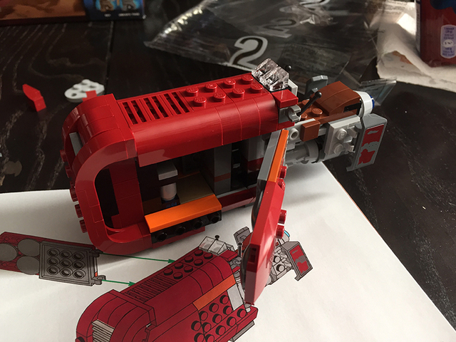](https://www.freelug.org/IMG/jpg/ReySpeeder18mini.jpg)

Les plaques latérales s’ouvrent pour accéder au coffre.

[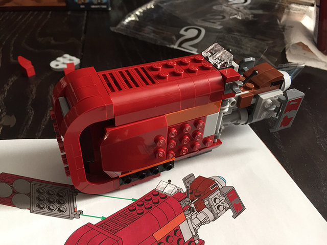](https://www.freelug.org/IMG/jpg/ReySpeeder19mini.jpg)

Le rendu plaque fermée.

[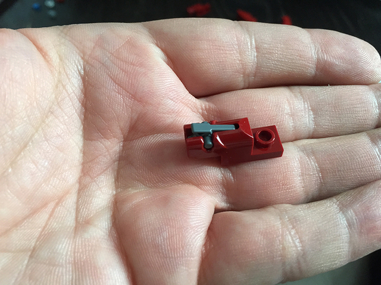](https://www.freelug.org/IMG/jpg/ReySpeeder20mini.jpg)

Les blasters, une pièce LEGO que je n’avais jamais vu avant.

[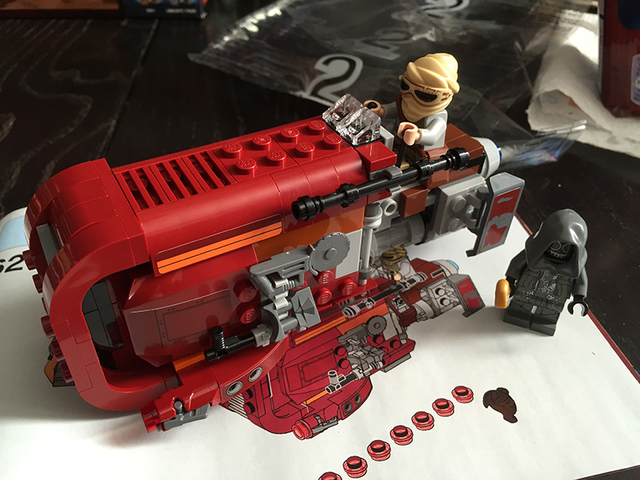](https://www.freelug.org/IMG/jpg/ReySpeeder21mini.jpg)

Et voilà le set fini avec les autocollants et les minifigures.

**Mon avis sur le set 75099 :**  
Tout d’abord je trouve le set vraiment chouette une fois monté. Sur un set de cette taille les techniques de montage sont classiques.  
Les minifigures sont tout simplement magnifiques.  
Seul point noir pour moi, c’est le prix, 30€ c’est beaucoup trop cher. Pour moi c’est un set qui vaut 15-20€ maximum.

J’espère que cette review vous a plu :)
