Salut tout le monde, accros de la brique et curieux de passage.

Alors que ce set est sorti il y a un petit moment (14 janvier 2015 en France soit presque deux ans après sa sortie américaine), je me suis aperçu qu’aucun de mes camarades Freelugiens n’en avait proposé la description. Je me fais donc un plaisir de corriger cela ici.  
Il s’agit donc du set 10232 **Palace Cinema** de la gamme _Creator Expert_. On le trouve encore au même prix qu’à sa sortie, c’est-à-dire à 139€ pour 2169 pièces soit un ratio de 6,4cts ce qui est, selon moi, un très bon rapport compte tenu que c’est le premier set dont je parle avec un ratio inférieur à 0,10cts (si on omet bien sûr les sets / polybags gratuits).

[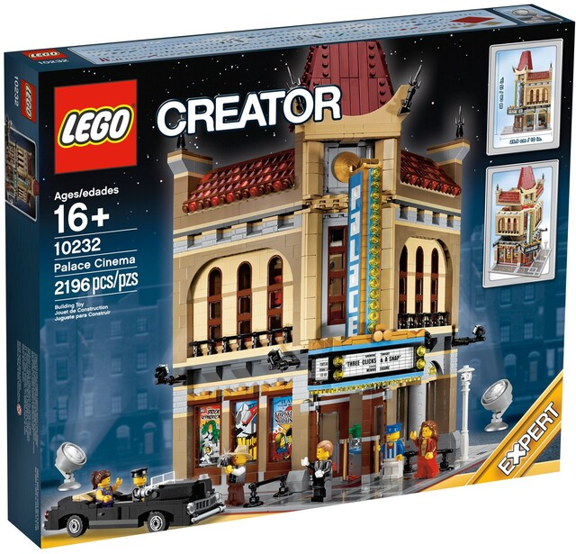](https://www.freelug.org/IMG/jpg/10232_alt1.jpg)

Allez, moteur, action, ça tourne !

* * *

On ne change pas une équipe qui gagne alors je commence bien sûr avec une petite description de la boîte.

[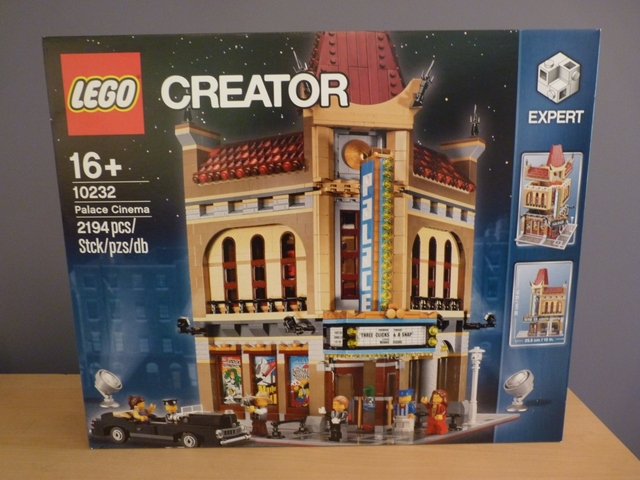](https://www.freelug.org/IMG/jpg/P1040709.jpg)

Sur fond de nuit étoilée pour coller à nos représentations féériques des avant-premières Hollywoodiennes, le set nous est présenté dans son ensemble mettant en scène l’arrivée d’une jeune starlette attendue par le personnel du cinéma et tout cela sous le flash d’un journaliste.  
Sur la droite, de haut en bas, on retrouve le logo informant l’appartenance à la gamme Expert, une photo spécifiant que le cinéma se compose de 3 niveaux et enfin une dernière photo spécifiant les dimensions du set monté.

[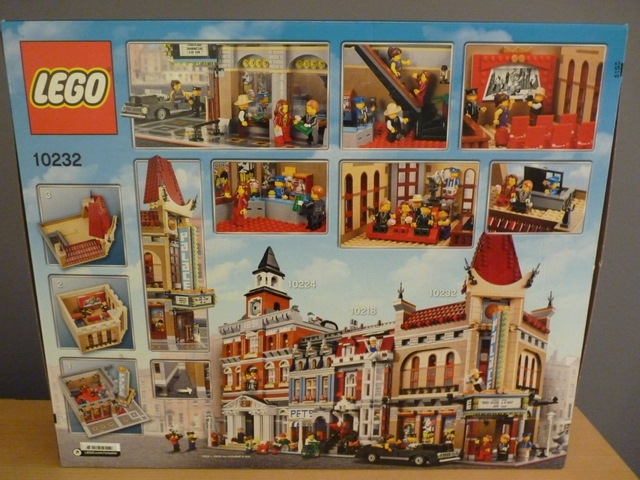](https://www.freelug.org/IMG/jpg/P1040710.jpg)

Au dos, sur la gauche, on nous détaille un peu mieux les trois niveaux du **Palace Cinema**. Le reste de ce verso nous présente diverses saynètes donnant vie au set ainsi qu’une petite publicité déguisée des autres sets de la même gamme en nous montrant quel magnifique décor final nous pourrions avoir si nous achetions également les sets 10224 **La Mairie** et 10218 **L’animalerie**.  
Non, LEGO, tu ne m’auras pas, je résisterai à la tentation !

* * *

[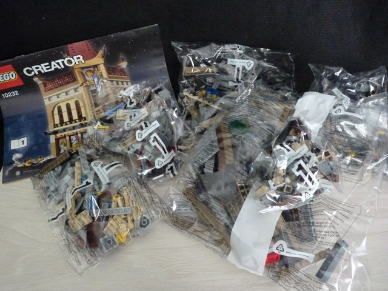](https://www.freelug.org/IMG/jpg/P1040711.jpg)

Une fois la boîte ouverte, on se retrouve avec 19 sachets numérotés de 1 à 3 (correspondant à une notice d’instruction chacun), une plaque rouge 32 x 32, deux plaques tan 16x16, deux plaques tan 8x16 et une plaquette d’autocollants.

Six minifigurines sont présentes dans ce set, dont quatre dans les sachets correspondant à la notice 1 et deux dans les sachets reliés à la notice 2. On retrouve pour chacun des personnages le visage LEGO unisexe souriant classique. Au moins, pas de risque de se tromper d’expression !

[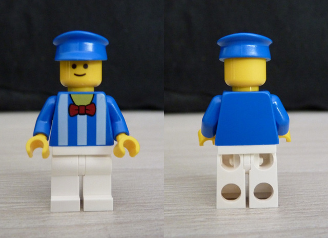](https://www.freelug.org/IMG/jpg/1-11.jpg)

L’employé du cinéma, tout d’abord, bénéficie d’une sérigraphie assez simple uniquement sur le torse et de sa petite casquette bleue.

[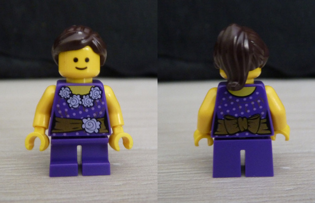](https://www.freelug.org/IMG/jpg/2-9.jpg)

La starlette, avec ses mini-jambes, porte un joli haut sérigraphié recto-verso avec plusieurs détails bien reproduits (fleurs et nœud) mais garde les bras nus.

[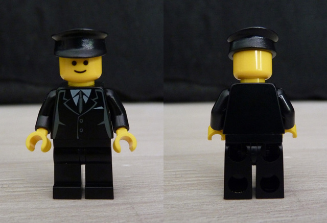](https://www.freelug.org/IMG/jpg/3-10.jpg)

Le chauffeur a une tenue aussi simple que celle du portier : pas de sérigraphie au dos, des jambes neutres et une casquette. A noter malgré tout ce qui me semble être un petit effort de sérigraphie au niveau du torse car la veste me semble un peu plus détaillée que celle du portier (mais ce n’est peut-être qu’une impression).

[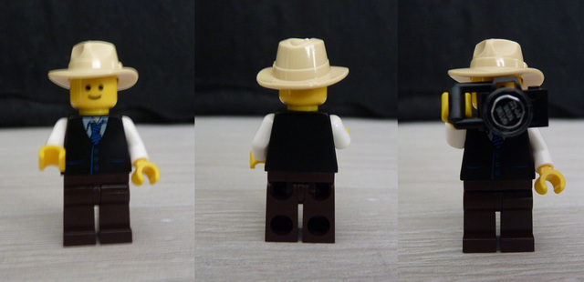](https://www.freelug.org/IMG/jpg/4-8.jpg)

Le journaliste et son appareil photo n’ont pas non plus bénéficié d’un design particulier : on retrouve un pantalon uni et un chapeau. A noter les bras de couleur différente nous permettant de dire, sans trop nous avancer, que le personnage porte un veston sérigraphiée (sur le torse uniquement) et non une veste comme les autres personnages masculins du set.

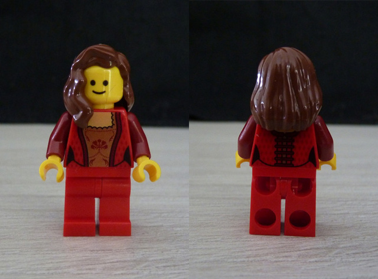

Ce que je supposais être la gérante du cinéma mais qui est en fait une invitée de marque a, elle aussi, une sérigraphie recto-verso pour le haut du corps avec un joli motif imprimé. Sinon, on reste dans le classique.

[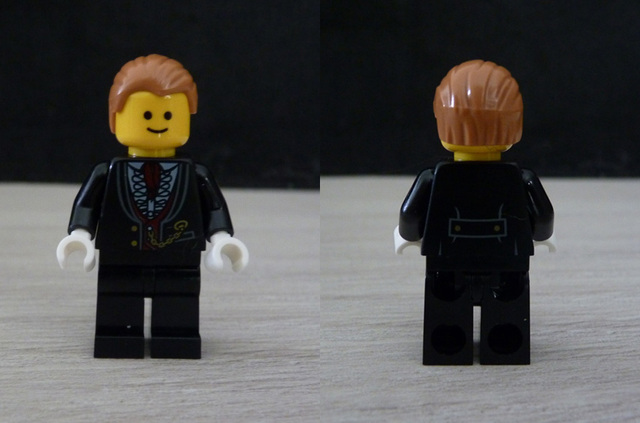](https://www.freelug.org/IMG/jpg/2-10.jpg)

Et enfin, l’invité de marque version homme, seul personnage masculin à avoir une petite sérigraphie dans le dos. En dehors des éléments assez banals, j’ai beaucoup aimé le détail apporté au torse (avec notamment la montre à gousset) ainsi que les mains blanches représentant les gants que le personnage porte.

* * *

Aujourd’hui, je vais me débrouiller tout seul pour la construction et on attaque les premiers sachets avec le montage de la limousine décapotable.

[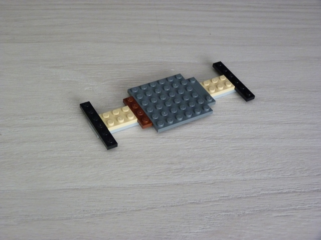](https://www.freelug.org/IMG/jpg/P1040724.jpg)

[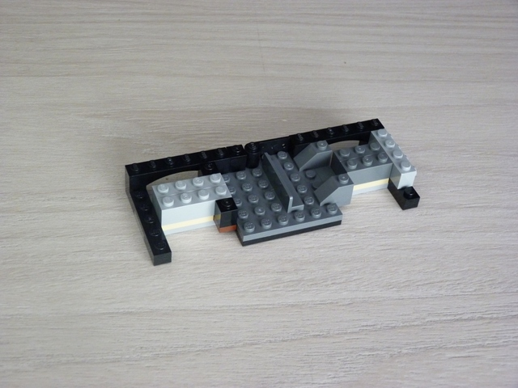](https://www.freelug.org/IMG/jpg/P1040725.jpg)

[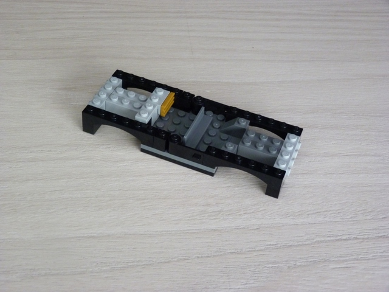](https://www.freelug.org/IMG/jpg/P1040726.jpg)

[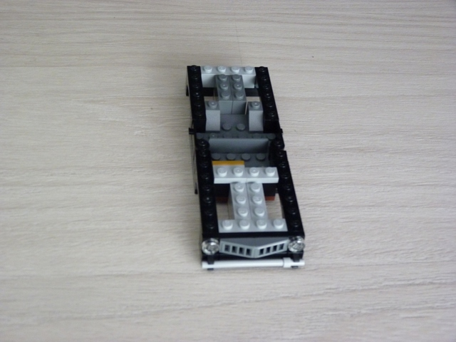](https://www.freelug.org/IMG/jpg/P1040727.jpg)

[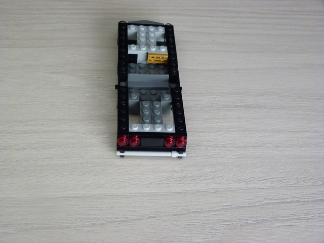](https://www.freelug.org/IMG/jpg/P1040728.jpg)

[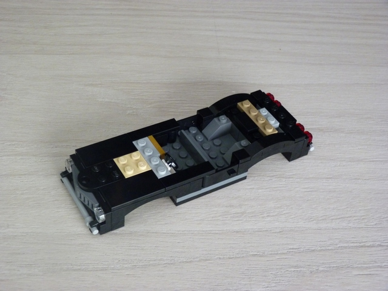](https://www.freelug.org/IMG/jpg/P1040729.jpg)

[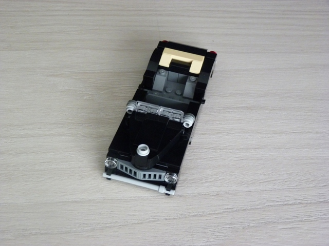](https://www.freelug.org/IMG/jpg/P1040731.jpg)

[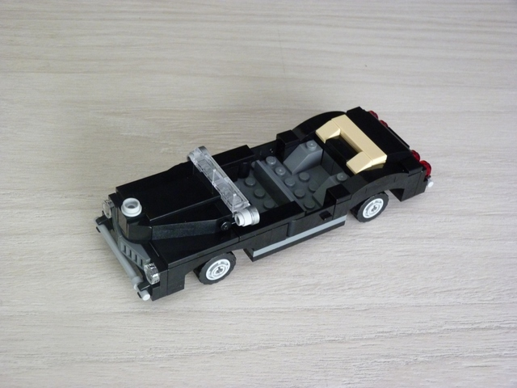](https://www.freelug.org/IMG/jpg/P1040732.jpg)

Une construction somme toute classique mais il est toujours agréable, dans la gamme _Creator Expert_, de remarquer la créativité des concepteurs.

On continue ensuite avec la plaque rouge 32x32 sur laquelle on commence par poser nos dalles.

[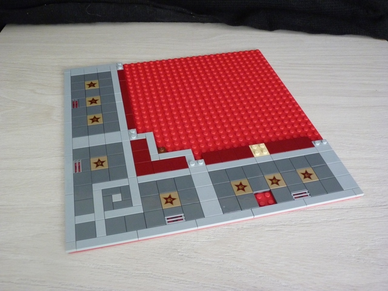](https://www.freelug.org/IMG/jpg/P1040735.jpg)

[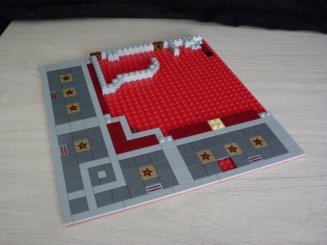](https://www.freelug.org/IMG/jpg/P1040736.jpg)

Les murs apparaissent.

[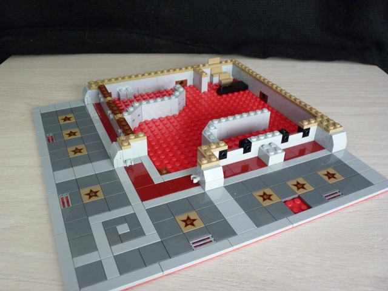](https://www.freelug.org/IMG/jpg/P1040741.jpg)

Les comptoirs se dessinent et les murs montent.

[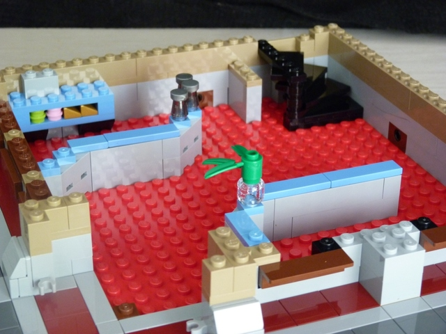](https://www.freelug.org/IMG/jpg/P1040745.jpg)

[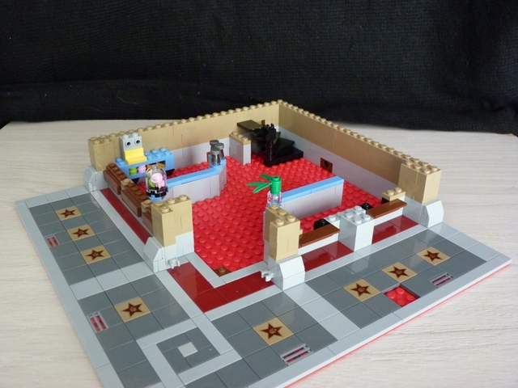](https://www.freelug.org/IMG/jpg/P1040747.jpg)

La confiserie, l’escalier et l’intérieur du cinéma se dessinent.

[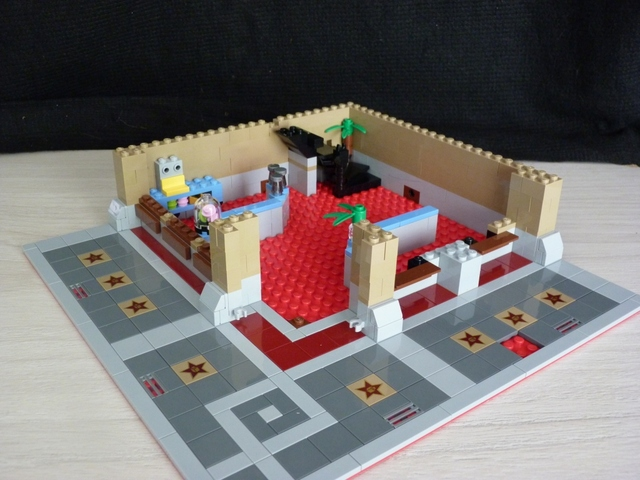](https://www.freelug.org/IMG/jpg/P1040749.jpg)

[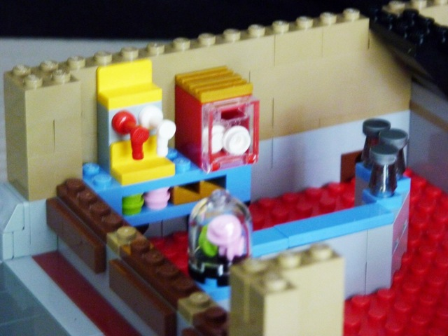](https://www.freelug.org/IMG/jpg/P1040750.jpg)

[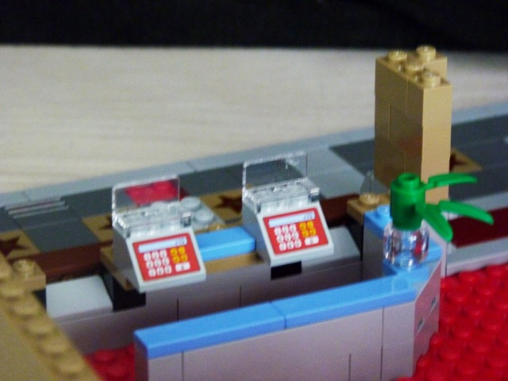](https://www.freelug.org/IMG/jpg/P1040751.jpg)

On alterne avec les murs de la bâtisse avant de terminer les comptoirs.

[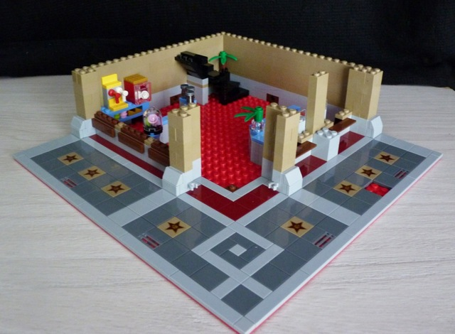](https://www.freelug.org/IMG/jpg/P1040752.jpg)

[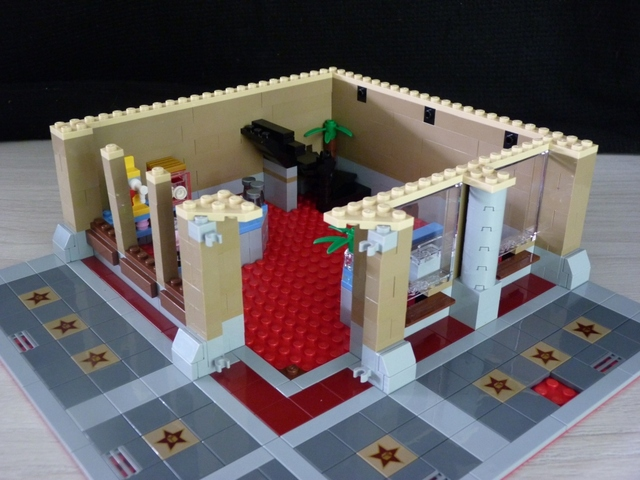](https://www.freelug.org/IMG/jpg/P1040755.jpg)

On s’occupe à nouveau de tirer la construction vers le haut.

[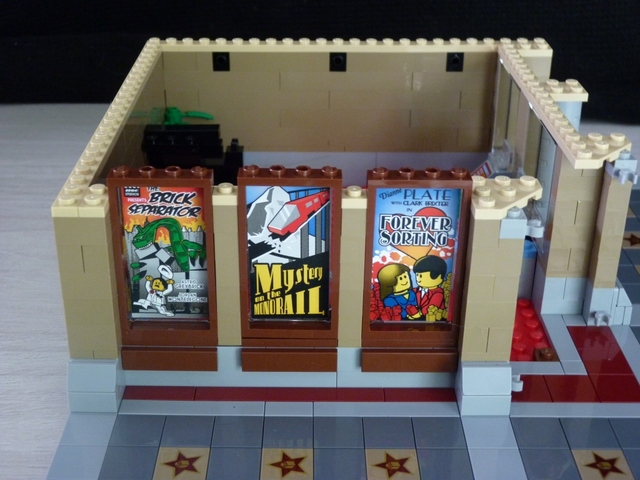](https://www.freelug.org/IMG/jpg/P1040756.jpg)

Des accessoires donnant un peu de vie apparaissent, ici les affiches des succès cinématographiques du moment.

[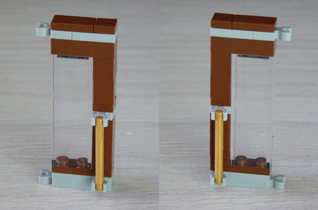](https://www.freelug.org/IMG/jpg/P1040758_9.jpg)

[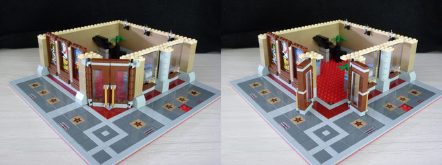](https://www.freelug.org/IMG/jpg/P1040760_1.jpg)

On prépare ensuite les portes avant de les intégrer à l’environnement.

[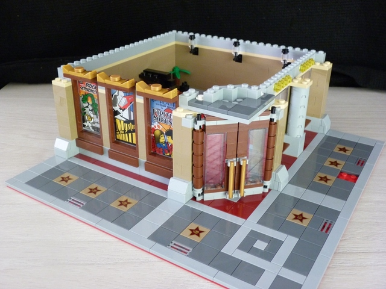](https://www.freelug.org/IMG/jpg/P1040764-2.jpg)

[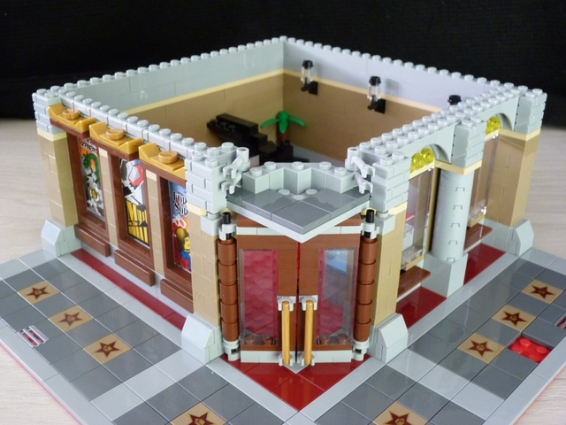](https://www.freelug.org/IMG/jpg/P1040766.jpg)

[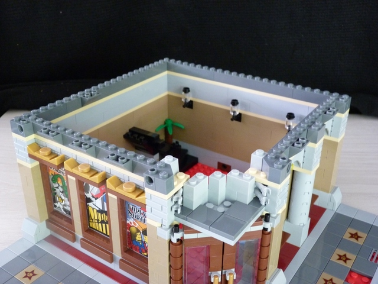](https://www.freelug.org/IMG/jpg/P1040768.jpg)

On pose quelques éléments de décor pour agrémenter nos murs avant de poursuivre l’ascension du monument.

[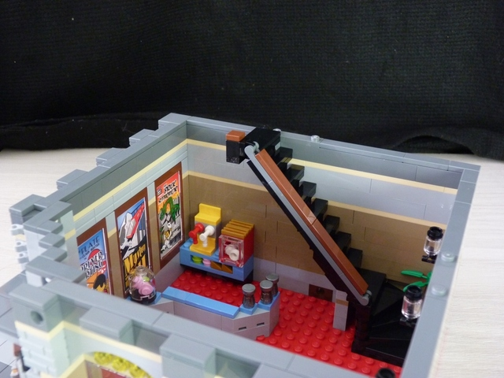](https://www.freelug.org/IMG/jpg/P1040771.jpg)

L’escalier s’agrandit lui aussi et se voit pourvu d’une rampe.

[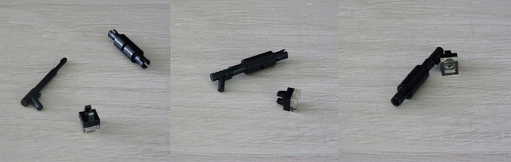](https://www.freelug.org/IMG/jpg/P1040772_3_4.jpg)

L’utilisation d’un harpon pour fabriquer les éclairages extérieurs est vraiment inattendue et intéressante. Il fallait y penser !

[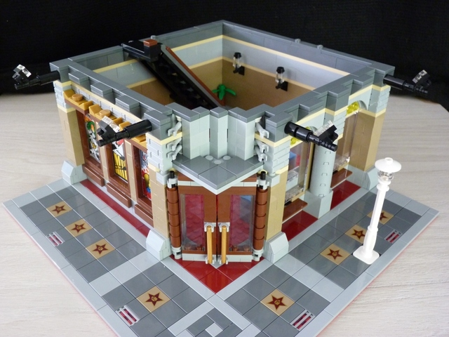](https://www.freelug.org/IMG/jpg/P1040776.jpg)

Le lampadaire est le dernier élément à poser quand nous arrivons au bout de la première notice de montage.

* * *

On passe ensuite à la réalisation du 1er étage avec, tout d’abord, le sol et sa structure de soutien.

[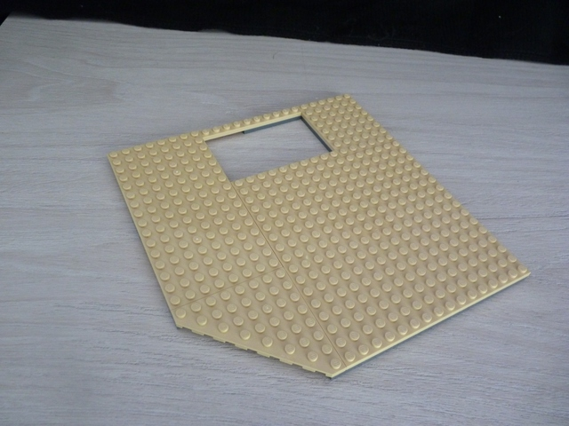](https://www.freelug.org/IMG/jpg/P1040784.jpg)

[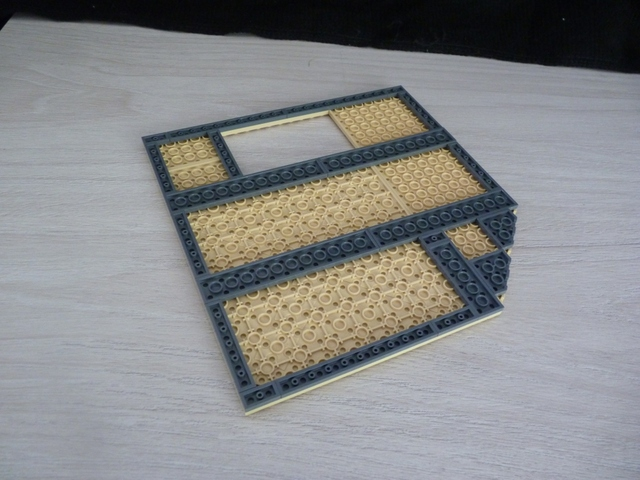](https://www.freelug.org/IMG/jpg/P1040785.jpg)

Les murs apparaissent.

[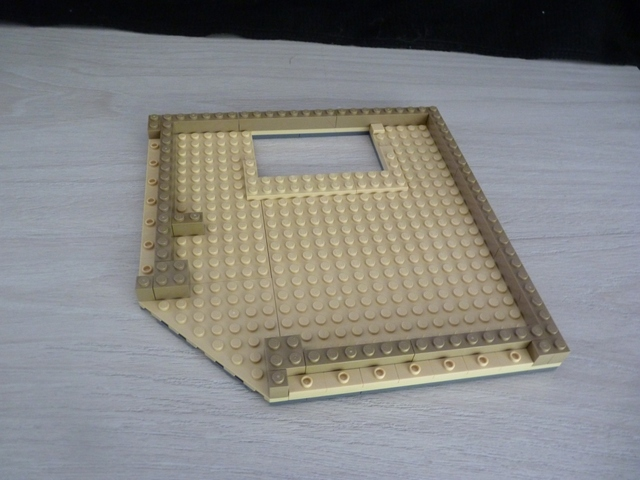](https://www.freelug.org/IMG/jpg/P1040787.jpg)

On avance sur l’ameublement intérieur avec notamment les sièges de la salle de projection.

[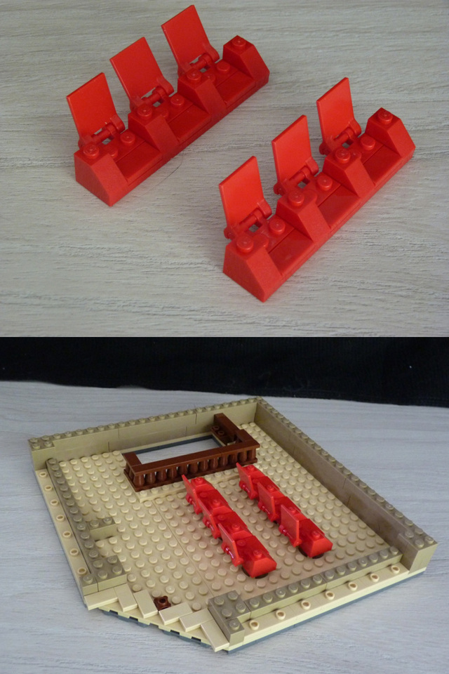](https://www.freelug.org/IMG/jpg/P1040791_2.jpg)

Après avoir ajouté quelques barrières à l’extérieur, on fait un petit break pour s’occuper de l’escalier.

[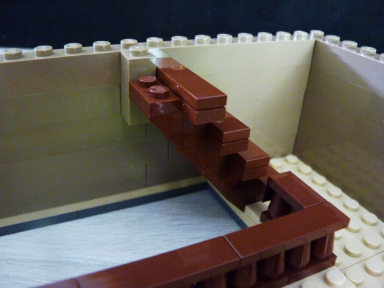](https://www.freelug.org/IMG/jpg/P1040798.jpg)

On s’occupe à nouveau un peu des murs.

[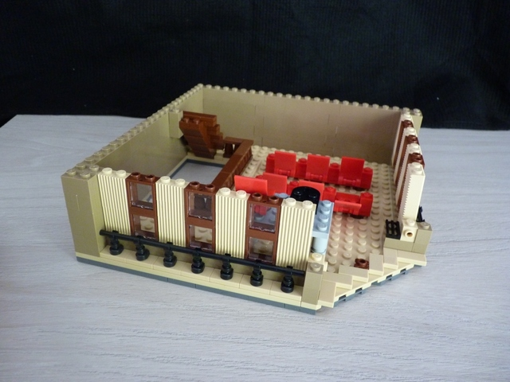](https://www.freelug.org/IMG/jpg/P1040800.jpg)

Et on repasse à l’aménagement intérieur avec la "cabine de projection" et le projecteur.

[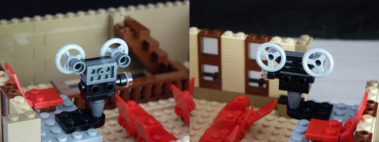](https://www.freelug.org/IMG/jpg/P1040801_2.jpg)

On reprend l’extérieur et les murs avec ce petit détail que j’ai vraiment trouvé sympa : le mur abîmé du fond qui sera caché par l’écran de cinéma juste après.

[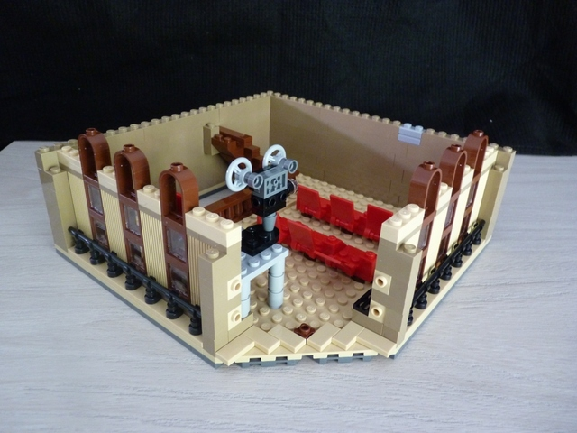](https://www.freelug.org/IMG/jpg/P1040804.jpg)

[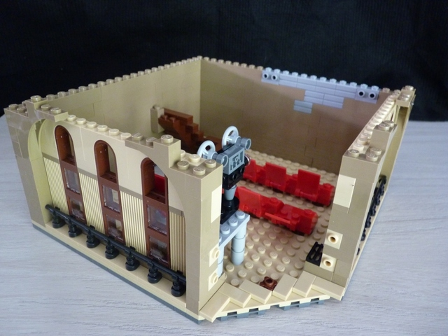](https://www.freelug.org/IMG/jpg/P1040807.jpg)

[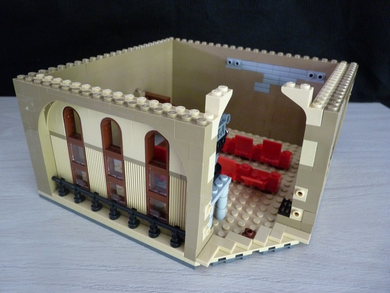](https://www.freelug.org/IMG/jpg/P1040810.jpg)

[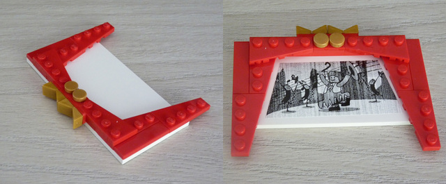](https://www.freelug.org/IMG/jpg/P1040811_2.jpg)

[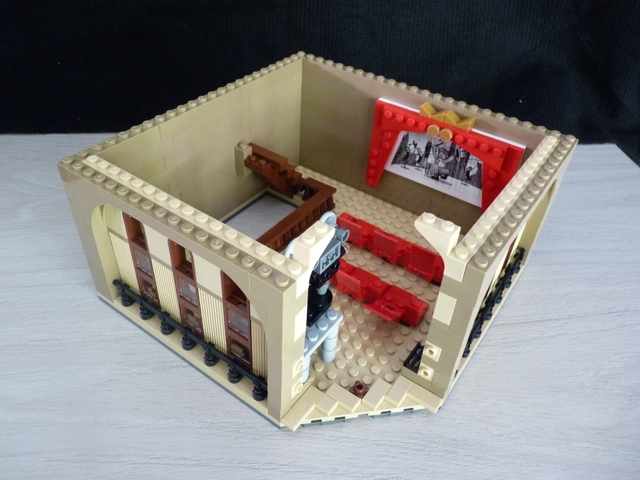](https://www.freelug.org/IMG/jpg/P1040813.jpg)

On monte encore un peu les murs, on referme le premier étage et celui-ci se termine petit à petit.

[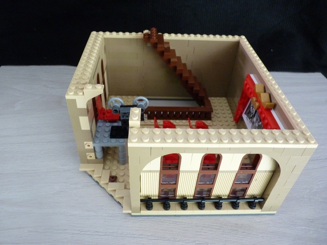](https://www.freelug.org/IMG/jpg/P1040815.jpg)

Et voici donc le premier étage terminé et ajouté à la structure du rez-de-chaussée :

* * *

Dernière partie, le toit et la déco.

On repart sur la base du 1er étage avec la structure sol + support.

Un petit bout de mur et on s’occupe de l’accès au toit.

On repasse sur les murs avant de s’occuper de ce qui va devenir un bout de toit (64 briques rondes Dark Red et 16 briques rondes Red, rien que ça !).

On abaisse la petite construction précédente et on passe à l’élément décoratif suivant.

On s’occupe à nouveau un peu des murs avant de préparer l’arrivée du toit principal et de sa décoration centrale (avec l’utilisation toujours sympa de Saïs élément décoratif).

La structure est terminée. On passe ensuite à la réalisation de l’enseigne lumineuse en commençant par sa base.

On travaille sur le panneau "PALACE" avec sa petite déco et on assemble le tout.

On fixe ça à notre ensemble.

On ajoute les petits éléments décoratifs à l’ensemble du bâtiment et voilà !!!

* * *

Pour conclure, ce que j’ai adoré dans ce set (comme dans toute la gamme _Creator Expert_), c’est de parfois débuter un assemblage de pièces que je laisse de côté pour construire quelque chose d’autre sans savoir pourquoi j’ai amorcé. Et ce n’est qu’après quelques étapes (et quelques briques manipulées) que la structure finale prend forme et que je me dis "ah ! Voilà pourquoi c’était comme ça !".  
C’est vraiment quelque chose que j’apprécie avec le fait que les concepteurs se tordent parfois vraiment l’esprit pour proposer des constructions un peu alambiquées mais avec de superbes résultats.

Autant les minifigurines n’ont rien d’exceptionnel, autant j’ai vite dépassé ce détail car tant la construction que le rendu final m’ont amené à plus être focalisé sur le bâtiment que les personnages.

Un set, à mon sens, très intéressant pour les fans de la gamme (comme moi) et/ou à ceux souhaitant développer un environnement citadin. L’aspect "vieux cinéma" ajoute du cachet à une rue LEGO en création.

Merci de m’avoir lu. Il est temps pour la jeune starlette de retourner vers ses autres projets et l’équipe du cinéma se joint à moi pour vous dire à bientôt !

