Aujourd’hui je vous propose la review du set 10260 dans la gamme _Creator Expert - Modular_ : **Downtown Diner**.  
Ce set sorti en 2018 est composé de 2480 pièces et coûte 149,99 euros, soit un ratio prix/pièce de 6 centimes d’euros.

[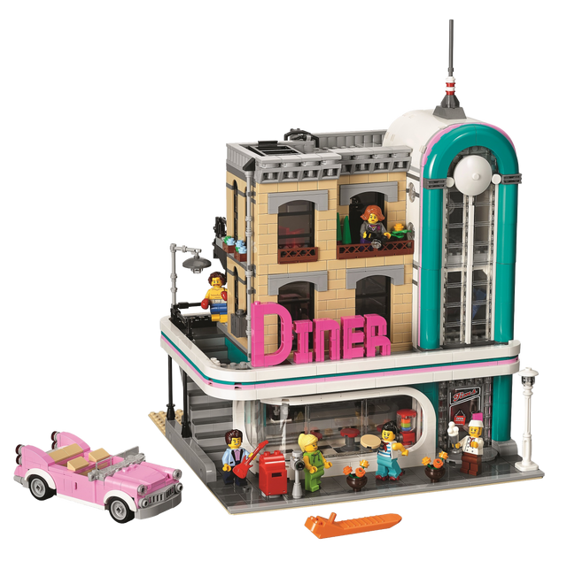](https://www.freelug.org/IMG/png/downtowndiner_set.png)

Après la _Brick Bank_ ([retrouvez la review](/articles/review-lego-10251-brick-bank-modular/)), le _Downtown Diner_ est mon deuxième _Modular_, je vais cette fois pouvoir comparer les sets par rapport à ma première expérience.

* * *

-   **La boite :**

Le visuel de la boite est composé des logos _LEGO_ et _CREATOR_ en haut de la boite. Sur la droite de cette dernière, un bandeau bleu contenant le nouveau logo _EXPERT_, et trois vignettes représentant un juke-box, une vue éclatée du set et enfin les mensurations de ce dernier.  
Le contenu du set est intégré dans un décor urbain.

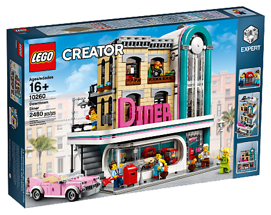

Au verso, un nombre impressionnant de vignettes avec les éléments de jouabilité du set. En bas, un visuel du _Diner_ en compagnie des sets _[Brick Bank](https://brickset.com/sets/10251-1/Brick-Bank)_ (10251) et _[Assembly Square](https://brickset.com/sets/10255-1/Assembly-Square)_ (10255).

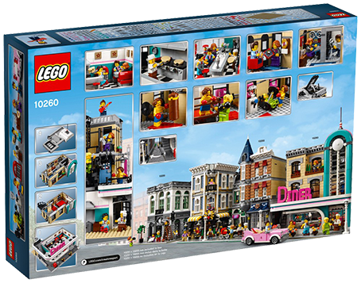

-   **Le contenu :**

Une fois ouvert, le set contient dix-neuf sachets portant des numéros de 1 à 5, une plaque _Tan_ (beige clair) de 32x32, quatre plaques _Light Blueish Grey_ (gris clair) 8x16 et enfin une notice.  
Aucun sticker n’est présent dans ce set.

[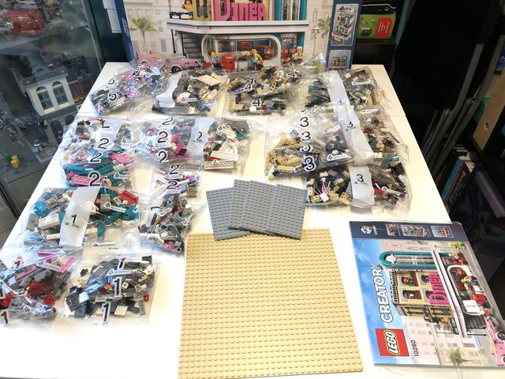](https://www.freelug.org/IMG/jpg/downtowndiner_01.jpg)

* * *

-   **Les minifigures :**

Six minifigures sont inclues dans le set (toutes exclusives). Grande nouveauté, la société _LEGO_ a troqué les têtes classiques pour des têtes à expressions comme sur les Minifigures Series. Même si certains crient au scandale, cette modification amène un vrai plus.

Première fig : le _[Chef](https://brickset.com/minifigs/twn310/chef-\(10260\))_. Même si les sérigraphies sont simples, ce chef est bien représenté, avec ses rouflaquettes et son calot.

[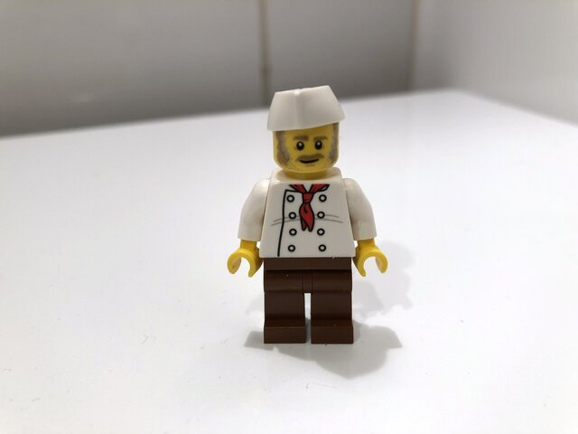](https://www.freelug.org/IMG/jpg/downtowndiner_03.jpg)

Au dos, ce n’est pas folichon, nous n’avons que deux lignes pour figurer les plis de la veste.

[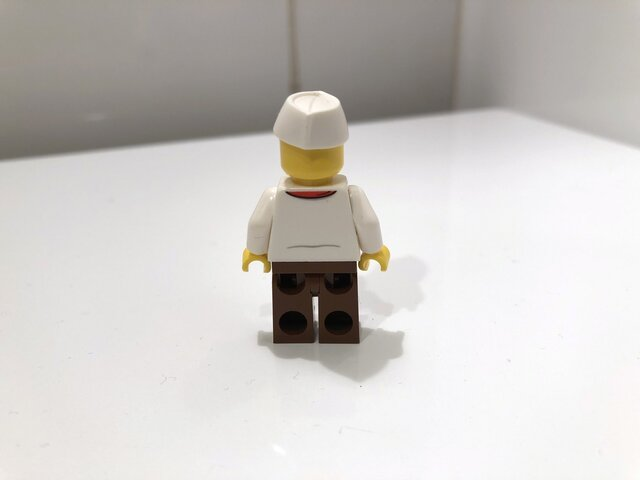](https://www.freelug.org/IMG/jpg/downtowndiner_04.jpg)

Deuxième fig : la _[Serveuse (Waitress)](https://brickset.com/minifigs/twn312/waitress-\(10260\))_. Elle est vraiment réussie et complétement représentative des _Diners_ américains des années 50/60. En effet, avec sa marinière, son bandana rouge noué autour du cou et ses rollers, on la croirait tout droit sortie de la série _[Happy Days](https://fr.wikipedia.org/wiki/Happy_Days_\(s%C3%A9rie_t%C3%A9l%C3%A9vis%C3%A9e\))_.

[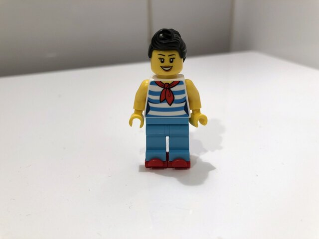](https://www.freelug.org/IMG/jpg/downtowndiner_05.jpg)

Comme pour le recto, la sérigraphie rayée est réussie.

[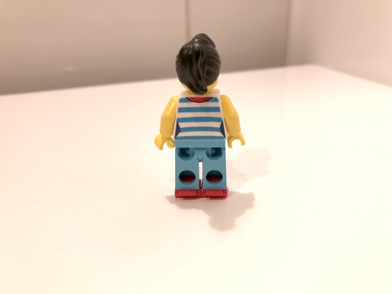](https://www.freelug.org/IMG/jpg/downtowndiner_06.jpg)

Troisième fig : dénommée _[Bodybuilder](https://brickset.com/minifigs/twn308/bodybuilder-\(10260\))_ par la société _LEGO_. Cette jeune femme au jogging vert a droit à un double visage et est joliment réalisée. Les ombres des lanières et des poches donnent de la perspective. Dommage que _TLC_ n’ait pas poussé jusqu’à sérigraphier les jambes pour un meilleur réalisme.  
Le visage en sueur est vraiment original.

[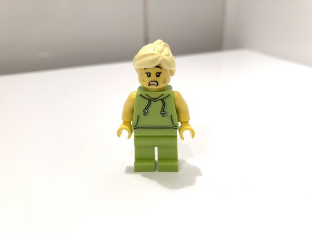](https://www.freelug.org/IMG/jpg/downtowndiner_07.jpg)

Le dos est bien réalisé avec l’élastique du bas du sweat ainsi que la capuche. Pour le visage alternatif nous avons le droit à un sourire en coin.

[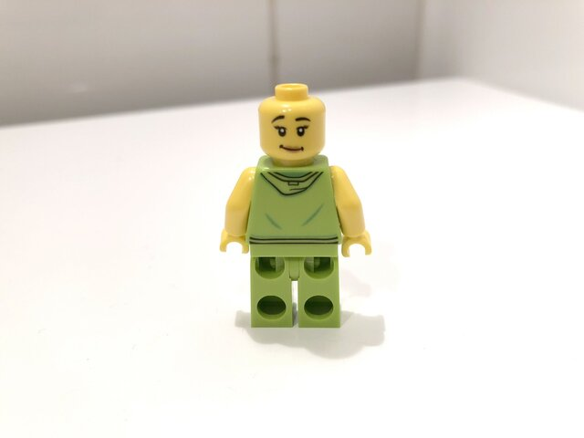](https://www.freelug.org/IMG/jpg/downtowndiner_08.jpg)

Quatrième fig : le _[Boxer](https://brickset.com/minifigs/twn309/boxer-\(10260\))_ est la bonne surprise de ce set. Il est original de par son visage et sa coiffure. Complétement dans la thématique du set, on dirait que lui aussi sort des années 50/60. C’est la seule fig du set à avoir droit à un traitement sur les jambes, pas de sérigraphies mais elle sont bi-injectées.

[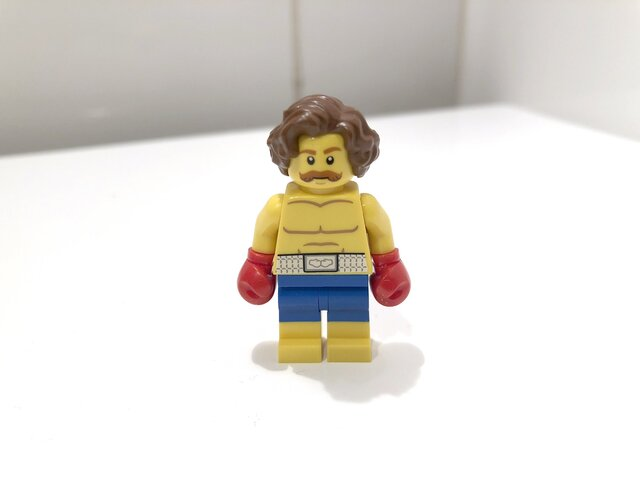](https://www.freelug.org/IMG/jpg/downtowndiner_09.jpg)

Au dos, c’est le néant.

[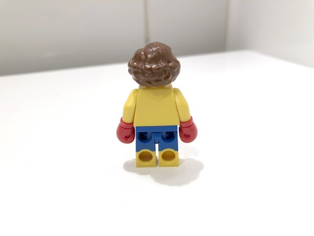](https://www.freelug.org/IMG/jpg/downtowndiner_10.jpg)

Cinquième minifig : la _[Manager](https://brickset.com/minifigs/twn311/manager-\(10260\))_. Très belle sérigraphie pour la veste de tailleur et encore un double visage. Ce dernier est très sympa, le petit grain de beauté sous la bouche ajoute un brin de féminité à la figurine.

[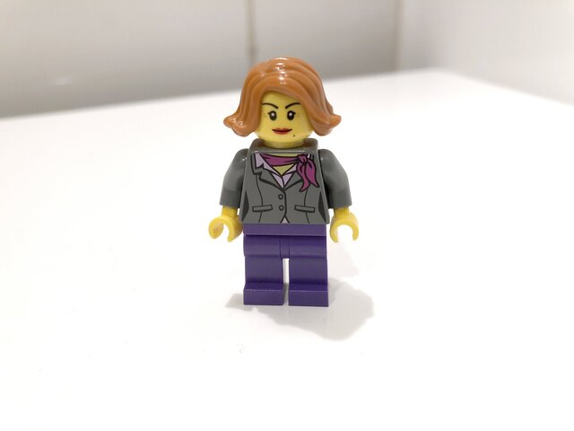](https://www.freelug.org/IMG/jpg/downtowndiner_11.jpg)

Rendu simple verso (coutures de la veste) et visage alternatif contrarié.

[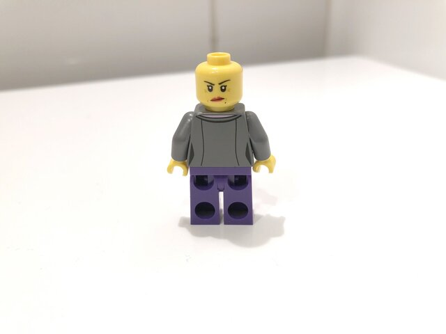](https://www.freelug.org/IMG/jpg/downtowndiner_12.jpg)

Sixième et dernière figurine : la _[Rock Star](https://brickset.com/minifigs/twn313/rock-star-\(10260\))_. Encore une belle réalisation qui colle complétement au thème du set. Veste sympa, visage expressif et coupe de rocker. Bref, cette fig peut se produire en spectacle dans le _Diner_ sans faire tache.

[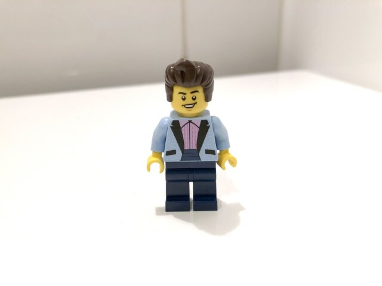](https://www.freelug.org/IMG/jpg/downtowndiner_13.jpg)

Au dos, un seul pli pour le col de la veste et les points argentés. Heureusement, un visage alternatif en train de chanter rattrape le coup.

[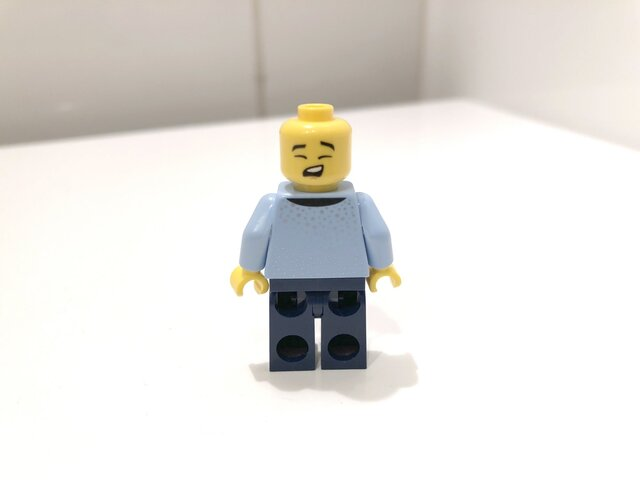](https://www.freelug.org/IMG/jpg/downtowndiner_14.jpg)

Pour conclure, la société _LEGO_ est montée en gamme pour les figurines des _Modular_ et c’est vraiment une bonne nouvelle quand on les compare avec celles des anciens sets _Modular_, avec les figs _Star Wars_ et Minifigures Series en termes de sérigraphies et de bras/jambes bi-injectés.

* * *

-   **Le montage :**

On commence la construction par recouvrir la _Plate 32x32 tan_ avec des _tile_. Puis les murs de fondation.

[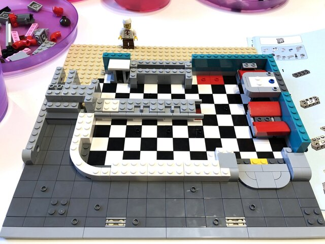](https://www.freelug.org/IMG/jpg/downtowndiner_15.jpg)

Très rapidement, l’intérieur du _Diner_ prend forme avec des détails qui nous mettent tout de suite dans l’ambiance.

[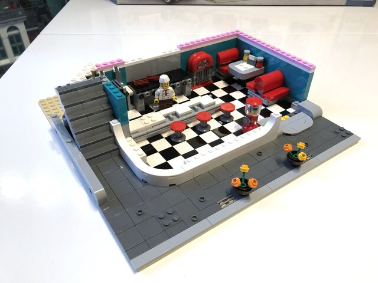](https://www.freelug.org/IMG/jpg/downtowndiner_16.jpg)

A la fin des sachets 1, on retrouve l’intérieur du _Diner_ terminé ainsi que le lettrage de l’enseigne.  
On commence à s’apercevoir de l’espace pris par chaque chose sans pour autant savoir le volume total que prendra ce set une fois fini.

[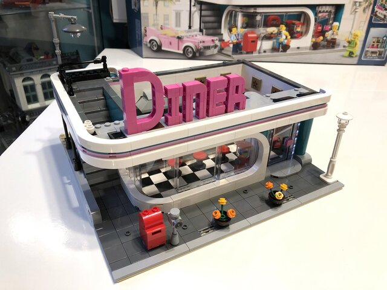](https://www.freelug.org/IMG/jpg/downtowndiner_17.jpg)

Voici le bâtiment à la fin des sachets 2. Les détails sur les murs sont assez impressionnants (gouttière, clim, escalier) tout comme le début de la verrière à droite au-dessus de la porte du _Diner_. Cet étage est totalement occupé par une salle de musculation ainsi qu’un ring de boxe.

[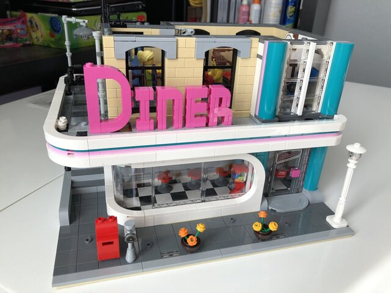](https://www.freelug.org/IMG/jpg/downtowndiner_18.jpg)

[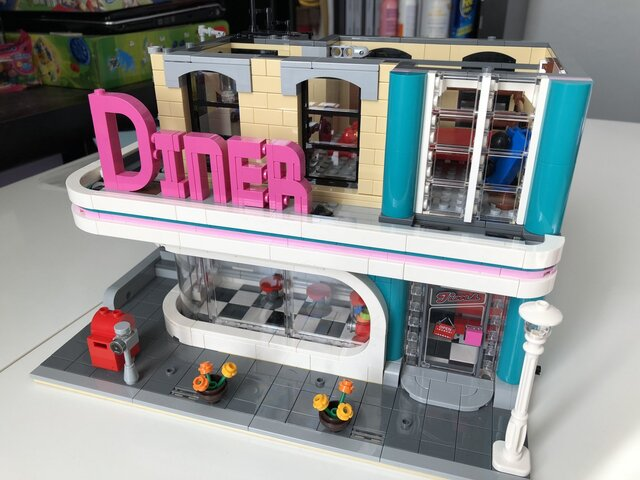](https://www.freelug.org/IMG/jpg/downtowndiner_19.jpg)

[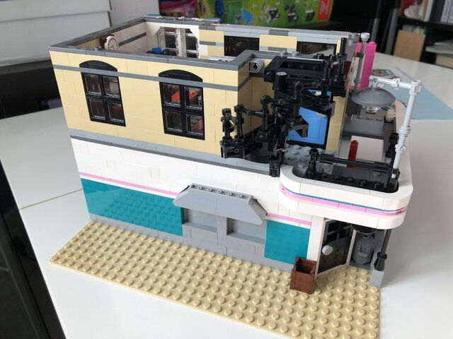](https://www.freelug.org/IMG/jpg/downtowndiner_20.jpg)

[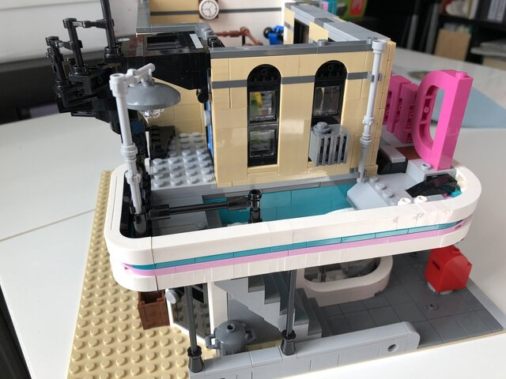](https://www.freelug.org/IMG/jpg/downtowndiner_21.jpg)

[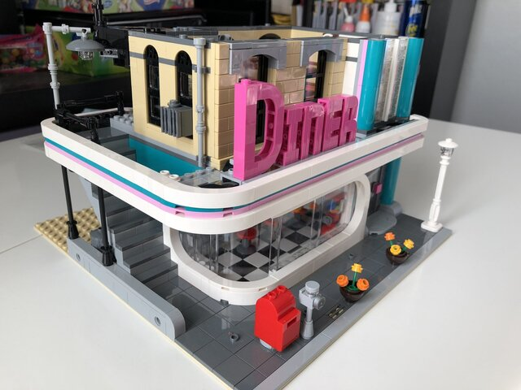](https://www.freelug.org/IMG/jpg/downtowndiner_22.jpg)

Quelques détails sur les briques murales faites en _tile_ et l’escalier en colimaçon.

[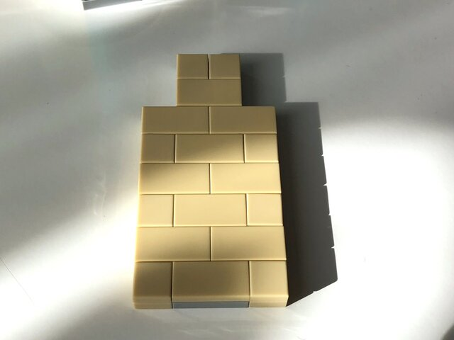](https://www.freelug.org/IMG/jpg/downtowndiner_22-1.jpg)

[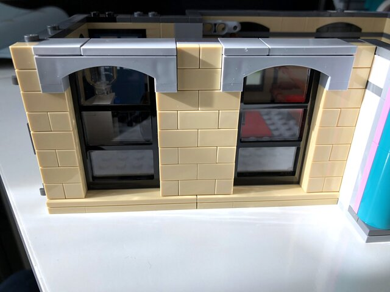](https://www.freelug.org/IMG/jpg/downtowndiner_22-2.jpg)

[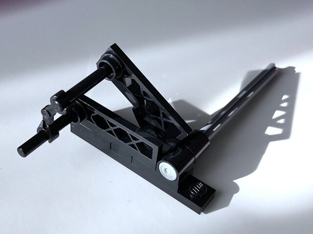](https://www.freelug.org/IMG/jpg/downtowndiner_22-3.jpg)

[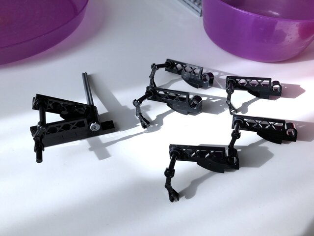](https://www.freelug.org/IMG/jpg/downtowndiner_22-4.jpg)

L’étape 3 (sachets 3) permet de construire le deuxième étage comprenant les bureaux d’une maison de disque ainsi qu’un studio d’enregistrement.

[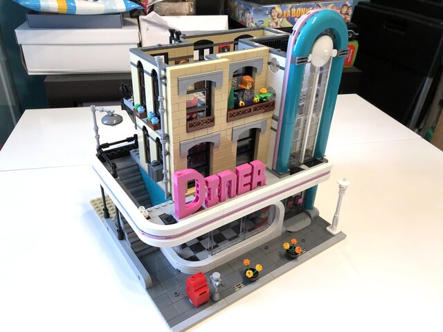](https://www.freelug.org/IMG/jpg/downtowndiner_23.jpg)

[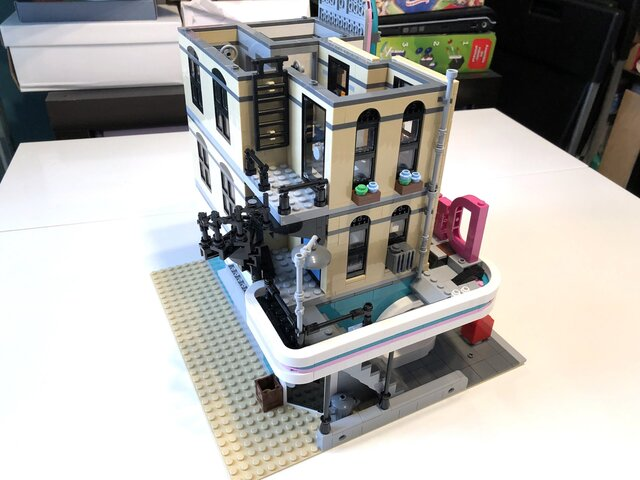](https://www.freelug.org/IMG/jpg/downtowndiner_24.jpg)

[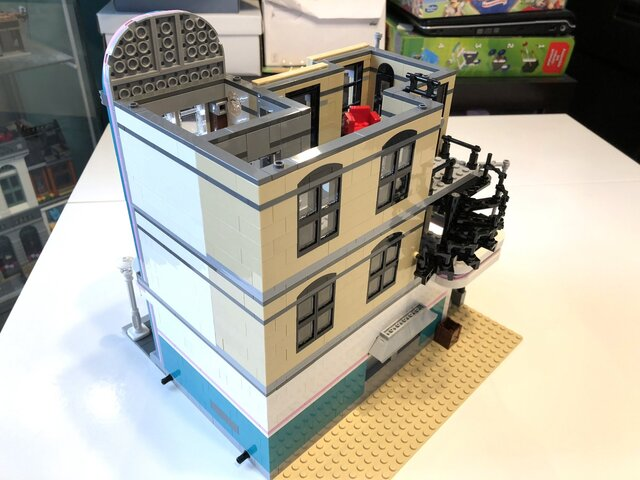](https://www.freelug.org/IMG/jpg/downtowndiner_25.jpg)

[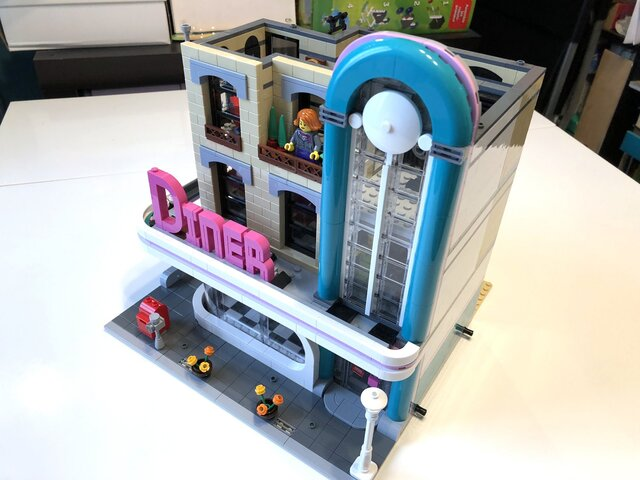](https://www.freelug.org/IMG/jpg/downtowndiner_26.jpg)

Dernière étape, le toit et la _Cadillac_ rose.

[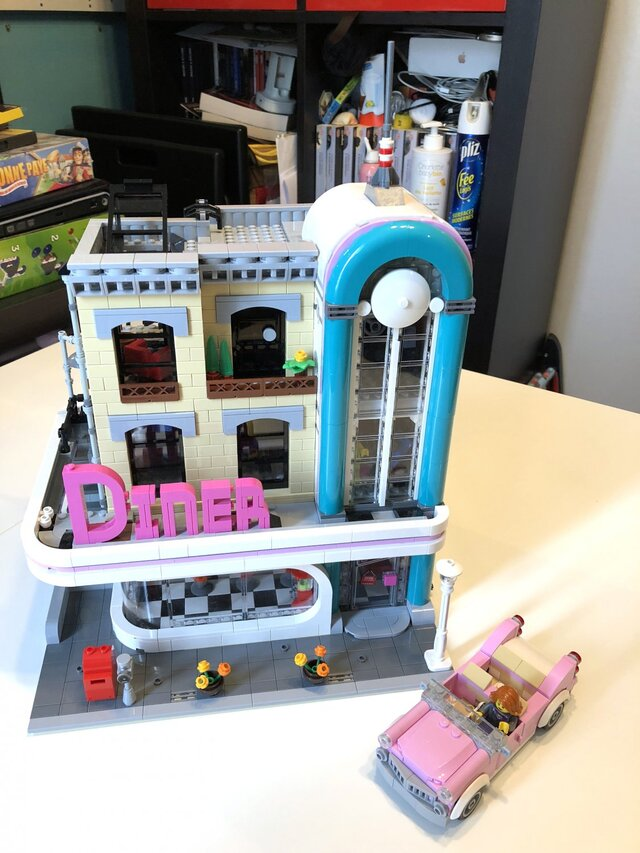](https://www.freelug.org/IMG/jpg/downtowndiner_27.jpg)

[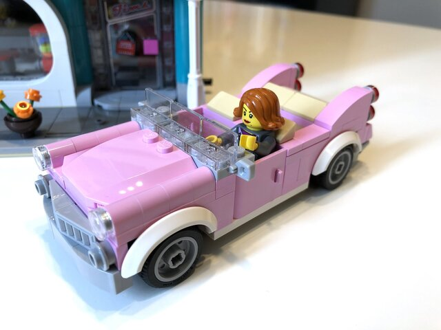](https://www.freelug.org/IMG/jpg/downtowndiner_26-1.jpg)

[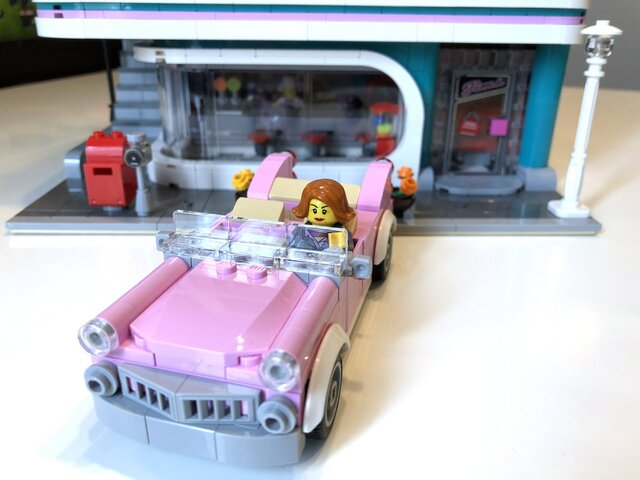](https://www.freelug.org/IMG/jpg/downtowndiner_26-2-2.jpg)

[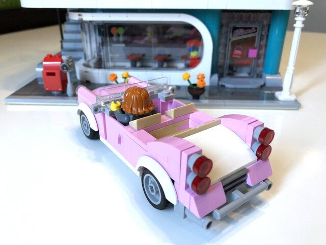](https://www.freelug.org/IMG/jpg/downtowndiner_26-3.jpg)

* * *

-   **Mise en situation :**

Quelques photos de deux _Modular_ accrochés ensemble, ici le _Downtown Diner_ et la _Brick Bank_.

[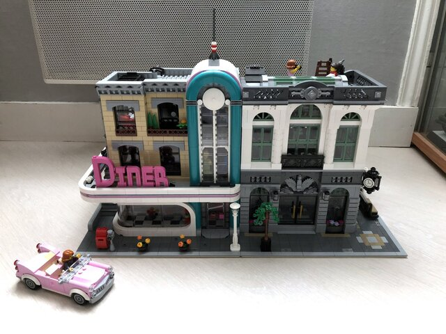](https://www.freelug.org/IMG/jpg/downtowndiner_73.jpg)

[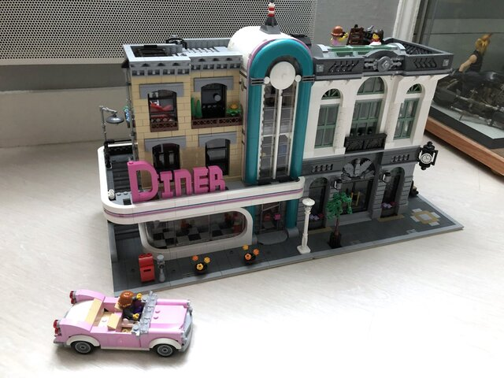](https://www.freelug.org/IMG/jpg/downtowndiner_74.jpg)

[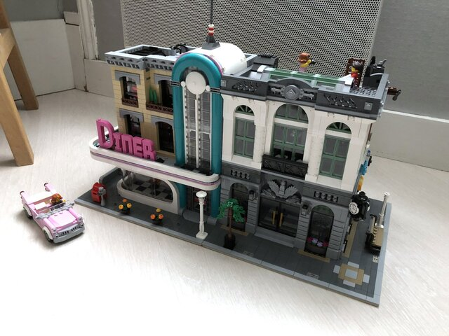](https://www.freelug.org/IMG/jpg/downtowndiner_75.jpg)

* * *

-   **Avis :**

Deuxième _Modular_ et deuxième claque, pour être franc une encore plus grosse claque tant j’ai aimé construire ce _Downtown Diner_. **Enfin** un peu de fraicheur dans les bâtiments aux styles très proches (début du 20ème siècle ou plus) avec une architecture années 50/60. Franchement, cela amène une touche de réalisme en plus.

J’espère vraiment que la société _LEGO_ va continuer dans cette voie et nous proposer maintenant d’autres _Modular_ aux styles années 70 ou 80.

Bref, je ne peux que vous conseiller d’acquérir ce set, le montage et le rendu sont vraiment top. Pour ma part, il rentre directement dans le top 3 des sets que j’ai le plus pris de plaisir à monter.

-   **Bonus #1 :**

Vous pouvez retrouver la review vidéo de ce set sur la chaine YouTube de _[Geekme3](https://youtube.com/channel/UC-ZDWS69odM3k6nDfv7udjw)_ (adhérent FreeLUG) : _[https://www.youtube.com/watch?v=ctlUg16NdB8&feature=youtu.be](https://www.youtube.com/watch?v=ctlUg16NdB8&feature=youtu.be)_

Bonus #2 :

-   **Bonus #2 :**

Voici plusieurs photos prises pendant la construction et une fois le set terminé. Elles vous permettront de vous rendre compte des détails présents dans ce set.

[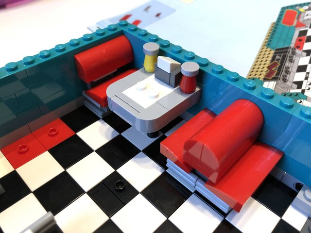](https://www.freelug.org/IMG/jpg/downtowndiner_28.jpg)

[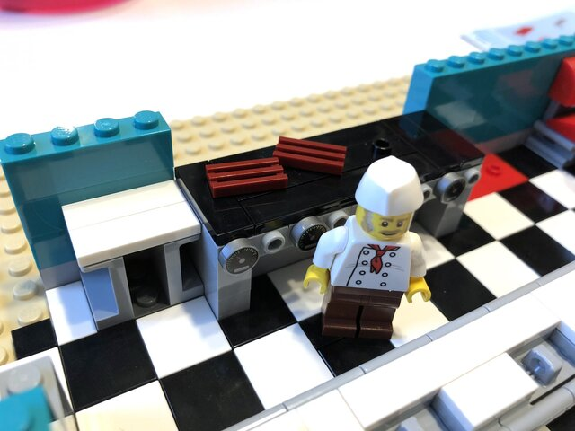](https://www.freelug.org/IMG/jpg/downtowndiner_29.jpg)

[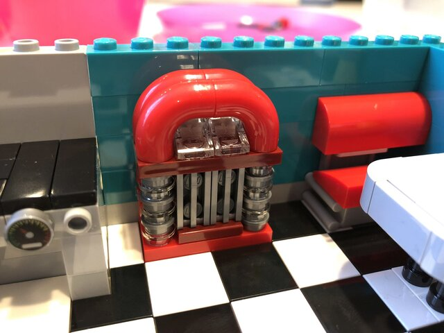](https://www.freelug.org/IMG/jpg/downtowndiner_30.jpg)

[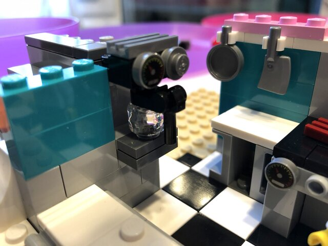](https://www.freelug.org/IMG/jpg/downtowndiner_31.jpg)

[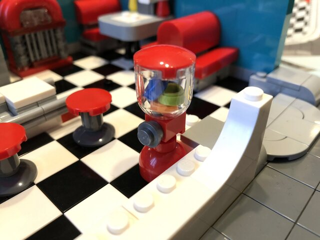](https://www.freelug.org/IMG/jpg/downtowndiner_32.jpg)

[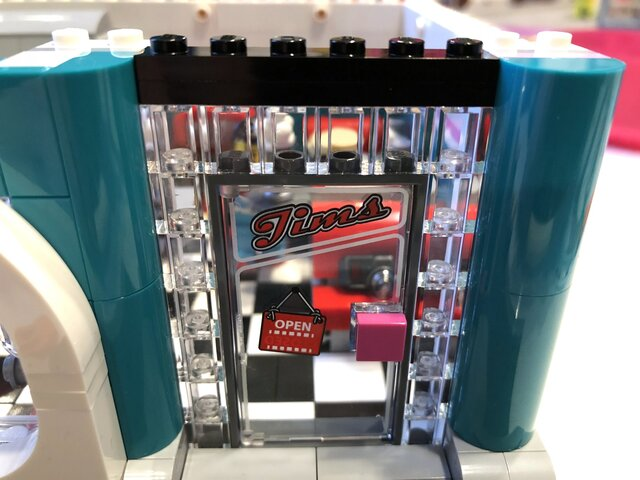](https://www.freelug.org/IMG/jpg/downtowndiner_33.jpg)

[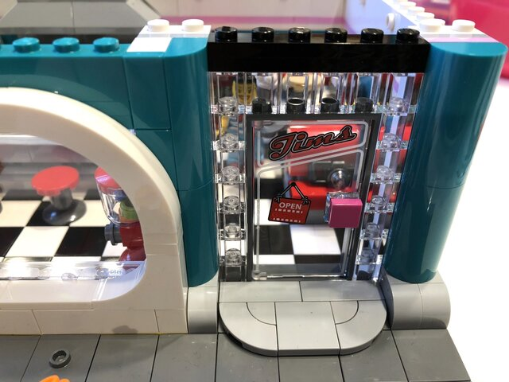](https://www.freelug.org/IMG/jpg/downtowndiner_34.jpg)

[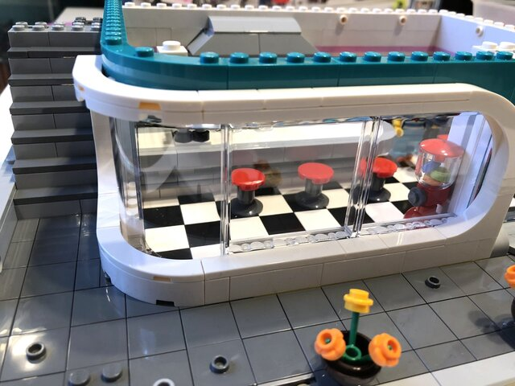](https://www.freelug.org/IMG/jpg/downtowndiner_35.jpg)

[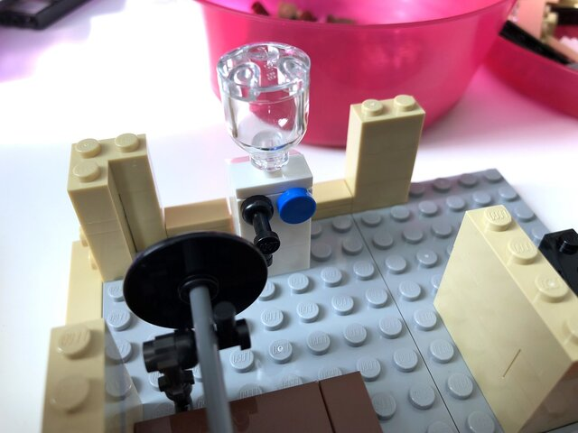](https://www.freelug.org/IMG/jpg/downtowndiner_36.jpg)

[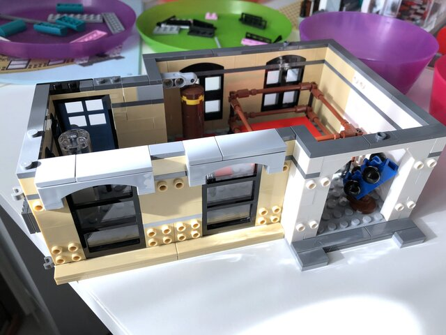](https://www.freelug.org/IMG/jpg/downtowndiner_37.jpg)

[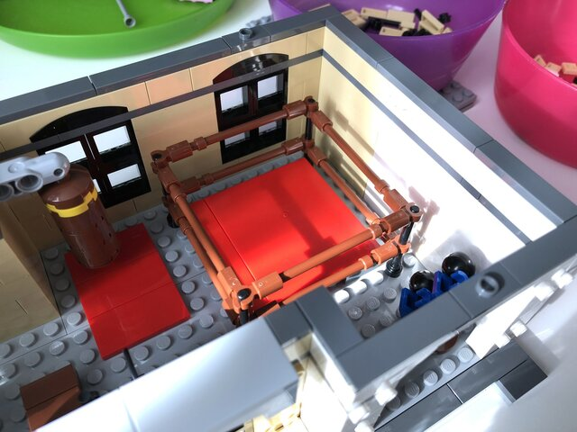](https://www.freelug.org/IMG/jpg/downtowndiner_38.jpg)

