Bonjour à tous, aujourd’hui je vous propose une review du set 21019 dans la gamme _Architecture_ : **The Eiffel Tower**.  
Ce set sorti en 2014 est composé de 321 pièces et coûte 34,99 euros, soit un ratio prix/pièce de 11 centimes d’euros.

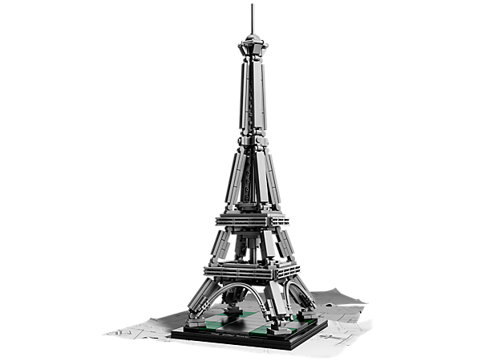

* * *

Au recto, on retrouve la signature noire de la gamme _Architecture_ avec le set mis en avant sur des plans de construction.

[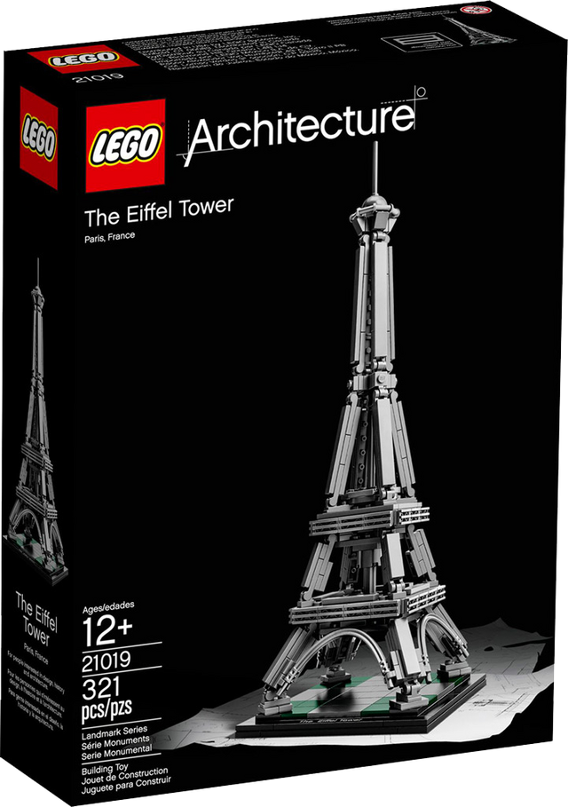](https://www.freelug.org/IMG/png/TourEiffel_01.png)

Au verso, des photos de l’édifice, la taille du modèle _LEGO_ et des informations (EDIT : Oups, j’ai oublié de faire la photo).

La boite contient quatre sachets et une notice assez conséquente.

[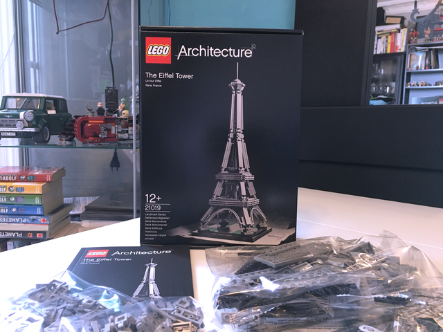](https://www.freelug.org/IMG/jpg/TourEiffel_03.jpg)

Fait assez rare pour le souligner, la tile sérigraphiée au nom du monument est présente en deux exemplaires. Une en anglais comme tous les sets _Architecture_ et une en français.  
Cette petite attention est somme toute bienvenue.

[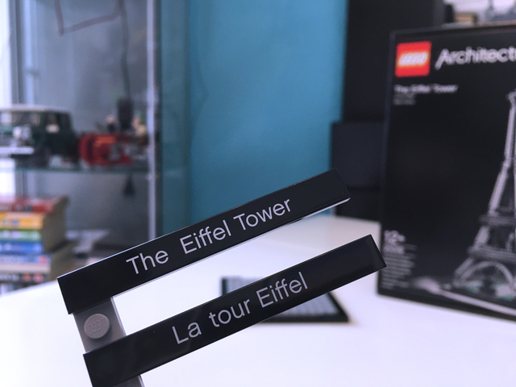](https://www.freelug.org/IMG/jpg/TourEiffel_04.jpg)

On commence la construction par le socle qui portera l’édifice, avec la traditionnelle _tile_ noire sérigraphiée au nom du monument.

[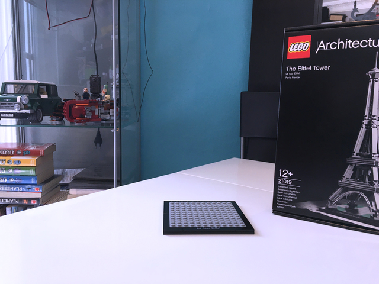](https://www.freelug.org/IMG/jpg/TourEiffel_05.jpg)

Une fois les quatre socles posés, on commence à construire le premier étage de l’édifice.

[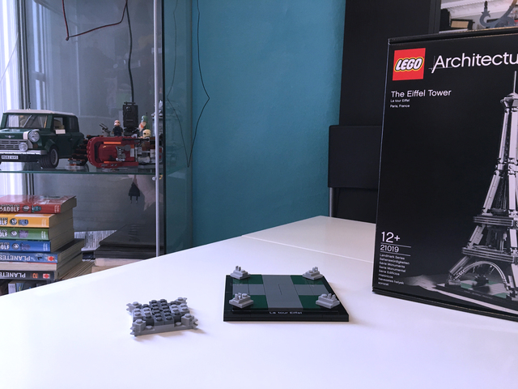](https://www.freelug.org/IMG/jpg/TourEiffel_07.jpg)

Le montage est intéressant même si’il est un poil répétitif puisque les quatre côtés sont identiques.

[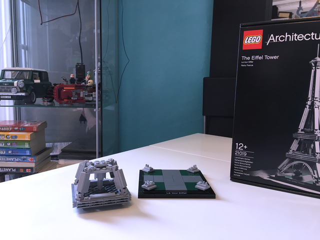](https://www.freelug.org/IMG/jpg/TourEiffel_08.jpg)

Voici la partie centrale de la tour terminée, elle va venir se clipser sur les quatre pieds.

[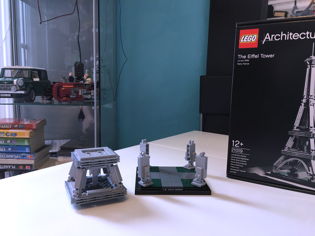](https://www.freelug.org/IMG/jpg/TourEiffel_09.jpg)

On s’attaque maintenant au haut de la tour qui s’affine de plus en plus.

[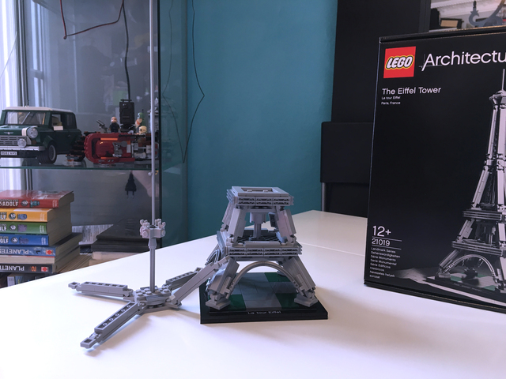](https://www.freelug.org/IMG/jpg/TourEiffel_10.jpg)

Montage astucieux pour la pointe de la tour.

[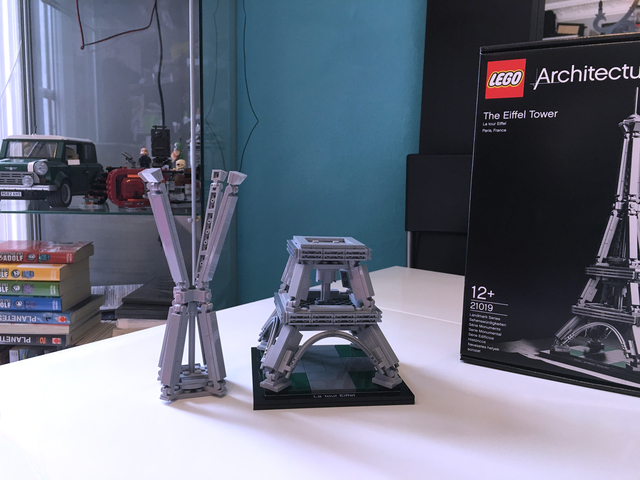](https://www.freelug.org/IMG/jpg/TourEiffel_11.jpg)

Il ne lui manque plus que l’antenne.

[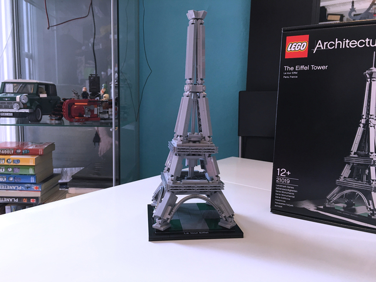](https://www.freelug.org/IMG/jpg/TourEiffel_12.jpg)

Et voici la tour finalisée.

[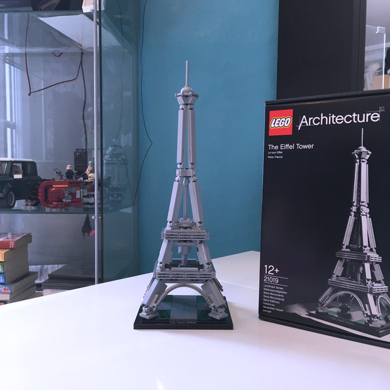](https://www.freelug.org/IMG/jpg/TourEiffel_13.jpg)

**AVIS :**

Un set intéressant à construire et de bonne taille. Une bonne reproduction de notre tour nationale, bref avec un brin de chauvinisme je vous conseille cette boite qui représente un des symbole de la France :)

**BONUS :**

Voici un GIF animé réalisé avec les photos prises pour cette review (cliquez sur l’image pour lancer l’animation).

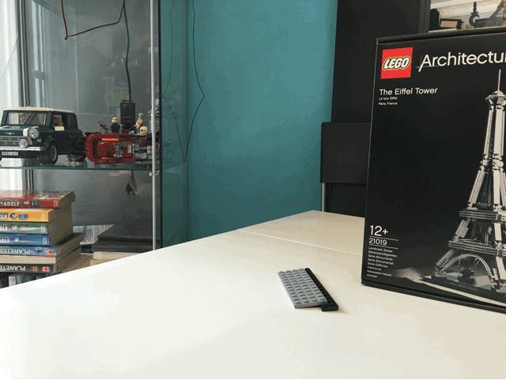
