Aujourd’hui je vous propose la review du set 21027 dans la gamme _Architecture_ : **Berlin**.  
Ce set sorti en 2016 au prix de 29,99 € est composé de 289 pièces, soit un ratio prix/pièce d’environ 10 centimes d’euros.

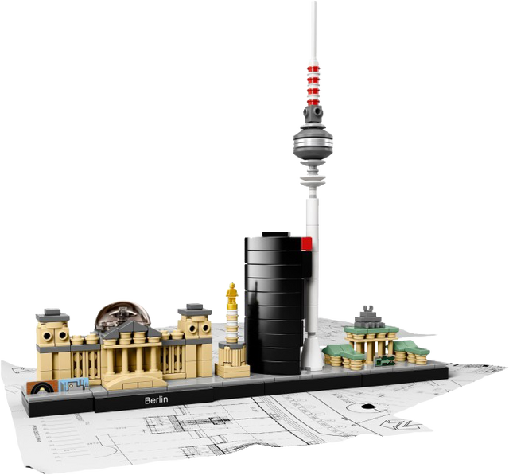

_La société LEGO_ a décidé cette année de faire évoluer sa gamme _Architecture_ en créant un sous-thème _Skylines_ qui nous propose des mini dioramas composés de plusieurs monuments emblématiques d’une ville.  
Après un _Venice_ vraiment réussi (lire la review _[ICI](/articles/review-lego-21026-venice-architecture/)_), voyons si _Berlin_ enfonce le clou.

* * *

La boîte revêt le traditionnel habit noir de la gamme _Architecture_, c’est toujours aussi sobre et classe.

[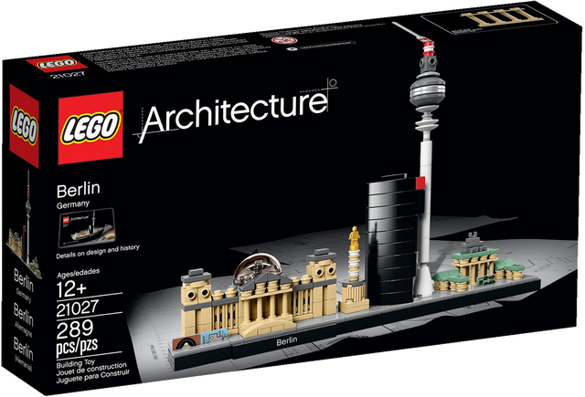](https://www.freelug.org/IMG/png/Berlin_Recto.png)

Au dos on découvre les différents monuments qui composent le diorama, avec des photos des vrais édifices.

[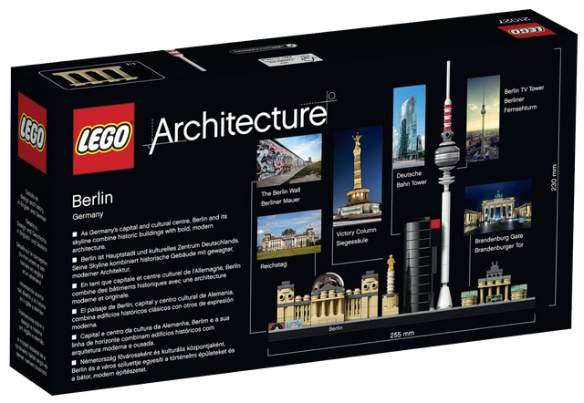](https://www.freelug.org/IMG/png/Berlin_Verso.png)

Ce set est composé de quatre sachets et d’un épais manuel d’instructions. Ce dernier a une finition impeccable et luxueuse avec un dos carré.

[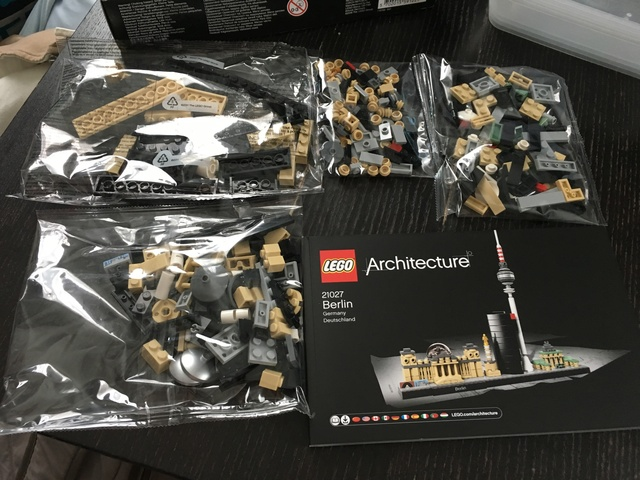](https://www.freelug.org/IMG/jpg/Berlin_01.jpg)

Le diorama fera donc 32x4 tenons (avec une petite excroissance de 2x4 tenons pour le _Reichstag_), vous voyez ici la base montée avec la tile sérigraphiée "_Berlin_".

[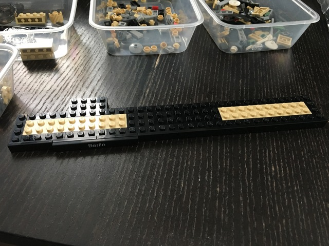](https://www.freelug.org/IMG/jpg/Berlin_02.jpg)

Le sol est composé, entre autres, de tiles grises. On voit sur la gauche les pièces sérigraphiées qui figurent les vestiges du mur de Berlin.

[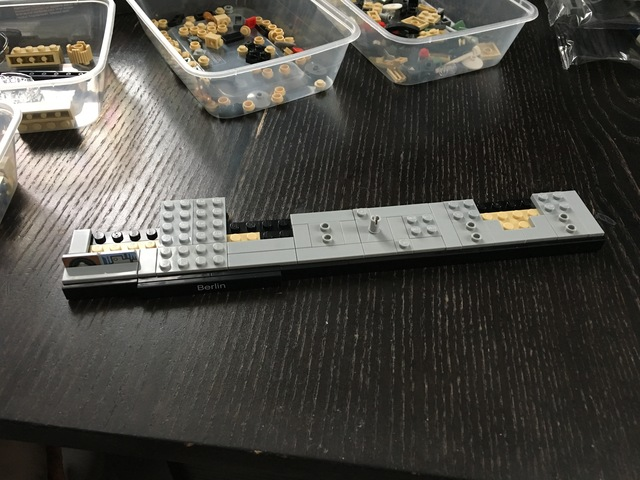](https://www.freelug.org/IMG/jpg/Berlin_03.jpg)

Le premier édifice monté, le _Reichstag_.

[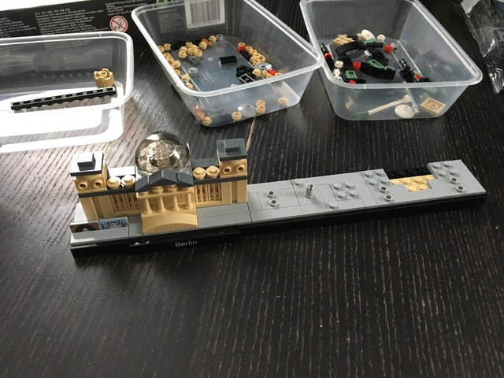](https://www.freelug.org/IMG/jpg/Berlin_04.jpg)

Gros plan sur le _Reichstag_ et la _colonne de la victoire_. On peut voir la construction ingénieuse pour la coupole.

[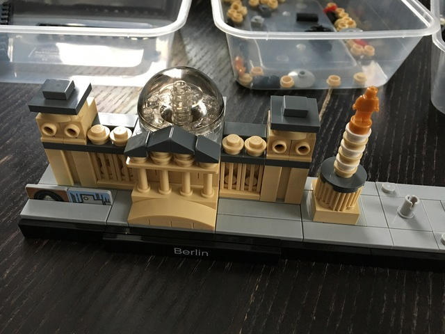](https://www.freelug.org/IMG/jpg/Berlin_05.jpg)

S’ensuit la _Deutsch Bahn Tower_ avec son design contemporain.

[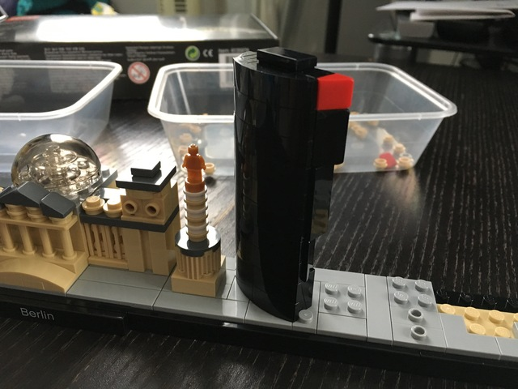](https://www.freelug.org/IMG/jpg/Berlin_06.jpg)

Puis la _Berlin TV Tower_.

[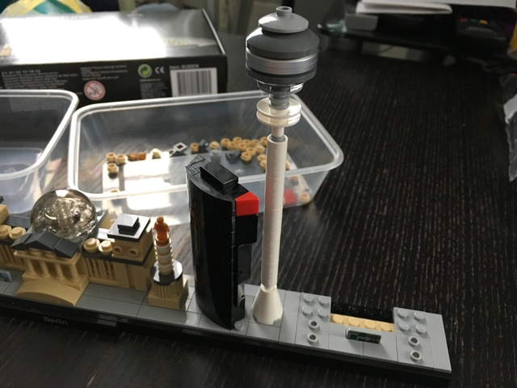](https://www.freelug.org/IMG/jpg/Berlin_07.jpg)

On finit par la _Porte de Brandenburg_ et la troisième pièce du mur de Berlin de ce set.

[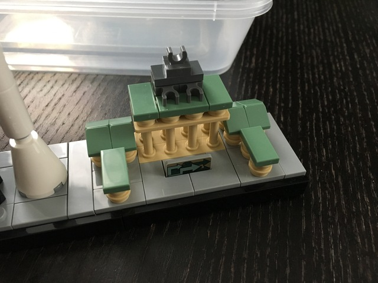](https://www.freelug.org/IMG/jpg/Berlin_08.jpg)

Le set une fois terminé. La _Berlin TV Tower_ est vraiment grande.

[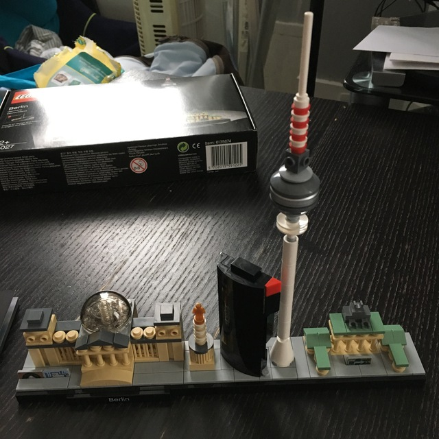](https://www.freelug.org/IMG/jpg/Berlin_10-2.jpg)

Avec une Minifig pour vous rendre compte de l’échelle.

[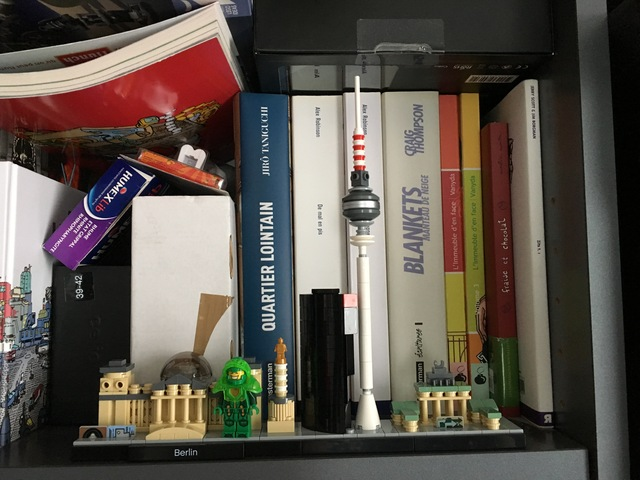](https://www.freelug.org/IMG/jpg/Berlin_11.jpg)

* * *

**AVIS :**

_La société LEGO_ réussi le pari de "réinventer" sa gamme _Architecture_ en exploitant l’idée de diorama. Comme pour _Venice_, le rendu final est vraiment au rendez-vous.

Décidément, ces nouveaux _Skylines_ sont une vraie réussite.
