Aujourd’hui, je vous propose la review du set 21028 dans la gamme _Architecture_ : **New York City**.

Ce set, sorti en 2016 au prix de 49,99 €, est composé de 598 pièces, soit un ratio prix/pièce d’environ 8 centimes d’euros.

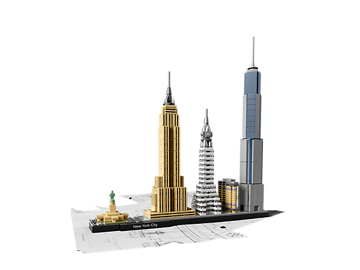

_LEGO_ a décidé en 2016 de faire évoluer sa gamme _Architecture_ en créant un sous-thème _Skylines_. Celui-ci propose des mini dioramas composés de plusieurs monuments emblématiques d’une ville. Après un _Venice_ vraiment réussi ([relire la review](/articles/review-lego-21026-venice-architecture/)) et un _Berlin_ superbe ([relire la review](/articles/review-lego-21027-berlin-architecture/)), voyons si _New York City_ assoit la gamme _Skylines_.

* * *

La boite revêt le traditionnel habit noir de la gamme _Architecture_, tout en sobriété.

[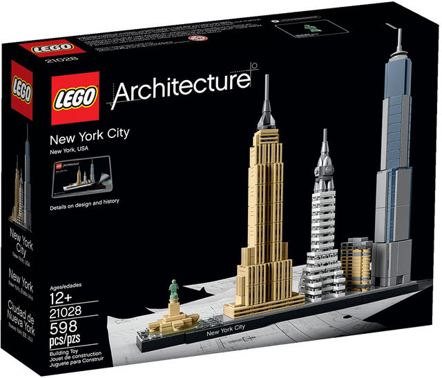](https://www.freelug.org/IMG/png/NYC_BoxRecto.png)

Au dos, on découvre les différents monuments qui composent le diorama, avec des photos des vrais édifices.

[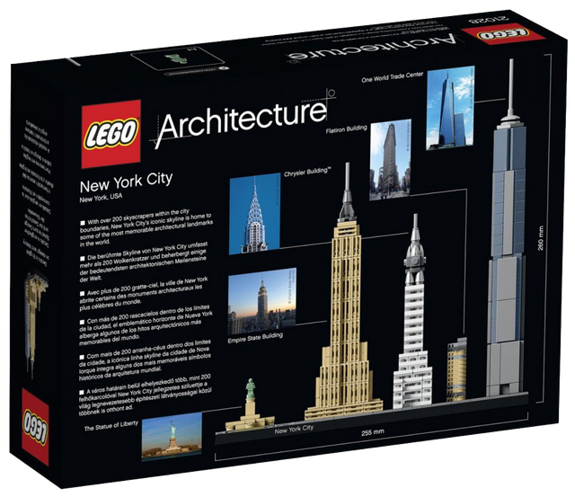](https://www.freelug.org/IMG/png/NYC_BoxVerso.png)

Ce set est composé de six sachets et d’un épais manuel d’instructions. Ce dernier a une finition impeccable et luxueuse avec un dos carré.

[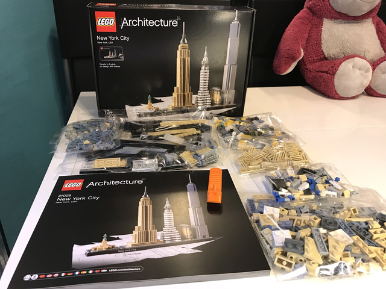](https://www.freelug.org/IMG/jpg/NYC_01.jpg)

* * *

Le diorama fera donc 32x4 tenons (avec une petite excroissance de 1x5 tenons pour la _Statue de la Liberté_), vous voyez ici la base montée avec la tile sérigraphiée "**New York City**".

[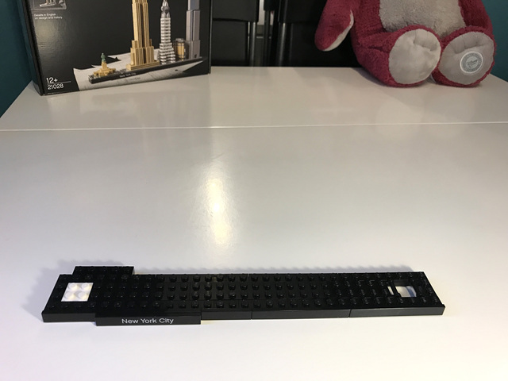](https://www.freelug.org/IMG/jpg/NYC_02.jpg)

Le sol est composé, entre autres, de tiles grises. Sur la droite l’emplacement du _One World Trade Center_ qui sera clipsé sur le socle, original.

[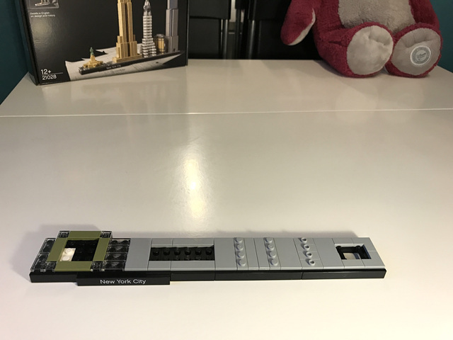](https://www.freelug.org/IMG/jpg/NYC_03.jpg)

Le premier édifice monté, la _Statue de la Liberté_ sur son île.

[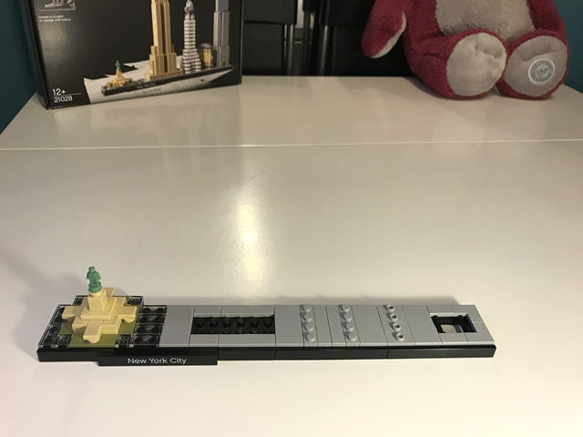](https://www.freelug.org/IMG/jpg/NYC_04.jpg)

Focus sur la construction de l’_Empire State Building_.

[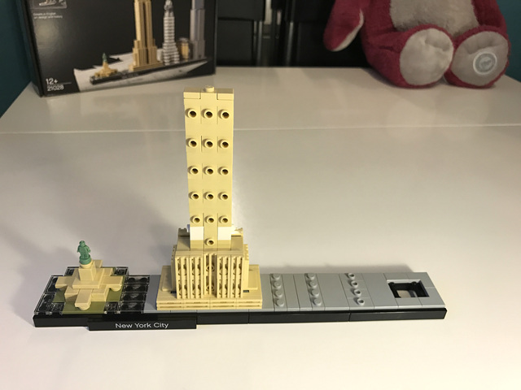](https://www.freelug.org/IMG/jpg/NYC_05.jpg)

Une fois l’_Empire State Building_ terminé, on commence le _Chrysler Building_ et son mille-feuilles de plates blanche et trans-clear.

[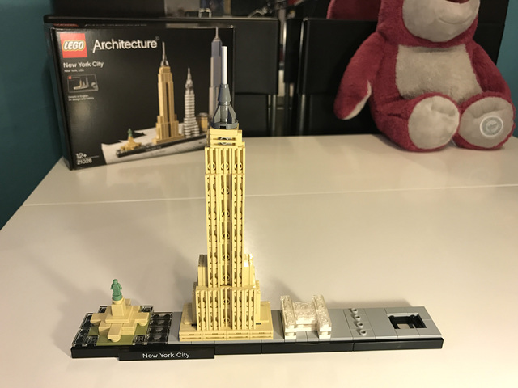](https://www.freelug.org/IMG/jpg/NYC_06.jpg)

On enchaine avec la construction du _Flatiron Building_, simple mais efficace.

[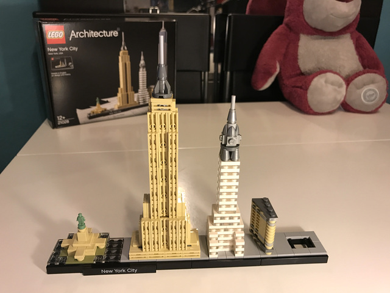](https://www.freelug.org/IMG/jpg/NYC_07.jpg)

On finit par le _One World Trade_ Center.

[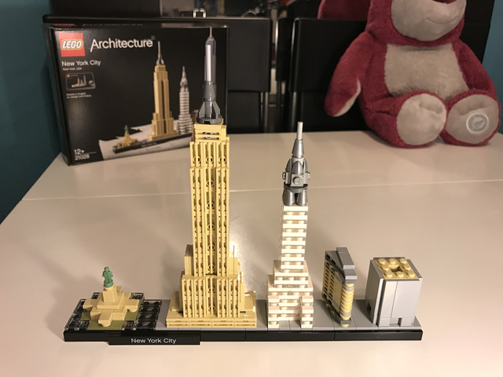](https://www.freelug.org/IMG/jpg/NYC_08.jpg)

Construction intéressante en quatre blocs distincts.

[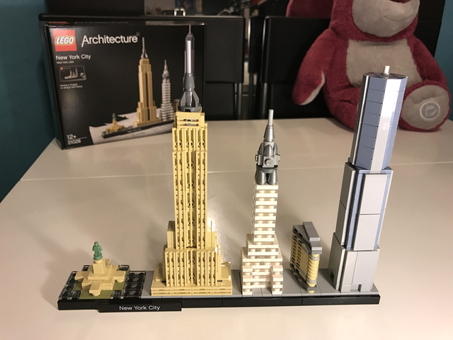](https://www.freelug.org/IMG/jpg/NYC_09.jpg)

Voilà le _Skyline New York City_ terminé vu sous plusieurs angles.

[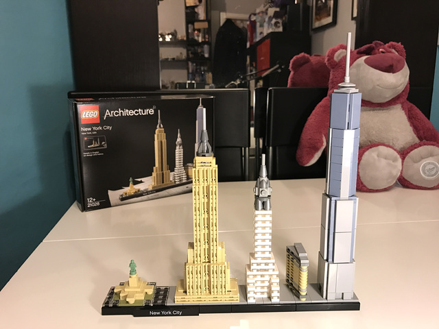](https://www.freelug.org/IMG/jpg/NYC_10.jpg)

[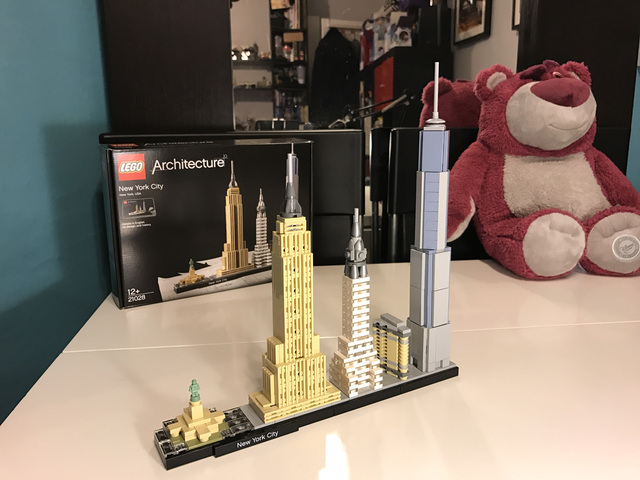](https://www.freelug.org/IMG/jpg/NYC_11.jpg)

[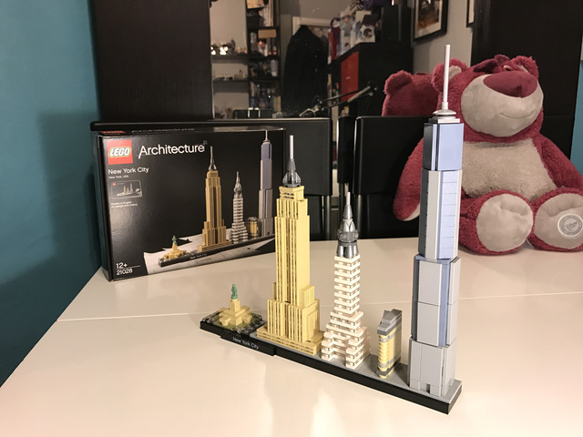](https://www.freelug.org/IMG/jpg/NYC_12.jpg)

* * *

**AVIS :**

_LEGO_ enfonce le clou avec ce troisième set de la première vague _Skyline_ et transforme son pari de "réinventer" sa gamme _Architecture_ en exploitant l’idée de diorama.  
Sur cette série 2016, _New York City_ est le plus intéressant niveau techniques de construction, par contre niveau rendu final, mon coup de cœur va vers _Berlin_ que je trouve plus abouti.

**BONUS :**

Voici un GIF animé réalisé avec la totalité des photos prises pour cette review (cliquez sur l’image pour lancer l’animation).

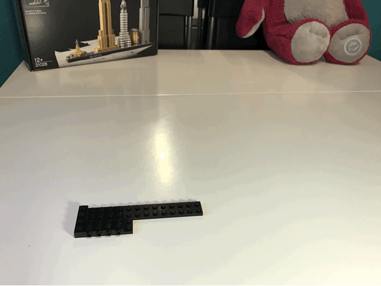
