Bonjour à tous, aujourd’hui je vous propose une review du set 21031 dans la gamme _Architecture_ : **Burj Khalifa**.  
Ce set sorti en 2016 est composé de 333 pièces et coûte 39,99 euros, soit un ratio prix/pièce de 12 centimes d’euros.

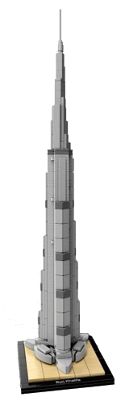

* * *

Au recto, on retrouve la signature noire de la gamme _Architecture_ avec le set mis en avant sur des plans de construction.

[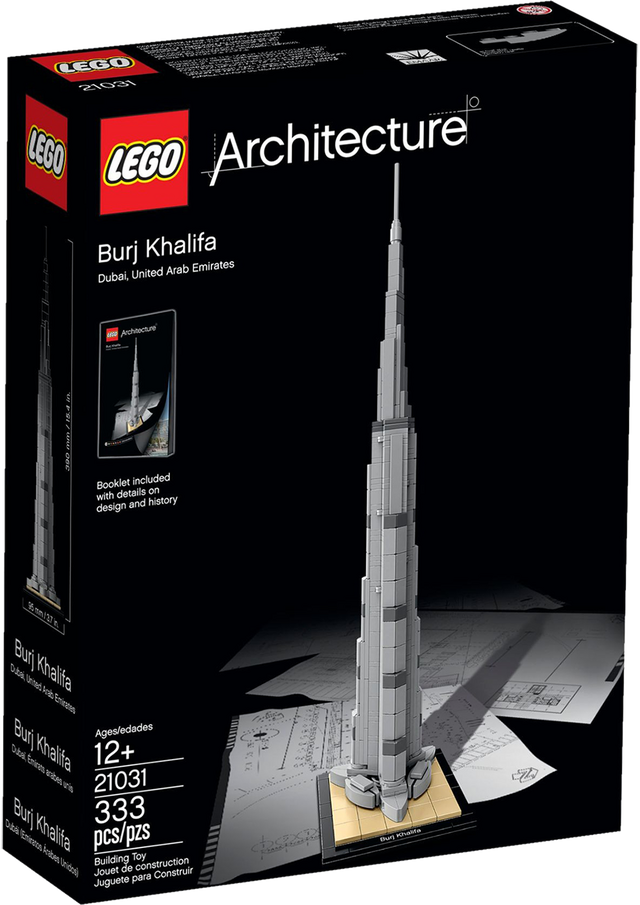](https://www.freelug.org/IMG/png/BurjKhalifa_BoxRecto.png)

Au verso, des photos de l’édifice, la taille du modèle _LEGO_ et des informations.

[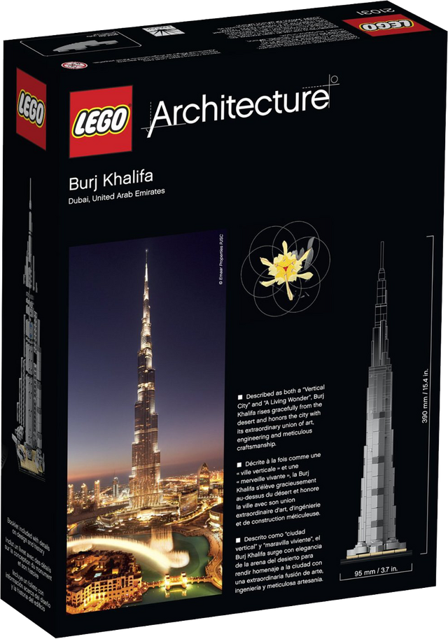](https://www.freelug.org/IMG/png/BurjKhalifa_BoxVerso.png)

La boite contient deux sachets et une notice assez conséquente.

[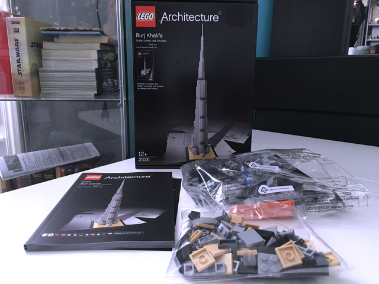](https://www.freelug.org/IMG/jpg/BurjKhalifa_01.jpg)

On commence la construction avec le socle qui portera l’édifice, avec la traditionnelle _Tile_ noire sérigraphiée au nom du monument.

[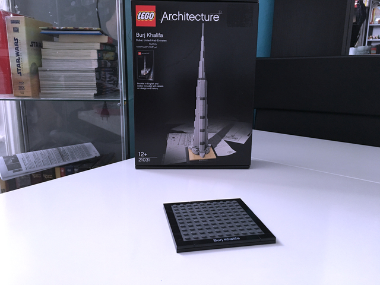](https://www.freelug.org/IMG/jpg/BurjKhalifa_02.jpg)

On habille de _Tile_ couleur _Tan_.

[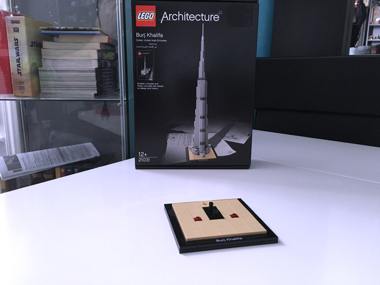](https://www.freelug.org/IMG/jpg/BurjKhalifa_03.jpg)

Viennent ensuite deux pièces _Technic_ qui permettront de fixer la tour.

[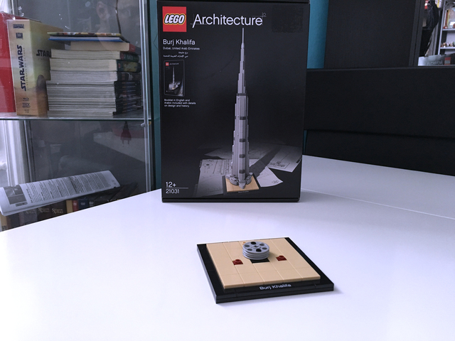](https://www.freelug.org/IMG/jpg/BurjKhalifa_04.jpg)

La base de la tour est montée.

[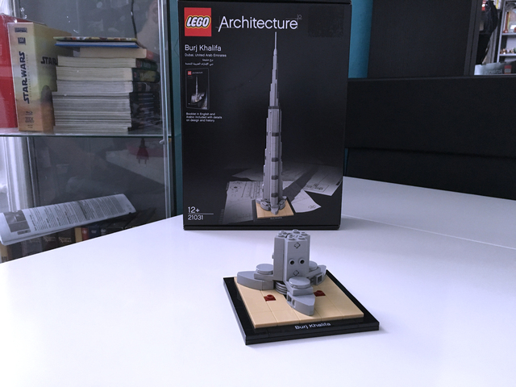](https://www.freelug.org/IMG/jpg/BurjKhalifa_05.jpg)

La base est complètement terminée, on continue de monter la tour.

[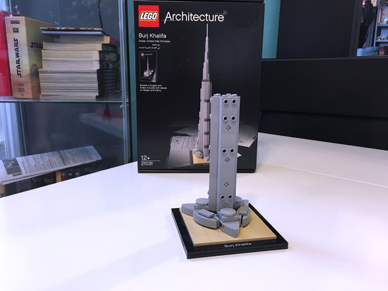](https://www.freelug.org/IMG/jpg/BurjKhalifa_06.jpg)

Obligé de changer de perspective car la tour prend vraiment de la hauteur.

[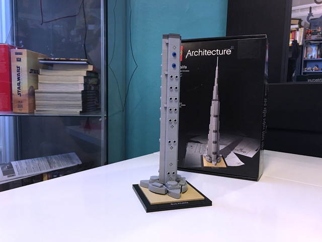](https://www.freelug.org/IMG/jpg/BurjKhalifa_07.jpg)

On habille maintenant les trois faces.

[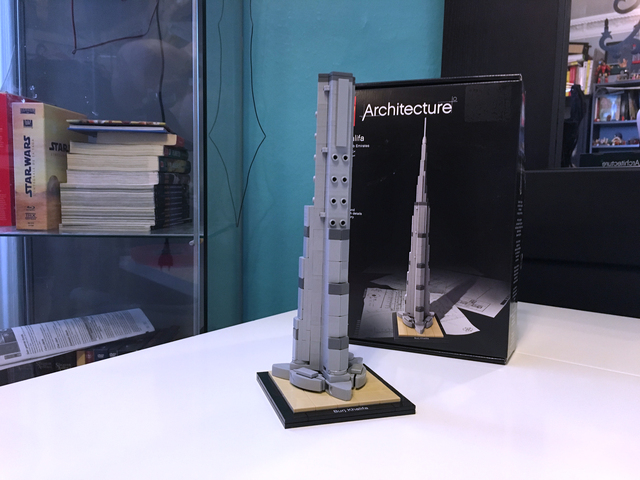](https://www.freelug.org/IMG/jpg/BurjKhalifa_08.jpg)

Et voici le modèle fini, haut de 39 cm tout de même.

[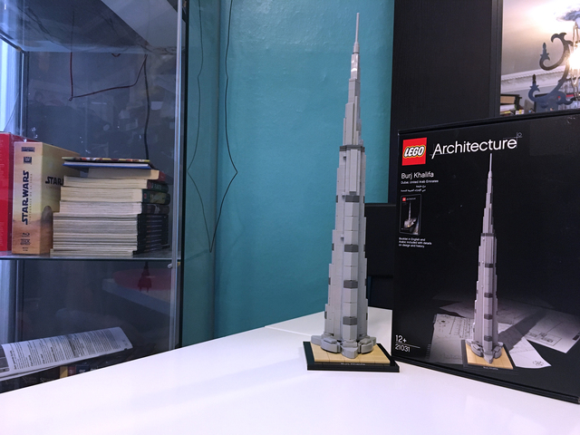](https://www.freelug.org/IMG/jpg/BurjKhalifa_09.jpg)

* * *

Petite comparaison du modèle 2016 à côté du modèle 2011 (_[21008](http://brickset.com/sets/21008-1/Burj-Khalifa)_). L’évolution saute immédiatement aux yeux.

[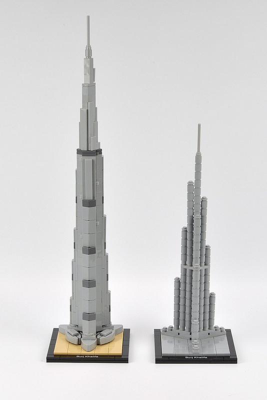](https://www.freelug.org/IMG/jpg/BurjKhalifa_2001-2016.jpg)

Pour vous rendre compte de la taille du modèle, voici une photo avec une Minifigure pour l’échelle.

[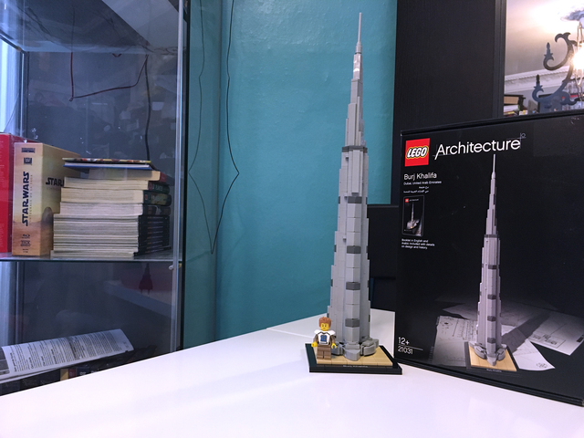](https://www.freelug.org/IMG/jpg/BurjKhalifa_10.jpg)

* * *

**AVIS :**

Une très belle réédition d’un set autrefois trop simpliste. Une boite _Architecture_ qui ravira les fans de la gamme à coup sûr.

**BONUS :**

Voici un GIF animé réalisé avec les photos prises pour cette review (cliquez sur l’image pour lancer l’animation).

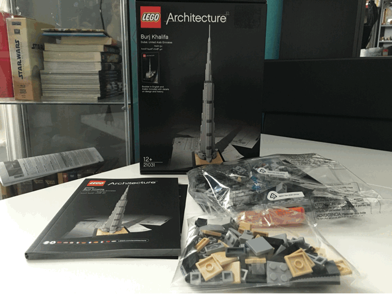
