Bonjour à tous, aujourd’hui je vous propose une review du set 21306 dans la gamme _Ideas_ : **The Beatles Yellow Submarine**.

Ce set, sorti en 2016, est composé de 550 pièces et coûte 59,99 euros, soit un ratio prix/pièce d’environ 11 centimes d’euros.

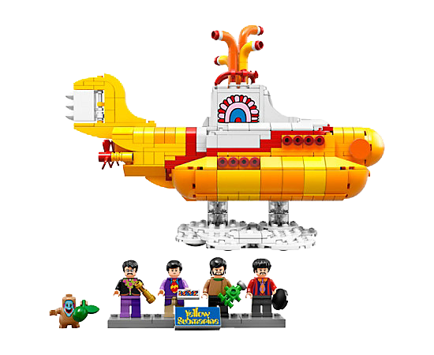

> _LEGO Cusoo_ renommé le 30 avril 2015 en _LEGO Ideas_ est un projet de _The LEGO Group_ créé en 2008.
> 
> Le projet consiste en ce qu’un joueur/créateur de _LEGO_ propose une de ses créations sur le site de _LEGO Ideas_. Si la boîte obtient 10000 votes et qu’elle est accepté par des créateurs _LEGO_, elle est alors mise en vente.  
> Le constructeur de la boîte reçoit 1% de l’argent gagné par la vente du produit. (Source _[Wikipedia](https://fr.wikipedia.org/wiki/Lego_Ideas)_)

* * *

Au recto de la boite, on retrouve le logo _Ideas_ en bas à droite. Le set est présenté sur un fond bleu et des éléments sortis du dessin animé _Yellow Submarine_.  
La décoration nous met dans le bain au premier coup d’œil.

[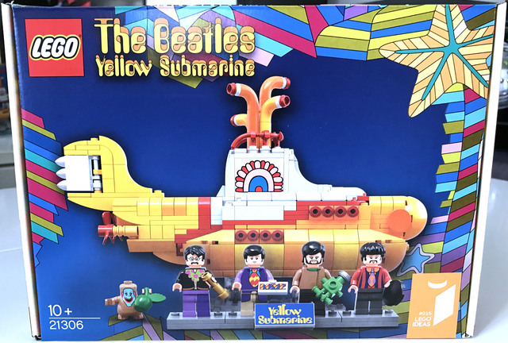](https://www.freelug.org/IMG/jpg/YellowSubmarine_01.jpg)

Au verso, sont présentés les personnages présents dans le set, ainsi que des éléments de jouabilité.

[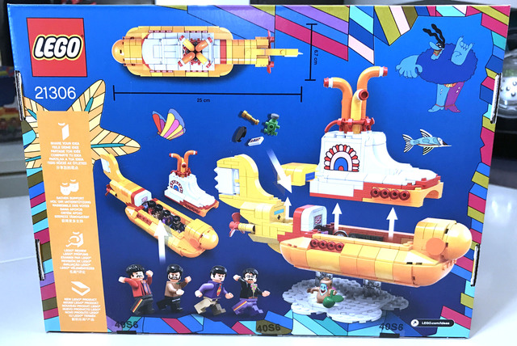](https://www.freelug.org/IMG/jpg/YellowSubmarine_02.jpg)

La boite contient cinq sachets et une notice assez conséquente. Cette dernière est brochée et contient moult photos, explications et anecdotes.  
Malheureusement le texte n’est pas pas traduit, il est vraiment dommage que _LEGO_ ne fasse pas l’effort pour régionaliser ses sets "premium".

[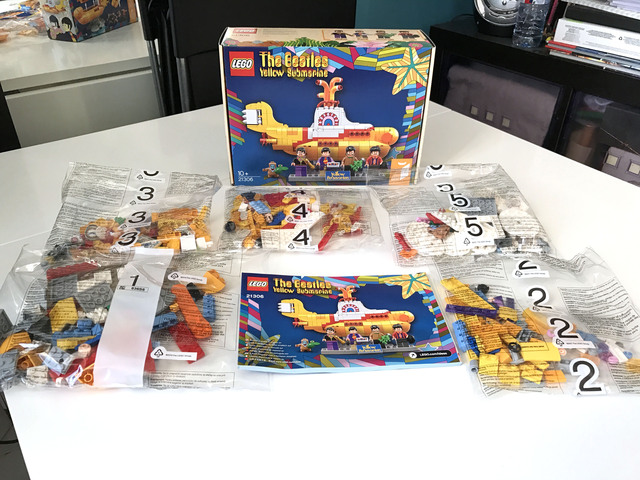](https://www.freelug.org/IMG/jpg/YellowSubmarine_03.jpg)

* * *

_[John Lennon](http://brickset.com/minifigs/idea025/The-Beatles-John)_ est reconnaissable grâce à ses lunettes rondes, le visage est réussi et pourra être réutilisé par les MOCeurs. La sérigraphie du torse est bien réalisée mais donne un gout de trop peu, c’est dommage. Impossible de trouver quel souvenir il ramène de l’aventure.

[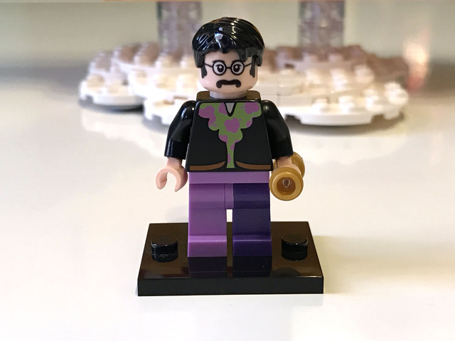](https://www.freelug.org/IMG/jpg/YellowSubmarine_04.jpg)

De dos c’est pas la joie, mais on reste complétement dans l’esprit des personnages du film. Le visage alternatif avec les "dents de lapin", _So british_.

[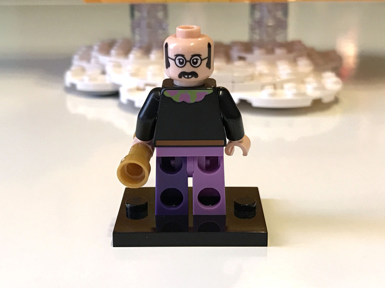](https://www.freelug.org/IMG/jpg/YellowSubmarine_05.jpg)

De côté on a le droit à des bandes sérigraphiées sur le pantalon.

[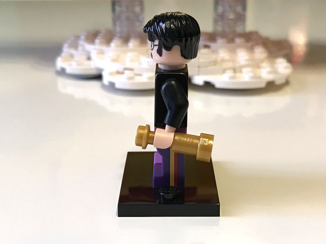](https://www.freelug.org/IMG/jpg/YellowSubmarine_06.jpg)

[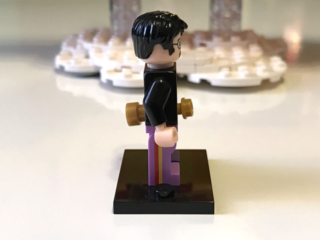](https://www.freelug.org/IMG/jpg/YellowSubmarine_07.jpg)

_[Paul McCartney](http://brickset.com/minifigs/idea026/The-Beatles-Paul)_ avec son souvenir, l’amour. Sérigraphie sur le torso (mention spéciale pour la cravate) et les jambes. Le visage fait ultra juvénile mais colle parfaitement au _Paul_ de l’époque.

[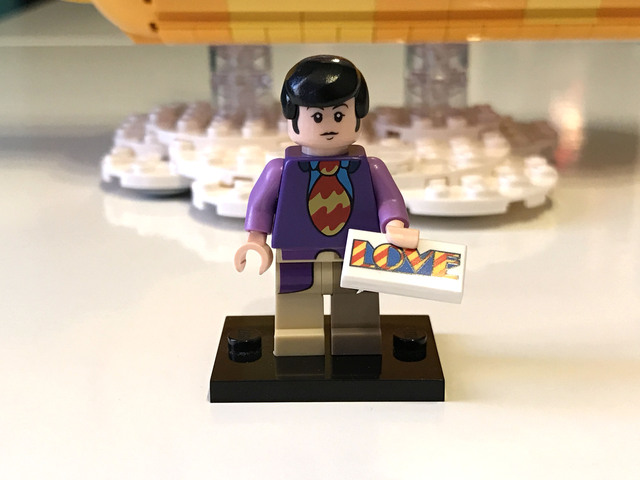](https://www.freelug.org/IMG/jpg/YellowSubmarine_08.jpg)

De dos, c’est le strict minimum. Le visage alternatif avec bouche ouverte est sympathique.

[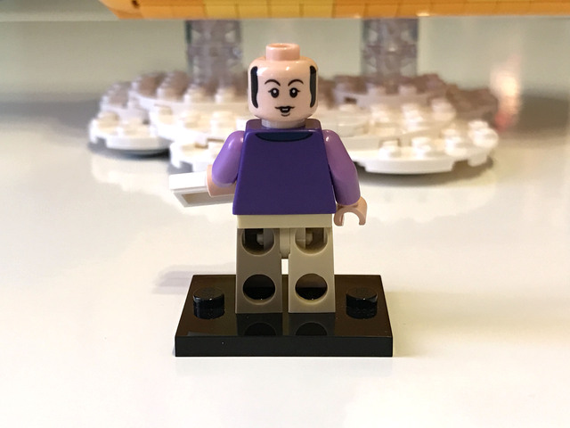](https://www.freelug.org/IMG/jpg/YellowSubmarine_09.jpg)

Aucune sérigraphie ne vient agrémenter les cotés

[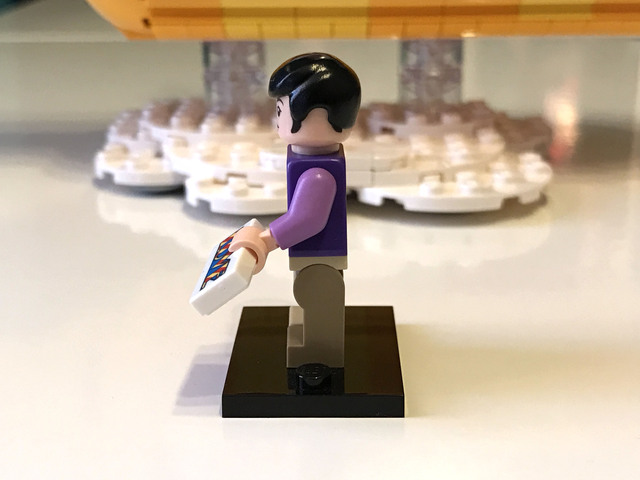](https://www.freelug.org/IMG/jpg/YellowSubmarine_10.jpg)

[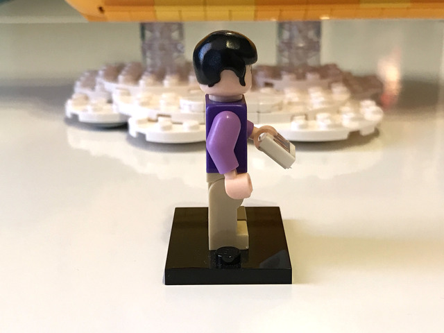](https://www.freelug.org/IMG/jpg/YellowSubmarine_11.jpg)

_[Georges Harrison](http://brickset.com/minifigs/idea027/The-Beatles-George)_ se voit affublé de la coiffure de _Sabine_ dans _Star Wars Rebel_, avec son visage barbu on se croirait presque en face de _Georges Lucas_ jeune. Le torso est pour le moins vide, avec une sérigraphie minimaliste. _Georges_ est accompagné par son souvenir, le moteur du _Yellow Submarine_.

[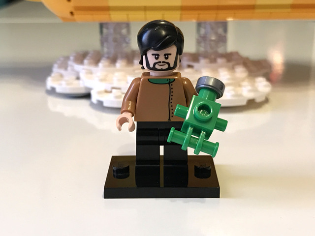](https://www.freelug.org/IMG/jpg/YellowSubmarine_12.jpg)

Le dos est quasi exempt de sérigraphie, le visage alternatif souriant est plutôt réussi.

[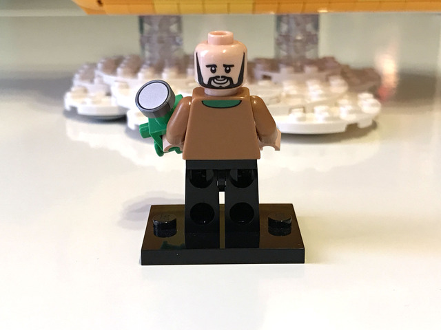](https://www.freelug.org/IMG/jpg/YellowSubmarine_13.jpg)

Ici aussi, pas de sérigraphie sur les côtés.

[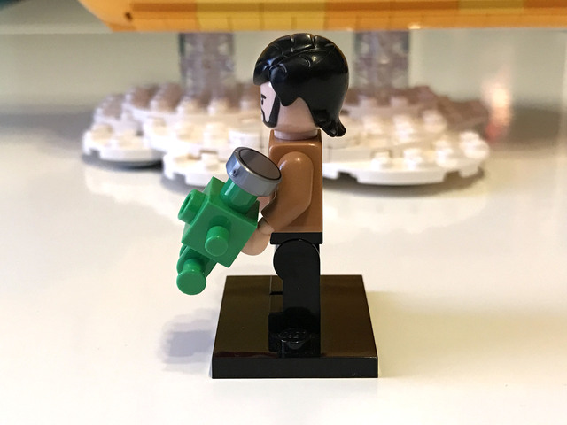](https://www.freelug.org/IMG/jpg/YellowSubmarine_14.jpg)

[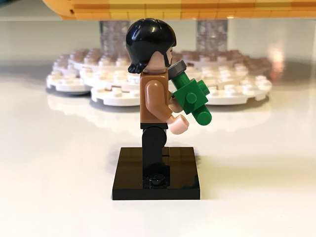](https://www.freelug.org/IMG/jpg/YellowSubmarine_15.jpg)

_[Ringo Starr](http://brickset.com/minifigs/idea028/The-Beatles-Ringo)_ est plutôt ressemblant même si la coupe de cheveux champignon (rarement vue depuis la gamme _Harry Potter_) n’est pas des plus esthétiques. La sérigraphie aux couleurs acidulées est joliment réalisée.  
Le souvenir que _Ringo_ ramène est la moitié d’un trou, d’où la _tile round 2x2 noire_ dans sa main.

[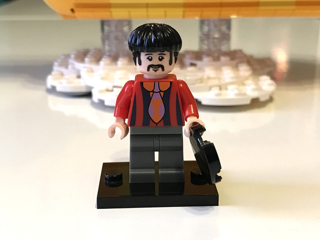](https://www.freelug.org/IMG/jpg/YellowSubmarine_16.jpg)

Le verso est plus sobre que le recto. Le visage alternatif souriant est une vraie réussite.

[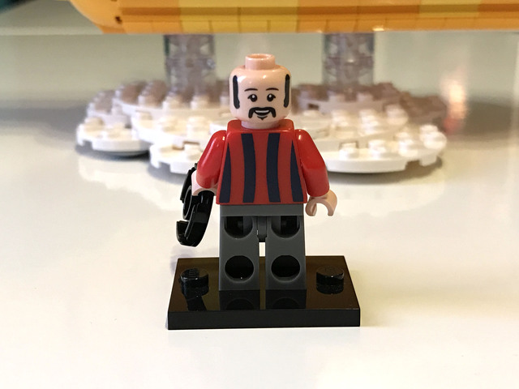](https://www.freelug.org/IMG/jpg/YellowSubmarine_17.jpg)

Des bandes de couleurs viennent agrémenter les jambes de _Ringo_.

[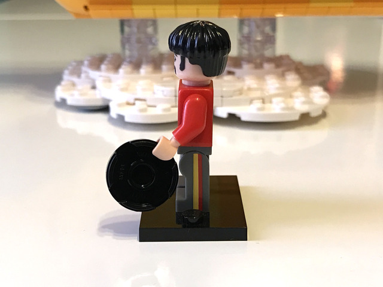](https://www.freelug.org/IMG/jpg/YellowSubmarine_18.jpg)

[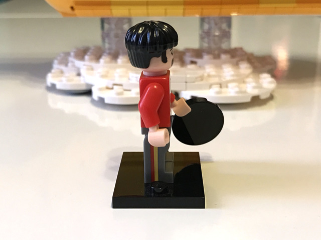](https://www.freelug.org/IMG/jpg/YellowSubmarine_19.jpg)

_[Jeremy Hillary Boob](http://brickset.com/minifigs/idea029/The-Beatles-Jeremy)_ est dans le film un habitant de la _mer du Rien_. Belle sérigraphie pour cette réutilisation de personnages apparus dans la gamme _Nexo Knight_.

[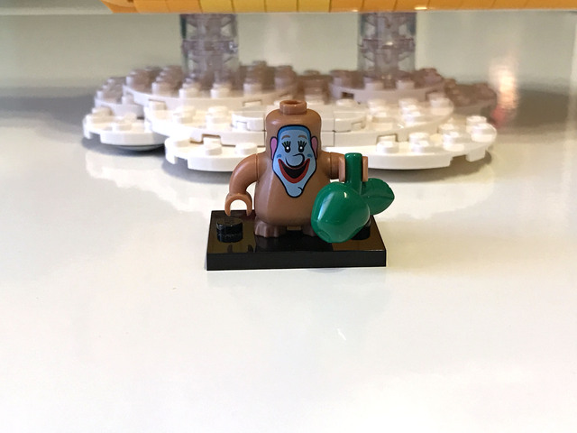](https://www.freelug.org/IMG/jpg/YellowSubmarine_20.jpg)

Au dos, une excroissance somme toute bizarre Ôo

[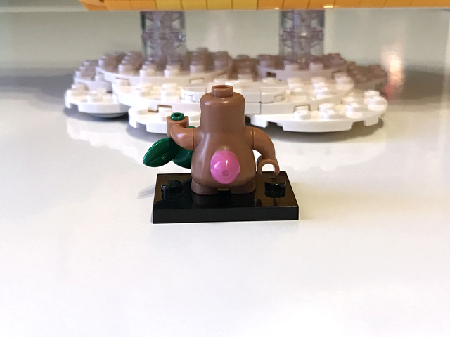](https://www.freelug.org/IMG/jpg/YellowSubmarine_21.jpg)

* * *

Set _Ideas_ oblige, aucun sticker n’est présent dans la boite, toutes les pièces sont sérigraphiées. Les photos ci-après vous montrent l’ensemble des pièces ayant droit à ce traitement.

[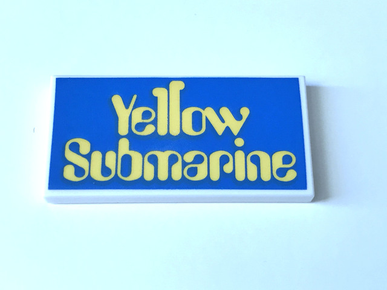](https://www.freelug.org/IMG/jpg/YellowSubmarine_22.jpg)

[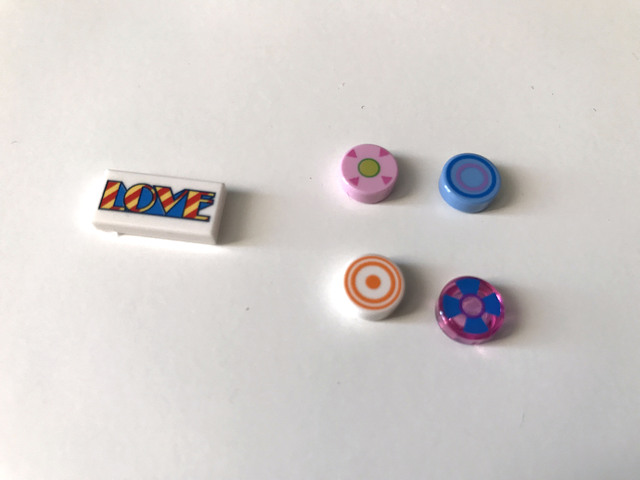](https://www.freelug.org/IMG/jpg/YellowSubmarine_24.jpg)

[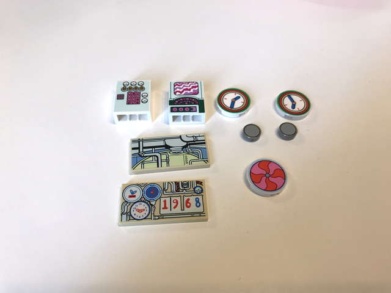](https://www.freelug.org/IMG/jpg/YellowSubmarine_25.jpg)

[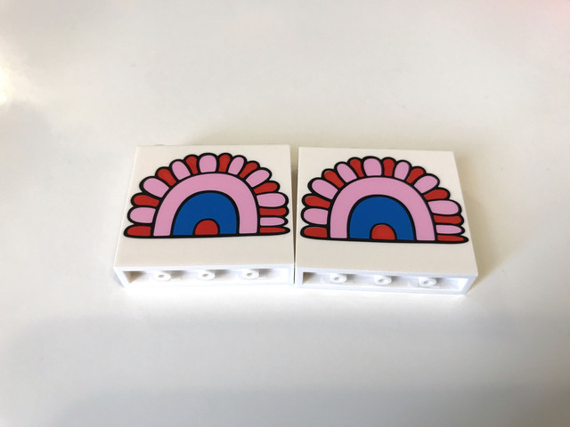](https://www.freelug.org/IMG/jpg/YellowSubmarine_26.jpg)

Nouvelles méta-pièces introduites par _LEGO_ dans ce set.

[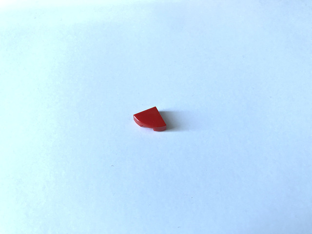](https://www.freelug.org/IMG/jpg/YellowSubmarine_23.jpg)

[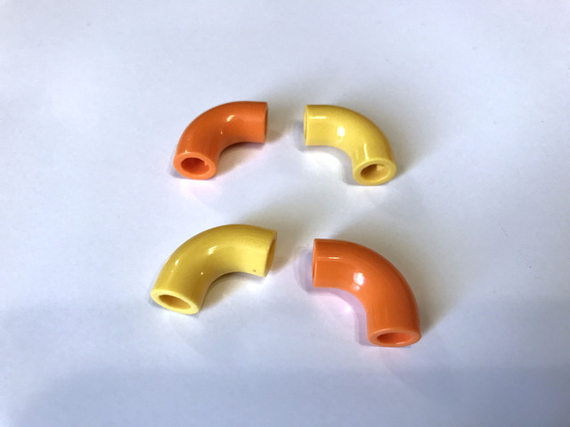](https://www.freelug.org/IMG/jpg/YellowSubmarine_27.jpg)

On commence la construction par l’estrade qui permettra d’exposer les quatre garçons dans le vent. Un peu à la manière du set _[Ideas 21108 - Ghostbusters Ecto-1](http://brickset.com/sets/21108-1/Ghostbusters-Ecto-1)_, mais en moins bien fini.

[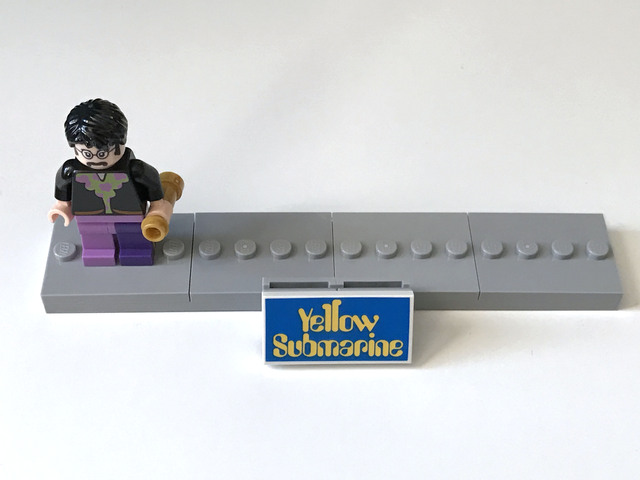](https://www.freelug.org/IMG/jpg/YellowSubmarine_28.jpg)

La base du sous-marin est une plaque 6x14.

[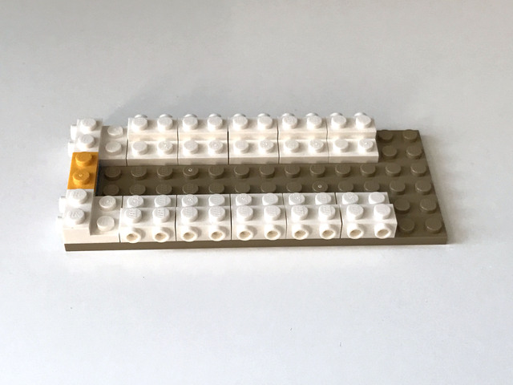](https://www.freelug.org/IMG/jpg/YellowSubmarine_29.jpg)

Le dessous de la plaque est intégralement recouvert pour lui donner une forme arrondie.

[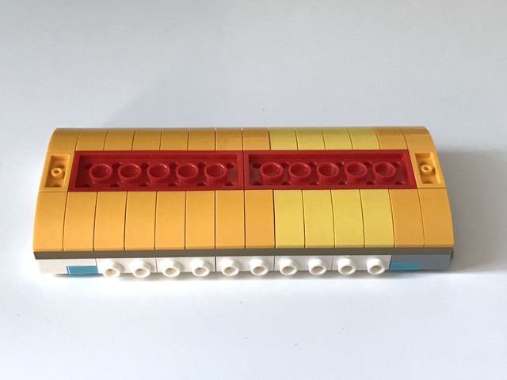](https://www.freelug.org/IMG/jpg/YellowSubmarine_30.jpg)

L’intérieur pourra accueillir les quatre _Beatles_.

[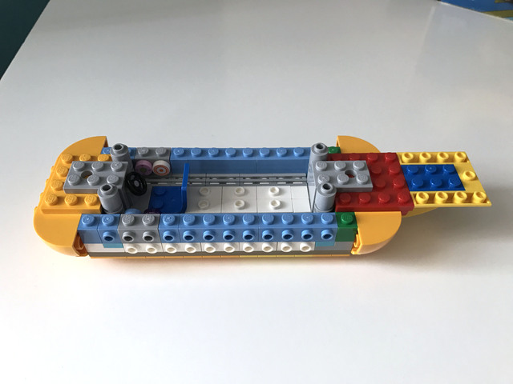](https://www.freelug.org/IMG/jpg/YellowSubmarine_31.jpg)

On habille les côtés.

[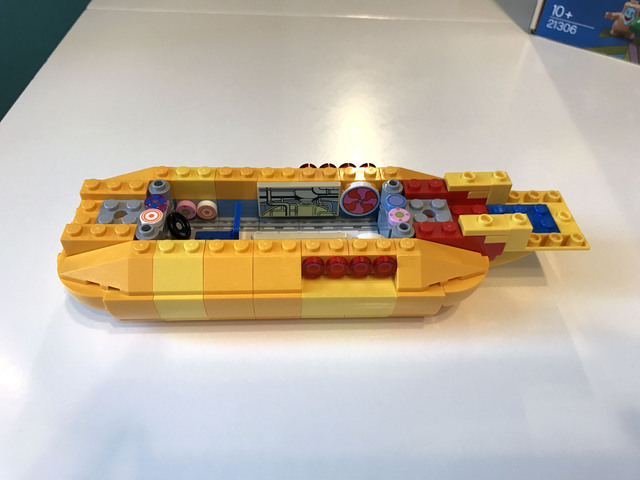](https://www.freelug.org/IMG/jpg/YellowSubmarine_32.jpg)

Le nez, les hélices, ainsi que le compartiment à souvenirs sont maintenant présents. On se rend bien compte que cette construction sera sans tenon apparent (ou quasi).

[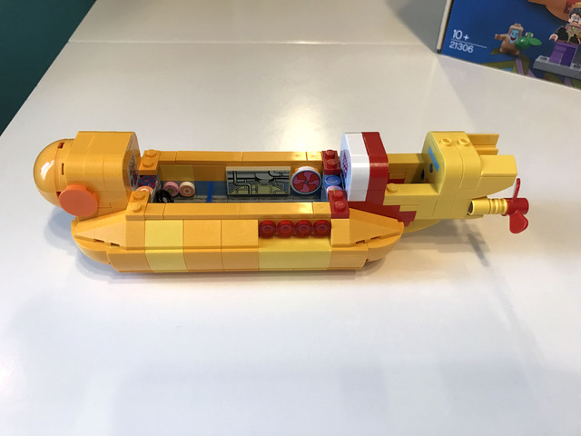](https://www.freelug.org/IMG/jpg/YellowSubmarine_33.jpg)

Une fois la gouvernail posé, on s’attaque au dessus du sous-marin.

[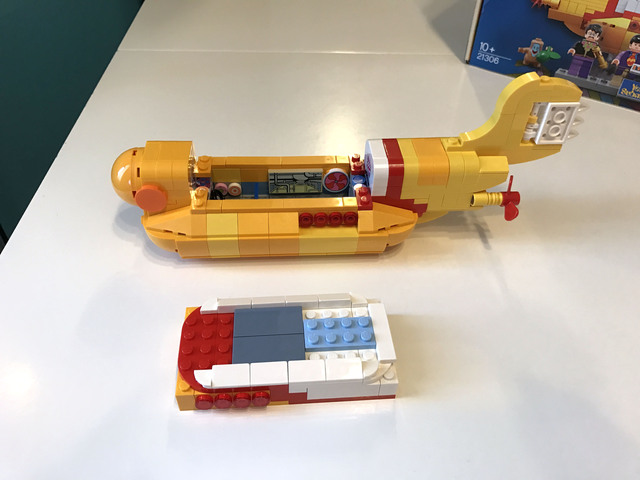](https://www.freelug.org/IMG/jpg/YellowSubmarine_34.jpg)

Quasiment sans tenon apparent, je vous avais prévenu. On va pas se le cacher, le rendu est vraiment beau.  
Notez l’utilisation des saucisses pour la balustrade du massif.

[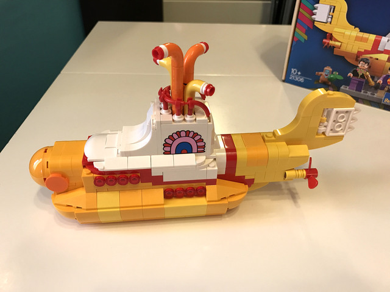](https://www.freelug.org/IMG/jpg/YellowSubmarine_35.jpg)

Une petite estrade nuage pour exposer la bête.

[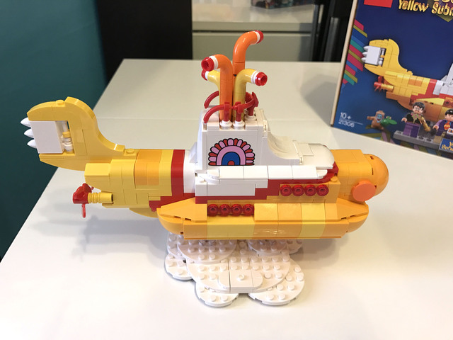](https://www.freelug.org/IMG/jpg/YellowSubmarine_36.jpg)

Et voici le _Yellow Submarine_ et les _Beatles_ une fois le set terminé.

[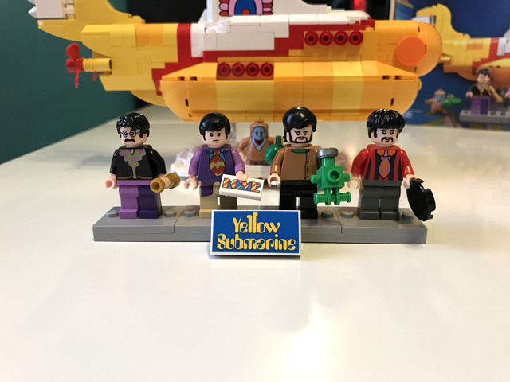](https://www.freelug.org/IMG/jpg/YellowSubmarine_37.jpg)

[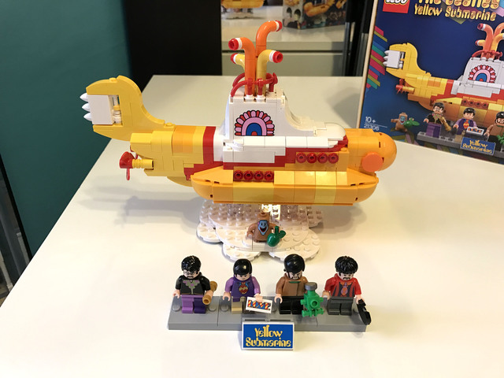](https://www.freelug.org/IMG/jpg/YellowSubmarine_38.jpg)

* * *

**Avis**

Une belle réussite pour cet _Ideas_, on nage en plein Sixties/Seventies. Les minifigs ainsi que les pièces sérigraphiées sont tout simplement superbes.  
Pour autant, ce set est quand même dédié aux fans des _Beatles_ et/ou aux collectionneurs de la gamme. Les autres passeront, sans aucun doute, leur chemin.

**Bonus**

Voici un GIF animé réalisé avec les photos prises pour cette review (cliquez sur l’image pour lancer l’animation).

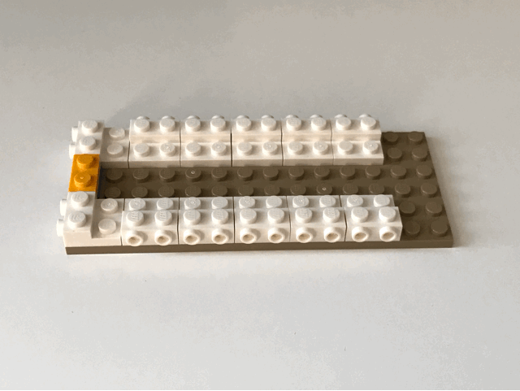
