Bonjour à tous, aujourd’hui je vous propose une review du set 21312 dans la gamme _Ideas_ : **Women of NASA**.

Ce set, sorti en 2017, est composé de 231 pièces et coûte 24,99 euros, soit un ratio prix/pièce d’environ 11 centimes d’euros.

[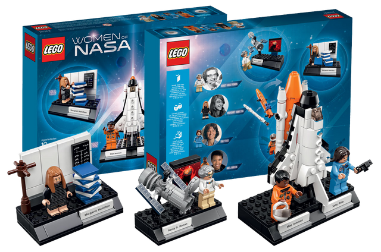](https://www.freelug.org/IMG/png/womenofnasa_box_figs.png)

> _LEGO Cusoo_ renommé le 30 avril 2015 en _LEGO Ideas_ est un projet de _The LEGO Group_ créé en 2008.
> 
> Le projet consiste en ce qu’un joueur/créateur de _LEGO_ propose une de ses créations sur le site de _LEGO Ideas_. Si la boîte obtient 10 000 votes et qu’elle est accepté par des créateurs _LEGO_, elle est alors mise en vente.  
> Le constructeur de la boîte reçoit 1% de l’argent gagné par la vente du produit.
> 
> Source : _[Wikipedia](https://fr.wikipedia.org/wiki/Lego_Ideas)_.

* * *

Au recto, on retrouve le logo _Ideas_ en bas à droite. Le set est présenté sur un fond bleu espace et des éléments scientifiques. La décoration nous plonge littéralement dans l’espace.

[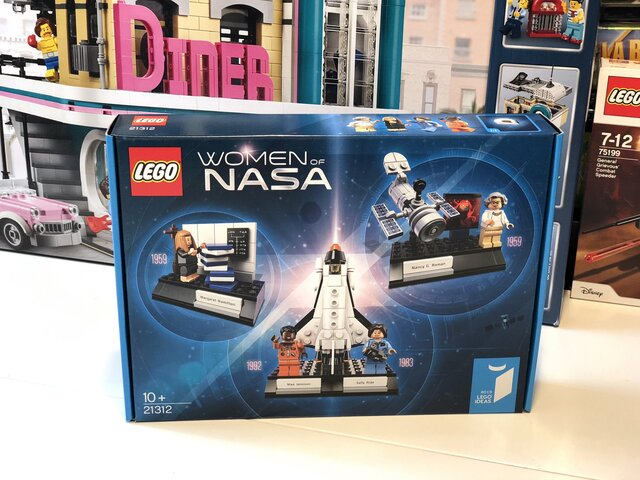](https://www.freelug.org/IMG/jpg/womenofnasa_01.jpg)

Au verso, sont présentés les personnages présents dans le set, ainsi que les rares éléments de jouabilités.

[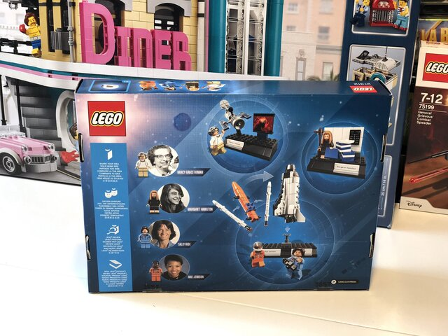](https://www.freelug.org/IMG/jpg/womenofnasa_02.jpg)

La boite contient trois sachets et une notice. Cette dernière contient moult photos, explications et anecdotes. Malheureusement le texte n’est pas traduit, il est vraiment dommage que _LEGO_ ne fasse pas l’effort pour régionaliser ses sets "premium".

[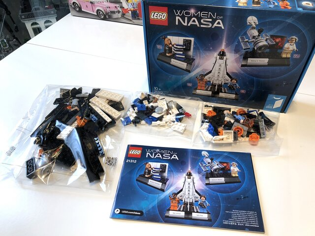](https://www.freelug.org/IMG/jpg/womenofnasa_03-2.jpg)

* * *

**[Nancy G. ROMAN](https://brickset.com/minifigs/idea036/nancy-g-roman) :**

> **Nancy Grace ROMAN** (née le 16 mai 1925 à _Nashville_, _Tennessee_) est une astronome américaine, l’une des premières femmes cadre à la _NASA_ et reconnue comme la “Mère de _Hubble_”. Tout au long de sa carrière, _Nancy ROMAN_ a été une conférencière et enseignante très active qui a toujours défendu la place des femmes dans les sciences.
> 
> [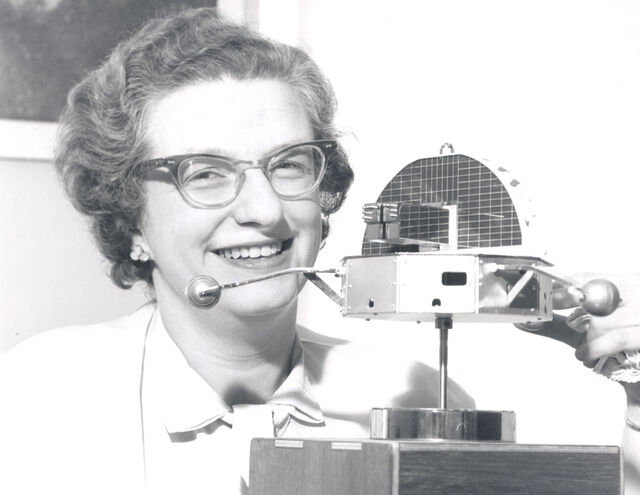](https://www.freelug.org/IMG/jpg/nancy_roman.jpg)
> 
> Source : _[Wikipedia](https://fr.wikipedia.org/wiki/Nancy_Roman)_.

Belle figurine tout en simplicité, le visage et la coiffure sont vraiment ressemblant à l’original. Les jambes sont vierges et le torso bien que simple est bien réalisé.

[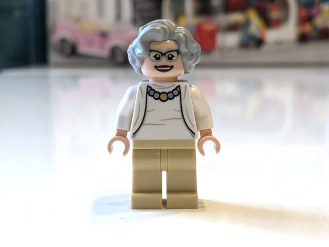](https://www.freelug.org/IMG/jpg/womenofnasa_05.jpg)

De dos on reste dans la simplicité, on a le droit à visage alternatif "sérieux".

[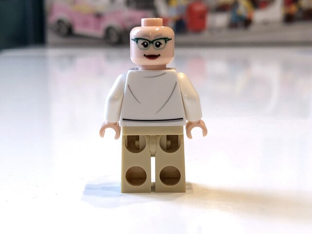](https://www.freelug.org/IMG/jpg/womenofnasa_06.jpg)

**[Margaret HAMILTON](https://brickset.com/minifigs/idea035/margaret-hamilton) :**

> **Margaret HAMILTON**, née le 17 août 1936 à _Paoli_ dans l’_Indiana_, est une informaticienne et mathématicienne. Elle était directrice du département génie logiciel (« _software engineering_ », terme de son invention) du _MIT Instrumentation Laboratory_ qui conçut le système embarqué du programme _Apollo_. La photo ci-dessous la montre avec l’intégralité du code de ce système.
> 
> [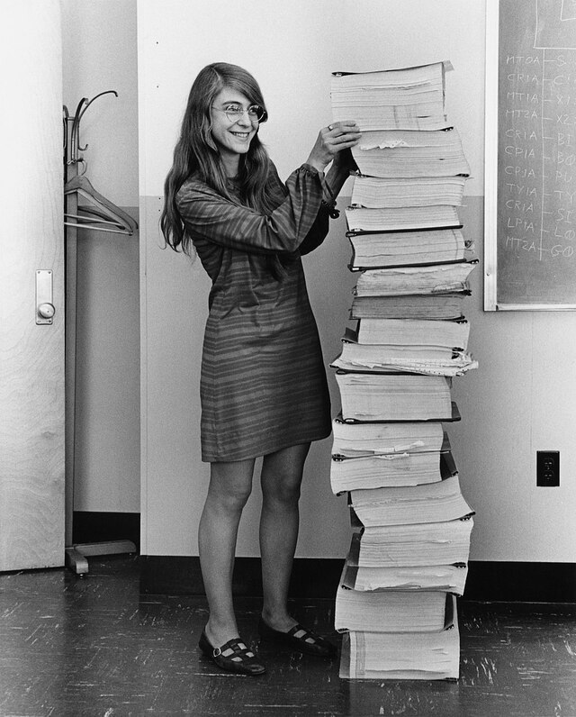](https://www.freelug.org/IMG/jpg/margaret_hamilton.jpg)
> 
> Source : _[Wikipedia](https://fr.wikipedia.org/wiki/Margaret_Hamilton_\(scientifique\))_.

La encore la fig est vraiment réussie par sa ressemblance avec l’originale (coiffure, robe, visage...). Nous avons même le droit à des jambes bi-injectées et des petites chaussures à boucle.

[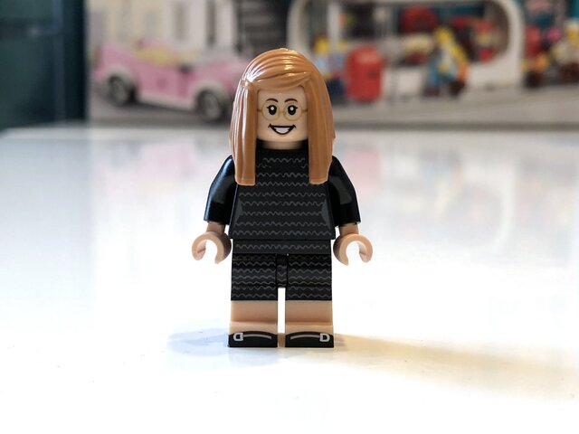](https://www.freelug.org/IMG/jpg/womenofnasa_07.jpg)

De dos, on retrouve le même motif pour la robe et un visage alternatif amusé.

[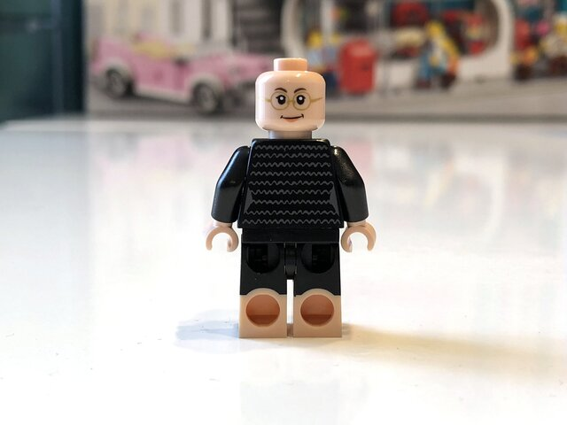](https://www.freelug.org/IMG/jpg/womenofnasa_08.jpg)

**[Sally RIDE](https://brickset.com/minifigs/idea037/sally-ride) :**

> **Sally Kristen RIDE**, née le 26 mai 1951 à _Los Angeles_ et décédée le 23 juillet 2012 à _San Diego_, est une astrophysicienne et astronaute américaine. Troisième femme à être allée dans l’espace, en 1983, et première de son pays, elle a participé en tant que spécialiste de mission aux vols STS-7 et STS-41-G de la navette spatiale américaine. Elle est précédée par deux soviétiques, _Valentina TERECHKOVA_ (1963) et _Svetlana SAVITSKAÏA_ (1982).
> 
> [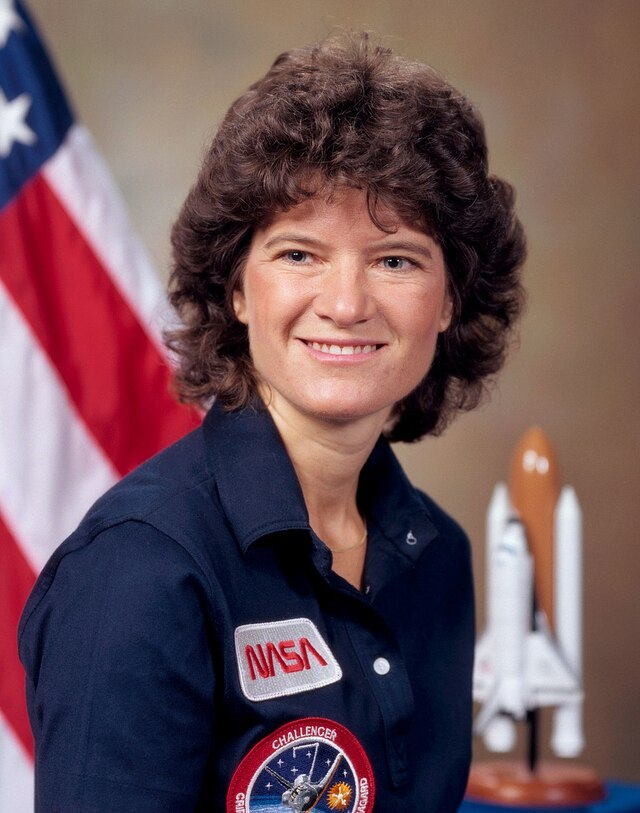](https://www.freelug.org/IMG/jpg/sally_ride.jpg)
> 
> Source : _[Wikipedia](https://fr.wikipedia.org/wiki/Sally_Ride)_.

Ici encore belle réalisation, dommage pour les cheveux qui n’ont pas l’effet bouclés. On retrouve bien le sourire de _Sally_ avec les fossettes. La combinaison de vol est superbement réalisée et l’on regrette que _LEGO_ n’ait pas sérigraphié aussi les jambes, nous aurions eu une fig vraiment magnifique.

[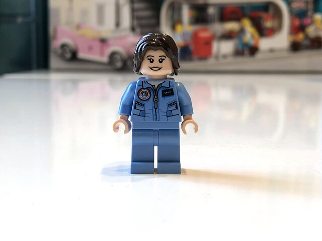](https://www.freelug.org/IMG/jpg/womenofnasa_09.jpg)

Le dos est est plus basique, le visage alternatif est une version "boudeuse" de _Sally_.

[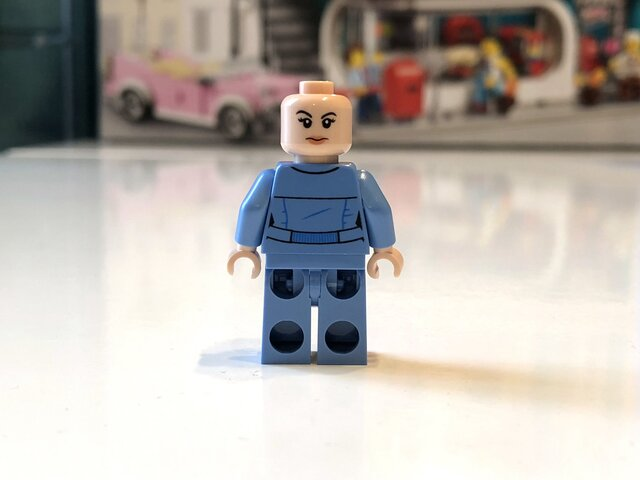](https://www.freelug.org/IMG/jpg/womenofnasa_10.jpg)

**[Mae JEMISON](https://brickset.com/minifigs/idea034/mae-jemison) :  
**

> **Mae Carol JEMISON**, née le 17 octobre 1956 à _Decatur_, _Alabama_, est une astronaute américaine. Elle est notamment connue pour être la première femme afro-américain à aller dans l’espace.
> 
> [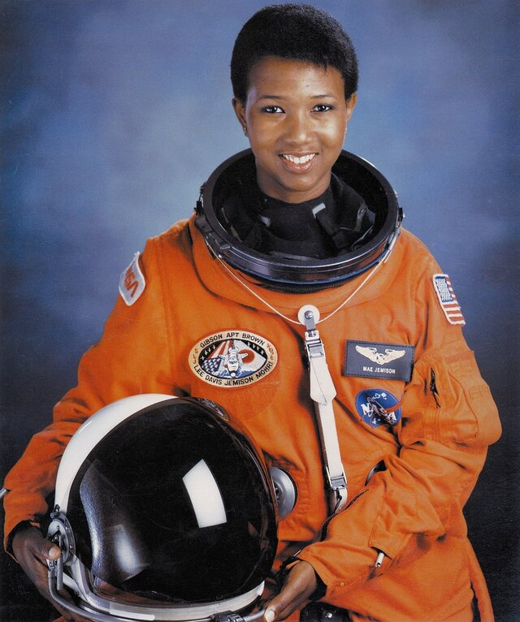](https://www.freelug.org/IMG/jpg/mae_jemison.jpg)
> 
> Source : _[Wikipedia](https://fr.wikipedia.org/wiki/Mae_Jemison)_.

Comme pour _Sally RIDE_, la figurine est réussie hormis les cheveux qui ne sont pas crépus. Pour le reste, rien à redire tellement la combinaison d’astronaute est "accurate" (voir la photo ci-dessus pour comparaison). Au niveau du visage on retrouve bien le sourire de _Mae_.

[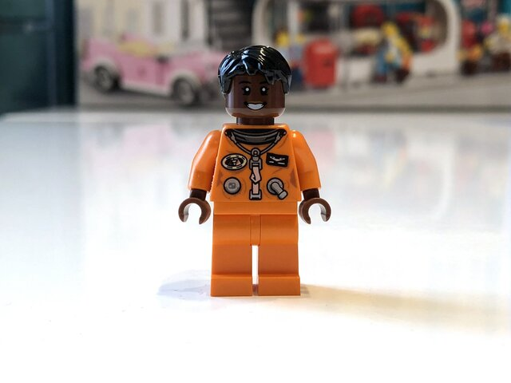](https://www.freelug.org/IMG/jpg/womenofnasa_11.jpg)

Le verso est plus sobre mais les sérigraphies restent superbes, les effets de plis notamment sont très bien retranscrits. Le visage alternatif "sérieux" complète le tableau.

[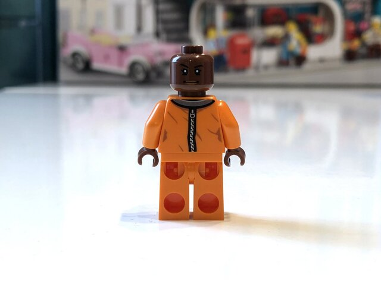](https://www.freelug.org/IMG/jpg/womenofnasa_12.jpg)

* * *

Bonne nouvelle, aucun stickers n’est présent dans la boite, toutes les pièces sont sérigraphiées et elles sont au nombre de huit.

[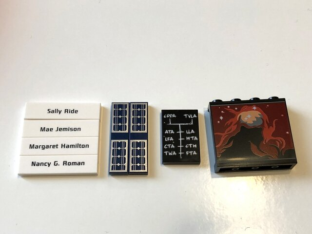](https://www.freelug.org/IMG/jpg/womenofnasa_04.jpg)

* * *

On commence la construction avec la scénette de _Margaret HAMILTON_, c’est très rapide et la construction n’a rien de transcendant.

[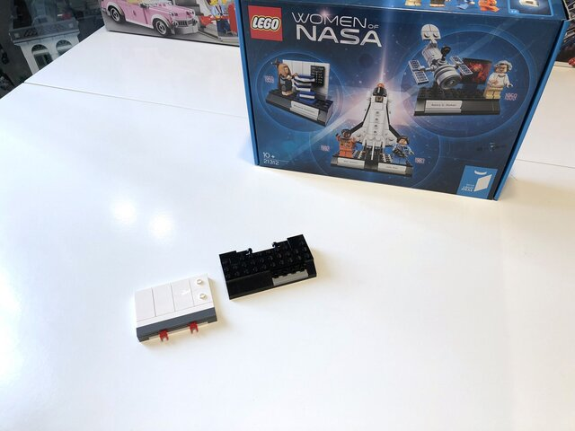](https://www.freelug.org/IMG/jpg/womenofnasa_13.jpg)

On ajoute la _Tile_ sérigraphiée "tableau noir" et la pile de livres plutôt bien retranscrite.

[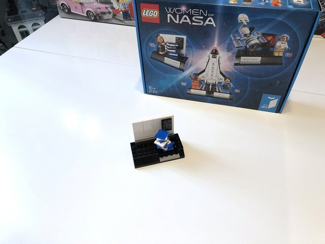](https://www.freelug.org/IMG/jpg/womenofnasa_14.jpg)

Un porte-manteau et une _Tile_ nominative plus tard, nous avons déjà fini cette première construction.

[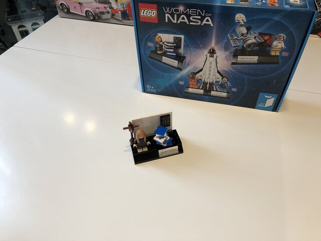](https://www.freelug.org/IMG/jpg/womenofnasa_15.jpg)

Deuxième scénette, la navette spatiale et les deux astronautes _Mae JEMISON_ et _Sally RIDE_.

[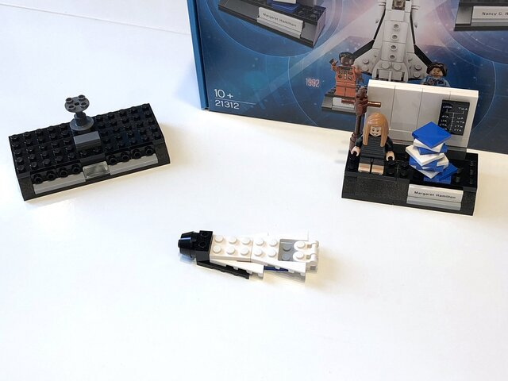](https://www.freelug.org/IMG/jpg/womenofnasa_16.jpg)

Je vous le dis tout de suite c’est LA partie la plus intéressante à monter dans le set, et pourtant ça n’a rien de transcendant.

[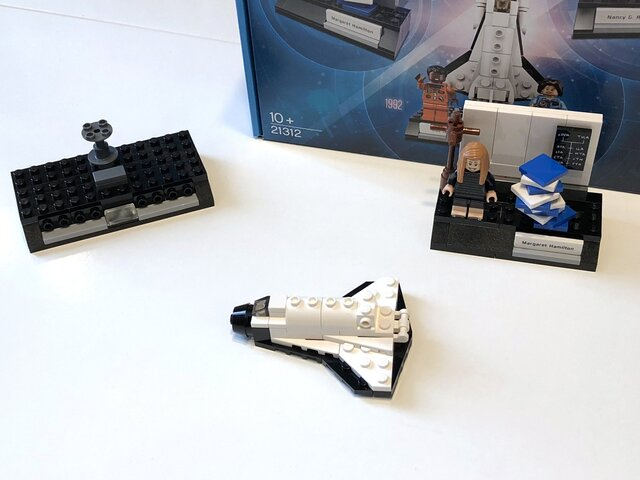](https://www.freelug.org/IMG/jpg/womenofnasa_17.jpg)

Néanmoins il est tout de même plaisant de voir prendre forme cette navette.

[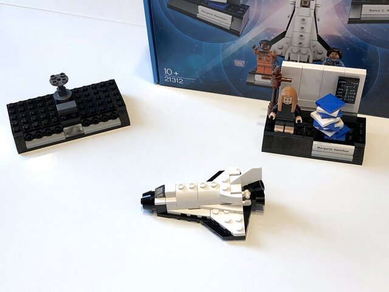](https://www.freelug.org/IMG/jpg/womenofnasa_18.jpg)

Construction du lanceur, à la couleur caractéristique orange, et ses boosters.

[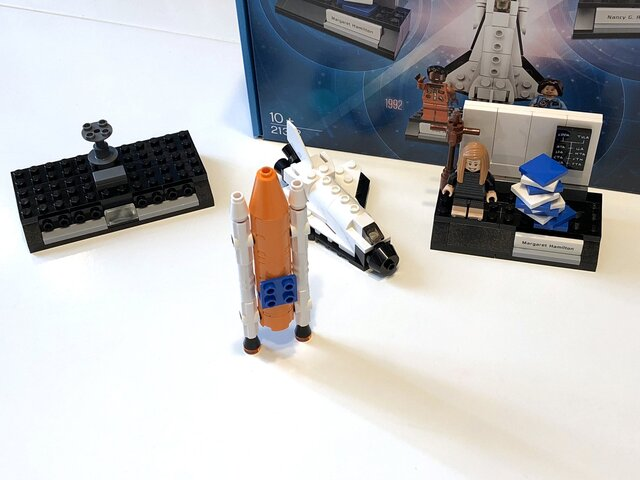](https://www.freelug.org/IMG/jpg/womenofnasa_19.jpg)

Il faut avouer que la navette sur son lanceur est plutôt réussie pour cette échelle.

[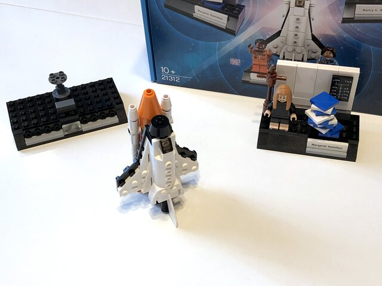](https://www.freelug.org/IMG/jpg/womenofnasa_20.jpg)

Déjà la deuxième scénette est terminée.

[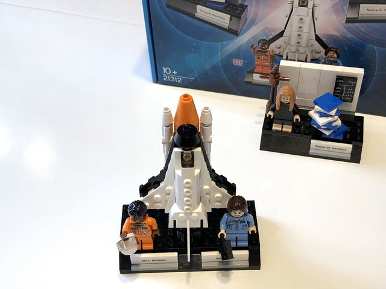](https://www.freelug.org/IMG/jpg/womenofnasa_21.jpg)

On attaque maintenant la troisième et dernière scénette, le socle se monte très rapidement.

[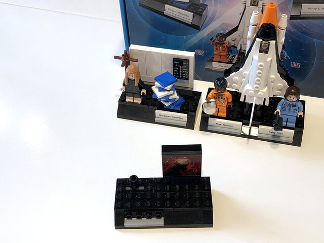](https://www.freelug.org/IMG/jpg/womenofnasa_22.jpg)

Construction du télescope _Hubble_.

[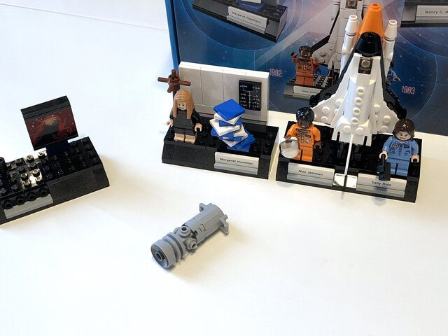](https://www.freelug.org/IMG/jpg/womenofnasa_23.jpg)

Ajout des panneaux solaire et du cache de protection

[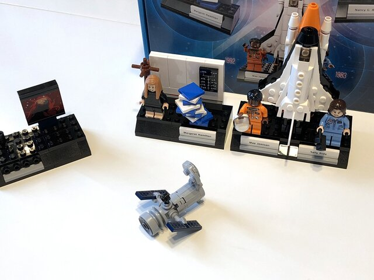](https://www.freelug.org/IMG/jpg/womenofnasa_24.jpg)

La troisième scénette est déjà finie.

[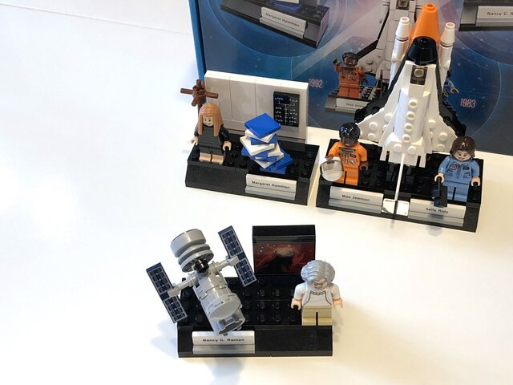](https://www.freelug.org/IMG/jpg/womenofnasa_25.jpg)

Et voici le set terminé avec les trois scénettes côte à côte.

[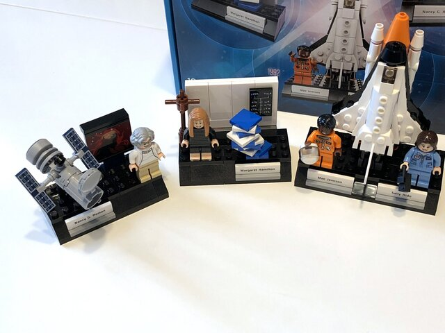](https://www.freelug.org/IMG/jpg/womenofnasa_26.jpg)

* * *

**AVIS :**

Sentiment mitigé pour ce set, pour moi il n’a clairement pas sa place dans la gamme Ideas tant il est inintéressant à construire.

C’est dommage car les quatre minifigures sont, elles, une vraie réussite.

**BONUS :**

Voici un GIF animé réalisé avec l’ensemble des photos prises pour cette review (cliquez sur l’image pour lancer l’animation).

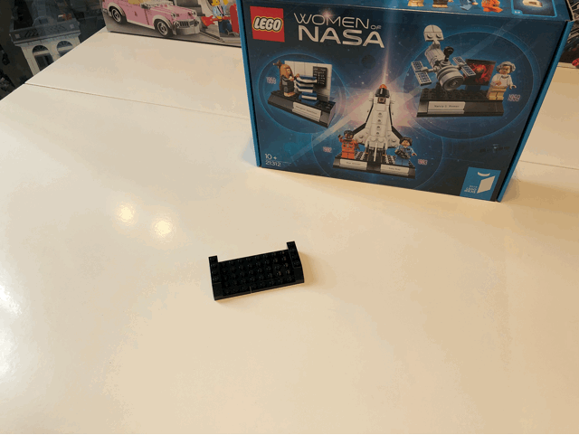
