Bonjour à tous, aujourd’hui je vous propose la revue du réveil 2856080 dans la gamme _Star Wars_ : **Stormtrooper Alarm Clock**.  
Sortie en 2010, cette horloge est toujours disponible sur le _[S@H](https://shop.lego.com/fr-FR/Horloge-Stormtrooper-LEGO-Star-Wars-2856080)_ ou en Store physique au prix de 29,99 euros.

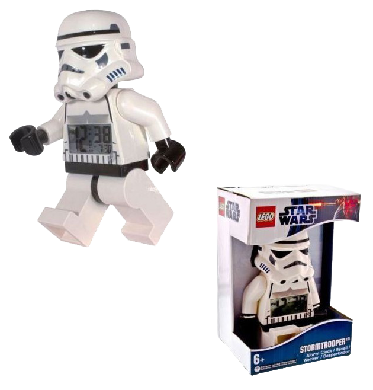

* * *

Le réveil est livré dans une boite semi-ouverte, ce qui permet de toucher la figurine avant achat.  
Un autocollant transparent est apposé sur la partie horloge ce qui permet de se rendre compte de la taille des chiffres.

[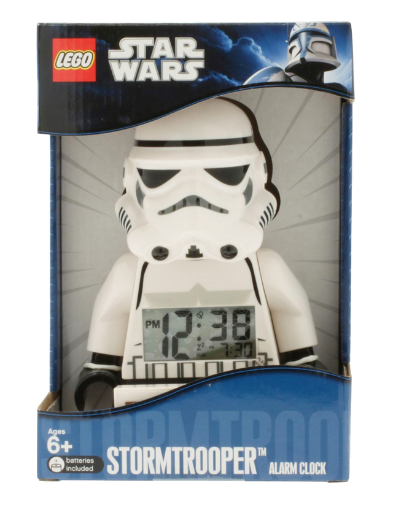](https://www.freelug.org/IMG/png/reveil_storm_box.png)

* * *

De face, le réveil est en tout point semblable à la minifigure du _Stormtrooper_ (ancienne version, sans sérigraphies sur les jambes).  
Un énorme cadran numérique orne son ventre.

[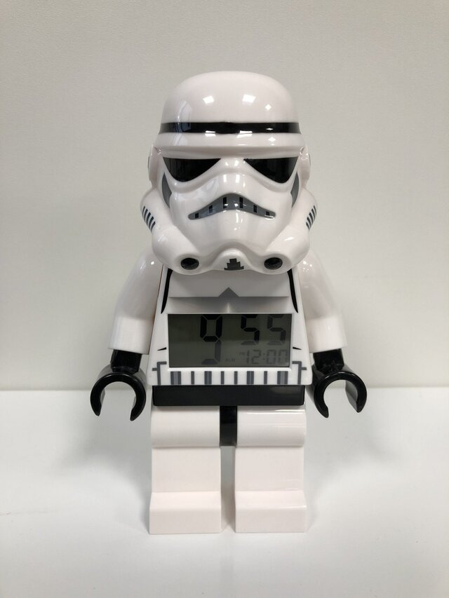](https://www.freelug.org/IMG/jpg/reveil_storm_01-r90.jpg)

De dos, outre le système de paramétrage du réveil, _LEGO_ a poussé le vice jusqu’à reproduire les quatre trous pour l’emboitement des tenons.

[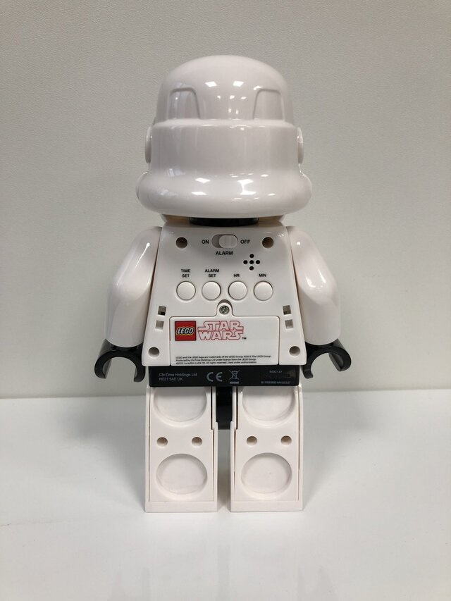](https://www.freelug.org/IMG/jpg/reveil_storm_03-r90.jpg)

Vue de côté, aucune sérigraphie hormis celle du casque, qui ne se retire pas.

[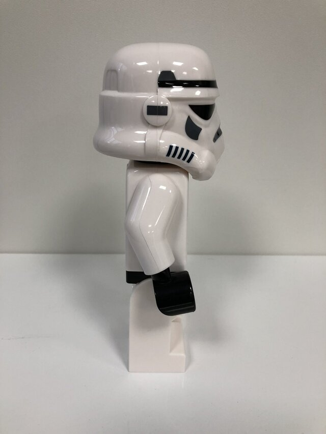](https://www.freelug.org/IMG/jpg/reveil_storm_02-r90.jpg)

La figurine est articulée de la même façon que les vraies minifig _LEGO_.

[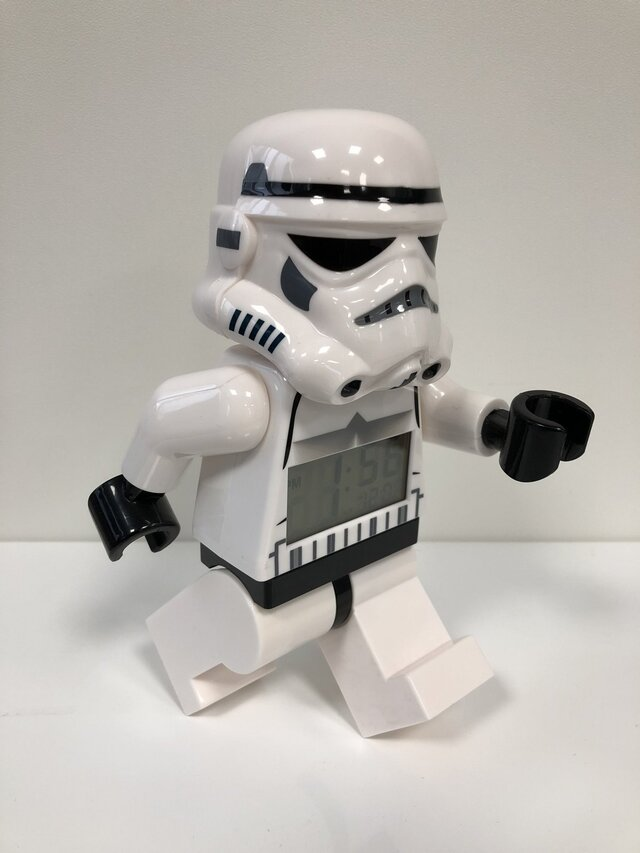](https://www.freelug.org/IMG/jpg/reveil_storm_08-r90.jpg)

[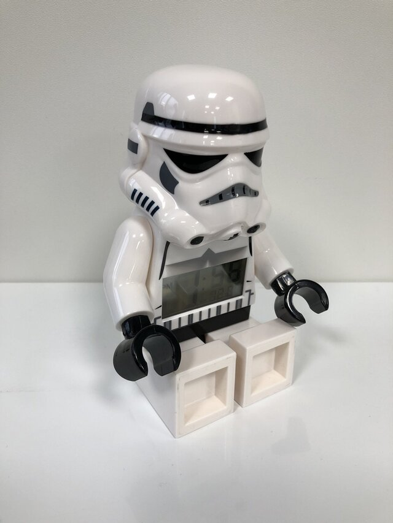](https://www.freelug.org/IMG/jpg/reveil_storm_09-r90.jpg)

Le casque de près, on voit que les sérigraphies ne sont pas exemptes de défauts.

[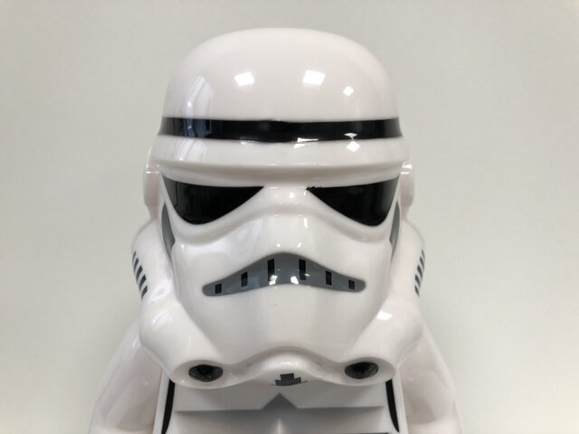](https://www.freelug.org/IMG/jpg/reveil_storm_06.jpg)

Gros plan sur la partie de l’horloge numérique. Il est à noter que le réglage de l’heure se fait sur le modèle US (AM/PM) et non sur le modèle 24H.

[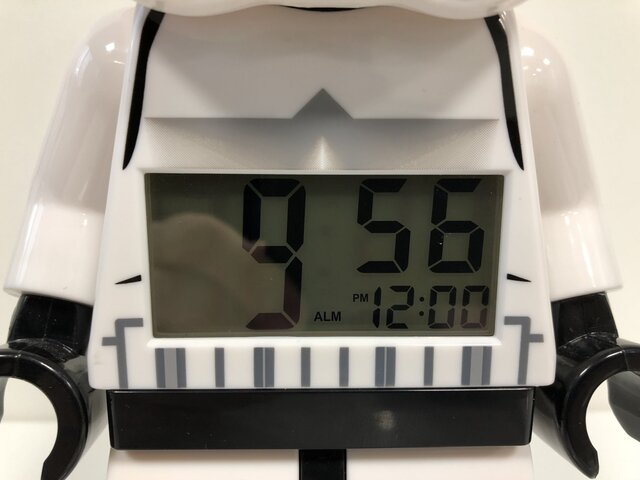](https://www.freelug.org/IMG/jpg/reveil_storm_05.jpg)

Le système de réglage de l’horloge, boutons pour l’heure et les minutes, réglage de l’heure et de l’alarme et un interrupteur pour l’alarme.

[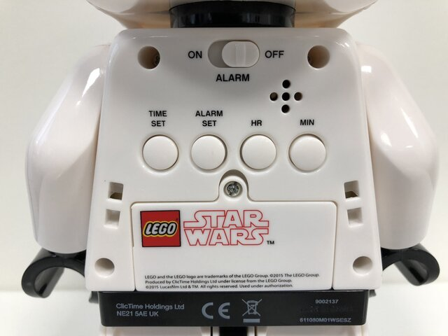](https://www.freelug.org/IMG/jpg/reveil_storm_04.jpg)

Un appui sur la tête déclenche l’éclairage du panneau numérique. Les couleurs d’éclairage peuvent varier selon le modèle, l’horloge de _Darth Vader_ s’allume en rouge par exemple.

[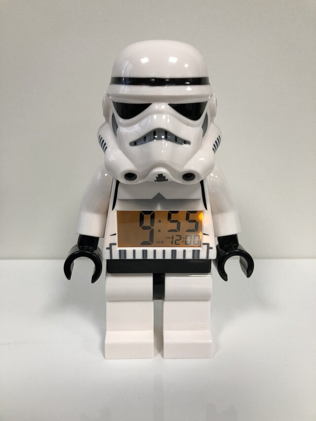](https://www.freelug.org/IMG/jpg/reveil_storm_07-r90.jpg)

* * *

Comparaison de taille entre une minifig _LEGO_ classique et le réveil (image trouvée sur internet).

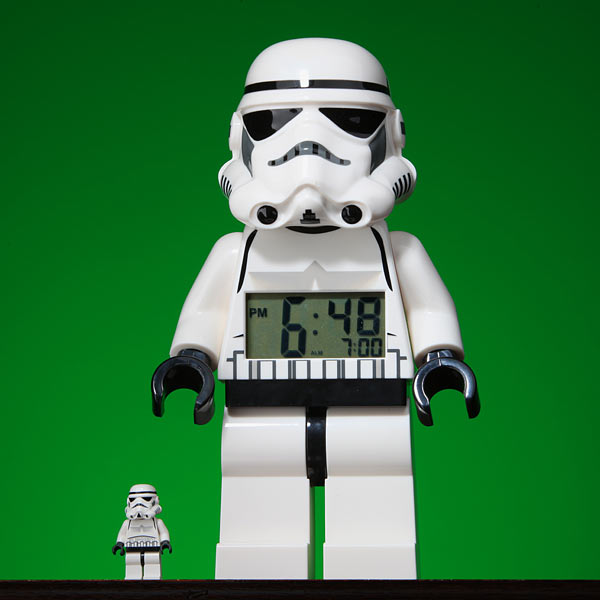

* * *

Voici des exemples d’autre réveils _LEGO_, il en existe vraiment beaucoup (ne rêvez pas, le _Shadow Trooper_ est introuvable, même sur _[BrickLink](https://www.bricklink.com/v2/catalog/catalogitem.page?G=CT80036&name=Digital%20Clock,%20SW%20Shadow%20Trooper%20Figure%20Alarm%20Clock&category=%5BClock%5D%5BStar%20Wars%5D#T=S&O={{ '{%' }}22iconly%22:0})_).

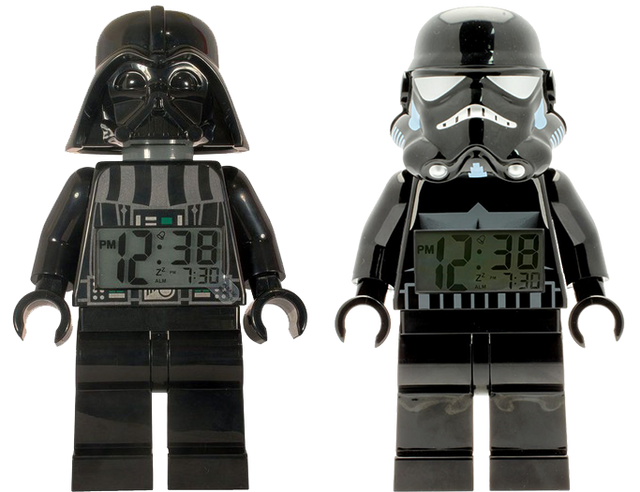

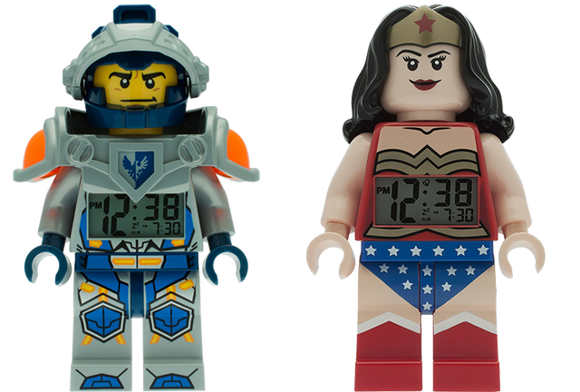

[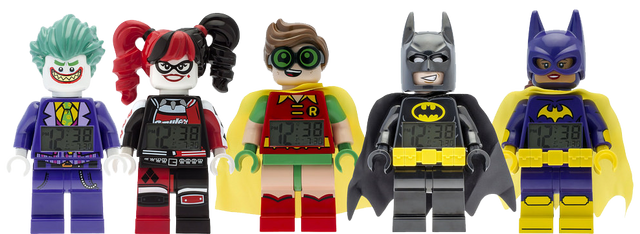](https://www.freelug.org/IMG/png/reveil_dc2.png)

* * *

**AVIS :**

Si l’on met de côté les quelques bavures des sérigraphies, ce réveil est une belle réussite de _LEGO_, qui décline ici le modèle de ses minifigures au format maxi.  
Avec une très grande variété de modèle piochés dans ses différentes gammes (_Star Wars_, _DC Comics_, _Marvel_, _Ninjago_, _Nexo Knight_...), les fans ne peuvent qu’être heureux.
