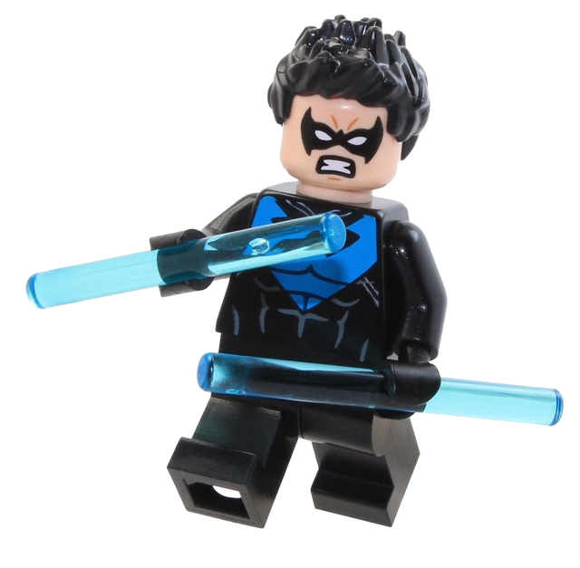
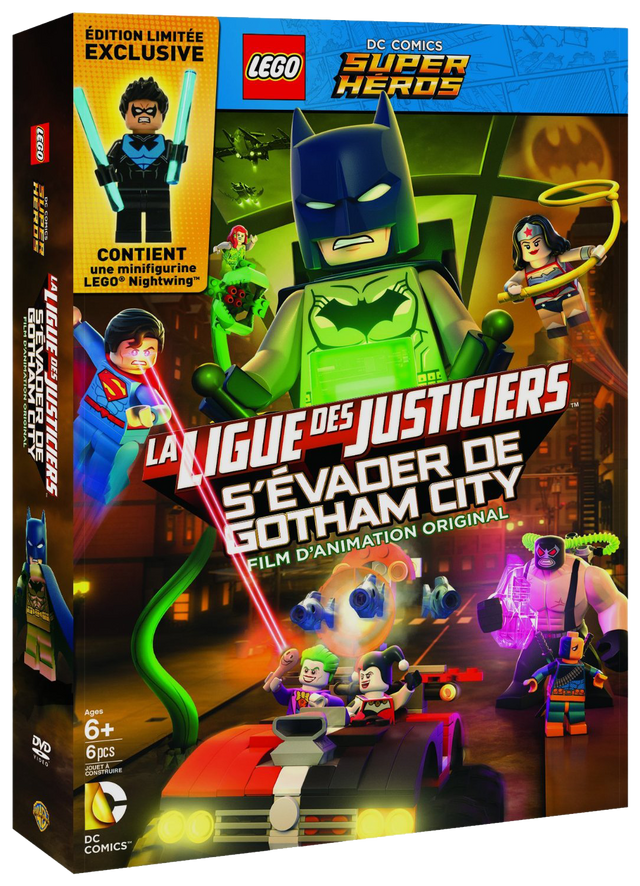
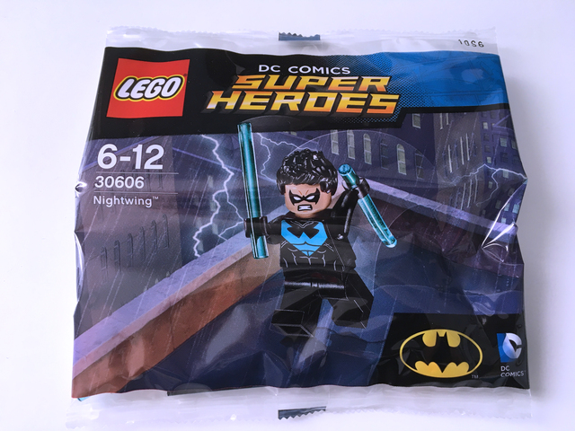
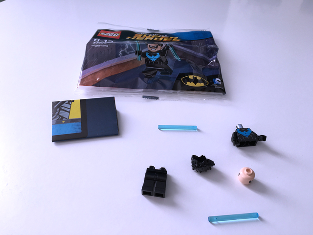
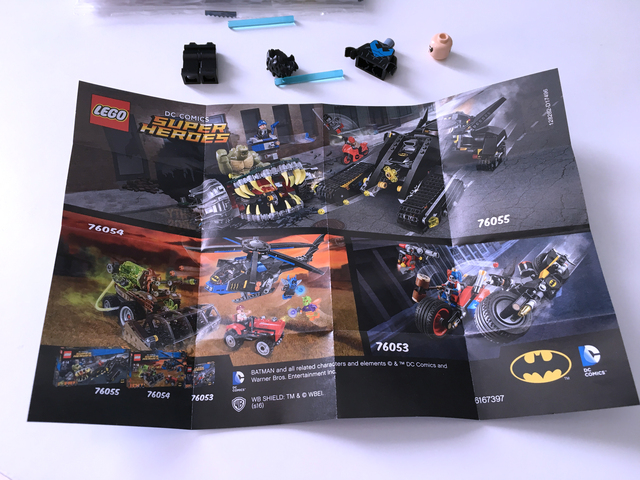
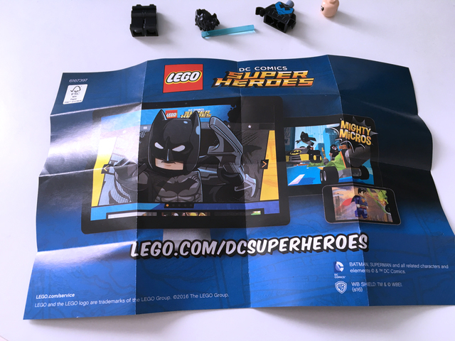
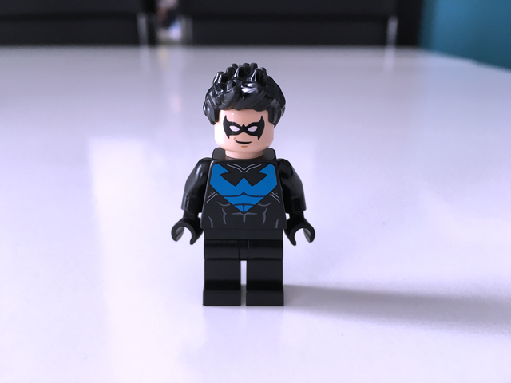
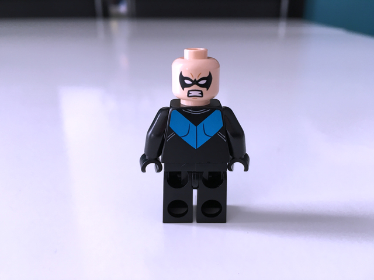
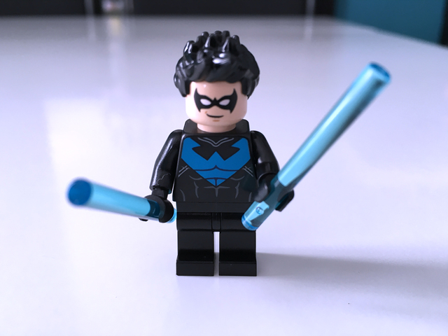

Bonjour à tous, aujourd’hui je vous propose une review du polybag 30606 dans la gamme _DC Comics_ : **Nightwing**.  
Ce polybag sorti en 2016 est composé de 6 pièces, il est offert avec le DVD du film d’animation _La Ligue des Justiciers : S’évader de Gotham City_ qui coûte environ 14,99 euros.

* * *

Voici le coffret, il contient le DVD et le polybag.

Sur le polybag, la figurine est mise en situation sur le toit d’un immeuble sous la pluie. C’est à la fois graphique et dynamique.

Une fois ouvert on se retrouve avec six pièces et un petit flyer.

Le flyer montre les derniers sets _Batman_ au recto et le jeu pour smartphone/tablette _Migthy Micro_ au verso.

* * *

Voici _[Nightwing](http://brickset.com/minifigs/sh294/Nightwing-Blue-Outfit-\(30606\))_, figurine exclusive, dans son costume noir et bleu. La sérigraphie est de bonne facture, par contre les jambes et les bras en sont dépourvus. Le visage narquois et le masque sont joliment réalisés.

De dos, à part la bande bleue, c’est un peu le désert. Le visage alternatif énervé est magnifique.

_Nightwing_ avec ses bâtons de combat.

* * *

**AVIS :**

Un polybag qui permet de compléter sa collection Super Héros. Sans être exceptionnelle en termes de sérigraphie, cette fig n’en reste pas moins une belle réussite à mon sens.
