Aujourd’hui, je vous propose de voir la boîte _31048_ de la gamme _Creator_, _La cabane du bord du lac_.

Sortie en 2016, elle comporte 368 pièce et coûtait 24,99 €, soit un ratio de moins de 7 centimes par pièce.

* * *

Comme toutes les boîtes de la gamme, l’avant montre le modèle principal, une cabane au bord du lac avec un élan ou un cerf, et une minifigurine. À droite les maisons alternatives, ressemblant également à des cabanes. Les logos « Creator » et « 3 in 1 » sont bien sûr présents.

[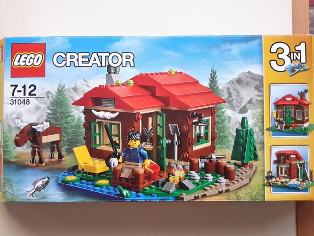](https://www.freelug.org/IMG/jpg/20180218_132057.jpg)

Le dos reprend les trois modèles, et précise que tous peuvent s’ouvrir pour montrer l’intérieur. Les cabanes sont sur un décor de montagne étoilé, en accord avec l’un des modèles alternatifs qui comporte un télescope.

[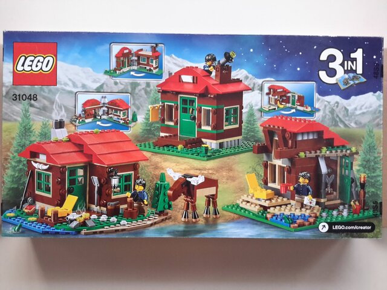](https://www.freelug.org/IMG/jpg/20180218_132126.jpg)

À noter que cette boîte se ferme avec du scotch sur les côtés, et peut donc facilement être démontée et rangée sans l’abîmer.

Une fois ouverte apparaissent quelques sachets et trois notices — celle du modèle principal est plus grande que celle des modèles alternatifs. Sans surprise après les visuels, beaucoup de pièces sont marron.

[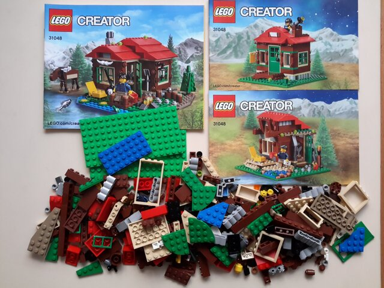](https://www.freelug.org/IMG/jpg/20180218_144020.jpg)

La figurine est assez simple, avec un torse sérigraphié comme une veste montagnarde, quelques rayures marron. Le visage est un peu soit amusé soit presque méprisant à mon sens, j’ignore pourquoi. Les cheveux montrent une coiffure avec une raie sur un côté. Rien sur les bras ou les jambes.

[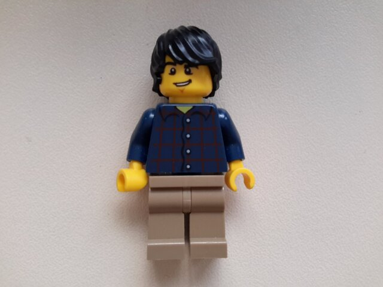](https://www.freelug.org/IMG/jpg/20180218_151054.jpg)

De dos rien à signaler, aucune sérigraphie, c’en est presque décevant.

[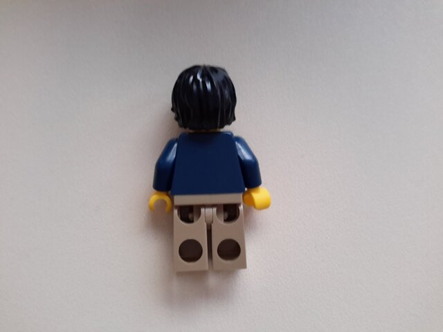](https://www.freelug.org/IMG/jpg/20180218_151113.jpg)

Voici la cabane au bord du lac complète. Le personnage pêche, et a d’ailleurs attrapé un poisson qu’il fait cuire sur le feu à sa gauche. L’équipement d’un bon montagnard est présent : pelle, hache (avec des rondins autour), lampe accrochée à la maison. Sur l’étang quelques nénuphars avec des fleurs — j’aime bien cette construction simple avec une pièce 2x2 ronde trouée et une fleur insérée dedans en retourné —, une grenouille. Dans le fond un petit sapin.

[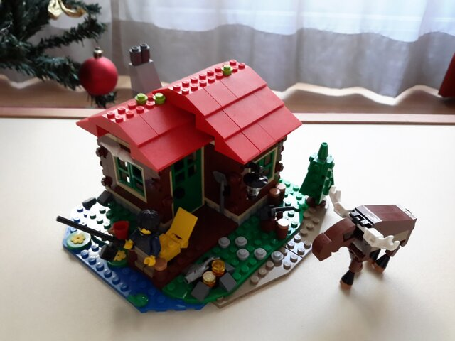](https://www.freelug.org/IMG/jpg/20180218_132228.jpg)

La maison sur le côté, avec une cheminée répartie de part et d’autre de l’articulation. Sur les côtés on voit les bois de construction dépasser, une petite touche sympathique qui se retrouve de tous les côtés. À l’intérieur on aperçoit une poêle garnie d’une fleur.

[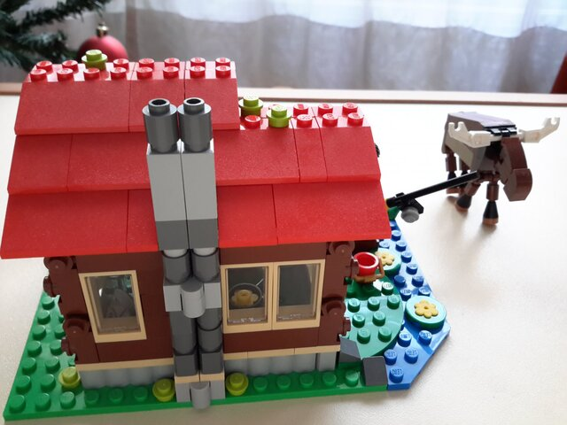](https://www.freelug.org/IMG/jpg/20180218_132252.jpg)

Les autres côtés de la maison. L’arrière est sobre.

[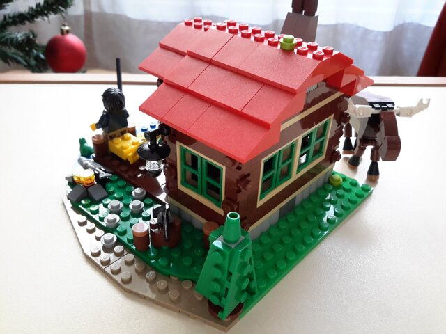](https://www.freelug.org/IMG/jpg/20180218_132309.jpg)

La maison ouverte, avec à gauche le coin cuisine (une brique à rayures simule probablement le four), une étagère avec une tasse et un pot (de sucre ?), à droite le coin chambre à coucher et bureau avec une plume et une lettre scellée.

[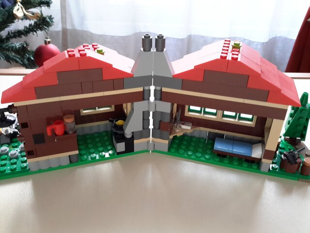](https://www.freelug.org/IMG/jpg/20180218_132334.jpg)

Voici les pièces bonus de la construction.

[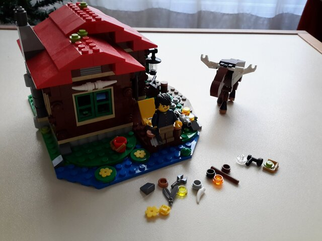](https://www.freelug.org/IMG/jpg/20180218_132602.jpg)

Et pour changer, je vais non pas construire le modèle mais le détruire ! Sans aucun ordre particulier.

Voici un désassemblage partiel de l’élan, avec des pièces en pente inversée pour faire le dos, et les pattes articulées.

[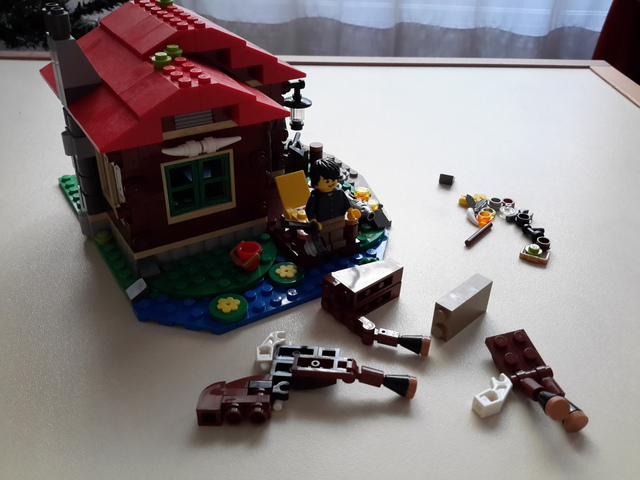](https://www.freelug.org/IMG/jpg/20180218_142340.jpg)

L’élan totalement démonté.

[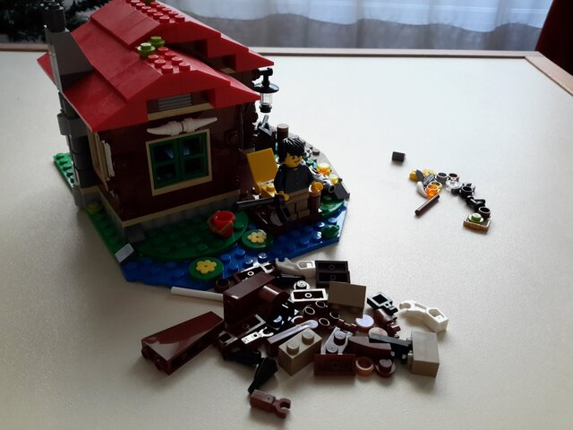](https://www.freelug.org/IMG/jpg/20180218_142457.jpg)

Le toit est emporté par une tornade, et le personnage séparé en pièces. Le sapin expose son intérieur, efficace.

[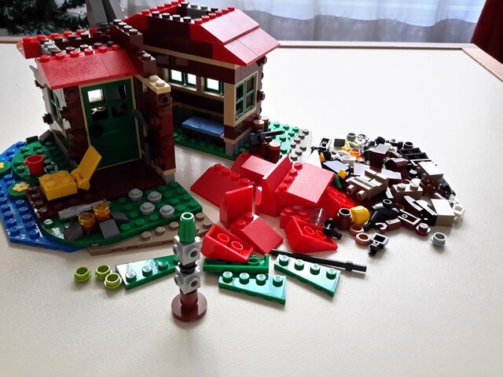](https://www.freelug.org/IMG/jpg/20180218_142634.jpg)

Le démontage continue, il reste un peu de toit.

[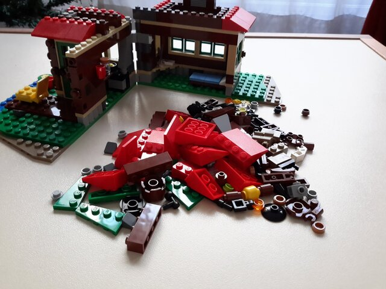](https://www.freelug.org/IMG/jpg/20180218_142818.jpg)

Le toit est entièrement démonté, passons au bas des murs. À noter deux couches de tan, en haut et bas des murs, pour changer un peu du marron.

[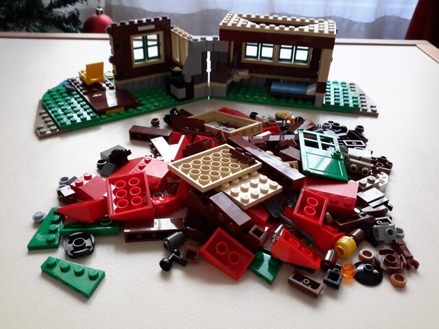](https://www.freelug.org/IMG/jpg/20180218_143030.jpg)

Le mur du fond y est passé, ainsi que la chaise longue au bord du lac.

[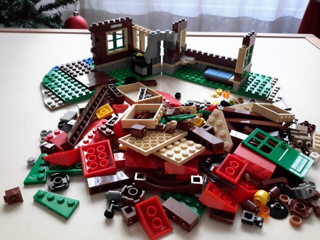](https://www.freelug.org/IMG/jpg/20180218_143249.jpg)

Et voici la maison réduite à ses fondations.

[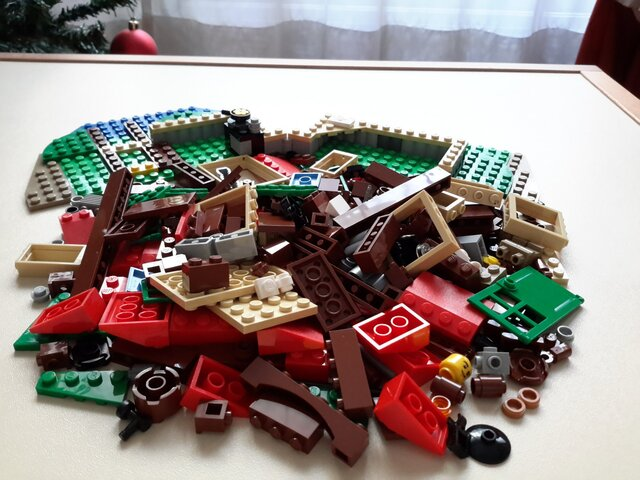](https://www.freelug.org/IMG/jpg/20180218_143635.jpg)

Maintenant que tout est démonté, je vais pouvoir assembler le premier modèle alternatif.

Cela reste une cabane, mais cette fois-ci il y a un télescope sur le toit pour regarder les étoiles. Le dossier de la chaise longue a été recyclé en drapeau, et il y a une « vraie » fleur à droite. Il reste pas mal de pièces une fois ce modèle construit.

[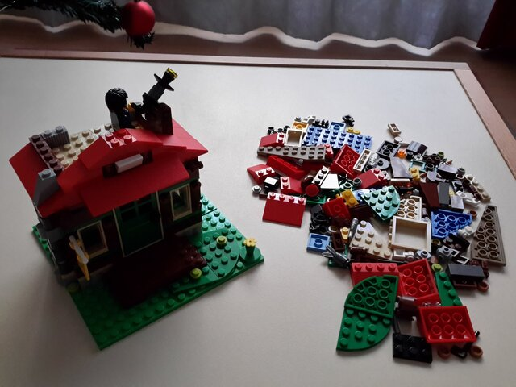](https://www.freelug.org/IMG/jpg/20180218_150956.jpg)

La maison sous un autre angle...

[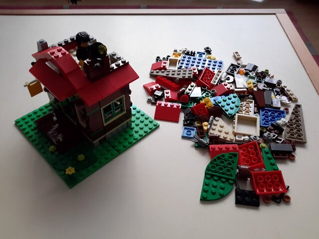](https://www.freelug.org/IMG/jpg/20180218_151006.jpg)

... et ouverte. On retrouve le coin bureau, avec une lettre et la tasse. Le siège est symbolisé par une plate 2x2 ronde posée sur une 2x2 lisse avec tenon et peut donc tourner.

[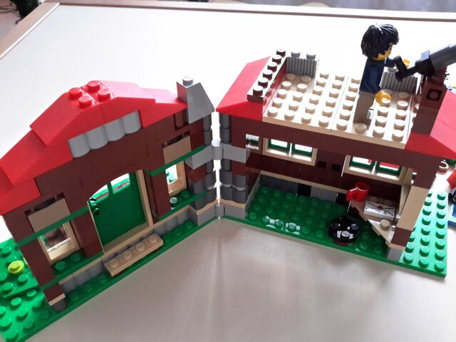](https://www.freelug.org/IMG/jpg/20180218_151021.jpg)

L’arrière de la maison, avec une échelle pour grimper sur le toit et accéder au télescope.

[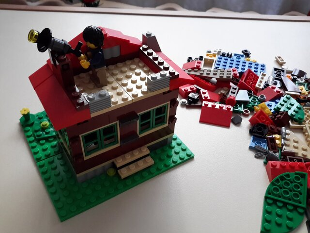](https://www.freelug.org/IMG/jpg/20180218_151029.jpg)

Le dernier côté, avec l’arrière de la cheminée. Quelques petites pièces 1x1 vert pâle égayent le paysage.

[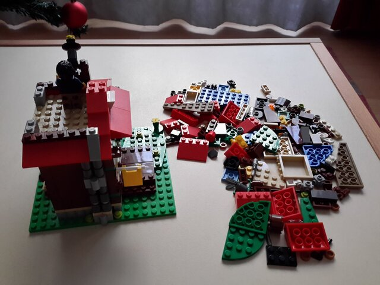](https://www.freelug.org/IMG/jpg/20180218_151036.jpg)

Le second modèle alternatif reprend des éléments de ses frères. Un seul côté expose des bouts de rondin, en revanche la grenouille est de retour, ainsi que la chaise longue, cette fois-ci en intérieur. Toujours le coin bureau et la lettre, mais un poisson accroché au mur change un peu. La figurine, debout à côté d’une lampe, a dans la main un bâton de randonnée.

[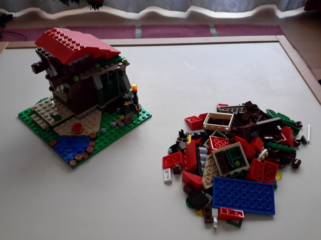](https://www.freelug.org/IMG/jpg/20180225_114259.jpg)

[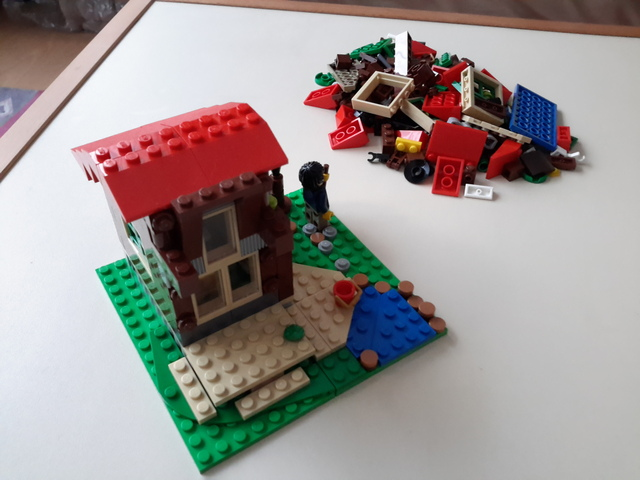](https://www.freelug.org/IMG/jpg/20180225_114312.jpg)

[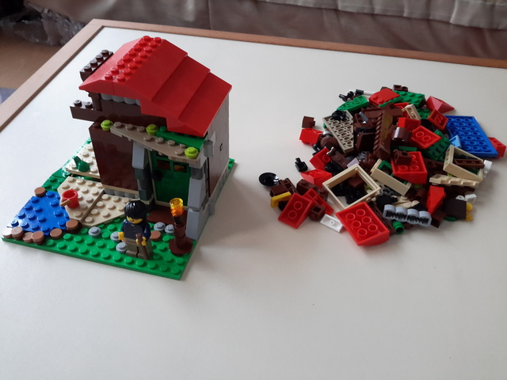](https://www.freelug.org/IMG/jpg/20180225_114331.jpg)

[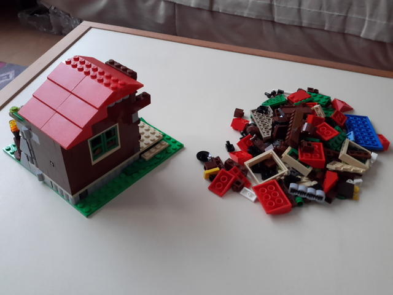](https://www.freelug.org/IMG/jpg/20180225_114339.jpg)

[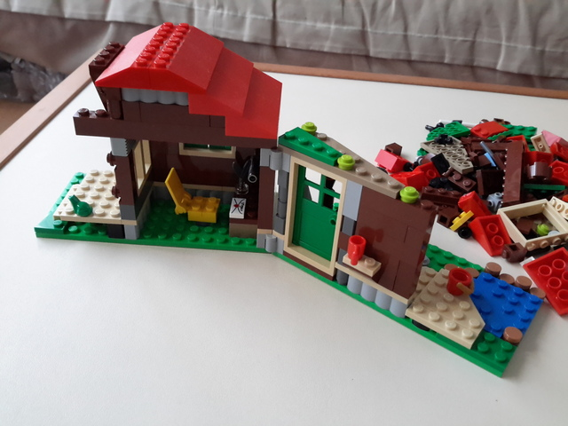](https://www.freelug.org/IMG/jpg/20180225_114404.jpg)

[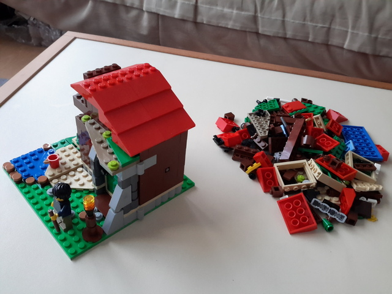](https://www.freelug.org/IMG/jpg/20180225_114419.jpg)

* * *

**Avis :** un modèle sympathique à monter, même s’il ne comporte pas de technique particulière. Les petits détails sont nombreux : rondins dépassant sur les angles, fleurs, lit et coin bureau, petites plates 1x1 sur le toit, cornes accrochées à la maison, etc. Et démonter, surtout dans n’importe quel ordre, est bien plus rapide et facile que monter !

Bref, un très bon modèle.
