Aujourd’hui, présentation rapide d’un petit modèle de la gamme « 3 en 1 », la boîte 31055, _Le bolide rouge_.

Sortie en 2017, cette boîte coûtait la modique somme de 4,99 € pour 72 pièces, soit un ratio de 0,7 € par pièce.

Autant le dire tout de suite, ce n’est donc pas un modèle très compliqué, bien qu’il soit officiellement pour les 6-12 ans :)

* * *

La face avant présente le modèle principal, un magnifique bolide rouge. Sur les côtés apparaissent les modèles alternatifs, une remorqueuse et une autre voiture de course. La traditionnelle mention « 3 in 1 » est présente en haut à droite.

[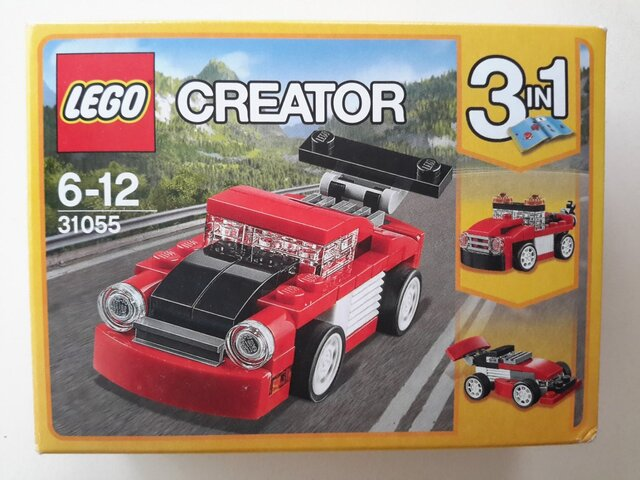](https://www.freelug.org/IMG/jpg/20180722_094115-r270.jpg)

Sur la face arrière rien de bien spécial, les trois modèles apparaissent sous différents angles, comme l’habitude sur cette gamme.

[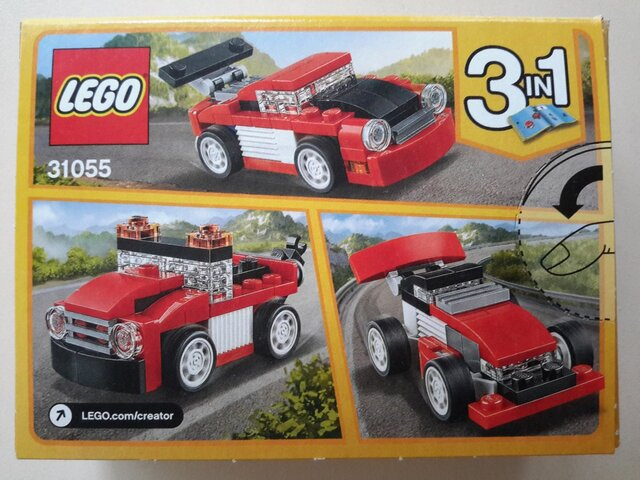](https://www.freelug.org/IMG/jpg/20180722_094104-r270.jpg)

À l’intérieur une notice et deux sachets (me semble-t-il) de pièces, qui forment un tout petit tas — et oui, 72 pièces, ce n’est pas beaucoup...

[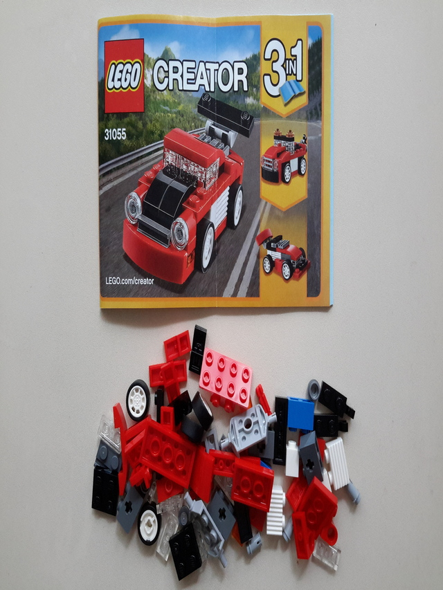](https://www.freelug.org/IMG/jpg/20180722_094501.jpg)

Sans plus attendre, commençons la construction. Le modèle se compose se trois sous-modules assemblés par deux pièces Technic rouge de connexion. L’idée, j’imagine, est que combiné à d’autres modèles similaires l’on peut piocher des modules ici et là pour construire des véhicules amusants.

On assemble d’abord un essieu avec deux briques...

[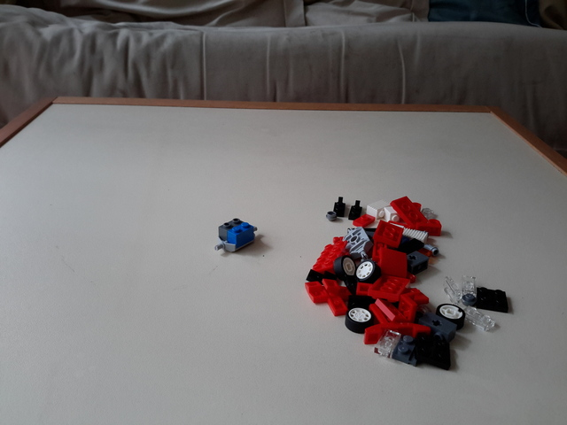](https://www.freelug.org/IMG/jpg/20180722_094603.jpg)

... puis on pose des grilles et attaches pour l’aileron arrière, avec deux feux.

[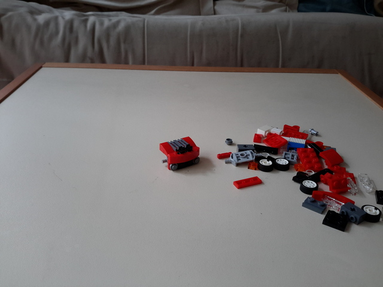](https://www.freelug.org/IMG/jpg/20180722_094733.jpg)

On pose l’aileron arrière (deux pièces), qui est articulé, et la pièce de connexion Technic, puis on passe à la partie centrale, qui se construit avec quelques briques simples. Deux briques à rayures rompent la monotonie de la carrosserie.

[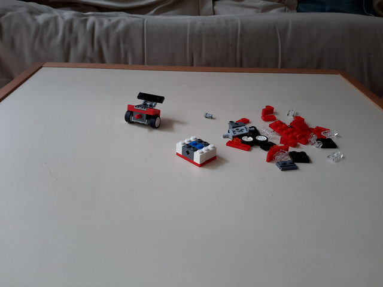](https://www.freelug.org/IMG/jpg/20180722_094932.jpg)

On monte le cockpit, fait de pièces transparentes, et la partie centrale est terminée. À noter que ce cockpit fait trois tenons de largeur, et est donc à une demi-brique de chaque côté, la voiture faisant 4 tenons.

Dernière partie, l’avant, qui se construit comme l’arrière autour d’un essieu. Deux feux orange à l’avant mettent un peu de variété.

[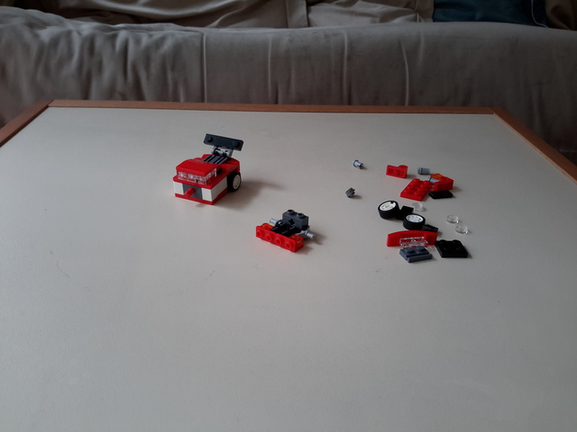](https://www.freelug.org/IMG/jpg/20180722_095235.jpg)

Le capot est construit avec des pièces noires, les phares avant avec des demi-pièces de liaison Technic sur lesquelles viennent se poser des pièces rondes transparentes. Le pare-choc, pièce courbe, est posé sur deux angles rouges.

[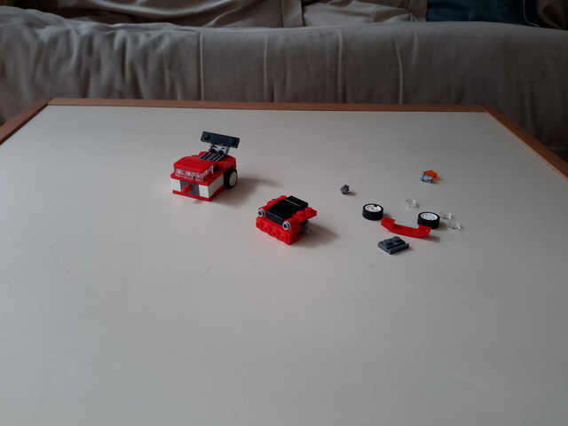](https://www.freelug.org/IMG/jpg/20180722_095345.jpg)

On ajoute les phares, le pare-choc et les roues, et voici le véhicule achevé. Il y a quatre pièces bonus, ça sert toujours.

[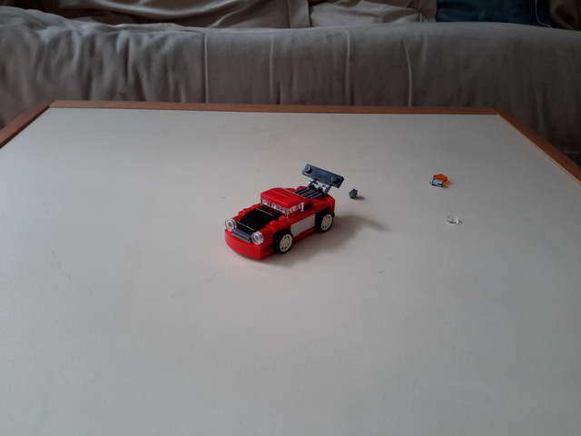](https://www.freelug.org/IMG/jpg/20180722_095438.jpg)

[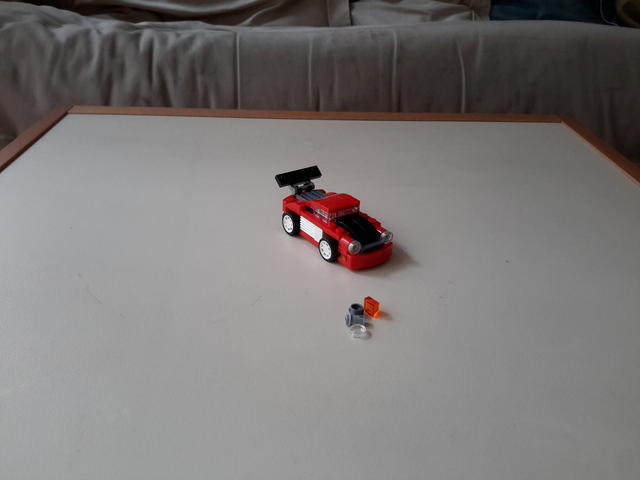](https://www.freelug.org/IMG/jpg/20180722_094025.jpg)

[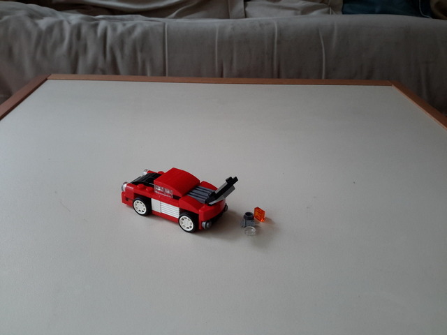](https://www.freelug.org/IMG/jpg/20180722_094031.jpg)

[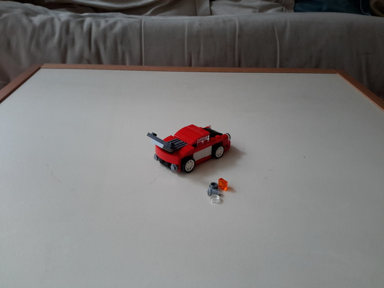](https://www.freelug.org/IMG/jpg/20180722_094037.jpg)

* * *

**Avis :** sans être exceptionnel, je trouve le rendu sympathique. Bien sûr ce n’est pas du tout à l’échelle d’une minifigurine, mais tant pis...

J’imagine que le modèle serait plus amusant combiné à d’autres, mais je n’en ai pas pour tester...

Comme dans d’autres constructions plus complexes, ce modèle utilise des briques de couleur dans des zones cachées pour permettre de facilement savoir ce qui se place où.

Au final, une petite boîte amusante pour se reposer, mais pas indispensable :)

**Bonus 1 :** quelques photos des modèles alternatifs.

La dépanneuse :

[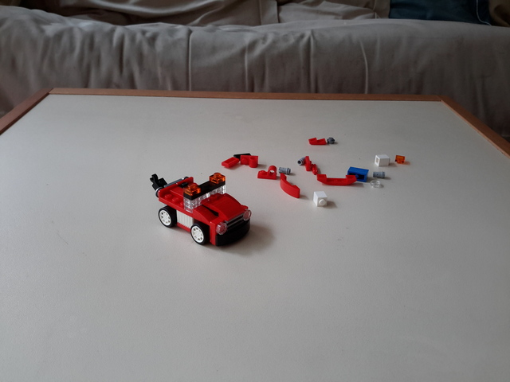](https://www.freelug.org/IMG/jpg/20180722_100126.jpg)

[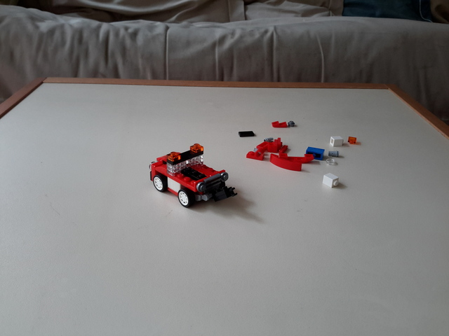](https://www.freelug.org/IMG/jpg/20180722_100134.jpg)

[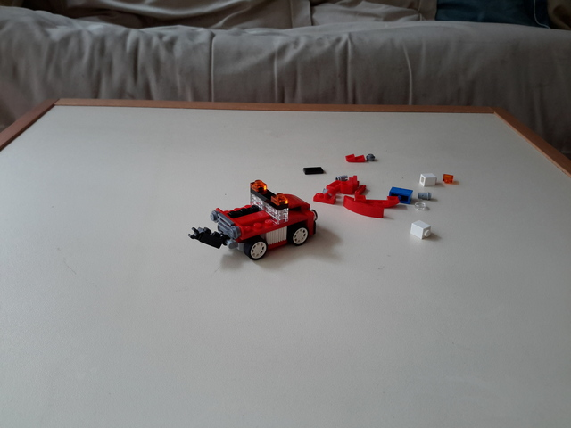](https://www.freelug.org/IMG/jpg/20180722_100138.jpg)

Elle peut se séparer en deux morceaux, comme le modèle principal.

[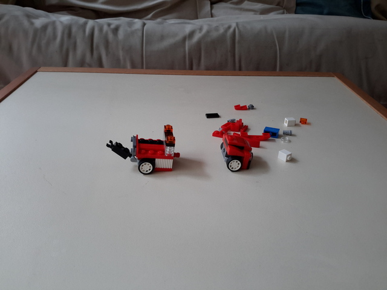](https://www.freelug.org/IMG/jpg/20180722_100147.jpg)

Et la seconde voiture...

[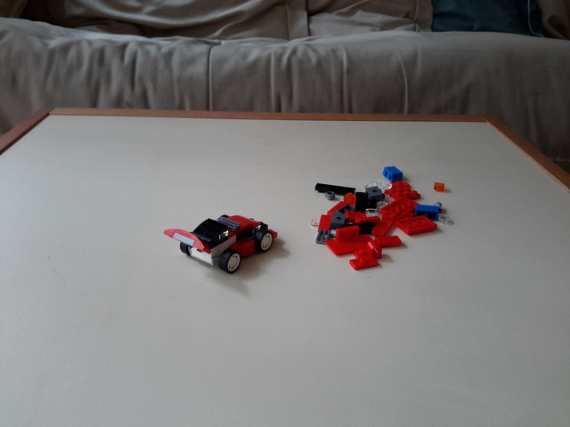](https://www.freelug.org/IMG/jpg/20180722_100647.jpg)

[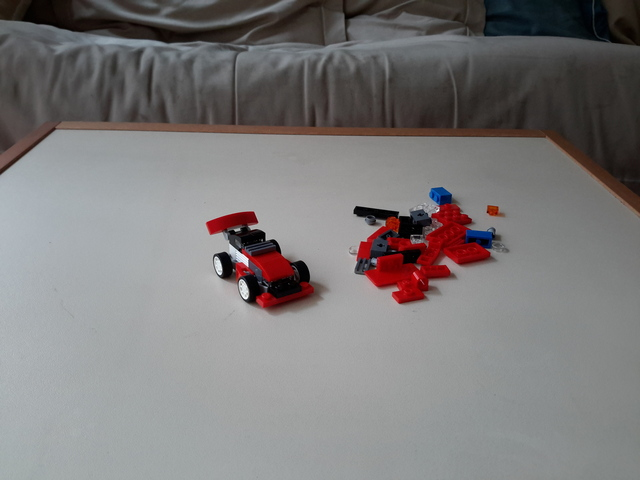](https://www.freelug.org/IMG/jpg/20180722_100651.jpg)

[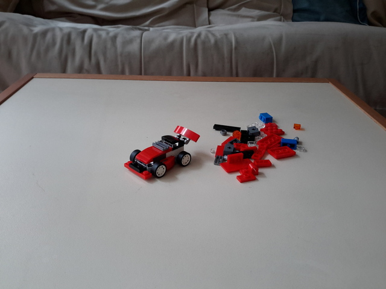](https://www.freelug.org/IMG/jpg/20180722_100655.jpg)

... qui se sépare également

[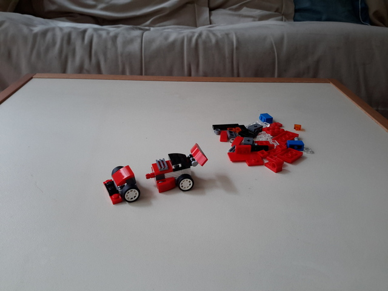](https://www.freelug.org/IMG/jpg/20180722_100709.jpg)

**Bonus 2 :** animation de toutes les étapes de construction du modèle principal (cliquer pour lancer).

[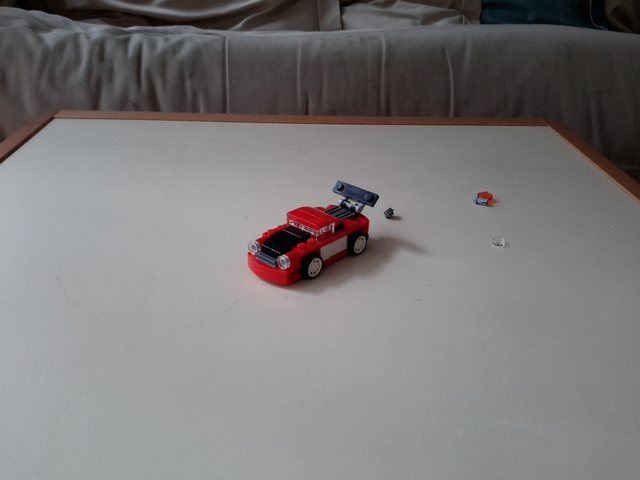](https://www.freelug.org/IMG/gif/31055-bolide-rouge.gif)
