Au programme aujourd’hui, une boîte exclusive parfois offerte dans les boutiques LEGO.

La boîte que je vous propose est un cadeau offert dans certaines circonstances dans les boutiques LEGO (j’ai eu la mienne pour fêter l’ouverture de la boutique des Halles à Paris, même si c’était quelques mois après son inauguration officielle. Peut-être est-elle distribuée en ligne, je l’ignore).

Apparemment apparue pour la première fois en 2014, cette boîte, qui porte la référence _40145_ représente une boutique LEGO. Nommée comme il se doit _La boutique LEGO_, elle comporte 413 pièces, dont une minifigurine.

* * *

L’avant de la boîte présente logiquement la boutique, qui est officiellement autorisée pour les 7 ans et plus. La minifigurine, qui représente probablement une cliente, s’apprête à rentrer dans la boutique LEGO (si elle en sortait, elle aurait un sac avec ses achats, bien sûr !). En haut à droite, un petit bandeau rappelle qu’il s’agit d’un set exclusif.

[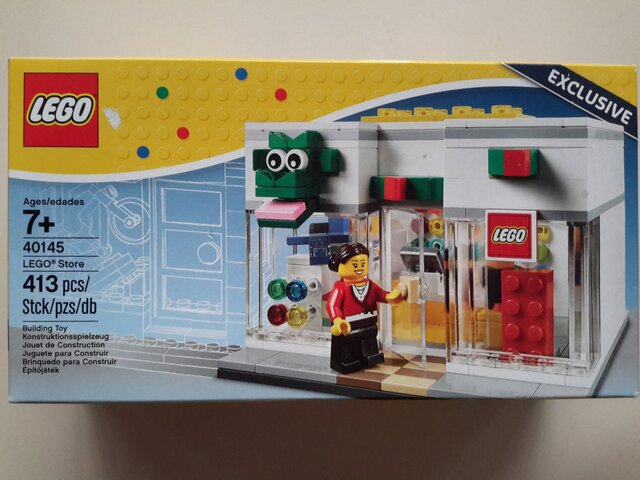](https://www.freelug.org/IMG/jpg/20190316_154438.jpg)

L’arrière présente la boutique ouverte, et informe que les toits peuvent s’enlever facilement. L’intérieur est bien visible, avec différents présentoirs. La cliente semble en train de scanner son article pour payer, c’est donc un self-service !

[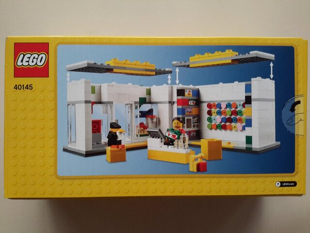](https://www.freelug.org/IMG/jpg/20190316_154502.jpg)

À l’intérieur, cinq sachets, une notice et une planche d’autocollants. Et oui, comble, LEGO ne fournit même pas de pièce sérigraphiée pour son propre logo... Les pièces forment un joli petit tas.

[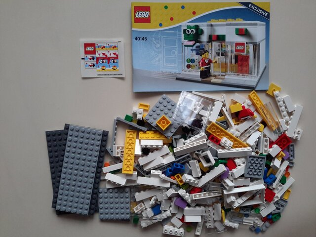](https://www.freelug.org/IMG/jpg/20190316_154822.jpg)

* * *

La cliente de la boutique est une jeune femme à l’air ravi avec un sac évidemment de LEGO (il n’y a pas de son, sinon on entendrait sans doute le cri d’horreur de la carte bleue qui a payé !). Elle est habillée d’un pull lacé avec un petit nœud, laissant apparaître un t-shirt blanc avec des étoiles. À son cou un pendentif en forme de cœur. Sa coiffure est avec les cheveux sur l’arrière. En revanche, les jambes sont noires unies. Le sac est un simple assemblage de trois pièces, sans autocollant.

[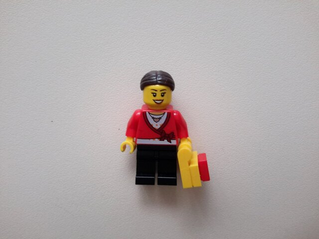](https://www.freelug.org/IMG/jpg/20190316_155301.jpg)

De dos service minimum, juste deux bandes pour compléter le t-shirt et le pull. Les cheveux sont en chignon.

[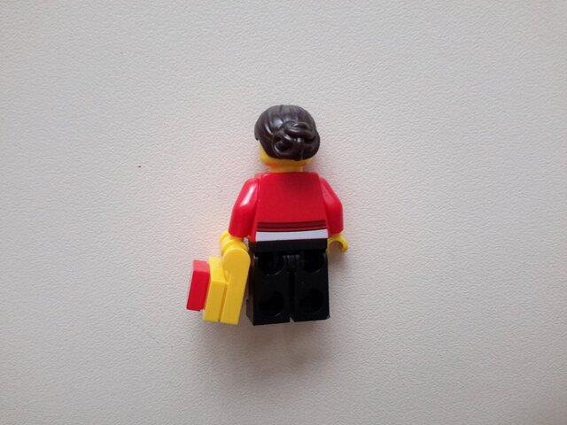](https://www.freelug.org/IMG/jpg/20190316_155318.jpg)

* * *

La construction de la boutique elle-même commence par une plaque 6 x 16 gris foncé, sur laquelle on pose différentes tiles et plates. Une charnière permet de rattacher une seconde plaque identique, également recouverte de plates et tiles. Il y a 5 plates 2 x 5 à jumper qui serviront à poser différents objets, et deux zones 1 x 4 non recouvertes — elles serviront respectivement pour la porte et certains objets. Deux pièces 1 x 4 à seulement 2 tenons, à droite, serviront à poser des étagères qui pourront être retirées facilement.

[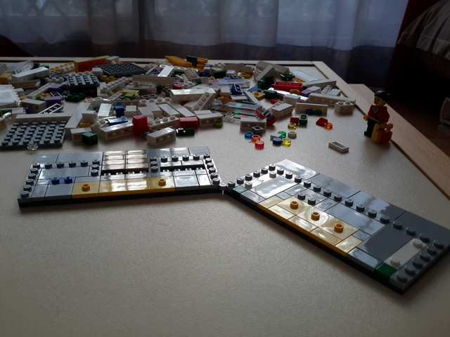](https://www.freelug.org/IMG/jpg/20190316_160455.jpg)

On pose une couche de plates blanches sur les plates grises, puis on commence à monter le mur de droite. Son élément central sera un mur de « choisis et construis », ou « pick & build » en original, un mur de briques. Il est constitué de pièces 1 x 2 ou 1 x 4 à tenons latéraux recouverts de pièces 1 x 1 rondes de différentes couleurs. Le rendu, ma foi, est sympathique !

[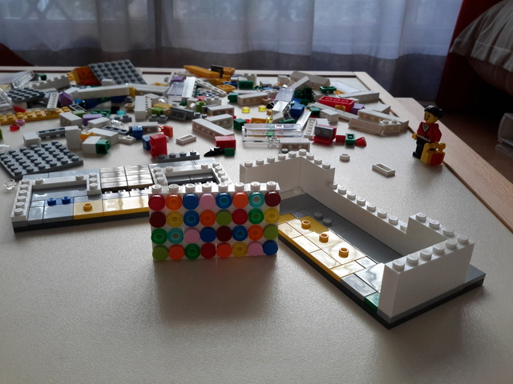](https://www.freelug.org/IMG/jpg/20190316_161232.jpg)

La construction continue avec le côté gauche, qui est l’avant de la boutique, avec de belles vitres transparentes. La porte est au centre, c’est bien symétrique pour l’instant.

[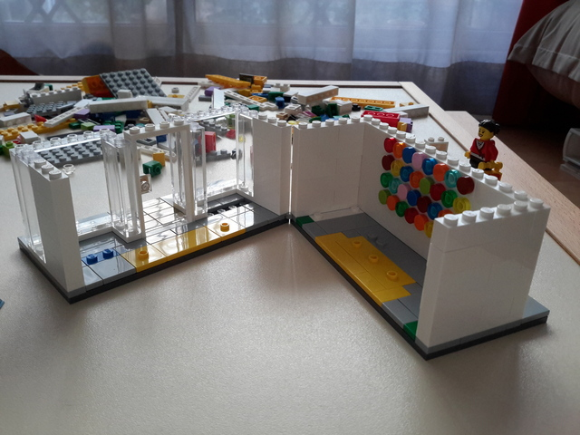](https://www.freelug.org/IMG/jpg/20190316_161603.jpg)

On pose une petite couche de plates grises sur les murs, puis on monte quelques objets décoratifs. Il y a une sorte de perchoir (en vitrine), et un mini-mur de briques ou pots avec un avion accroché. Sur la gauche sera posée verticalement une brique LEGO, qui sera donc visible de l’extérieur de la boutique.

[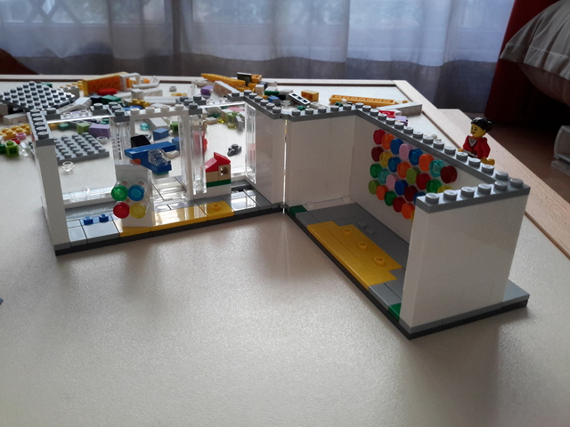](https://www.freelug.org/IMG/jpg/20190316_162120.jpg)

L’étape suivante est de construire les rayonnages (deux identiques) contenant les boîtes LEGO à acheter. Il s’agit simplement de briques avec autocollants, reprenant les grands thèmes LEGO de l’époque et une couleur qui me semble associée : Creator sur du jaune, Ninjago sur du vert, Friends sur du rose, City sur du bleu, Juniors sur du rouge. Quelques briques à trou sur le bas représentent probablement les emplacements à gobelets, tandis que les espaces vides permettent d’exposer des modèles de Maîtres constructeurs — enfin, c’est mon interprétation !

[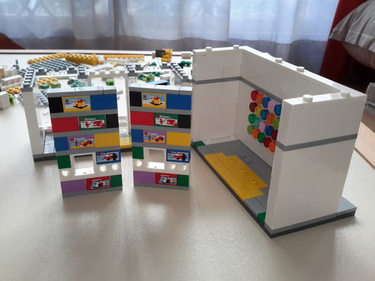](https://www.freelug.org/IMG/jpg/20190316_163502.jpg)

On pose les rayonnages puis on assemble un comptoir avec la caisse. Rien de spécial à dire, il semble ceci dit que je me sois trompé sur la pièce inclinée, ou alors la notice ne correspond pas à l’image sur la boîte — j’ai mis la pièce inclinée vers le bas, elle est plutôt vers le haut sur la boîte. Le comptoir se pose sur les 3 pièces 2 x 2 à jumper à droite.

[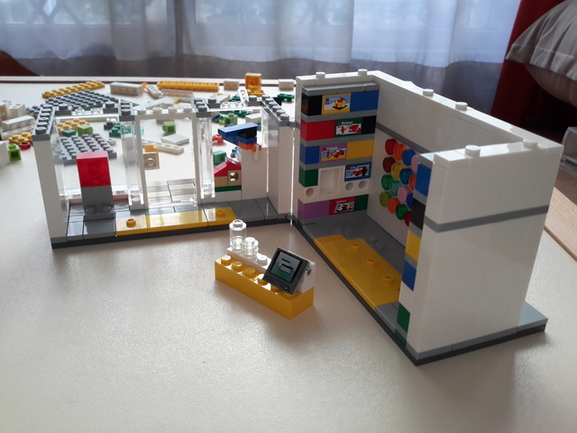](https://www.freelug.org/IMG/jpg/20190316_163616.jpg)

On rajoute une petite boîte à droite de l’entrée, et à gauche un petit oiseau, ici pas encore posé sur son support (la pièce 2 x 2 jaune à gauche).

[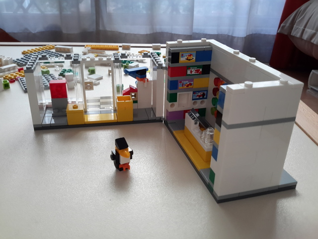](https://www.freelug.org/IMG/jpg/20190316_163822.jpg)

La suite nous ramène à la façade avant de la boutique. On pose enfin l’enseigne LEGO, qui est donc un simple autocollant sur une tile 2 x 2 blanche. Bon, ça rend bien, mais pourquoi pas une pièce sérigraphiée, hein ?

[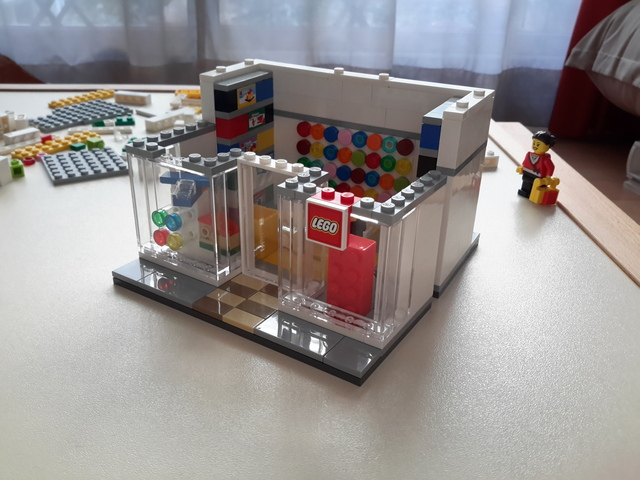](https://www.freelug.org/IMG/jpg/20190316_163930.jpg)

On monte quelques étages de la façade, on accroche un bout de corps du dragon au-dessus de la porte, puis on assemble sa tête. Il a une magnifique gueule avec plate rose 1 x 2 pour la langue, qui est articulée. Les naseaux et la tête utilisent des pentes 1 x 1 x 1/3, et les yeux sont tout ce qu’il y a de plus classique.

[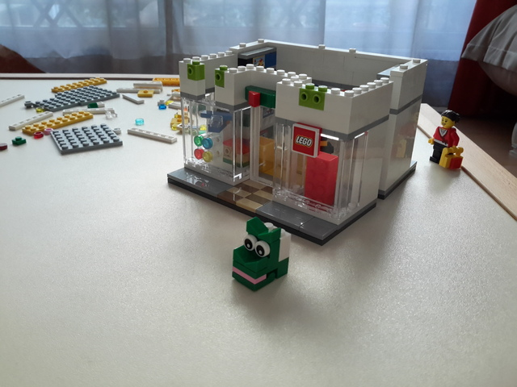](https://www.freelug.org/IMG/jpg/20190316_170003.jpg)

La tête accrochée, il faut rajouter la queue (à droite), on termine le mur, et on pose la couche de plates à tenons (quelle est donc le nom officiel de cette pièce 1 x 4 à seulement 2 tenons ?). Le premier morceau de toit se pose sur le côté de la boutique avec la porte. Il est constitué de quelques plates avec une bordure de tiles et au centre des 2 x 2 jaune recouvertes d’une pièce 1 x 1 transparente. Le rendu est ma foi intéressant.

[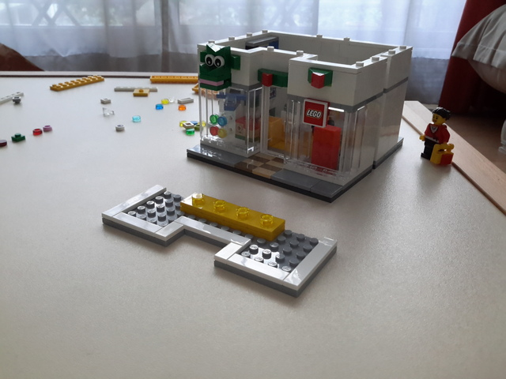](https://www.freelug.org/IMG/jpg/20190316_170306.jpg)

La seconde moitié du toit est construite sur le même modèle, ici présenté de dessous.

[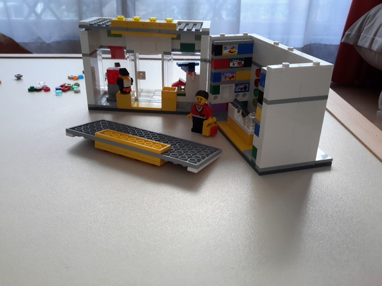](https://www.freelug.org/IMG/jpg/20190316_170520.jpg)

Et voici la boutique terminée, sous différents angles. Les vitrines transparentes permettent bien de voir l’intérieur, c’est un joli rendu. Les côtés ne sont pas particulièrement intéressants, mais on ne peut pas tout avoir !

[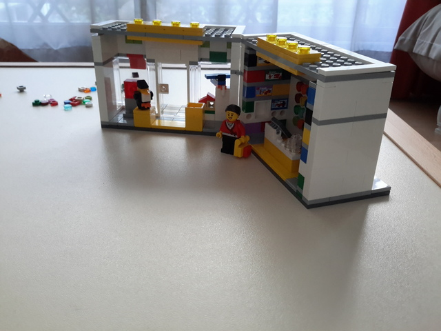](https://www.freelug.org/IMG/jpg/20190316_170531.jpg)

[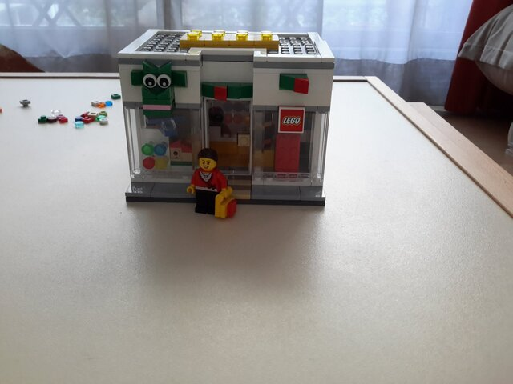](https://www.freelug.org/IMG/jpg/20190316_170540.jpg)

[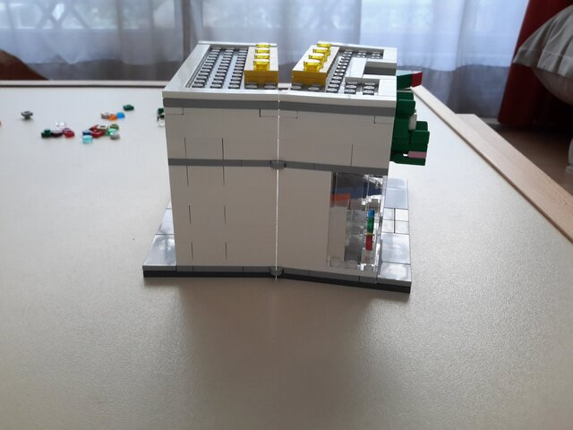](https://www.freelug.org/IMG/jpg/20190316_170550.jpg)

[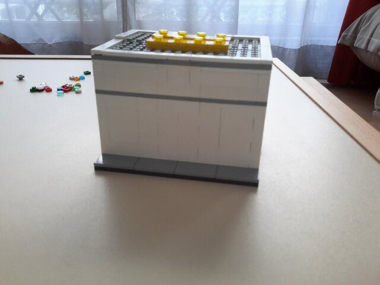](https://www.freelug.org/IMG/jpg/20190316_170556.jpg)

[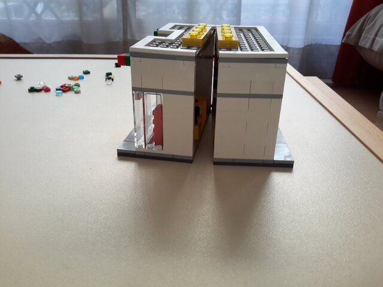](https://www.freelug.org/IMG/jpg/20190316_170605.jpg)

[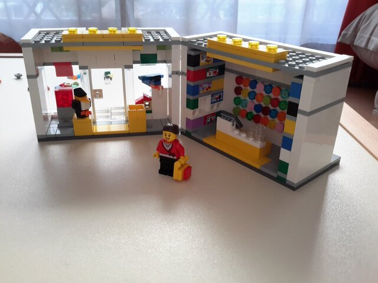](https://www.freelug.org/IMG/jpg/20190316_170616.jpg)

Et voici les pièces bonus de l’ensemble, même s’il n’y a rien d’exclusif ou rare, ça fait une belle pile par rapport au nombre de pièces dans la boîte !

[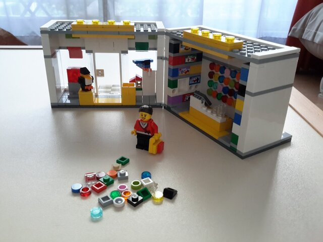](https://www.freelug.org/IMG/jpg/20190316_170630.jpg)

* * *

**Avis :** c’est franchement un beau résultat ! Point négatif, les autocollants, je trouve que c’est un comble que LEGO ne fournisse pas de pièces sérigraphiées au moins pour son logo, ce n’est pas comme s’il ne pouvait pas être réutilisé dans d’autres circonstances. À part cela je trouve que l’ambiance des boutiques que je connais est bien rendue, avec le mur de briques, les boîtes en rayon, le dragon, les constructions à l’entrée, à part un vendeur tout y est !

Bref une boîte très amusante à monter, même sans technique particulière, et qui trouvera certainement sa place (même s’il faut la modifier un peu) dans quelque diorama de ville.

**Bonus :** animation de toutes les étapes de construction (cliquer pour lancer).

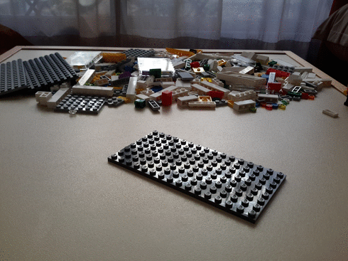
