C’est le printemps, alors quoi de mieux que de petites fleurs en briques pour le fêter ? :)

Je vous propose donc un rapide coup d’œil sur la boîte _40187_ intitulée _Fleurs décoratives_.

Sortie en 2018 elle aligne fièrement 100 pièces pour un prix de 5,99 €, soit un ratio de 6 centimes.

Sur la fiche de présentation, LEGO déclare que ces fleurs sont parfaitement adaptées pour la Saint-Valentin ou la fête des mères... Soit.

* * *

Cette boîte permet de construire deux fleurs, une rose (rouge en l’occurrence) et une marguerite. Pas de fioritures sur l’avant, pas de catégorie particulière, c’est une boîte un peu passe-partout. À noter qu’elle est fermée simplement par du scotch, pas besoin de la déchirer pour l’ouvrir.

[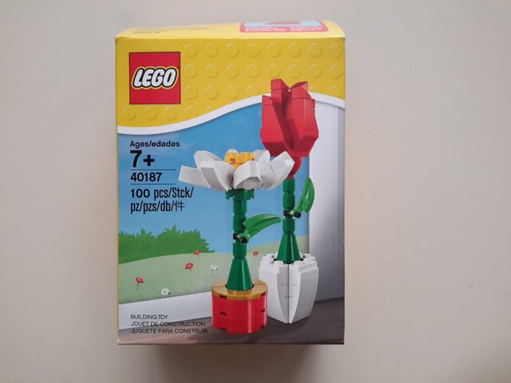](https://www.freelug.org/IMG/jpg/20190316_171258.jpg)

Les faces latérales présentent les deux fleurs, rien à dire de spécial.

[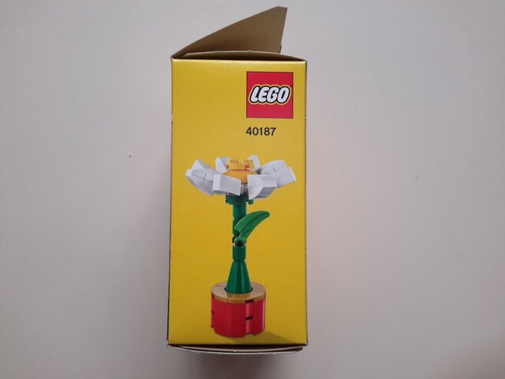](https://www.freelug.org/IMG/jpg/20190316_171326.jpg)

[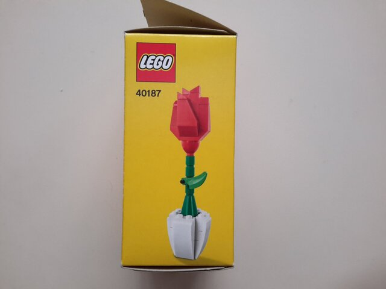](https://www.freelug.org/IMG/jpg/20190316_171333.jpg)

À l’intérieur on trouve deux sachets et deux notices, un couple pour chaque fleur. Ceci permet éventuellement de se partager la construction (qui, ceci dit, n’est pas particulièrement compliquée ou longue), donc une belle activité de couple pour la Saint-Valentin, par exemple !

[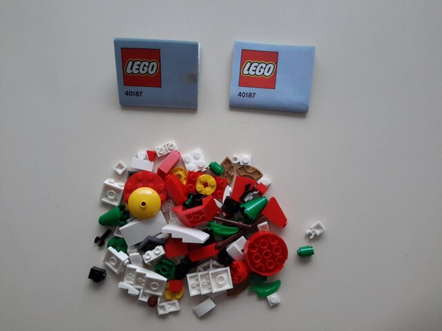](https://www.freelug.org/IMG/jpg/20190316_171450.jpg)

Les notices sont de simples feuilles recto-verso pliées.

[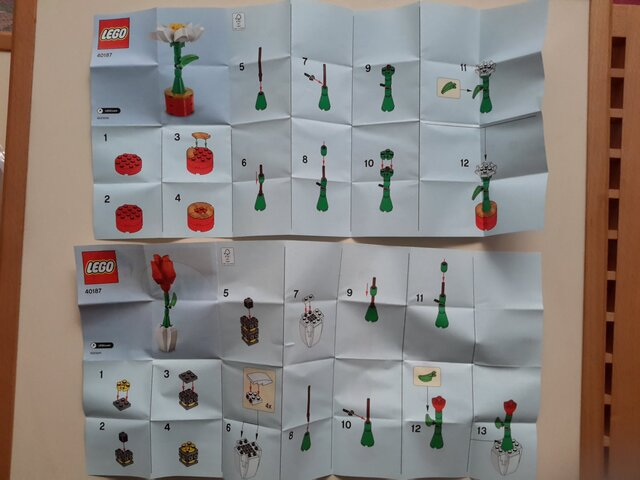](https://www.freelug.org/IMG/jpg/20190316_171540.jpg)

* * *

La première fleur que j’ai choisi de construire, la rose, a un pot blanc. La construction est assez simple, avec un centre à base de briques 1x1 à deux tenons latéraux, avec ce qu’il faut de plates entre pour pouvoir accrocher des briques verticales. Les côtés sont des briques courbes, du plus bel effet.

[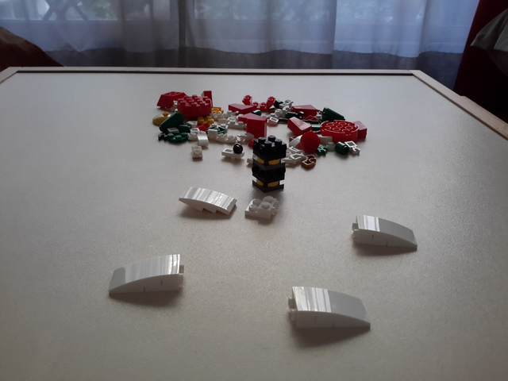](https://www.freelug.org/IMG/jpg/20190316_171804.jpg)

La tige est constituée d’un support conique vert avec une barre marron, qui est ensuite recouverte de briques rondes vertes 1x1.

[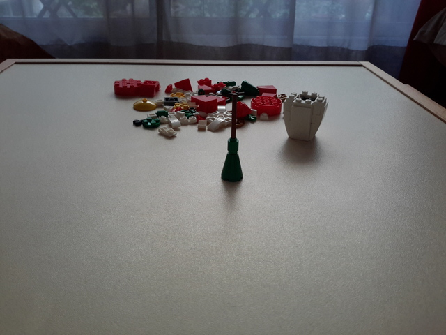](https://www.freelug.org/IMG/jpg/20190316_171906.jpg)

Après la première brique on accroche une pince et une feuille, pour agrémenter un peu la fleur. Une demi-sphère inversée rouge de 2x2 permet de faire la partie basse de la fleur.

[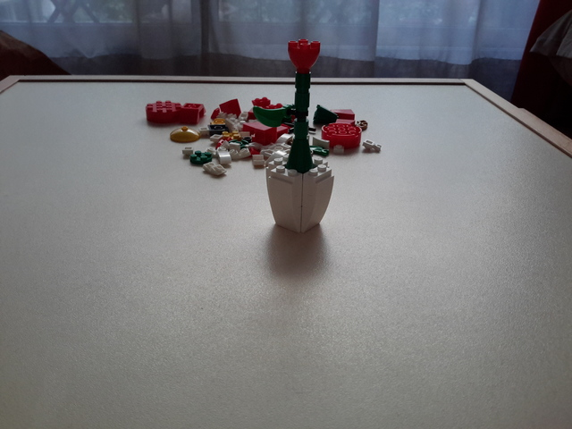](https://www.freelug.org/IMG/jpg/20190316_171949.jpg)

Le cœur de la rose est constitué de briques 2x1x2 en pente, montées sur des briques en creux de 2x4, et surmontées de pentes 1x1x1/3.

[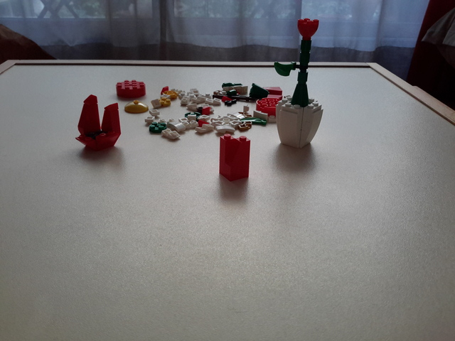](https://www.freelug.org/IMG/jpg/20190316_172107.jpg)

Et voici la rose terminée. Elle mesure une dizaine de centimètres de hauteur, quand même !

[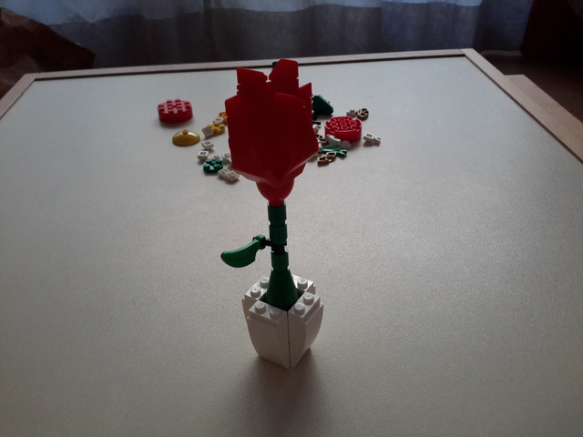](https://www.freelug.org/IMG/jpg/20190316_172226.jpg)

La marguerite elle a une base arrondie, avec des pièces rondes 4x4x1 rouge. Sur le dessus du vase des briques plates quart de cercle dorées.

[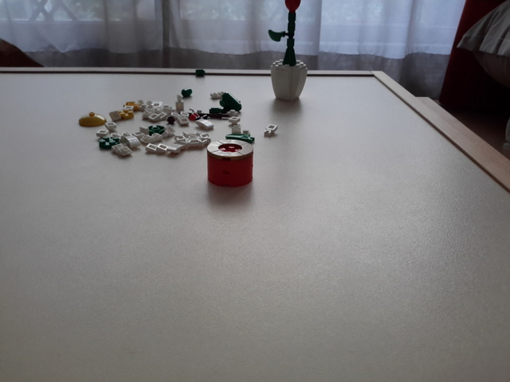](https://www.freelug.org/IMG/jpg/20190316_172335.jpg)

La tige se construit sur le même principe que pour la rose, pas de surprise, même si la feuille est disposée un peu différemment.

[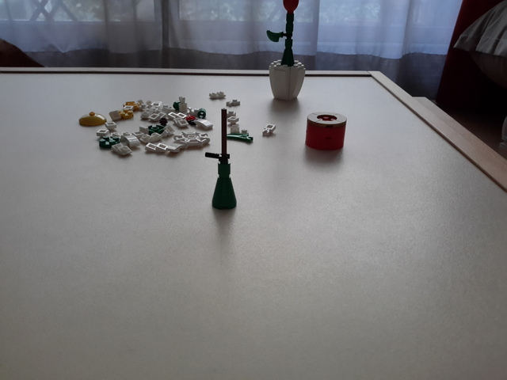](https://www.freelug.org/IMG/jpg/20190316_172404.jpg)

Au sommet de la tige on place une brique hexagonale blanche, sur laquelle viendront se rattacher les pétales.

[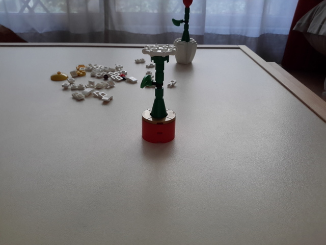](https://www.freelug.org/IMG/jpg/20190316_172458.jpg)

Les pétales sont au nombre de 8. Ils se construisent sur le même modèle, un clips coincé entre deux pentes 2x1 (l’une ordinaire l’autre inversée). Les clips sont en deux modèles, horizontal (sur la droite) et vertical (sur la gauche).

[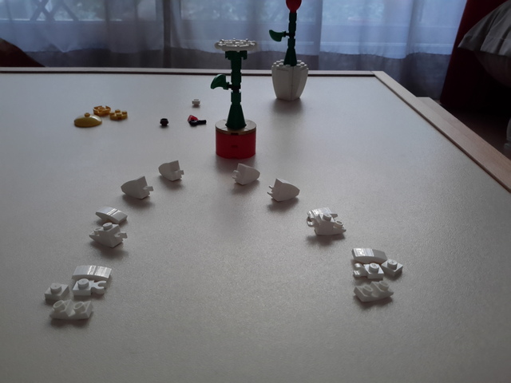](https://www.freelug.org/IMG/jpg/20190316_172836.jpg)

On accroche les pétales, puis on construit le cœur jaune de la fleur. Rien de bien spécial, deux pièces 2x2 rondes encadrant un disque 4x4 jaune.

[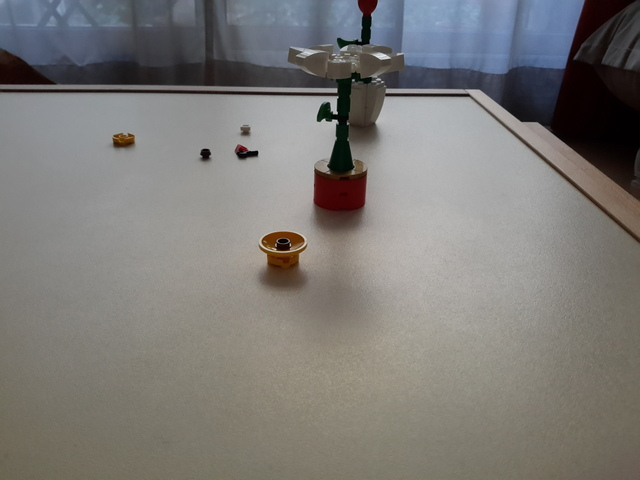](https://www.freelug.org/IMG/jpg/20190316_173024.jpg)

Et voici côte à côte les deux fleurs terminées. La rose est plutôt fermée, tandis que la marguerite est épanouie.

[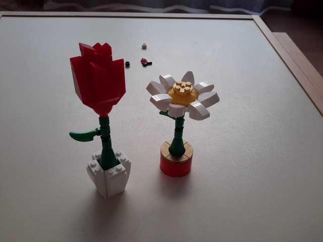](https://www.freelug.org/IMG/jpg/20190316_173118.jpg)

[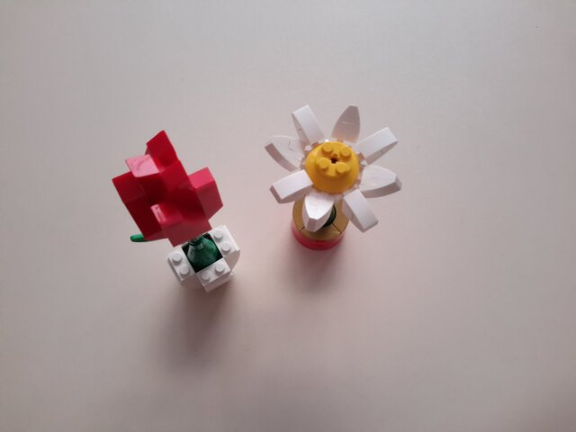](https://www.freelug.org/IMG/jpg/20190316_173122.jpg)

Il y a quelques petites pièces bonus, c’est toujours ça de pris.

[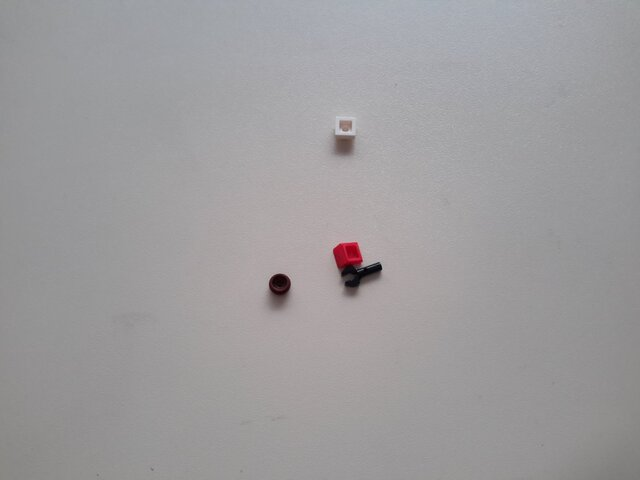](https://www.freelug.org/IMG/jpg/20190316_173138.jpg)

* * *

**Avis :** le rendu est assez sympathique j’admets. Ok, la construction n’a rien de vraiment super original (bien que les pétales de la marguerite apportent un petit plus), mais au final c’est suffisamment joli pour pouvoir être exposé comme de vraies fleurs sur une table.

Bref, c’était un petit modèle qui m’a bien plu !

**Bonus :** animation de toutes les étapes (cliquer pour lancer)

[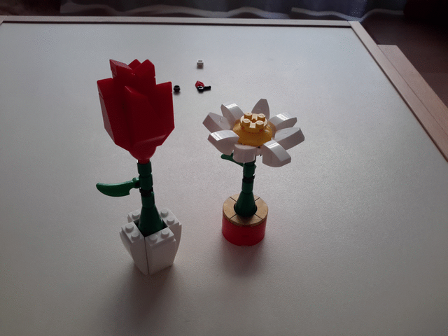](https://www.freelug.org/IMG/gif/40187.gif)
