Salut à toutes et à tous,

Aujourd’hui, je vous propose la review du set 40221 **Fontaine LEGO** de la gamme _Creator_ sorti le 1er juin 2016 et offert pour 55€ d’achat sur le shop en ligne ou en magasin.  
Ce set est composé de 105 pièces et comme il est offert, cela nous fait un ratio de 0,00cts par pièce (on voit les matheux !).

[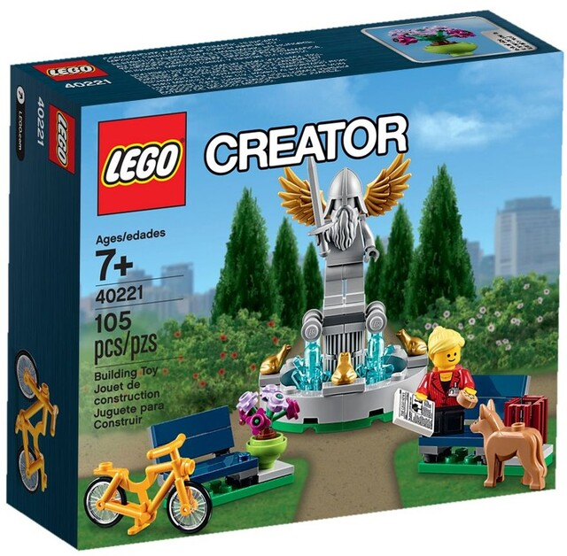](https://www.freelug.org/IMG/jpg/40221_alt1.jpg)

* * *

[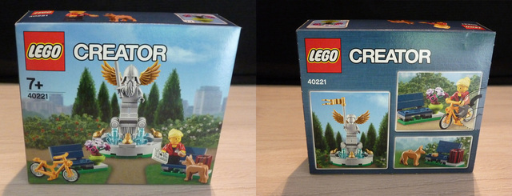](https://www.freelug.org/IMG/jpg/1-8.jpg)

Sur un joli petit fond de décor d’extérieur, la boîte nous présente la création terminée et l’envers de la boîte nous propose la variante au niveau de la statue ainsi que deux petites saynètes.

* * *

[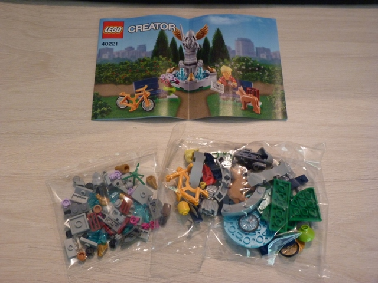](https://www.freelug.org/IMG/jpg/P1040511.jpg)

Dans la boîte, on trouve deux sachets et une notice divisée en plusieurs sous-parties dont la plus longue ne dépasse pas 15 étapes.

* * *

[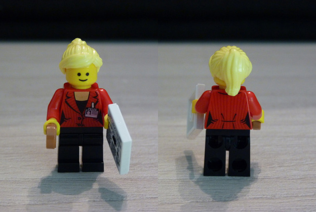](https://www.freelug.org/IMG/jpg/3-7.jpg)

On commence avec la minifigurine représentant une journaliste sûrement en pause dans le parc. Les détails de la veste sont vraiment sympas, notamment le petit badge qui justement m’a permis de savoir que ce personnage était journaliste. J’aime bien le détail au niveau des boutons qui fait penser que cette demoiselle a peut-être pris une veste un peu trop petite !

Le dos est sérigraphié également avec l’aspect cintré qui attire plus l’œil que sur le torse.

[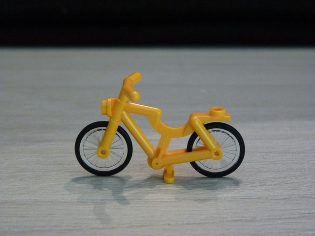](https://www.freelug.org/IMG/jpg/P1040514.jpg)

Étape suivante, rapide, avec le montage des pneus de la bicyclette.

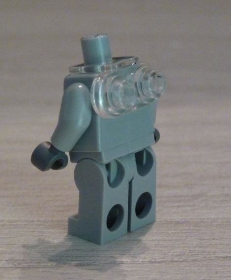

On poursuit avec la construction de la statue de la fontaine et cette petite pièce que je ne connaissais pas permettant de fixer les ailes dorées. Elle est assez récente puisque sa première apparition date semble-t-il de 2015 et on ne la trouve que dans 11 sets.

[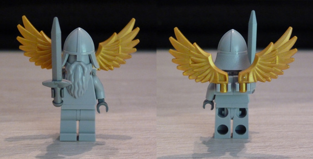](https://www.freelug.org/IMG/jpg/4-5.jpg)

La statue finie de face et de dos.  
Cela m’a fait bizarre de replacer un casque de chevalier comme celui-là sur une tête de figurine LEGO car je pense que la dernière fois que j’ai fait ce geste, c’était il y a une vingtaine d’années... séquence nostalgie...

* * *

[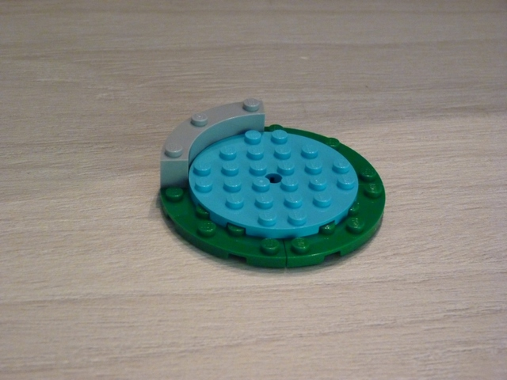](https://www.freelug.org/IMG/jpg/P1040520.jpg)

Allez, on continue avec la fontaine à proprement parler et on commence comme le plus souvent avec la base.

[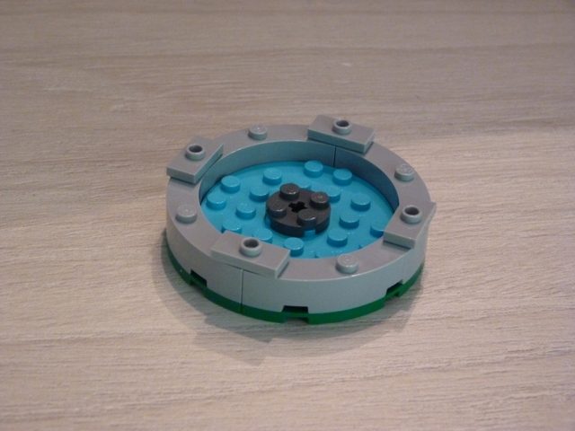](https://www.freelug.org/IMG/jpg/P1040521.jpg)

[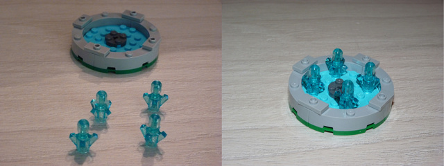](https://www.freelug.org/IMG/jpg/5-3.jpg)

L’utilisation des cristaux et des globes avec stick bleu transparent pour reproduire les jets d’eau de la fontaine est intéressante.

[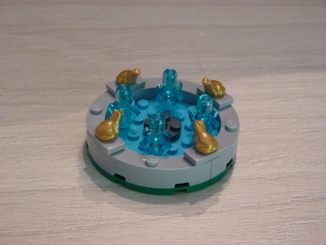](https://www.freelug.org/IMG/jpg/P1040527.jpg)

On rajoute quelques grenouilles dorées (présentes dans seulement 3 sets LEGO) pour la déco.

[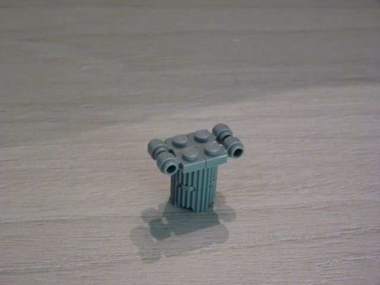](https://www.freelug.org/IMG/jpg/P1040528.jpg)

On s’attaque ensuite à la colonne supportant la statue.

[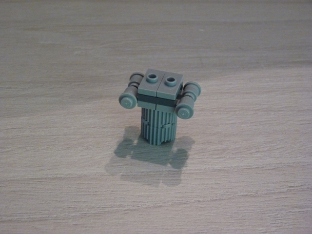](https://www.freelug.org/IMG/jpg/P1040530.jpg)

[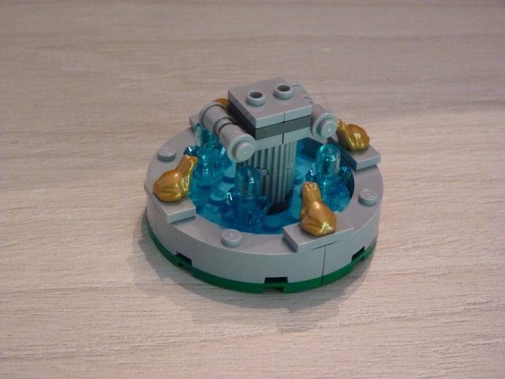](https://www.freelug.org/IMG/jpg/P1040531.jpg)

[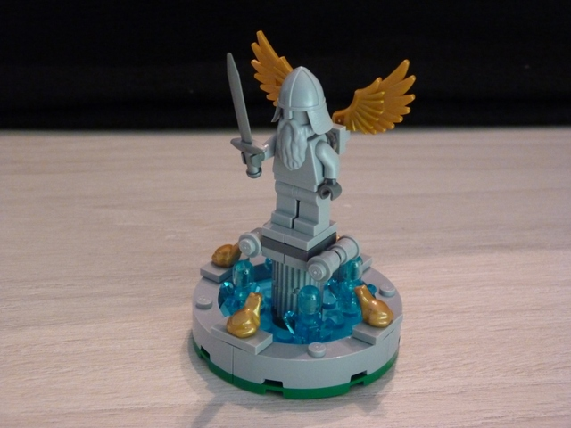](https://www.freelug.org/IMG/jpg/P1040536.jpg)

Et voilà la fontaine terminée !

On passe ensuite à l’environnement avec les bancs. Ici, deux constructions de base identiques, la seule différence sera sur l’agrément à droite : une poubelle ou un pot de fleurs.

[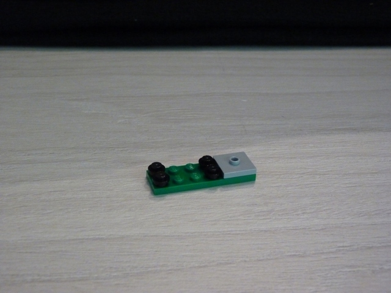](https://www.freelug.org/IMG/jpg/P1040537.jpg)

[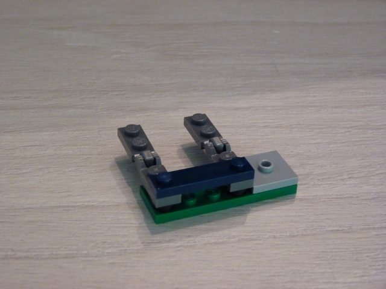](https://www.freelug.org/IMG/jpg/P1040538.jpg)

[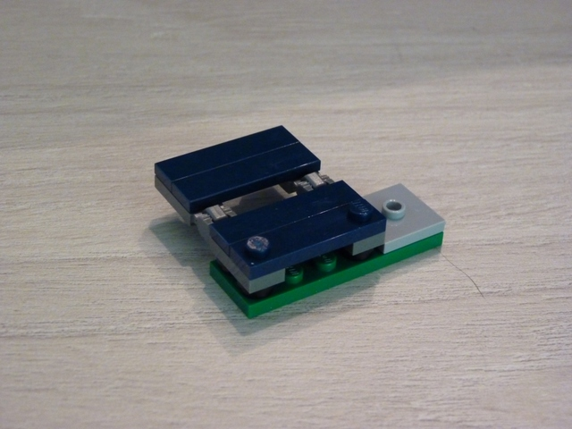](https://www.freelug.org/IMG/jpg/P1040539.jpg)

[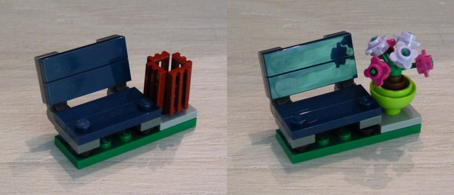](https://www.freelug.org/IMG/jpg/2-6.jpg)

[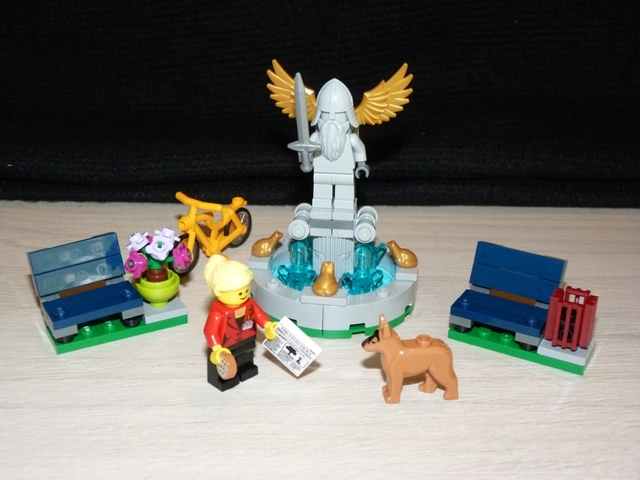](https://www.freelug.org/IMG/jpg/P1040543.jpg)

Voilà le set terminé !

[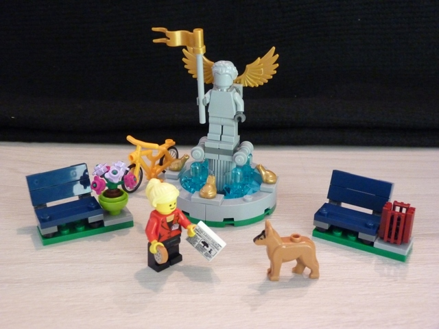](https://www.freelug.org/IMG/jpg/P1040544.jpg)

A noter la petite variante disponible au niveau de la statue (pour les moins guerriers d’entre nous).

[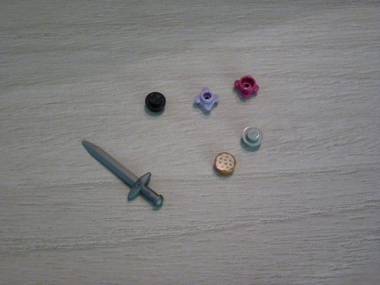](https://www.freelug.org/IMG/jpg/P1040545.jpg)

Les pièces restantes une fois le set fini (sans compter celles de la variante).

* * *

En résumé, un petit set sympathique, rien d’extraordinaire dans la construction mais la présence de pièces rares, la variante de la statue et, pour moi, le petit aspect nostalgique du casque de chevalier m’ont permis de passer un bon moment.

Une petite interrogation cependant persiste vis-à-vis de sa présence dans la gamme _Creator_ plutôt que _City_ (bien que cette dernière se concentre peut-être plus sur les bâtiments et les véhicules)...

Voilà, c’est tout pour aujourd’hui !

Merci de m’avoir lu !

[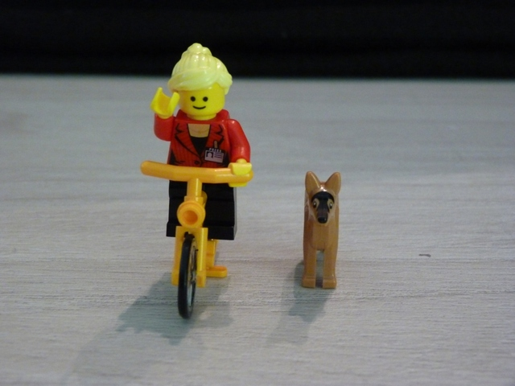](https://www.freelug.org/IMG/jpg/P1040546.jpg)

A bientôt !
