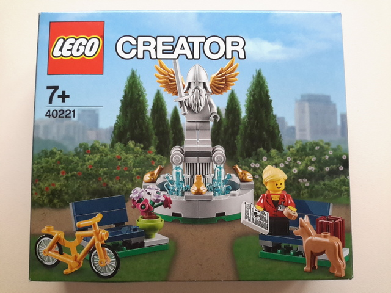
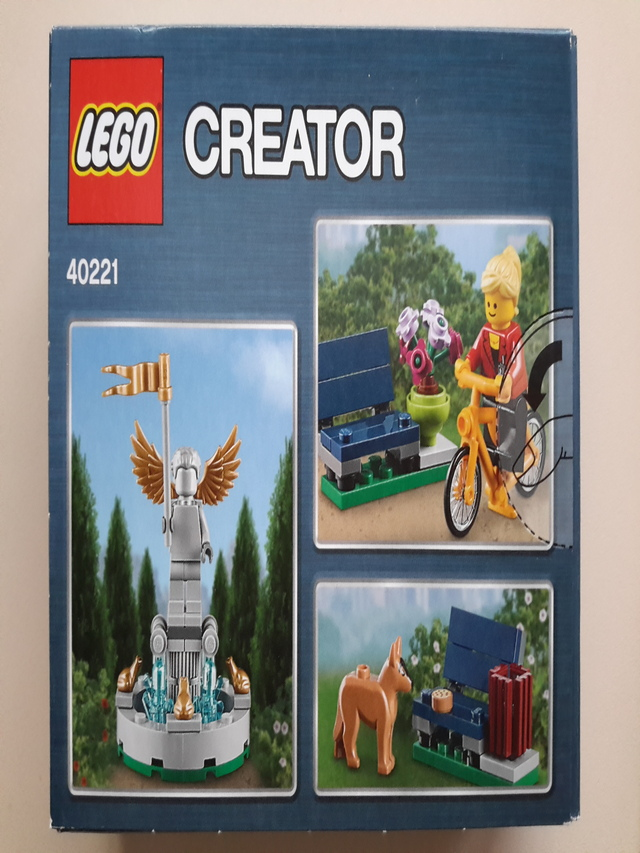
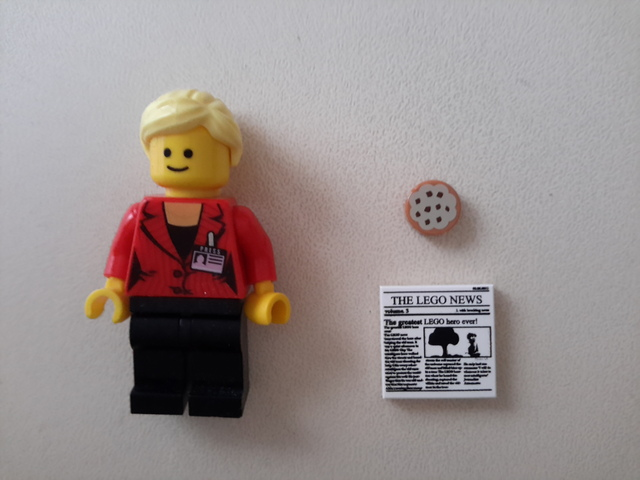
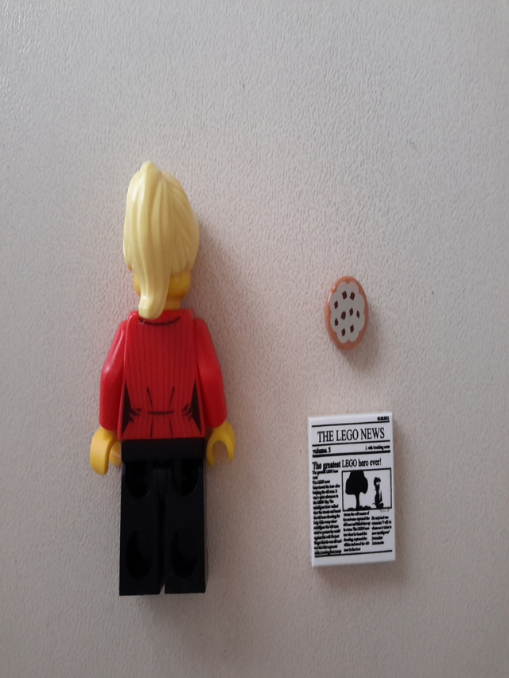
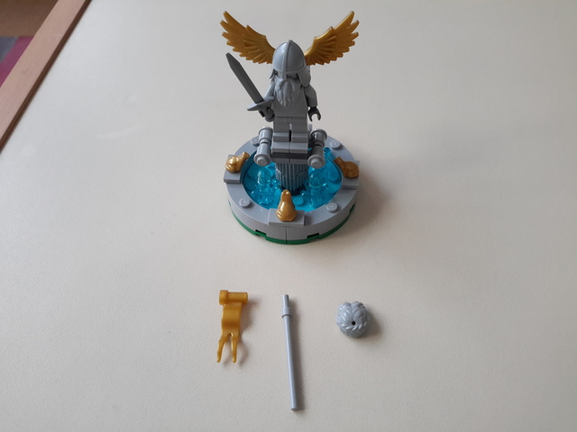
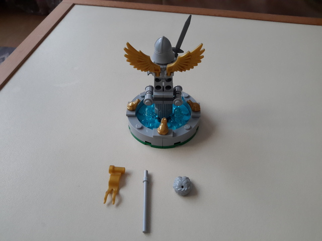
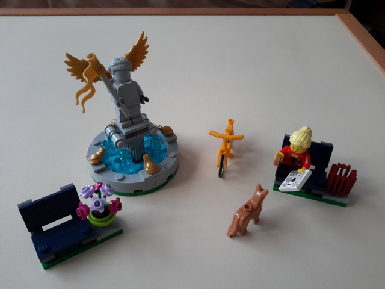
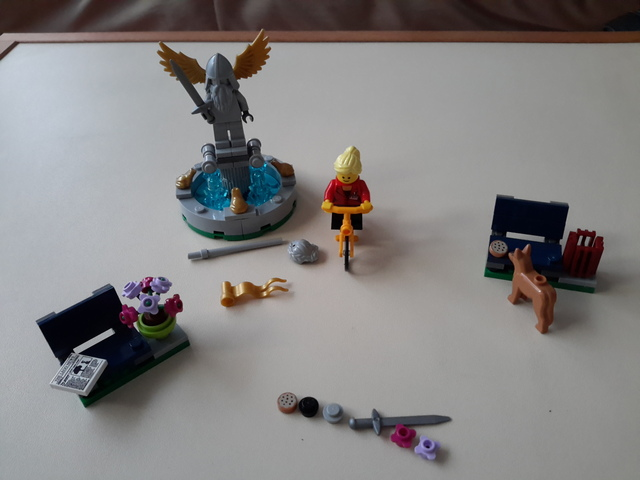

Aujourd’hui je vous propose une présentation d’une fontaine dans la gamme Creator, la boîte _40221_, _Fontaine LEGO_.

Sorti en 2016, cet ensemble contient 106 pièces. Il était offert pour, me semble-t-il, 65 € d’achats.

* * *

L’avant de la boîte présente l’ensemble, qui est une scénette se déroulant vraisemblablement dans un parc : deux bancs, une statue sur une fontaine, un décor avec arbre et massifs fleuris, c’est signé ! Une femme tient un journal à la main et donne un gâteau à un chien, une bicyclette est posée à côté d’un autre banc. Au fond une statue trône au milieu d’une fontaine, donnant son nom à l’ensemble. Pour une raison que j’ignore la boîte appartient à la gamme Creator.

Le dos montre la femme sur la bicyclette, le chien lorgnant le biscuit abandonné, et la statue, cette fois-ci sous sa forme alternative : l’avant montre une statue guerrière, un homme barbu avec une arme, ici nous avons une femme tenant un drapeau, symbole pacifiste pour moi.

La figurine a un visage neutre LEGO, mais représente une jeune femme, reconnaissable à sa coiffure. Elle a un badge « press », et tient, évidemment, un journal à la main - il s’agit de l’habituel « LEGO news », présent dans de nombreux modèles. La sérigraphie du torse est réussie, avec des plis sur la veste, un col ouvert. Rien sur les bras ou les jambes en revanche.

À l’arrière pas de surprise. La coiffure est un chignon, la veste se prolonge avec ses plis, toujours rien sur les jambes.

Voici la fontaine, qui donne nom à l’ensemble, et la statue en son centre. La construction de la fontaine est parfaitement symétrique, avec des grenouilles dorées amusantes, et quatre jets d’eau. Le piédestal est composé de quelques pièces. La statue existe donc en deux versions, une guerrière, et une pacifiste. La photo montre la version guerrière, avec les trois pièces à changer pour obtenir la version pacifique. Le guerrier est clairement un homme à barbe bien fournie.

De dos la statue porte un harnais sur lequel s’accrochent les ailes dorées.

Voici la version pacifiste de la statue. Le personnage est probablement féminin, en témoigne son chignon (visible sur les photos précédentes)

Je ne vais pas détailler la construction, très simple, et plutôt montrer une vue d’ensemble de tous les éléments.

Il y a donc deux bancs, construits pareillement. L’un est jouxté d’une poubelle (pièce 1x1 à 4 tenons latéraux plus quatre grilles marron), l’autre d’une fleur. Il y a également un chien, pièce peu décorée. Au centre les pièces bonus, sans compter celles pour transformer la statue.

Une version alternative du parc, avec la statue pacifiste, dans une disposition qui se rapproche de la représentation sur l’avant de la boîte.

* * *

**Avis :** j’aime bien cette petite boîte ! Les composants sont somme toute assez simples, mais iront très bien dans une ville, au centre d’un parc par exemple, et sont facilement reproductibles si besoin.
