Puisque Noël approche, je vous propose une séquence nostalgie avec la boîte _40223 - Boule de Noël_, offerte fin 2016 pour un achat d’un montant qui m’échappe.

Cette petite boîte met en scène un globe à neige, avec un tiroir en bas et un père Noël adossé à un sapin au-dessus. Elle comporte 210 pièces au total.

La face avant présente le modèle (pourquoi est-il pour 7 ans et plus alors qu’il ne comporte aucune technique de construction complexe je l’ignore) sur lequel les pièces rondes blanches flottent pour simuler la neige — je vous gâche le plaisir, mais en réalité, elles ne restent pas en lévitation...

Le tiroir se présente avec une face avant comme une porte (une fenêtre en réalité), encadrée de deux torches éclairant le seuil.

Sur le côté droit le sceau « Limited Edition » montre qu’on n’est pas là pour rigoler, c’est une édition limitée !

[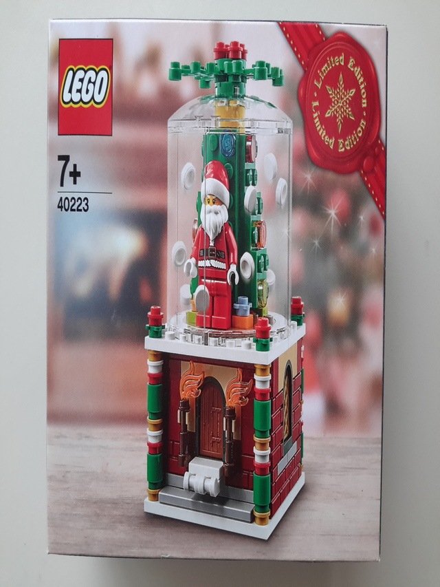](https://www.freelug.org/IMG/jpg/20190317_112834.jpg)

Sur la face arrière le tiroir est sobrement présenté à moitié ouvert. Les pièces blanches sont toujours en lévitation.

[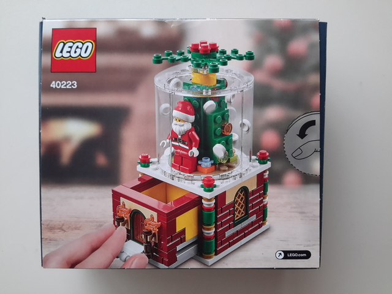](https://www.freelug.org/IMG/jpg/20190317_112854.jpg)

À l’intérieur, trois sachets, une notice. Le petit tas de pièces est à tonalité vert et rouge, avec un peu de blanc, de gris et de tan. La notice reprend le sceau « Limited Edition ».

[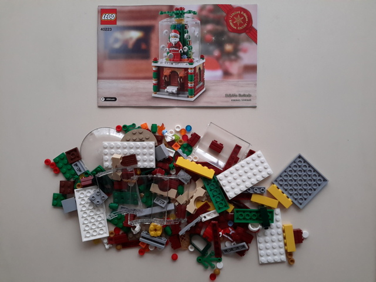](https://www.freelug.org/IMG/jpg/20190317_113935.jpg)

La boîte contient une minifigurine, logiquement de père Noël. Barbe blanche, sourcils bien blancs, le bonnet qui tombe sur les yeux, tout y est. La figurine est apparemment exclusive combinée, mais les pièces individuelles sont facilement trouvables séparément. La tampographie est sobre, avec un peu de doublure qui dépasse sur les jonctions du manteau. Par contre les jambes sont uniformément rouge...

[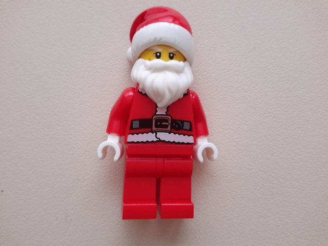](https://www.freelug.org/IMG/jpg/20190317_114213.jpg)

De dos rien à signaler, aucune tampographie, pas un motif... C’en est décevant j’admets.

[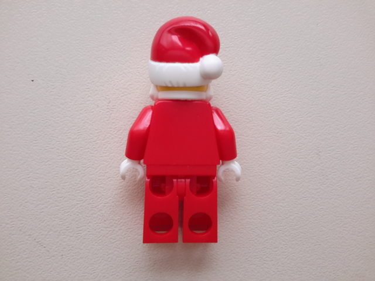](https://www.freelug.org/IMG/jpg/20190317_114226.jpg)

Le visage sans le bonnet et la barbe est clairement âgé, avec des cernes, et pas complètement souriant... Le Père Noël est-il fatigué de son travail ?

[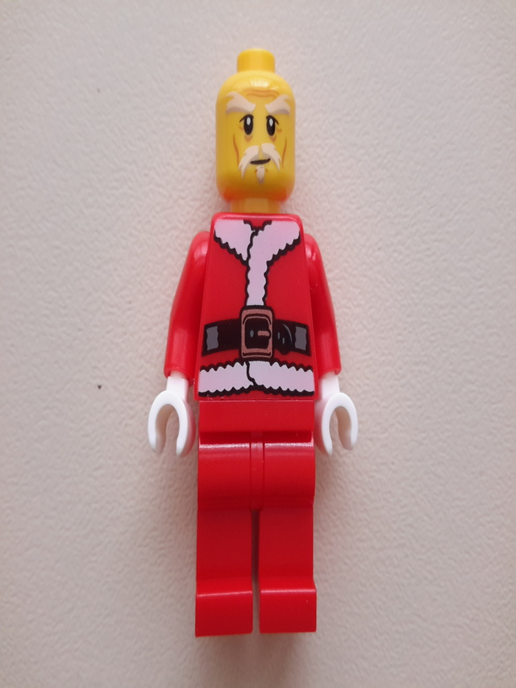](https://www.freelug.org/IMG/jpg/20190317_114133.jpg)

* * *

La construction commence par la base qui contiendra le tiroir et sur laquelle se posera le Père Noël en boule. Cette base est une plaque 8x8 blanche, sur laquelle on construit trois murs. Les deux murs opposés ont des pièces qui permettront d’enclencher le tiroir pour le guider. Au milieu de chaque mur prendra place une fenêtre. Les quatre coins de la plaque seront des colonnes.

[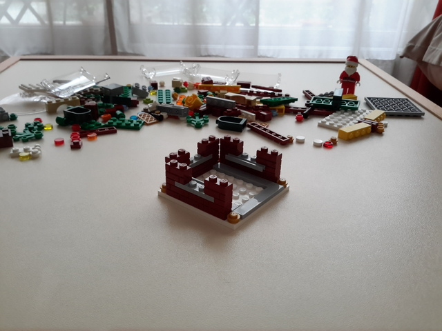](https://www.freelug.org/IMG/jpg/20190317_114653.jpg)

Voici la base presque terminée, avec les quatre colonnes à différents stades de construction. Couleurs rouge, vert, doré et blanc, ça fait festif, et c’est dans la gamme des modèles de Noël des années précédentes me semble-t-il (j’ai souvenir d’une petite maison en pain d’épice et d’un train qui étaient sur ces gammes de couleurs). Les fenêtres sont de simples pièces dorées, avec une arche tan par-dessus.

[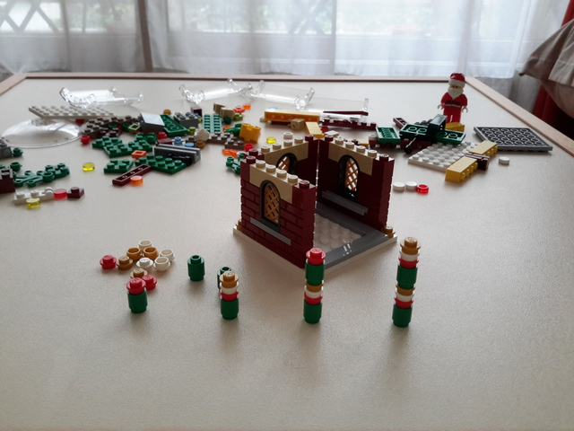](https://www.freelug.org/IMG/jpg/20190317_115049.jpg)

On termine la base en posant une seconde plaque 8x8 blanche, sur laquelle on ajoute une couche brun et quelques fleurs et pièces carrées qui seront le décor où poser le Père Noël.

[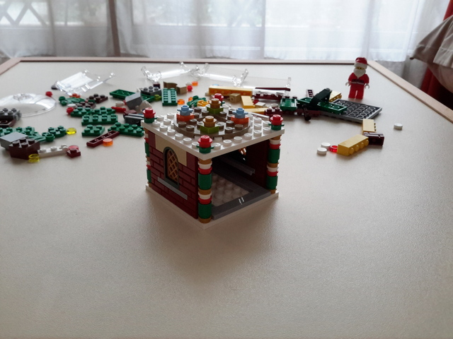](https://www.freelug.org/IMG/jpg/20190317_115346.jpg)

On pose le Père Noël, puis on monte le sapin auquel il sera adossé. Les quatre côtés de ce sapin sont très symétriques, avec seulement une couleur spécifique pour celui faisant face à la figurine. Une dizaine de pièces 1x1 ronde transparent sont présentes à cette étape.

[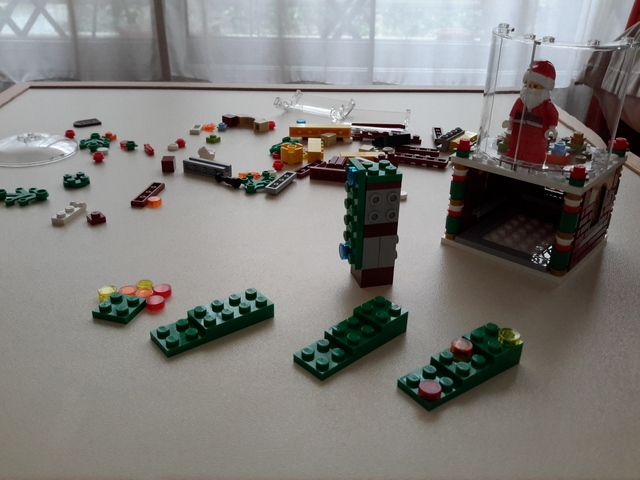](https://www.freelug.org/IMG/jpg/20190317_115702.jpg)

On termine le sapin que l’on pose, on met le tour transparent, et on ajoute les pièces rondes blanches qui symbolisent la neige. Pour une fois, la notice n’explique pas comment précisément les placer, on saupoudre à sa sauce ! Enfin on met le couvercle de la boule, qui reçoit quelques plantes pour faire plus joli.

[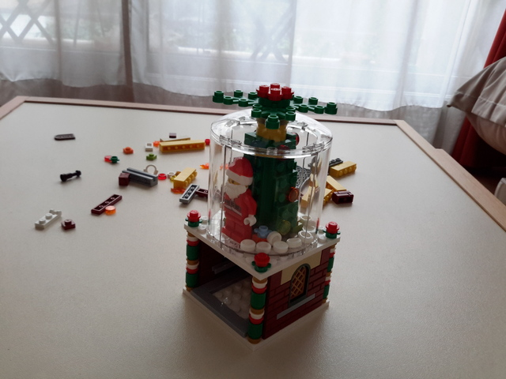](https://www.freelug.org/IMG/jpg/20190317_120047.jpg)

Vient le montage du tiroir, qui est également très symétrique. Un côté recevra la porte, deux autres opposés ont des pièces à encoches qui permettront de caler le tiroir à la base. Au fond se trouvent des pièces plates rondes 1x1 transparentes, pour faire joli même si elles ne seront pas visibles.

[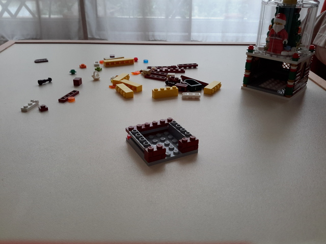](https://www.freelug.org/IMG/jpg/20190317_120200.jpg)

Le tiroir lui est à dominante jaune, avec une arche tan à l’avant par cohérence avec la base. La porte est une pièce prenant place dans un cadre de fenêtre. Deux clips permettront de mettre les torches de part de l’autre de la porte et du seuil.

[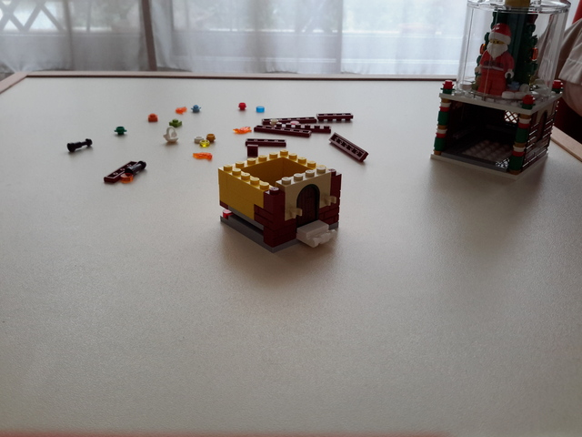](https://www.freelug.org/IMG/jpg/20190317_120351.jpg)

On termine le tiroir avec des pièces plates rouge foncé et les torches, rien de bien complexe.

[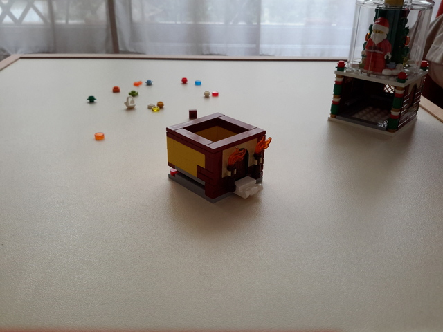](https://www.freelug.org/IMG/jpg/20190317_120442.jpg)

Et voici la boule terminée.

[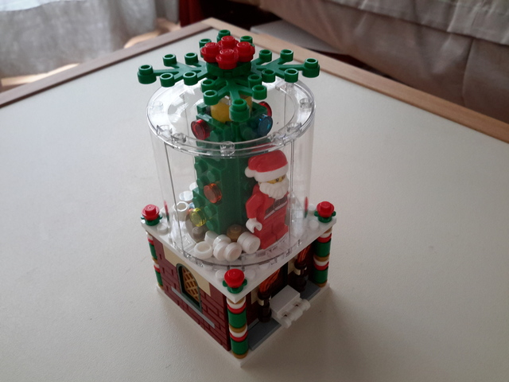](https://www.freelug.org/IMG/jpg/20190317_112655.jpg)

[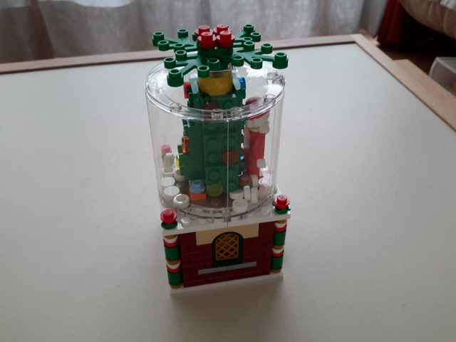](https://www.freelug.org/IMG/jpg/20190317_112720.jpg)

Avec le tiroir ouvert.

[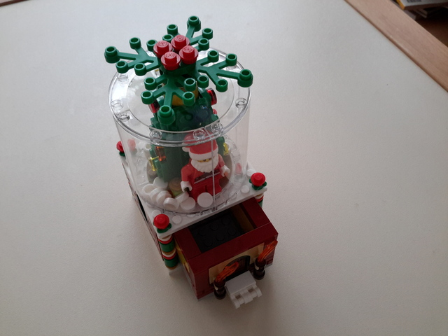](https://www.freelug.org/IMG/jpg/20190317_112736.jpg)

[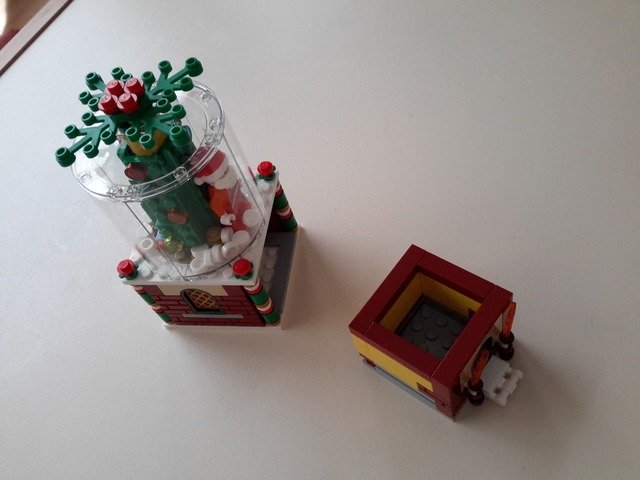](https://www.freelug.org/IMG/jpg/20190317_112746.jpg)

Voici les pièces bonus, il y en a quinze (dont une barbe et une flamme), ce qui est un bon score pour si peu de pièces dans une boîte !

[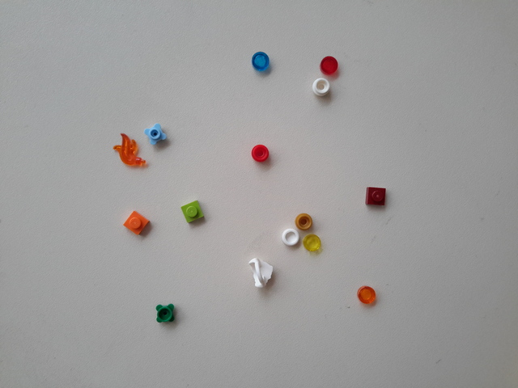](https://www.freelug.org/IMG/jpg/20190317_120455.jpg)

* * *

**Avis :** j’aime bien le rendu de cette boule ! Bon, ok, quand on la retourne, les flocons (pièces blanches plates rondes) retombent très vite, pas comme de la fausse neige. Mais l’aspect général est sympathique, et cette boîte fera un très bel accessoire décoratif dans une étagère ou sur un coin de table. Et qui sait, vous pourrez peut-être mettre un mini cadeau pour quelqu’un dans le tiroir, cela ferait sans doute une bonne surprise !

**Bonus :** animation de la construction (cliquer pour lancer).

[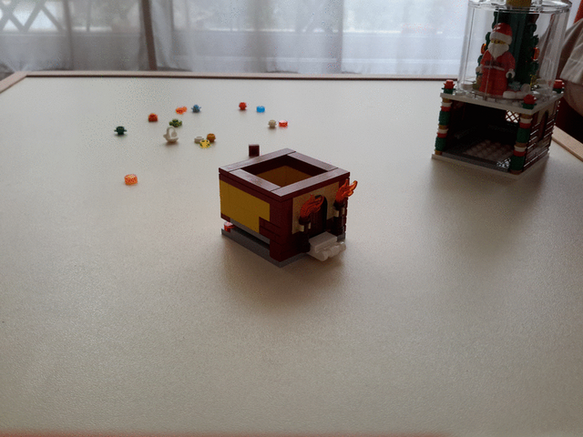](https://www.freelug.org/IMG/gif/40223-boule-noel.gif)
