Alors que c’est bientôt la saison d’Halloween, retour sur un petit set lié à ce thème sorti en 2017 et portant la référence 40260, _La hutte d’Halloween_.

Cette petite boîte comporte 145 pièces et coûtait 9,99 €, avec une minifigurine et un squelette.

* * *

L’avant de la boîte montre la scène dans son intégralité, avec un mini-décor, un chaudron, un sorcier, un squelette et une souris. La tête de mort en haut à droite, qui comporte quelques lignes pour écrire un destinataire de cadeau par exemple, inscrit clairement le set dans une gamme Halloween ou équivalent.

[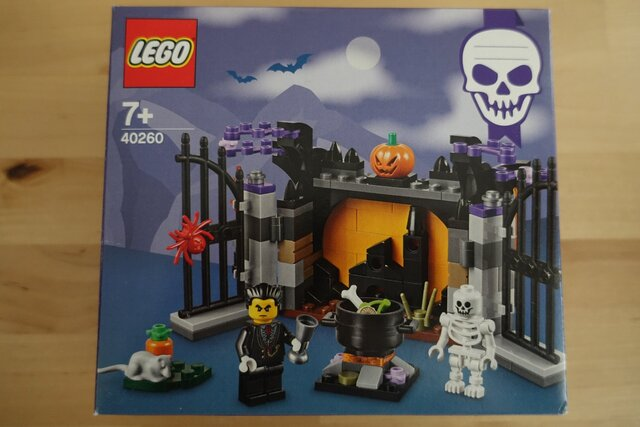](https://www.freelug.org/IMG/jpg/dsc02315.jpg)

Au dos une mini-histoire dans laquelle le sorcier décide de remplacer la tête du squelette par une citrouille. Il me semble que de nombreuses boîtes thématiques du même genre ont leur petite histoire, rien d’exceptionnel donc, mais c’est toujours amusant — sauf pour le squelette bien sûr !

[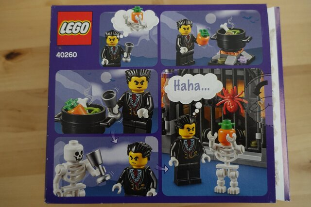](https://www.freelug.org/IMG/jpg/dsc02317.jpg)

Je ne vais pas m’étendre sur la construction, qui n’utilise pas de technique particulière. Voici l’ensemble mis en scène, avec le petit décor et les autres éléments.

[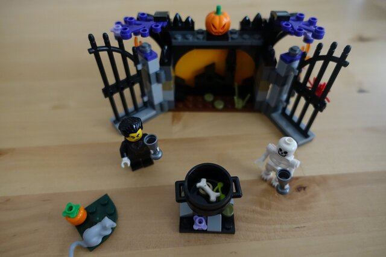](https://www.freelug.org/IMG/jpg/dsc02318.jpg)

Le décor, qui a une magnifique citrouille au centre pour insister sur le thème d’Halloween, montre un manoir stylisé sur un fond orange, avec un peu de verdure devant. Quelques plantes violettes encadrent les grilles qui permettent de refermer la mini-boîte du décor.

[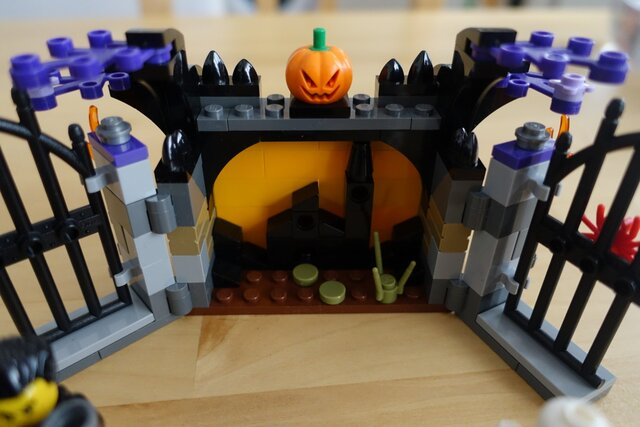](https://www.freelug.org/IMG/jpg/dsc02320.jpg)

Voici le décor fermé, avec une belle araignée sur les grilles et des flammes autour. À noter que les grilles sont articulées, mais les murs portant ces articulations aussi, permettant d’ouvrir en grand le tout.

[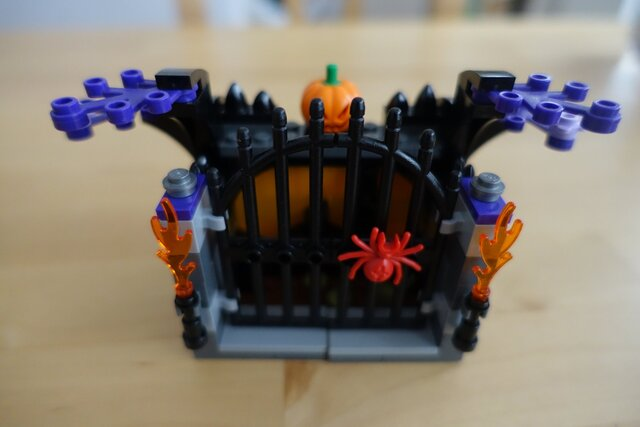](https://www.freelug.org/IMG/jpg/dsc02330.jpg)

Le dos du décor est basique, juste le fond orange uni et le tour, rien de recherché pour le coup, mais ce n’est pas très gênant.

[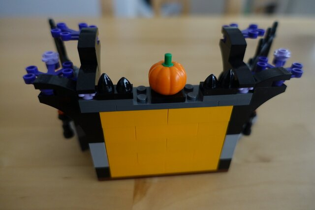](https://www.freelug.org/IMG/jpg/dsc02329.jpg)

Le sorcier fourni, qui tient un calice permettant de piocher de sa mixture du chaudron, est assez simple, avec des jambes unies et un gilet à montre gousset sur une chemise à cravate. Son visage est crispé, et il a les cheveux un peu au carré.

[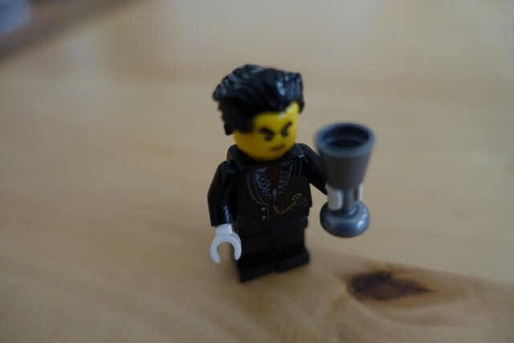](https://www.freelug.org/IMG/jpg/dsc02324.jpg)

De dos l’arrière du gilet est suggéré, mais rien de plus.

[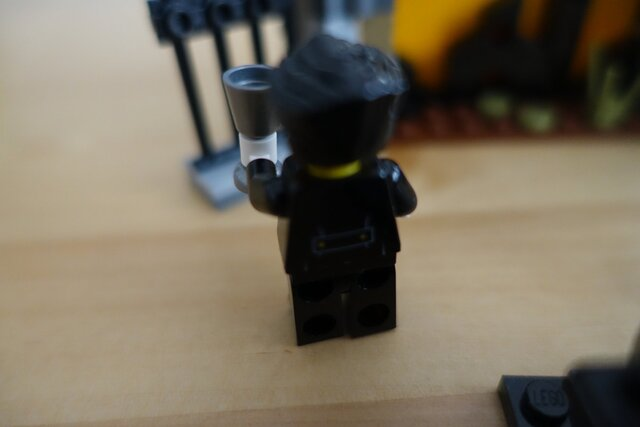](https://www.freelug.org/IMG/jpg/dsc02325.jpg)

Le chaudron est posé sur un feu (symbolisé par des pièces orange transparent), avec quelques branchages et fleurs autour. Bon, ce n’est pas extraordinaire, mais c’est suffisant...

[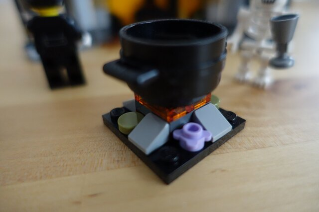](https://www.freelug.org/IMG/jpg/dsc02327.jpg)

Le squelette, qui sera donc le cobaye, est un classique présent dans d’autres sets je pense. Rien à redire, il fait le travail, dans un cadre Halloween c’est très bien.

[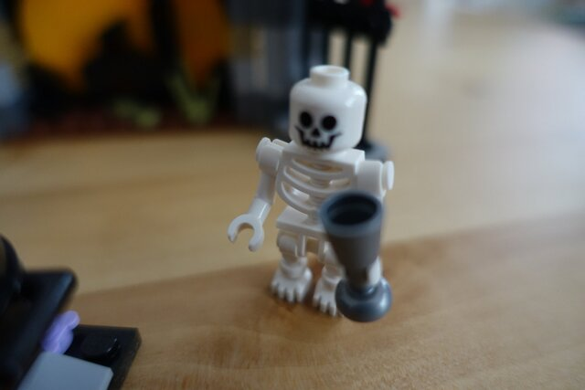](https://www.freelug.org/IMG/jpg/dsc02328.jpg)

Pour rajouter un peu d’ambiance, il y a une petite pièce arrondie avec une souris et une citrouille. Celle-ci est une classique tête orange plus fleur verte, que l’on retrouve dans d’autres sets. Mais ça rend bien, pas de réclamation.

[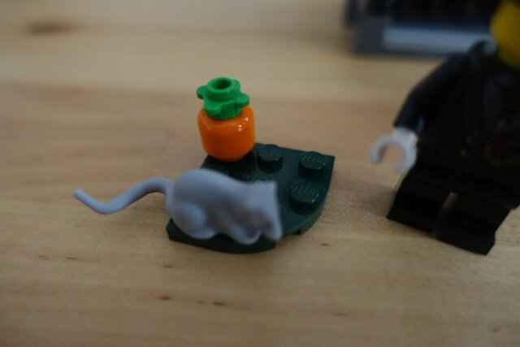](https://www.freelug.org/IMG/jpg/dsc02334.jpg)

Pour finir, une vue de l’ensemble avec le décor fermé. Cela rend pas mal aussi, disons que ça percute un peu moins qu’ouvert je trouve.

[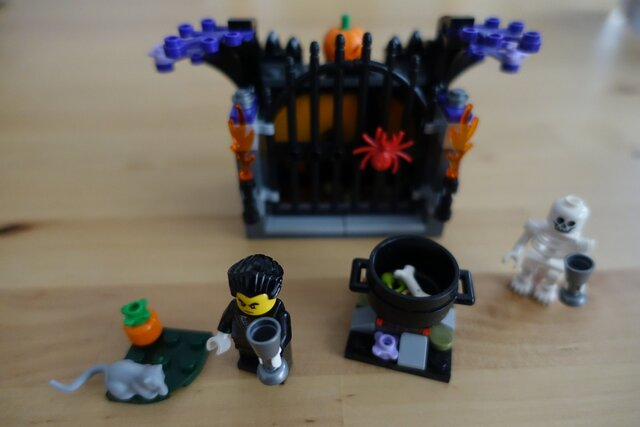](https://www.freelug.org/IMG/jpg/dsc02333.jpg)

Enfin les pièces en trop à fin de construction, toujours ça de pris.

[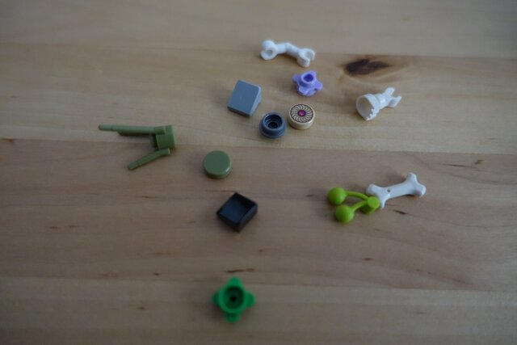](https://www.freelug.org/IMG/jpg/dsc02335.jpg)

* * *

**Avis :** rien d’extraordinaire dans ce set, mais il m’a amusé quand même par son contenu — la construction est basique, je suis même surpris qu’il soit indiqué 7+, peut-être à cause du thème ?

Pas de regret de l’avoir acheté, il pourra toujours servir pour mettre un peu d’ambiance dans un décor !
