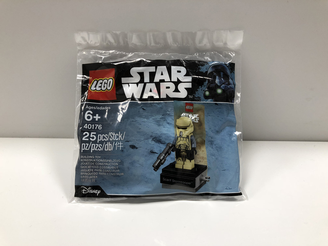
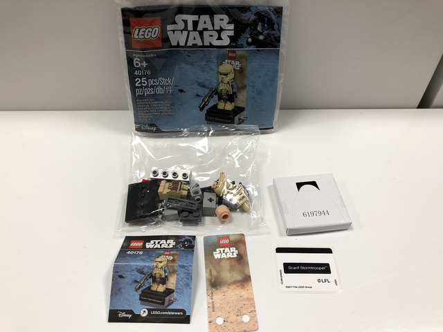
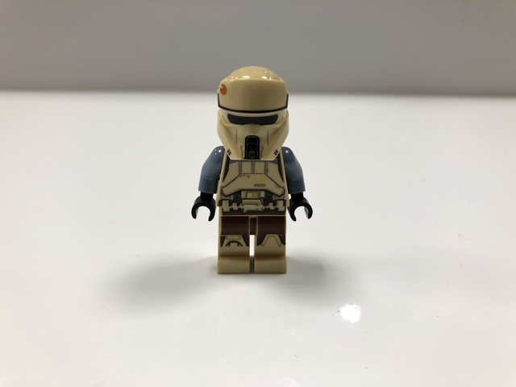
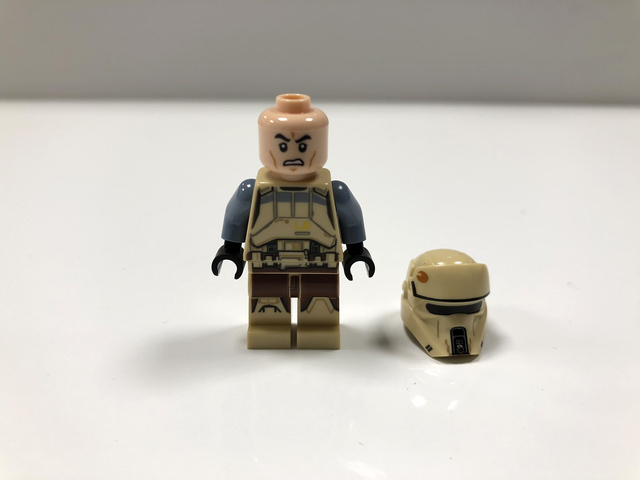
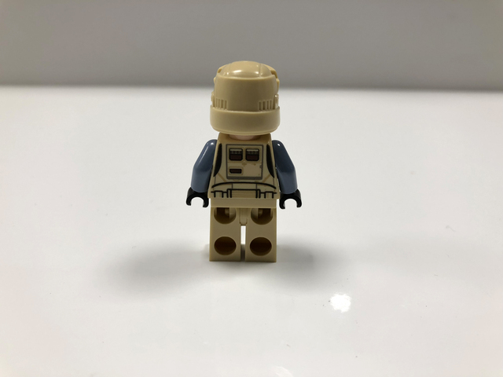

Bonjour à tous, aujourd’hui je vous propose une review du polybag 40176 dans la gamme _Star Wars_ : **Scarif Stormtrooper**.  
Ce polybag sorti en 2017 est composé de 25 pièces, il était offert dans les _LEGO Store physique_ et le _S@H_ pour tout achat dans la gamme _LEGO Star Wars_.

* * *

Sur le polybag, le _Scarif Stormtrooper_ est mis en situation sur son socle et un fond ressemblant à une plage, on a connu mieux comme décors. Les logos _LEGO_ et _Star Wars_ sont présent sur le bandeau en haut du polybag, ainsi que le casque d’un _Deathtrooper_.

A l’intérieur on trouve un sachet de pièces, un sticker avec le nom de la figurine, un décor de fond, un carton contenant la jupe et une notice de montage.

* * *

Le _[Scarif Stormtrooper](https://brickset.com/minifigs/sw850/scarif-stormtrooper-\(40176\))_ est superbement réalisé, les tampographies sont belles et précises. Le mélange des couleurs Tan et gris vont très bien ensemble.

Encore une fois le visage des Troopers _LEGO_ est le même qu’ils soient clone ou non, c’est dommage que _LEGO_ ne fasse pas un effort a ce niveau là.

De dos, on voit de nombreux détails de l’armure.

Le _Scarif Stormtrooper_ sur son stand de présentation.

_R3-M2_ et le _Scarif Stormtrooper_ avec leurs stands accolés (image trouvée sur internet).

* * *

**AVIS :**

_LEGO_ continue donc la série ouverte avec [_R3-M2_](/articles/revue-40268-r3-m2-polybag-star-wars/) et nous livre encore une fois un polybag sympathique avec un stand de présentation qui donne un air premium à la minifig.  
Dommage que _LEGO_ n’ai pas sérigraphié la _Tile_ noire comme sur les sets _Architecture_.
