Alors que la gamme Hidden Side semble disparaître de la boutique officielle LEGO, retour sur un petit ensemble offert en janvier 2020, le « Drag Racer », portant le numéro 40408.

* * *

Comportant 134 pièces, dont deux minifigurines, cette boîte permet d’assembler un dragster de course.

Je ne connais pas l’histoire liée à la gamme, j’imagine que le garçon (chasseur de fantômes très certainement) a un nom et un passé, mais je me contenterai de décrire mon ressenti.

Comme toutes les boîtes de la gamme, l’avant montre la construction version normale et version hantée à travers un smartphone. Une petite vignette sur la droite rappelle qu’il est possible de « hanter seul, chasser à plusieurs ».

[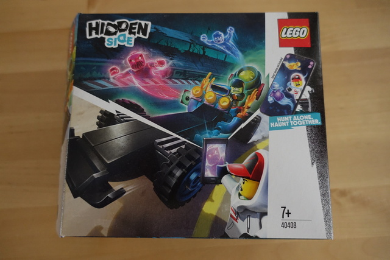](https://www.freelug.org/IMG/jpg/dsc02796.jpg)

L’arrière pour sa part rappelle que la construction peut être associée à l’application (gratuite) Hidden Side afin de chasser des fantômes, ou au contraire de hanter, en réalité virtuelle. Est également présenté le canon à l’arrière du véhicule en train de projeter le fantôme, sans doute pour aller hanter quelque pauvre victime.

[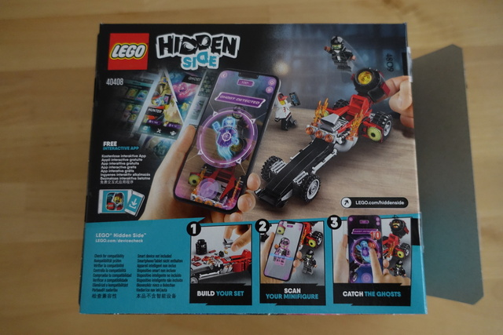](https://www.freelug.org/IMG/jpg/dsc02798.jpg)

Je ne vais pas m’attarder sur la construction qui n’est pas particulièrement compliquée.

Le véhicule a un rendu ma foi efficace, avec des flammes sortant sur le côté. J’aime bien les os utilisés en décoration et comme support des trois lumières à l’avant.

[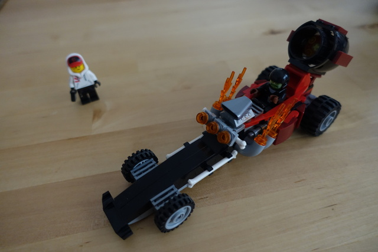](https://www.freelug.org/IMG/jpg/dsc02799.jpg)

[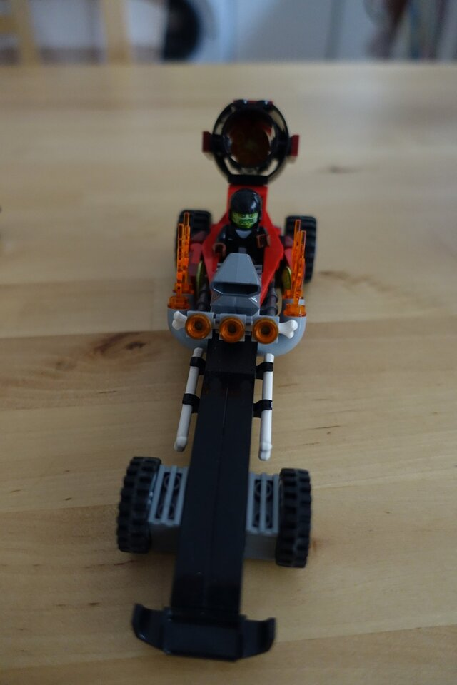](https://www.freelug.org/IMG/jpg/dsc02801-r90.jpg)

Comme tous les produits de la gamme, différents éléments peuvent être dévoilés pour transformer la construction en sa version hantée. Ici les portières latérales cachent de magnifiques yeux d’un joli vert, qui rendent assez bien. Bon, ok, c’est limité, mais peu importe...

[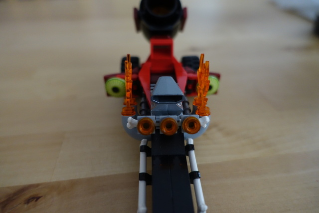](https://www.freelug.org/IMG/jpg/dsc02812.jpg)

[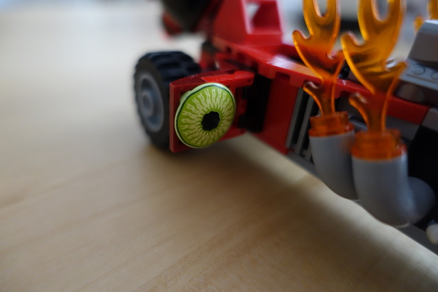](https://www.freelug.org/IMG/jpg/dsc02813.jpg)

Gros plan sur le canon à l’arrière, inclinable, qui permet de projeter une minifigurine assez loin. Pas de ressort ni rien, le poussoir pend en permanence, car le canon ne peut pas être mis à l’horizontale...

[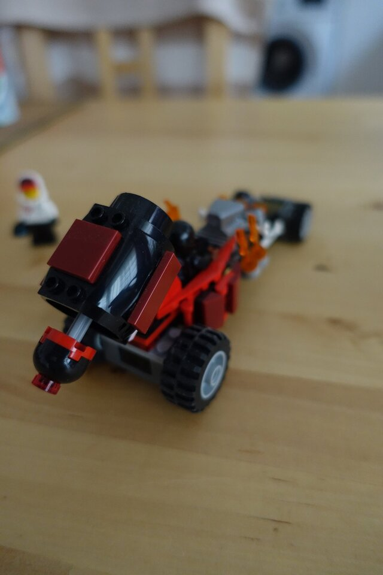](https://www.freelug.org/IMG/jpg/dsc02802-r90.jpg)

Le canon est assez grand pour contenir une minifigurine, évidemment.

[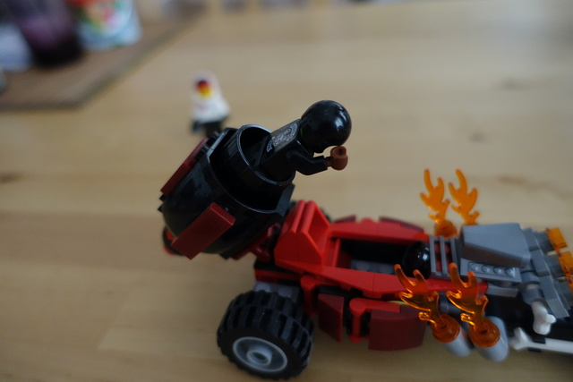](https://www.freelug.org/IMG/jpg/dsc02803.jpg)

[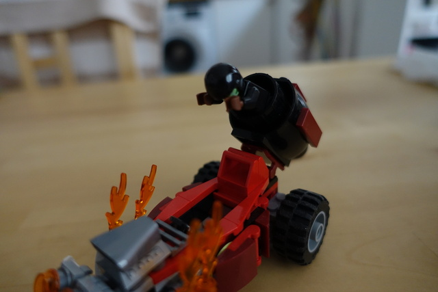](https://www.freelug.org/IMG/jpg/dsc02804.jpg)

Côté minifigurines, la boîte contient dont le jeune garçon avec son smartphone et un conducteur fantôme. La tampographie des torses est plutôt réussie, surtout pour le fantôme qui a des chaînes avec une tête de lièvre comme médaillon, sur une veste ouverte. La ceinture présente des clous, sur le pantalon se trouve une autre chaîne. La tête est d’un magnifique vert transparent, avec une expression grimaçante. Le garçon pour sa part porte un survêtement blanc avec quelques bandes rouges, et une casquette sous sa capuche. Les jambes sont également tampographiées avec des poches et quelques objets accrochés.

[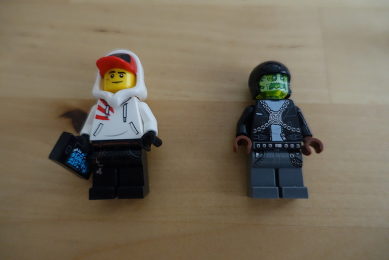](https://www.freelug.org/IMG/jpg/dsc02807.jpg)

L’arrière des jambes est uniforme, en revanche le jeune garçon a la suite des bandes rouges, tandis que celui du conducteur présente les chaînes et un magnifique logo à tête de lièvre avec la légende « Hares of havoc », soit « lièvres de la dévastation [^1] »

[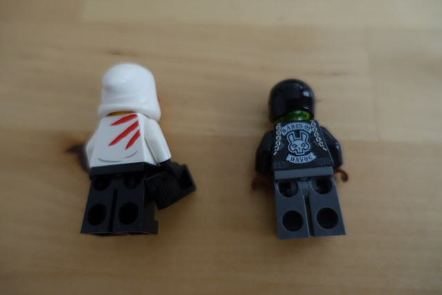](https://www.freelug.org/IMG/jpg/dsc02809.jpg)

Le garçon a un visage alternatif effrayé, tandis que le conducteur semble avoir un cerveau baigné dans un liquide...

[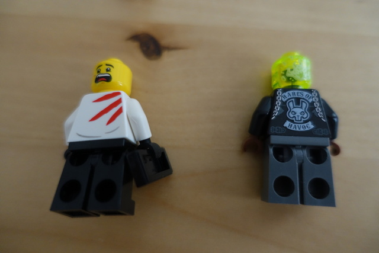](https://www.freelug.org/IMG/jpg/dsc02810.jpg)

À noter que la casquette et la capuche du garçon sont un même élément tampographié, dont je ne suis pas familier. Les trois bandes rouges sont également présentes sur l’avant de la casquette.

[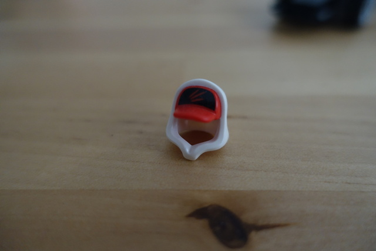](https://www.freelug.org/IMG/jpg/dsc02811.jpg)

* * *

**Avis :** je ne suis donc absolument pas familier de l’histoire liée à la gamme, mais je trouve ce petit dragster bien rendu, il s’intégrera très bien dans n’importe quelle ville voire campagne. Les figurines sont jolies, et contribueront sans souci à n’importe quelle scène un peu imaginaire.

Bref une petite boîte bien rendue.

[^1]: « havoc » a plusieurs sens, j’en choisis un arbitrairement.
