Aujourd’hui, je vous propose de découvrir l’ensemble **Le salon de coiffure de Heartlake City**, dans la gamme Friends.

Portant la référence 41391, cette boîte sortie en 2018, au prix officiel de 19,99 €, comporte 235 pièces dont deux figurines — Emma et Nina d’après la boîte.

L’avant met en scène la construction, avec les deux figurines. En haut à droite trône le logo Friends, avec différents personnages (Nina étant absente) dans un cœur se tenant la main. En bas à gauche une petite scénette tirée de la boîte, Emma coiffée par Nina. Pas de surprise, tous les accessoires présents sont montrés.

[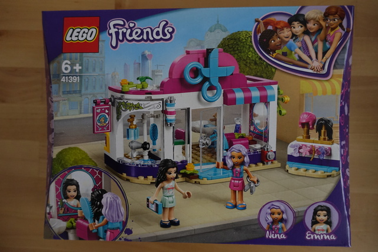](https://www.freelug.org/IMG/jpg/dsc02732.jpg)

L’arrière montre l’intérieur du salon de coiffure, avec les différentes activités pouvant y être réalisées — shampoing, perruques, accessoires dans les cheveux, permanente, paiement bien sûr. Pour une raison que j’ignore il est montré comment assembler Emma.

[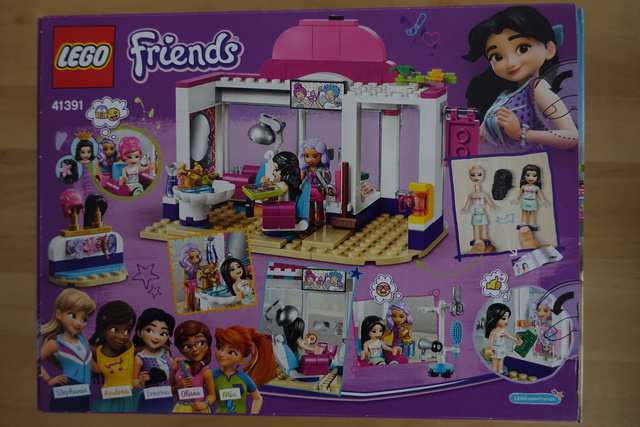](https://www.freelug.org/IMG/jpg/dsc02734.jpg)

* * *

La construction n’a rien de spécial à présenter, aussi je ne vais pas m’y attarder. À noter que je n’ai pas mis les stickers, ce qui rend l’ensemble moins joli.

L’avant du salon de coiffure est joliment rendu, avec une belle enseigne en ciseaux bleue, à droite un store, à gauche un cylindre multicolore. C’est lumineux, tout est en pièces transparentes. Petites fleurs de chaque côté de la porte, fleurs sur le toit et à droite, c’est très décoré.

[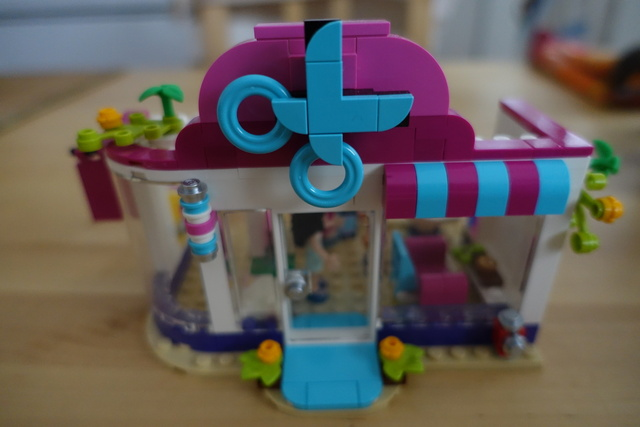](https://www.freelug.org/IMG/jpg/dsc02736.jpg)

Vu de dessus, le salon est de disposition assez simple : à gauche en rentrant la caisse, à droite l’espace principal où se fera la coiffure. J’ai sorti quelques accessoires en dehors de la pièce, sinon ça faisait un peu tassé. Mais il y a clairement tout ce qu’il faut pour un bon service.

[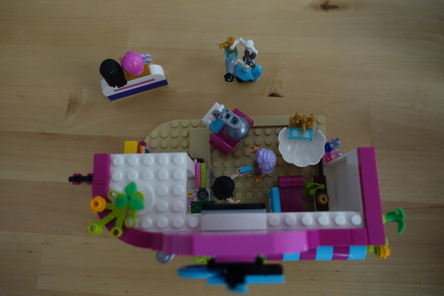](https://www.freelug.org/IMG/jpg/dsc02739.jpg)

Petit zoom sur la fleur à droite du salon, juste pour le plaisir.

[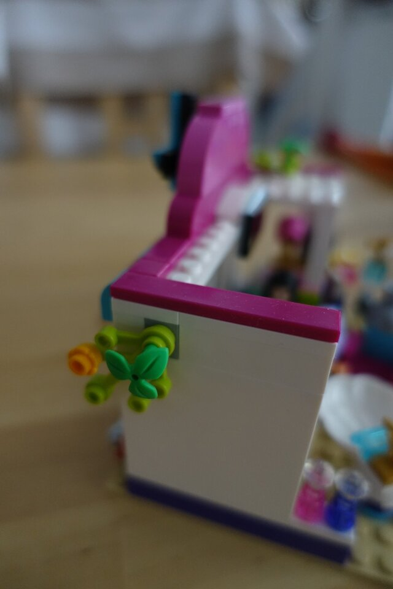](https://www.freelug.org/IMG/jpg/dsc02749-r90.jpg)

Vu d’arrière, le salon est un peu encombré, avec pas mal de détails : une machine à café à droite, un balai accroché pour ramasser les cheveux, un présentoir à catalogue (pièces lisses 2x2 violet et vert en vertical), une télévision (plaque noire qui devrait avoir un autocollant), à gauche deux bouteilles sans doute de produit lié à la coiffure — du gel peut-être ?

[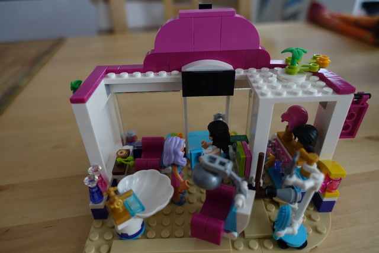](https://www.freelug.org/IMG/jpg/dsc02748.jpg)

[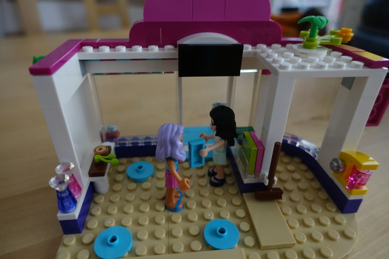](https://www.freelug.org/IMG/jpg/dsc02746.jpg)

Voici l’arrière sans les différents meubles et accessoires. Des plaques rondes à tenon permettent de poser les meubles, donnant une idée de disposition, mais il n’y en a pas assez pour tout ce qui est inclus.

[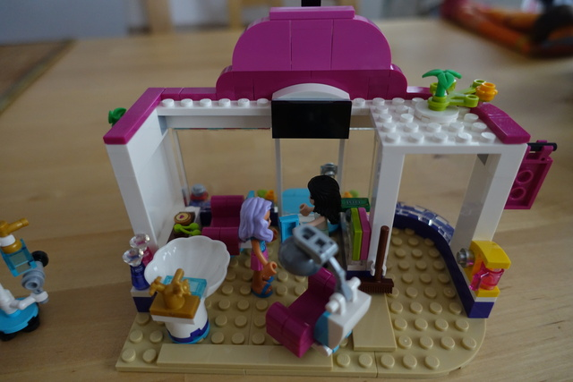](https://www.freelug.org/IMG/jpg/dsc02742.jpg)

Un salon ne serait pas complet sans présentoir à accessoires et perruques, le voici donc. Barrette, couronne, nœud, fleur, il y a du choix. Deux perruques permettent de changer totalement de look. Le présentoir est simple mais suffisant pour le boulot.

[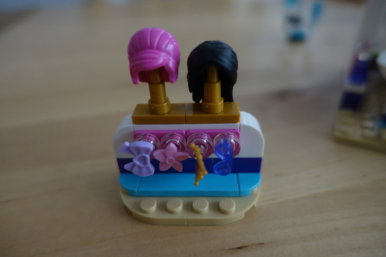](https://www.freelug.org/IMG/jpg/dsc02740.jpg)

On trouve également un pied à accessoires, avec brosse, séchoir, aérosol (pour humidifier ?), ciseaux. Tout ce qu’il faut pour une bonne séance de coiffure.

[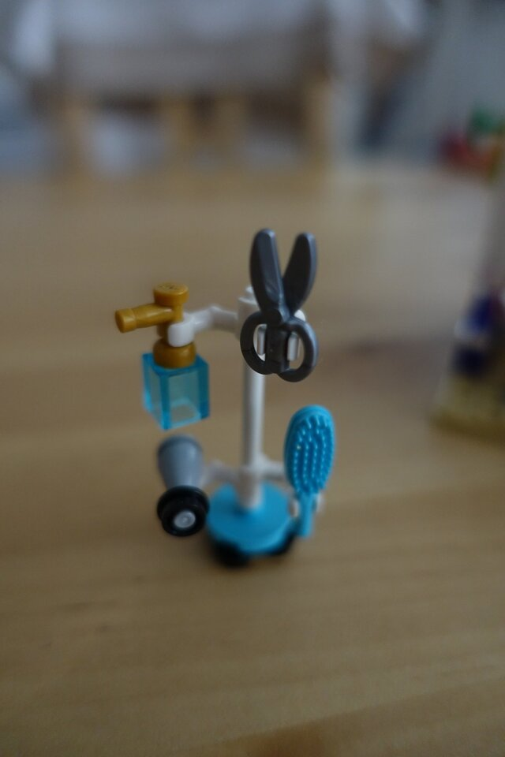](https://www.freelug.org/IMG/jpg/dsc02741-r90.jpg)

Voici les deux sièges inclus, l’un à permanente l’autre classique. Ils sont sur le même modèle, et je trouve le rendu joli, possible que je réutilise cette construction — c’est simple mais efficace.

[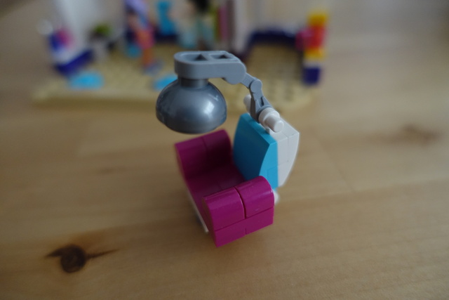](https://www.freelug.org/IMG/jpg/dsc02743.jpg)

[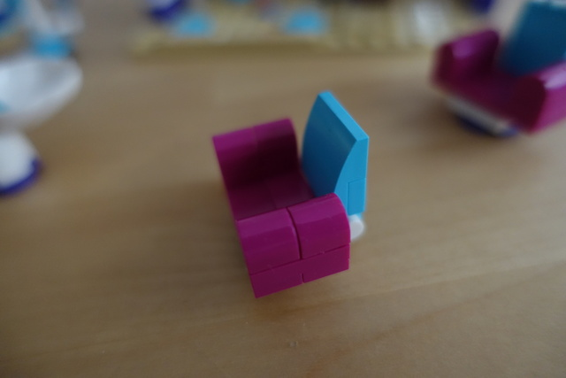](https://www.freelug.org/IMG/jpg/dsc02744.jpg)

Dernière pièce, le lavabo pour laver les cheveux. Il est tout simple, avec un robinet doré posé sur un coquillage blanc, une pièce transparente symbolisant sans doute l’eau. Simple mais suffisamment réaliste à mon goût.

[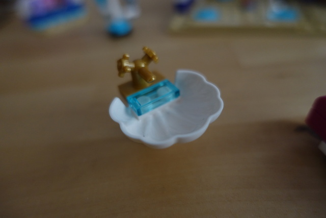](https://www.freelug.org/IMG/jpg/dsc02745.jpg)

* * *

**Avis :** c’est l’un des premiers ensembles Friends que je construis, et je trouve le rendu vraiment correct. Il y a quelques possibilités de jouer (changer les coiffures, mettre en scène eg le lavage de cheveux), et le rendu global est réussi. La surface du salon paraît un peu petite par rapport aux nombreux accessoires fournis cependant, peut-être qu’il faut l’agrandir un peu pour l’inclure dans un diorama.

En tout cas je n’aurai aucun scrupule à l’ajouter à ma ville plutôt sur le thème City !

Par contre je signale quelque chose qui m’a vraiment marqué. LEGO pour autant que je sache vante que ses produits sont unisexes. Pourtant, le manuel d’instructions est totalement différent d’autres gammes (notamment City, dont Friends est sans doute le plus proche), avec des cœurs partout, une « barre de progression » en bas de page (avec Emma qui avance progressivement vers la droite), des « illuminations » à chaque fin de sous-modèle (sièges, présentoirs). Durant le montage je m’imaginais presque entendre les exclamations de joie ! Et rien que ceci pour moi met la gamme à part...
