Pour mon premier article, je vous propose la review de trois sets Mixels, la série 7 version bleue.

Ces sets sortis en 2015 au prix de 3,99 € chacun sont composés de 63 (Kuffs), 69 (Busto) et 62 (Tiketz) pièces, soit un ratio prix/pièce de 6 centimes d’euros environ.

Les [Mixels](http://www.lego.com/fr-fr/mixels/) sont des sets conçus pour se combiner, à deux ou plus, donnant naissance à un nouveau personnage.

## Le set 41554, Kuffs.

L’emballage contient un sachet et une notice de construction.

[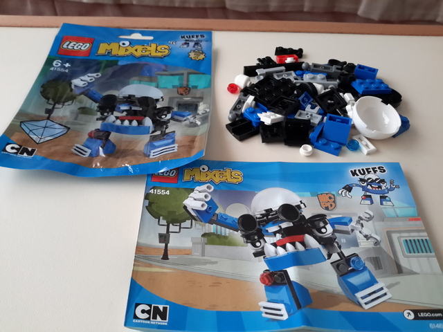](https://www.freelug.org/IMG/jpg/20160320_150305.jpg)

On commence par monter la partie inférieure de la tête.

[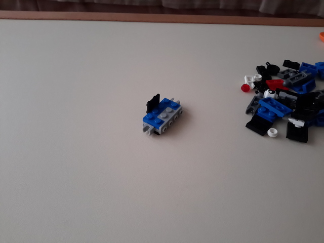](https://www.freelug.org/IMG/jpg/20160320_150531.jpg)

Que vous avez de grandes dents, grand-mère...

[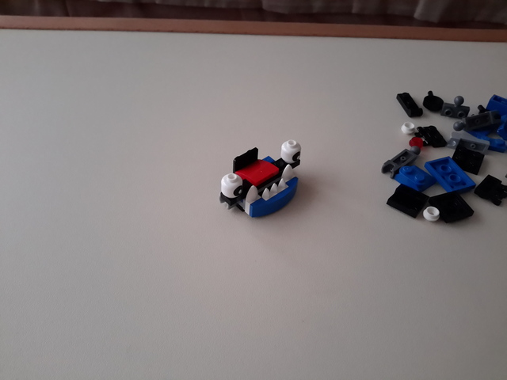](https://www.freelug.org/IMG/jpg/20160320_150812.jpg)

On monte le support arrière pour la tête...

[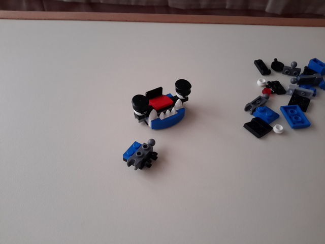](https://www.freelug.org/IMG/jpg/20160320_150927.jpg)

... et on le met en place.

[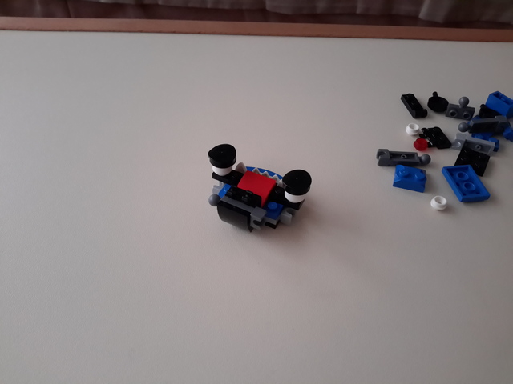](https://www.freelug.org/IMG/jpg/20160320_150958.jpg)

On s’attaque à la tête.

[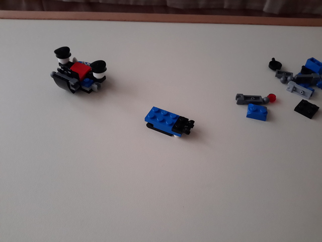](https://www.freelug.org/IMG/jpg/20160320_151100.jpg)

La voici complète, à noter les poêles utilisées pour les sourcils.

[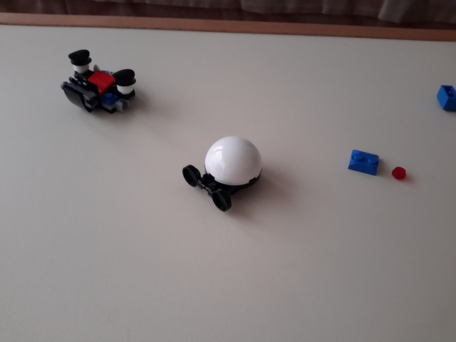](https://www.freelug.org/IMG/jpg/20160320_151558.jpg)

On commence le bras droit.

[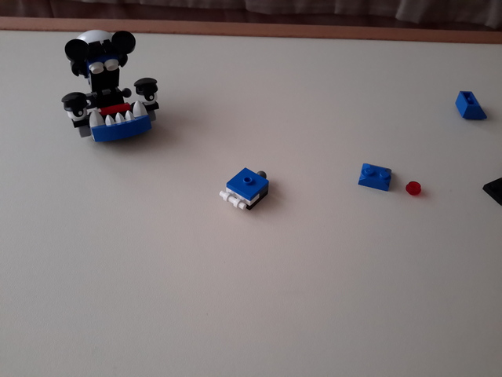](https://www.freelug.org/IMG/jpg/20160320_151822.jpg)

Avec trois petits doigts habiles.

[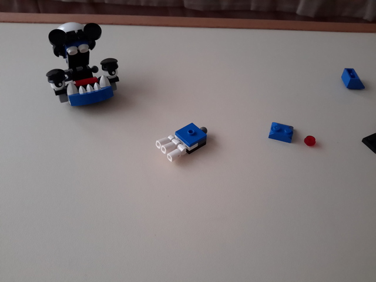](https://www.freelug.org/IMG/jpg/20160320_151842.jpg)

Le bras l’est également, avec deux articulations.

[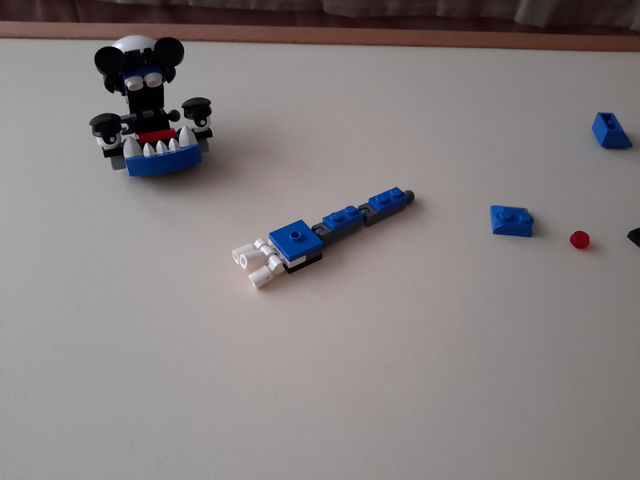](https://www.freelug.org/IMG/jpg/20160320_151933.jpg)

Voici le bras droit en place, l’épaule rajoutant un degré de liberté.

[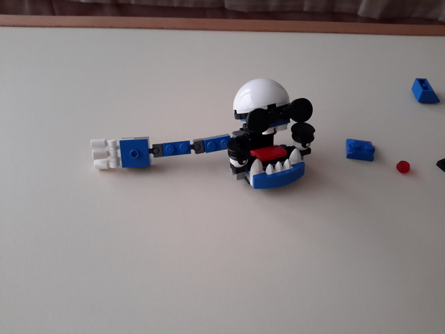](https://www.freelug.org/IMG/jpg/20160320_151951.jpg)

Le gauche est bien plus simple, et pas articulé sauf à l’épaule...

[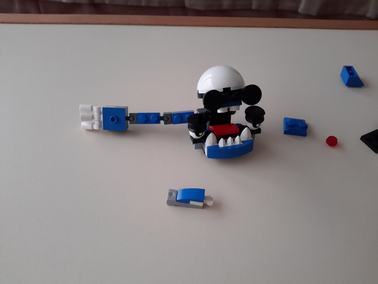](https://www.freelug.org/IMG/jpg/20160320_152046.jpg)

... mais il tient les menottes donnant (j’imagine) son nom au personnage.

[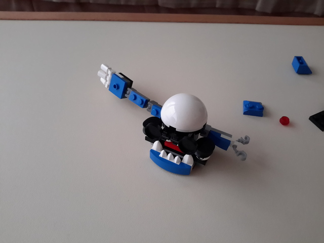](https://www.freelug.org/IMG/jpg/20160320_152116.jpg)

Un premier pied...

[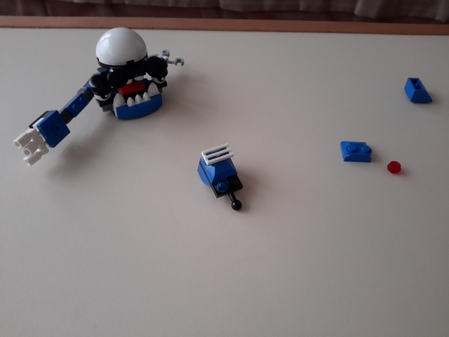](https://www.freelug.org/IMG/jpg/20160320_152237.jpg)

... et le second.

[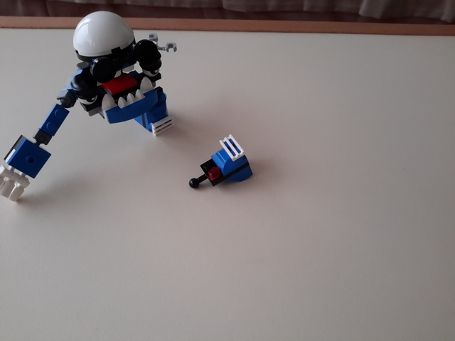](https://www.freelug.org/IMG/jpg/20160320_152347.jpg)

Le set terminé.

[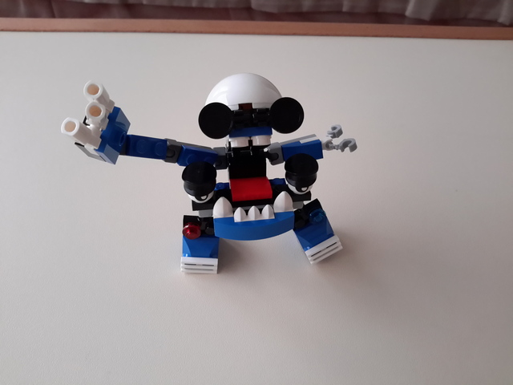](https://www.freelug.org/IMG/jpg/20160320_152430.jpg)

Et les pièces en bonus, dont une paire de menottes.

[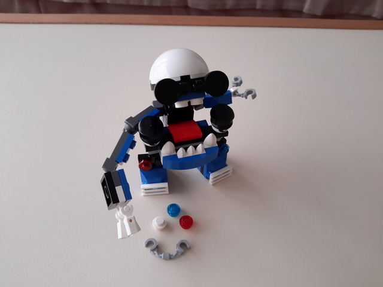](https://www.freelug.org/IMG/jpg/20160320_152534.jpg)

## Le set 41555, Busto

L’emballage contient un sachet et une notice de construction.

[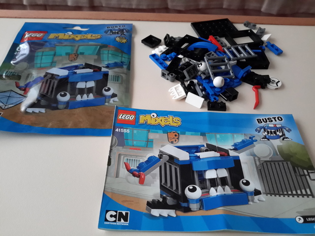](https://www.freelug.org/IMG/jpg/20160320_155412.jpg)

On construit la base.

[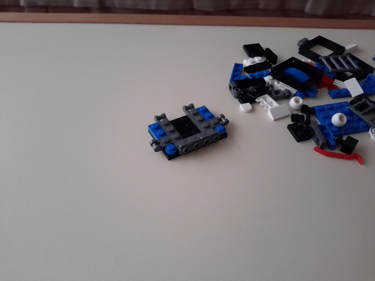](https://www.freelug.org/IMG/jpg/20160320_155600.jpg)

Elle est fermée sur trois côtés par des barreaux.

[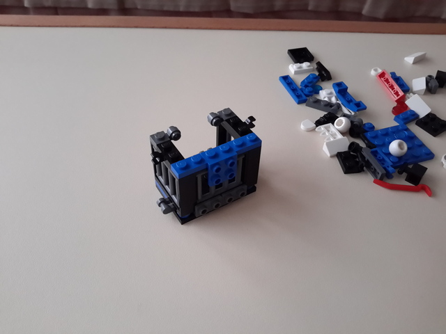](https://www.freelug.org/IMG/jpg/20160320_155822.jpg)

La base presque finie.

[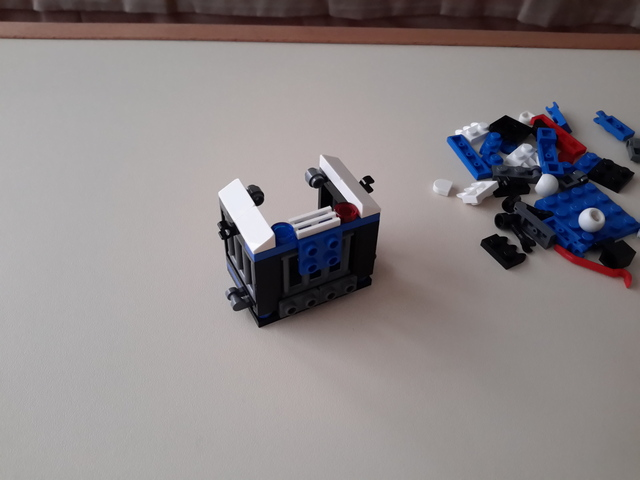](https://www.freelug.org/IMG/jpg/20160320_155914.jpg)

La mâchoire inférieure.

[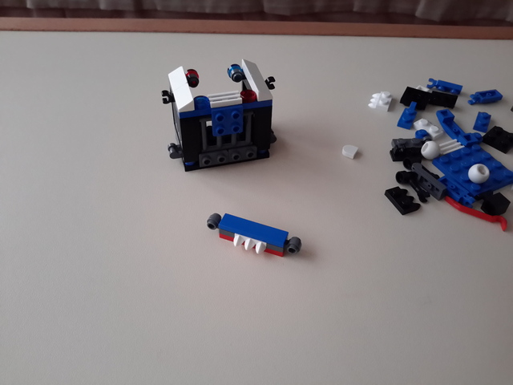](https://www.freelug.org/IMG/jpg/20160320_160024.jpg)

La mâchoire en place avec les deux yeux.

[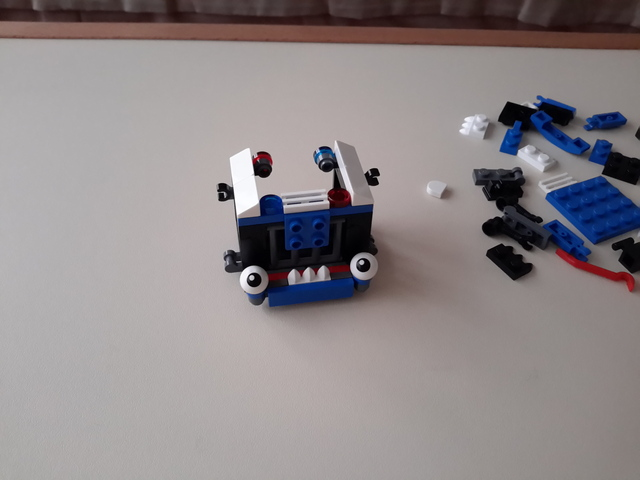](https://www.freelug.org/IMG/jpg/20160320_160119.jpg)

Et on finit la lèvre supérieure avec les dents.

[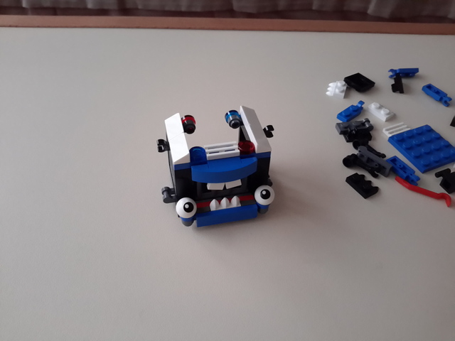](https://www.freelug.org/IMG/jpg/20160320_160259.jpg)

Une petite trappe à l’arrière pour fermer.

[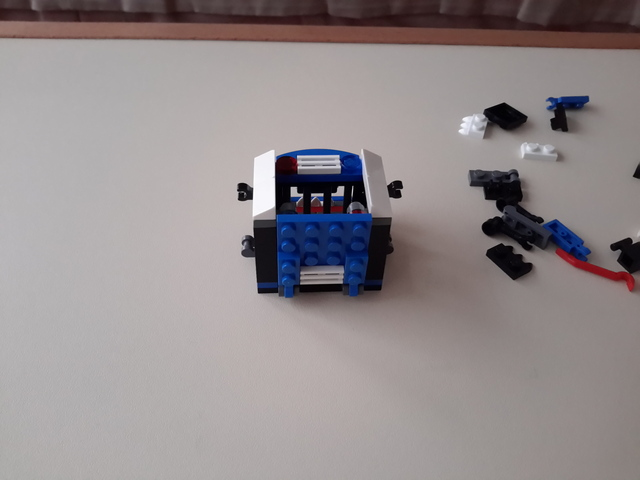](https://www.freelug.org/IMG/jpg/20160320_160355.jpg)

Les deux pieds, sans articulation particulière.

[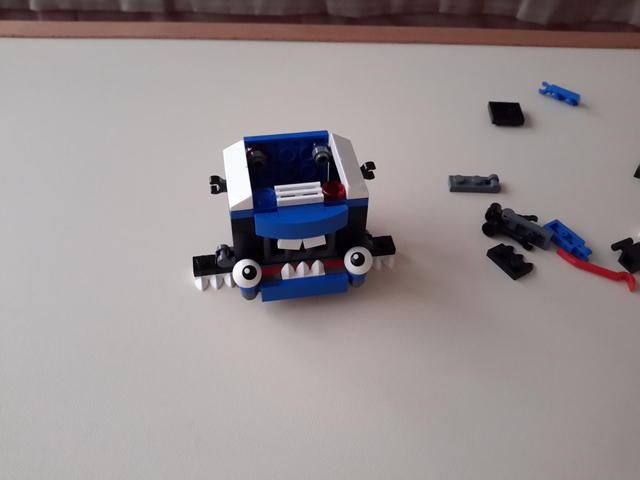](https://www.freelug.org/IMG/jpg/20160320_160515.jpg)

Et les deux bras, qui n’ont pas d’articulation non plus sauf l’épaule.

[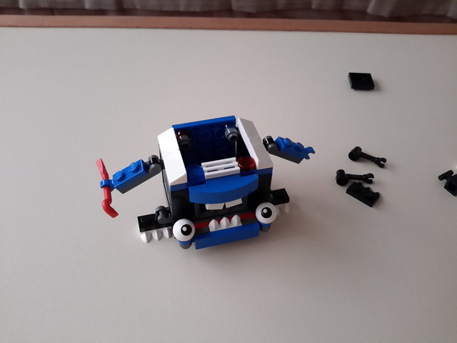](https://www.freelug.org/IMG/jpg/20160320_160627.jpg)

Le complice, avec une utilisation astucieuse de pièces pour les pieds et les mains.

[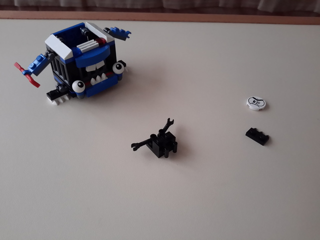](https://www.freelug.org/IMG/jpg/20160320_160719.jpg)

Le set terminé.

[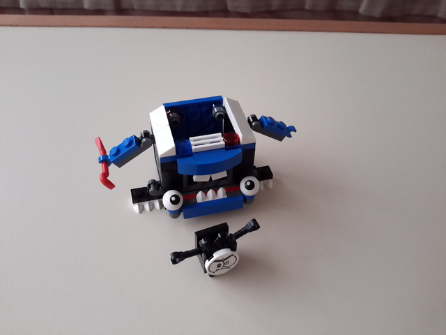](https://www.freelug.org/IMG/jpg/20160320_160756.jpg)

Et les pièces bonus, avec le complice à moitié rentré dans la cage.

[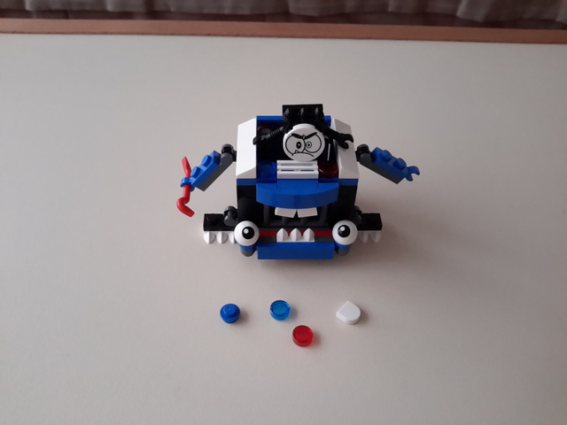](https://www.freelug.org/IMG/jpg/20160320_160921.jpg)

## Le set 41556, Tiketz

Sans surprise le troisième set contient un sachet et une notice de construction.

[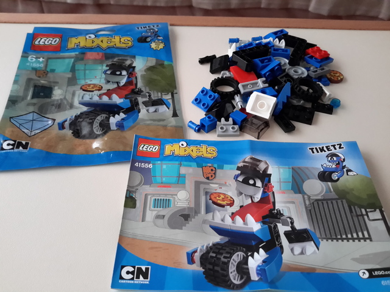](https://www.freelug.org/IMG/jpg/20160320_153150.jpg)

Le corps contient quelques pièces Technic, qui serviront à accrocher les jambes.

[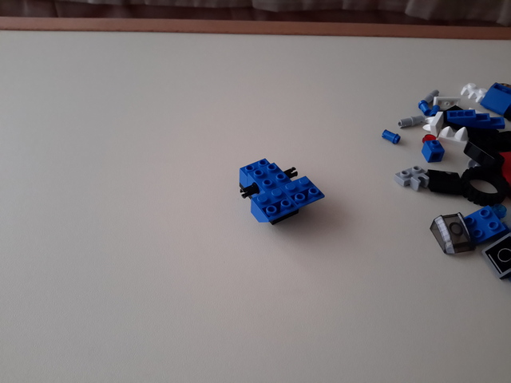](https://www.freelug.org/IMG/jpg/20160320_153354.jpg)

Le corps avec les supports des bras, la langue rouge, les dents.

[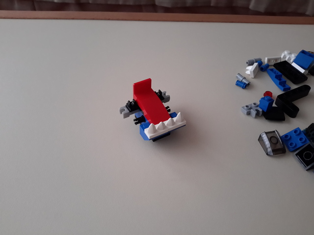](https://www.freelug.org/IMG/jpg/20160320_153544.jpg)

On monte la tête...

[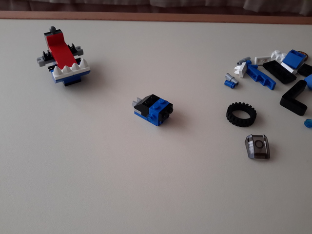](https://www.freelug.org/IMG/jpg/20160320_153826.jpg)

... qui a un côté aérodynamique.

[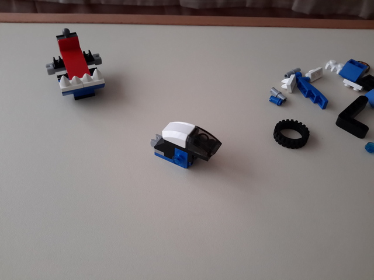](https://www.freelug.org/IMG/jpg/20160320_153914.jpg)

On rajoute quelques dents et un bel œil à moitié fermé.

[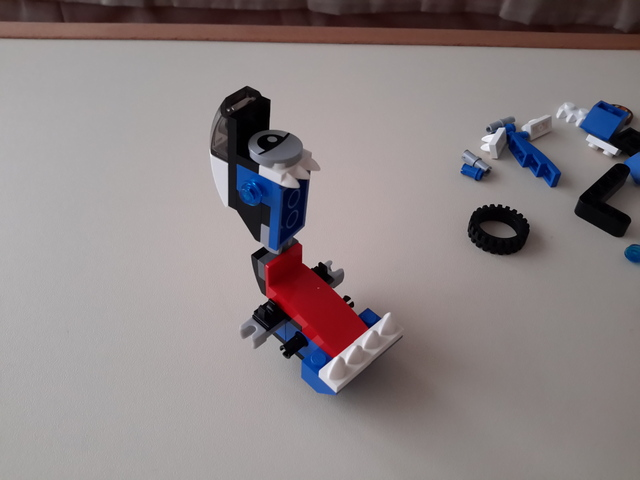](https://www.freelug.org/IMG/jpg/20160320_154029.jpg)

On s’attaque à la jambe gauche, à base de pièces Technic.

[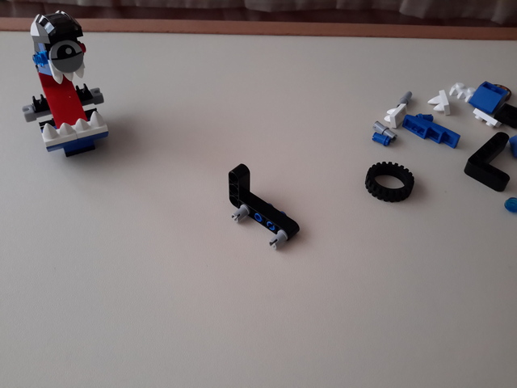](https://www.freelug.org/IMG/jpg/20160320_154136.jpg)

Avec encore des dents.

[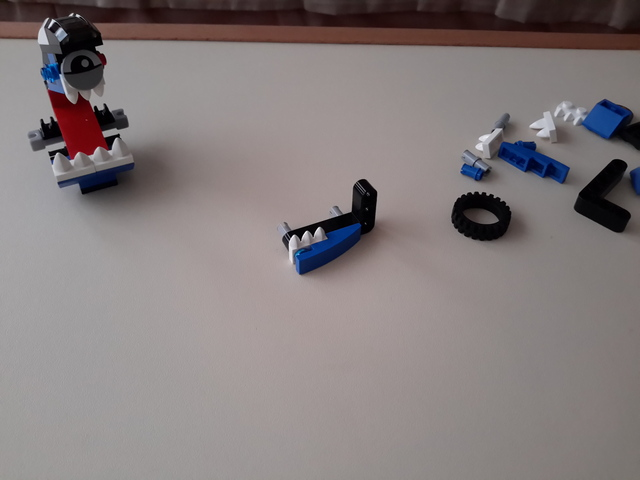](https://www.freelug.org/IMG/jpg/20160320_154221.jpg)

La première jambe en place, l’articulation au niveau du corps permettant de relever la partie tête.

[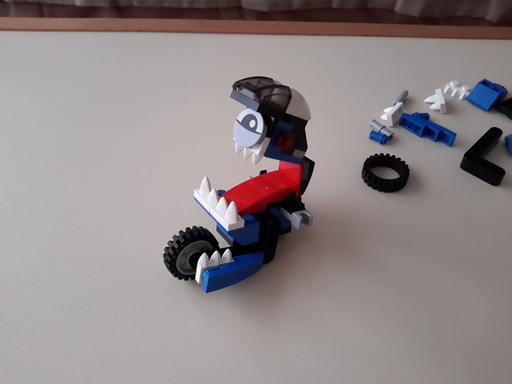](https://www.freelug.org/IMG/jpg/20160320_154306.jpg)

La deuxième jambe est tout à fait similaire, avec du rouge au lieu de bleu pour la pièce transparente.

[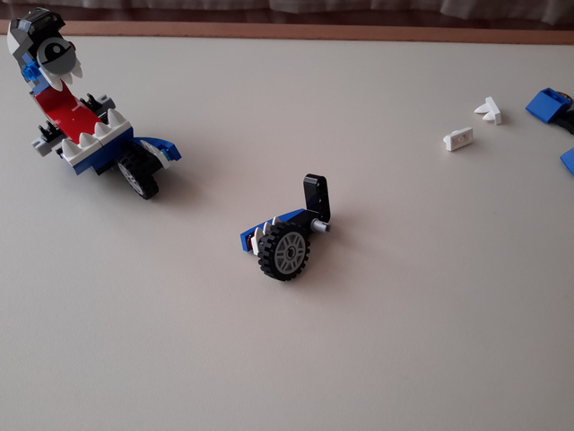](https://www.freelug.org/IMG/jpg/20160320_154509.jpg)

Les deux jambes sont en place, mais le modèle n’est pas encore très stable...

[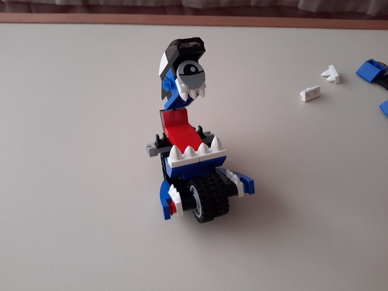](https://www.freelug.org/IMG/jpg/20160320_154531.jpg)

... donc on va lui rajouter les deux mains un peu en forme de masse.

[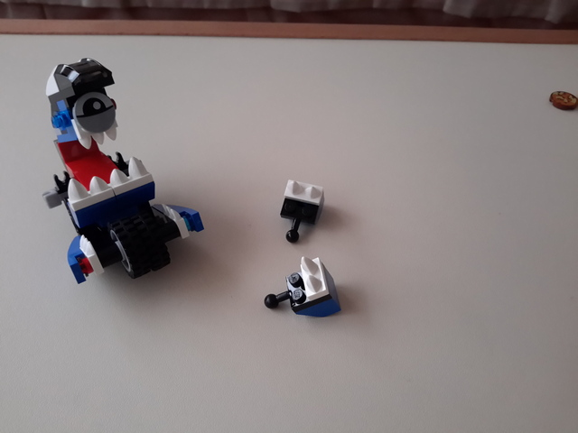](https://www.freelug.org/IMG/jpg/20160320_154642.jpg)

Le modèle terminé, avec une belle pièce sérigraphiée.

[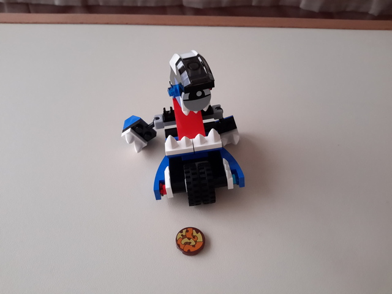](https://www.freelug.org/IMG/jpg/20160320_154717.jpg)

[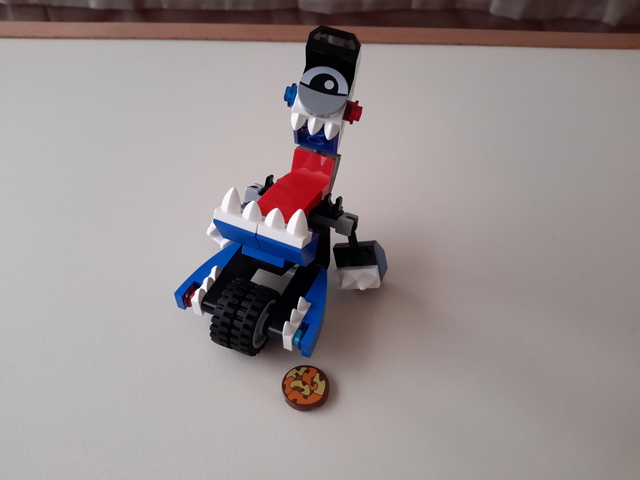](https://www.freelug.org/IMG/jpg/20160320_154735.jpg)

Miam miam, ces pièces bonus ont l’air appétissantes.

[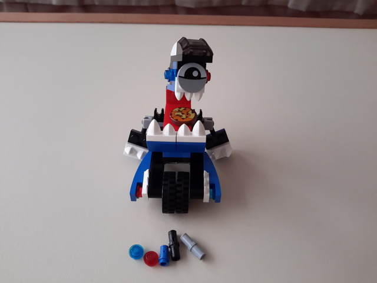](https://www.freelug.org/IMG/jpg/20160320_154846.jpg)

## Les trois Mixels réunis

[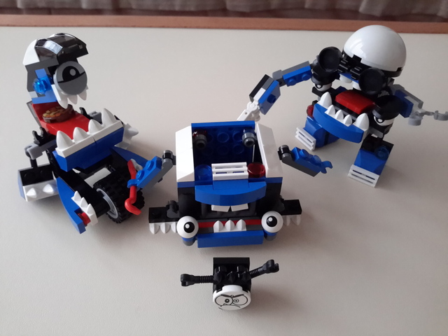](https://www.freelug.org/IMG/jpg/20160320_161019.jpg)

[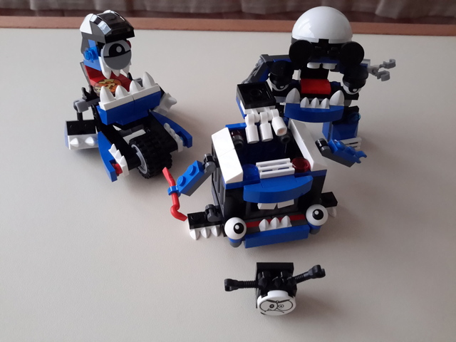](https://www.freelug.org/IMG/jpg/20160320_161054.jpg)

**Avis**

Pour 4 € chacun, ces petits modèles sont intéressants, à la fois en tant que modèles sortant des gammes habituelles LEGO, et également pour les différentes pièces proposées (yeux variés, charnières à gogo, fenêtres à barreaux, dents, etc.).

Un achat qui m’a bien amusé et que je ne regrette absolument pas.

**Bonus**

Un gros GIF (presque 10 Mo) animé avec quelques photos non utilisées dans la review (cliquez sur l’image pour lancer l’animation).

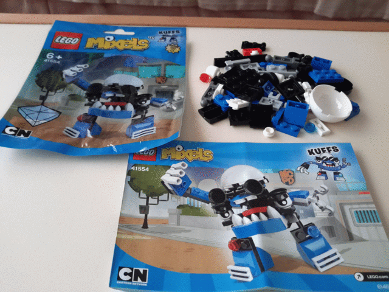

**Bonus 2 (ajouté le 14/11/2016)** : les Mixels sont conçus pour se combiner, aussi voici _MCPD MAX_ dans sa plus grande splendeur. Il incorpore des éléments des trois Mixels : la « cage » de Busto, les roues (modifiées) de Tiketz, la tête ressemblant à Kuffs ainsi que ses bras, etc. Une rampe sur le bas laisse espérer qu’il puisse capturer le Nixel.

[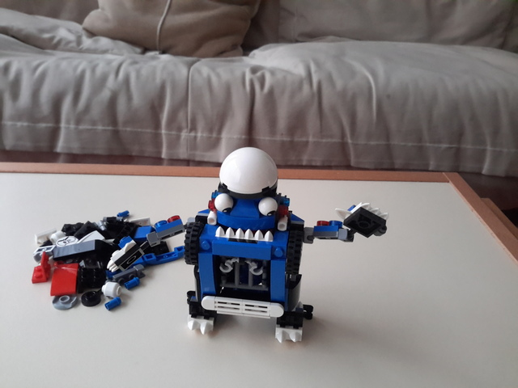](https://www.freelug.org/IMG/jpg/mcpd-max-1.jpg)

[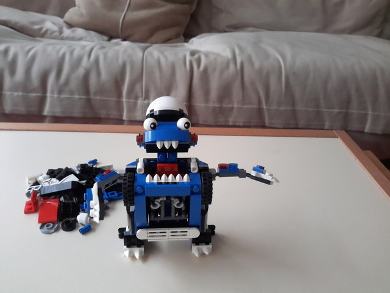](https://www.freelug.org/IMG/jpg/mcpd-max-2.jpg)

