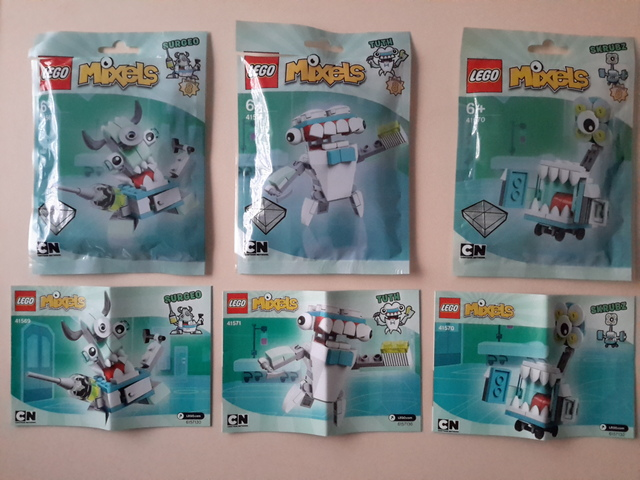
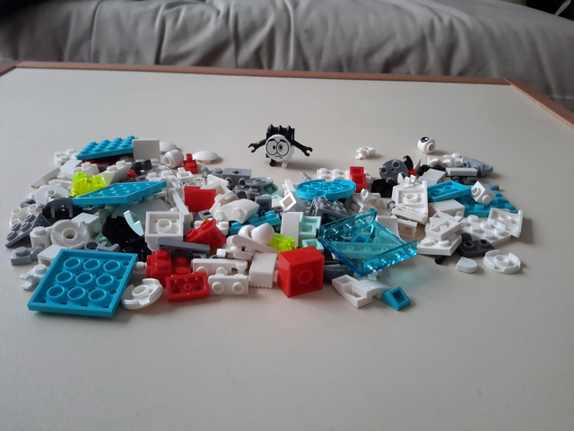
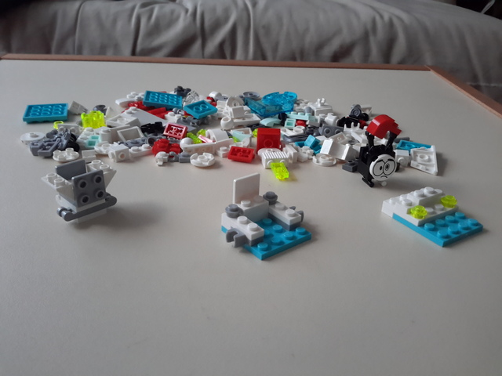
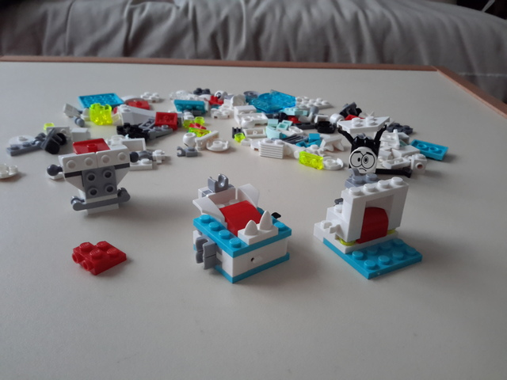
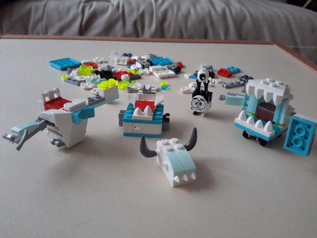
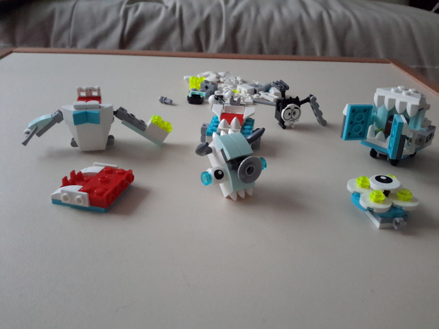
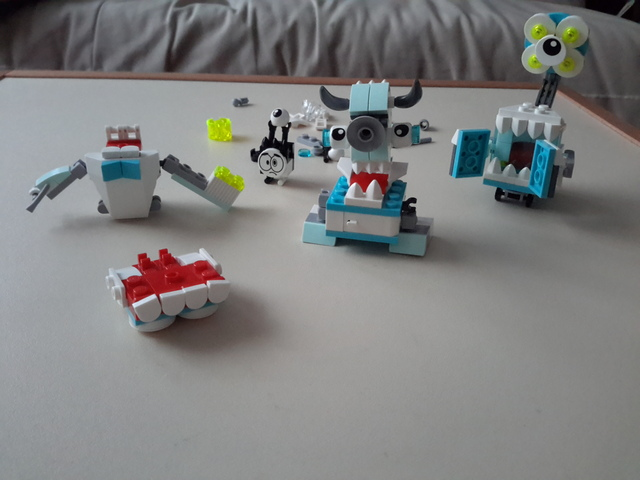
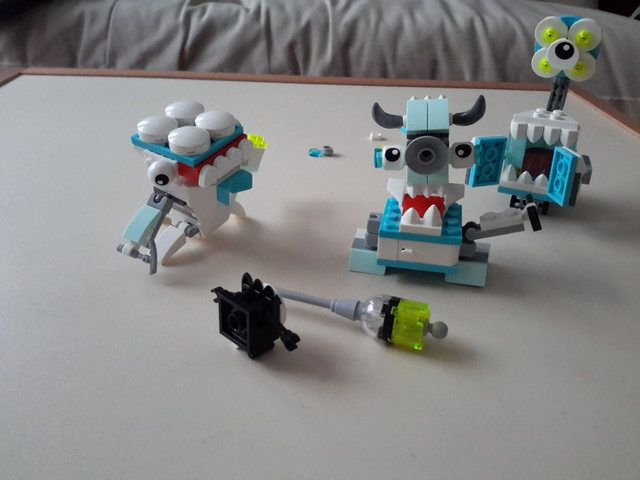
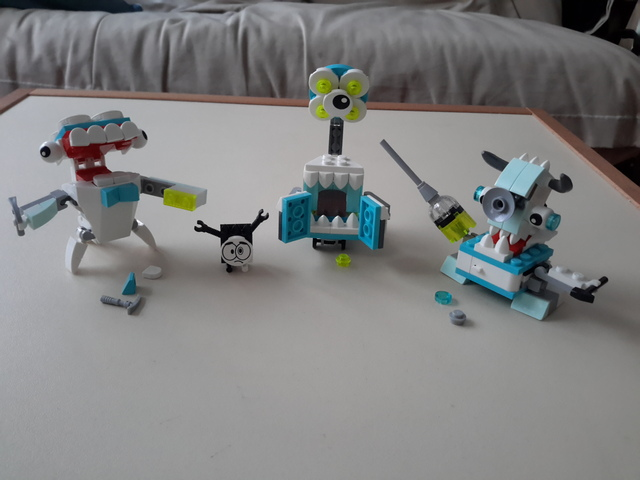
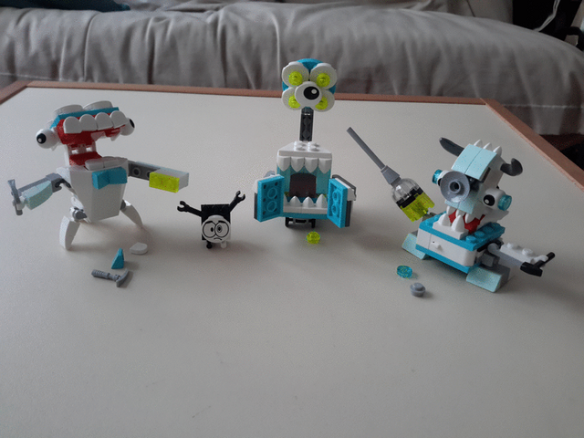

Pour conclure les Mixels série 8 (voir les [pompiers](/articles/revue-lego-41563-41564-et-41565-mixels-serie-8-splasho-aquad-et-hydro/) et les [pirates](/articles/revue-lego-41566-41567-et-41568-mixels-serie-8-sharx-skulzy-et-lewt/)), je vous propose une revue des sets « santé » [^1], sachets _41569_, _41570_ et _41571_, à savoir **Surgeo**, **Skrubz** et **Tuth**.

Ces Mixels, sortis en 2016 comme les autres gammes de la série 8, coûtent 3,99 €, et comportent 63, 68 et 67 pièces respectivement, soit un ratio de 6 centimes environ.

* * *

Chaque sachet contient comme il se doit une notice et un petit tas de pièces.

Hélas, un accident s’est produit ! Le Nixel s’est auto-assemblé, il a éventré les sachets, et toutes les pièces se sont mélangées ! Voici une photo du coupable, bien embêté, et d’ailleurs il s’est cassé la jambe gauche, qui est déjà dans le plâtre...

En punition, le Nixel est condamné à monter les trois Mixels en parallèle.

La construction débute par les bases, deux sur des plaques carrées la dernière avec quelques supports.

Le Nixel continue avec quelques belles langues et dents, il faut quand même que les Mixels aient leur physionomie décalée habituelle.

On monte ensuite les bras de Tuth, et la tête de Surgeo, qui a de belles cornes, pendant que Skrubz ouvre bien grand sa bouche avec une vitre bleue du plus bel effet.

Viennent ensuite les têtes de Tuth et Skrubz. Le premier a un magnifique œil entre quatre plates rondes jaune transparent, donnant un effet de lumière sur table d’opération, tandis que le second a une mâchoire supérieure bien rouge. Surgeo pour sa part a deux beaux yeux et un stéthoscope, il faut bien qu’il puisse examiner les patients.

Que seraient des Mixels sans dents dans tous les sens ?

L’assemblage est presque fini. Tuth a une pioche en main, indispensable pour soigner, et Surgeo a d’un côté un marteau et de l’autre une seringue remplie d’un liquide certainement inoffensif vu sa couleur jaune.

Et voici les Mixels complétés, avec les quelques pièces bonus.

* * *

**Avis :** comme les autres série Mixels, les personnages sont amusants, et bien décalés. Mais j’admets avoir un peu plus de mal à saisir le thème, car Tuth ne me semble pas lié à la médecine...

Il n’empêche que la série reste bien sympathique, et ravira les amateurs, avec des pièces amusantes comme toujours.

**Bonus :** animation de toutes les étapes de construction (cliquer pour lancer).

[^1]: Je donne de façon purement subjective ce nom, car ce n’est pas que sur la médecine me semble-t-il, Skrubz évoquant le nettoyage.
