Aujourd’hui je vous propose la review du polybag 5004914 dans la gamme _Nexo Knight_ : **Armour Pod**.  
Ce polybag sorti en 2017 est composé de 24 pièces, il était offert dans les _LEGO_ Store physique et le _S@H_ pour tout achat dans la gamme _Nexo Knight_.

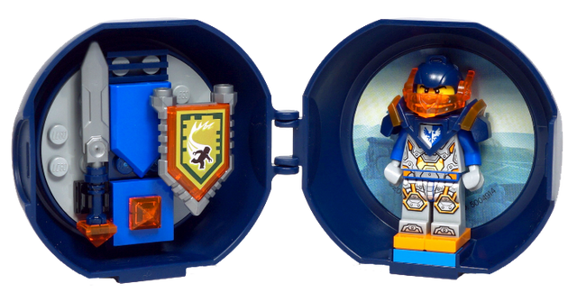

* * *

Sur le polybag, le Pod est ouvert et mis en situation sur un fond rocailleux avec un château en arrière-plan. Les logos _LEGO_ et _Nexo Knight_ sont présents en haut du polybag.

[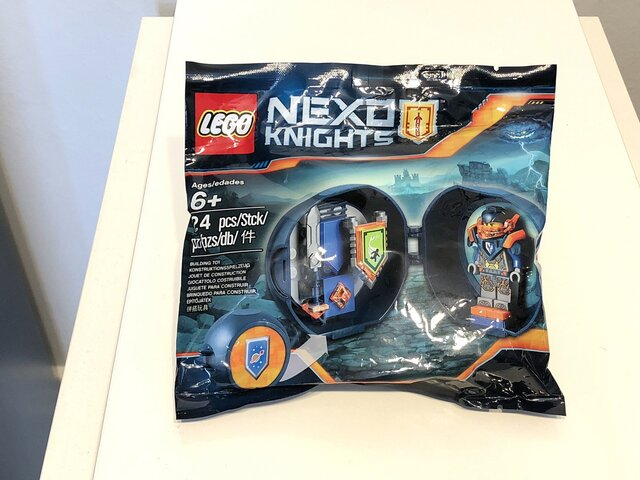](https://www.freelug.org/IMG/jpg/polypodnexoknight_01.jpg)

A l’intérieur on trouve le pod renfermant un sachet de pièces et une notice de montage.

[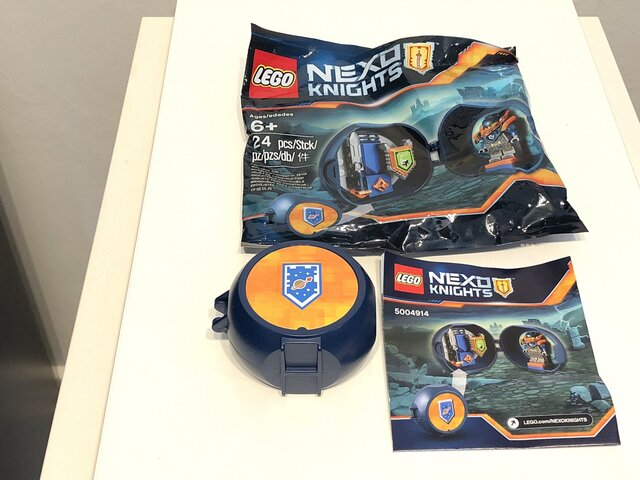](https://www.freelug.org/IMG/jpg/polypodnexoknight_02.jpg)

* * *

_[Clay, Dark Blue Armor](https://brickset.com/minifigs/nex117/clay-dark-blue-armor-\(5004914\))_ est superbement réalisé, les tampographies sont fines et précises. Les couleurs bien que flashy se marient bien ensembles.  
Les épaulettes sont bi-injectées avec du _trans-orange_ et une fois tout l’attirail enlevé, les sérigraphies font toujours autant penser à une armure d’_Iron Man_.

[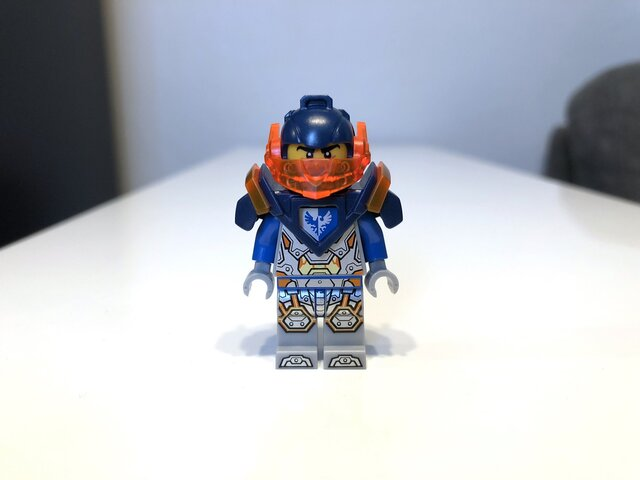](https://www.freelug.org/IMG/jpg/polypodnexoknight_04.jpg)

[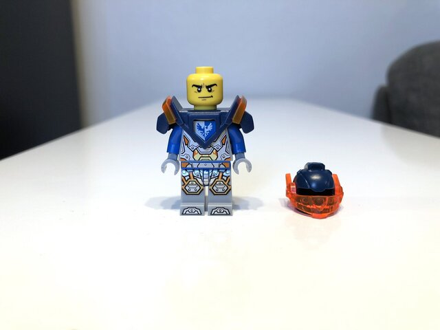](https://www.freelug.org/IMG/jpg/polypodnexoknight_05.jpg)

[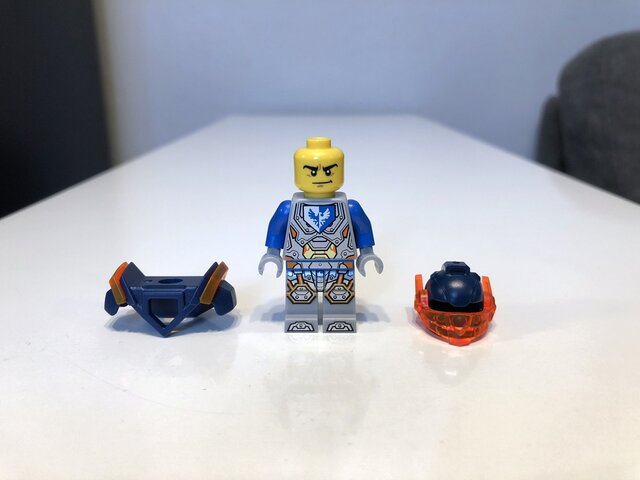](https://www.freelug.org/IMG/jpg/polypodnexoknight_06.jpg)

De dos, la tampographie est là aussi superbe, avec moult détails. Pas de visage alternatif pour _Clay_, c’est un petit plus qui aurait été sympathique.

[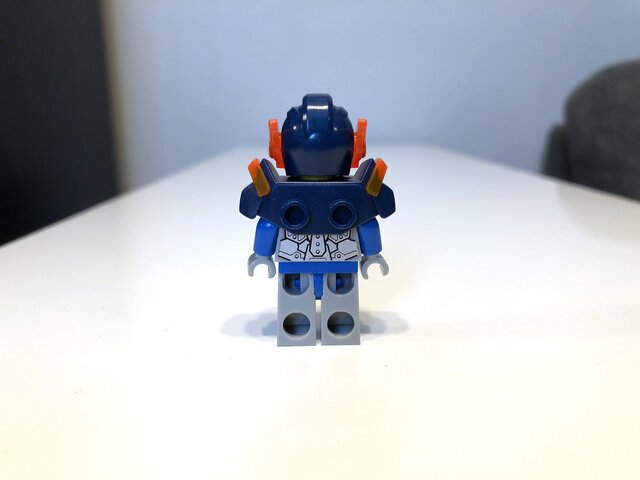](https://www.freelug.org/IMG/jpg/polypodnexoknight_07.jpg)

[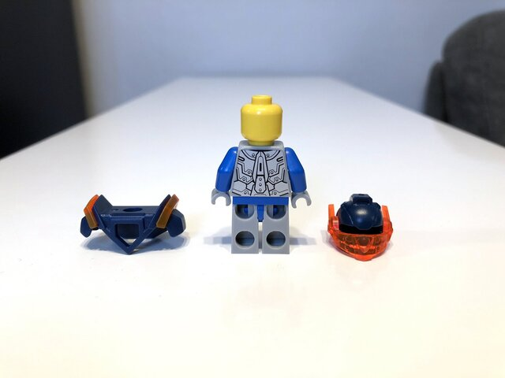](https://www.freelug.org/IMG/jpg/polypodnexoknight_08.jpg)

* * *

L’intérieur du Pod se monte en moins de 2 minutes.

[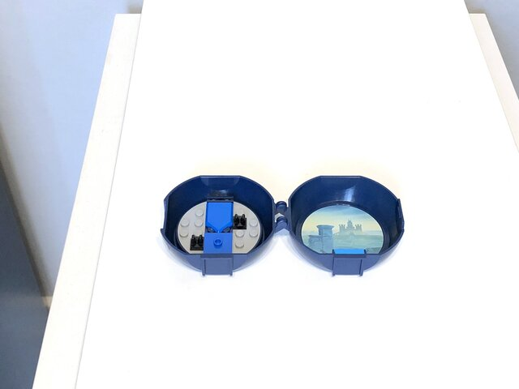](https://www.freelug.org/IMG/jpg/polypodnexoknight_09.jpg)

Pour un résultat assez sommaire.

[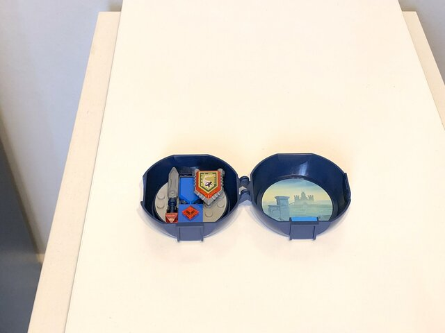](https://www.freelug.org/IMG/jpg/polypodnexoknight_10.jpg)

[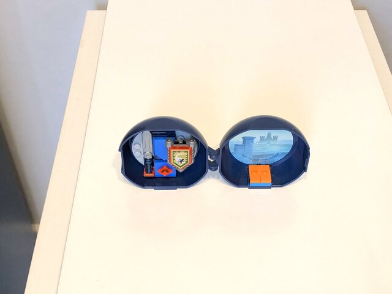](https://www.freelug.org/IMG/jpg/polypodnexoknight_11.jpg)

_Clay_ en position dans le pod.

[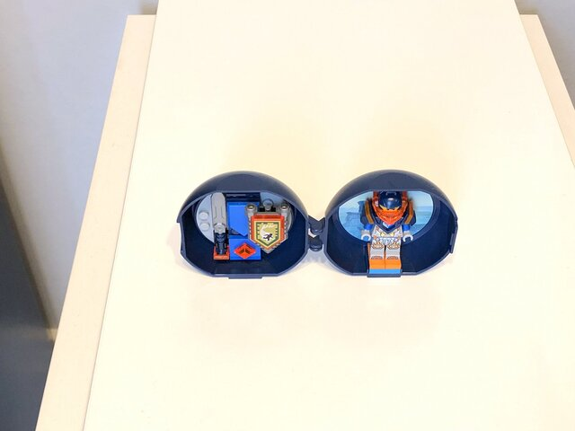](https://www.freelug.org/IMG/jpg/polypodnexoknight_12.jpg)

[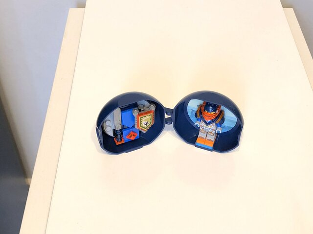](https://www.freelug.org/IMG/jpg/polypodnexoknight_13.jpg)

* * *

Gros plan sur le bouclier qui orne le pod, dommage que _LEGO_ n’ait pas réalisé celui-ci sur une vrai pièce.  
Le clin d’œil au fan de _Space Classic_ a du coup un arrière-goût amer.

[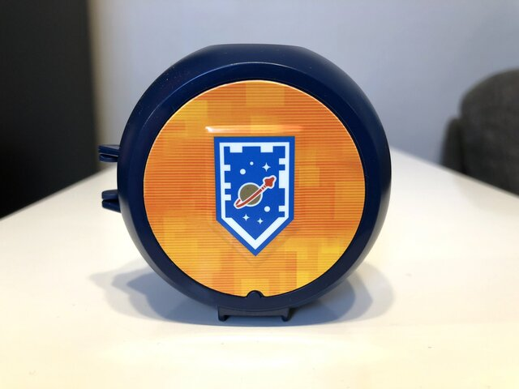](https://www.freelug.org/IMG/jpg/polypodnexoknight_03.jpg)

* * *

**AVIS :**

Un polybag sympathique mais qui pêche par un montage interne anecdotique. L’absence d’un vrai bouclier _Space Classic_ enfonce le clou sur notre déception.

Dommage, _LEGO_ aurait pu faire un joli cadeau aux fans nostalgiques d’une gamme qui reste encore à ce jour la madeleine de Proust de bon nombre d’_AFOL_.

**BONUS :**

Un GIF animé réalisé avec l’intégralité des photos du montage (cliquez sur l’image pour lancer l’animation).

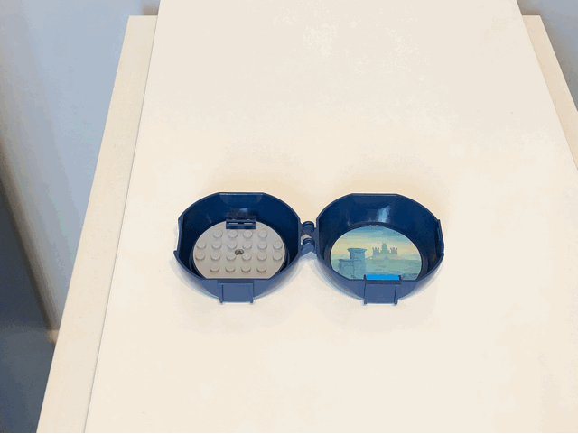
