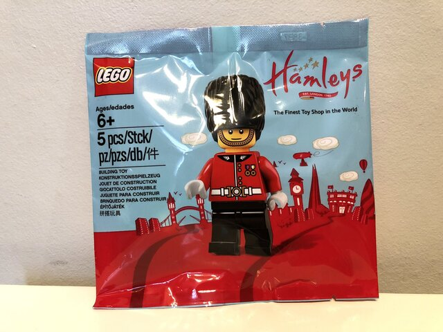
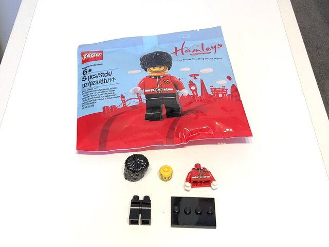

Bonjour à tous, aujourd’hui je vous propose la review du polybag 5005233 dans la gamme _Minifigures_ : **Hamleys Royal Guard**.  
Ce polybag, sorti en 2018, est composé de 5 pièces. Il est en vente exclusivement dans le magasin _Hamleys_ à Londres pour environ 7 euros.

* * *

Sur le polybag, le _Royal Guard_ est mis en situation dans un Londres stylisé. Les logos _LEGO_ et _Hamleys_ sont présents en haut du polybag. L’ensemble donne un air cartoonesque à cette mise en situation.

A l’intérieur, on trouve cinq pièces, dont une plaque.

* * *

Une fois monté, ce _Royal Guard_ a fier allure, les sérigraphies sont propres bien que très simples.

Au dos, aucune sérigraphie ne vient décorer cette fig, _LEGO_ aurait pu tout de même mettre un ou deux plis sur la veste.

* * *

Comparatif entre la figurine _Hamleys_ et la figurine de la série 5.  
Bien que beaucoup plus ancienne, le _Royal Guard_ de la série 5 parait bien mieux fini au niveau des sérigraphies de sa veste.

* * *

**AVIS :**

Une belle figurine au prix contenu, cela permet aux gens qui avait raté celui de la série 5 de se rattraper.  
Pour autant on aurait pu s’attendre à une meilleure mise à jour de la part de _LEGO_.
