En apnée, je vous propose de jeter un coup d’œil rapide à la boîte _60091_, titrée _Ensemble de démarrage sous-marin_.

Sortie en 2015, cette boîte aligne 90 pièces pour 9,99 €, soit un ratio de 11 centimes par pièce. Trois figurines et un requin sont inclus.

* * *

L’avant de la boîte montre les différents éléments inclus : les plongeurs, le requin, le bathyscaphe, et le trésor caché par une plante. Le logo CITY rappelle à quelle gamme se rattache ce petit set, et la mention « STARTER KIT » apparaît en bas à droite.

[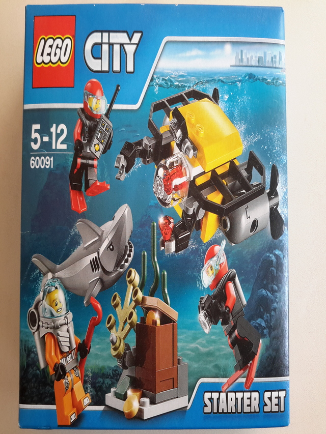](https://www.freelug.org/IMG/jpg/20180722_101705.jpg)

L’arrière reprend les trois personnages, et les met en scène dans deux petites vignettes. Rien de bien surprenant, c’est classique.

[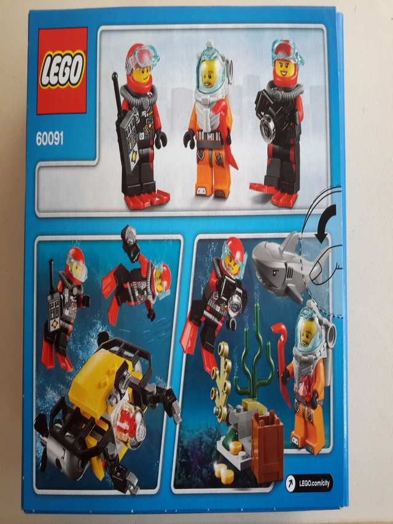](https://www.freelug.org/IMG/jpg/20180722_101720.jpg)

À l’intérieur, une petite notice et un petit tas de pièces, normal, il n’y en a que 90.

[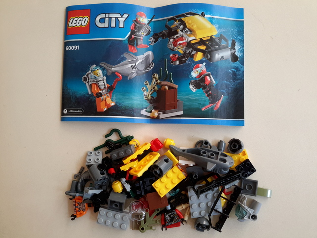](https://www.freelug.org/IMG/jpg/20180722_102651.jpg)

* * *

Passons aux différents protagonistes de l’affaire.

La première figurine est une plongeuse équipée d’un appareil photo. Comme il se doit, elle a des bouteilles dans le dos, un masque et tuba, des palmes. Plusieurs cadrans et indicateurs insistent sur le côté combinaison de plongée. Petite sérigraphie sur les jambes, rien d’exceptionnel.

[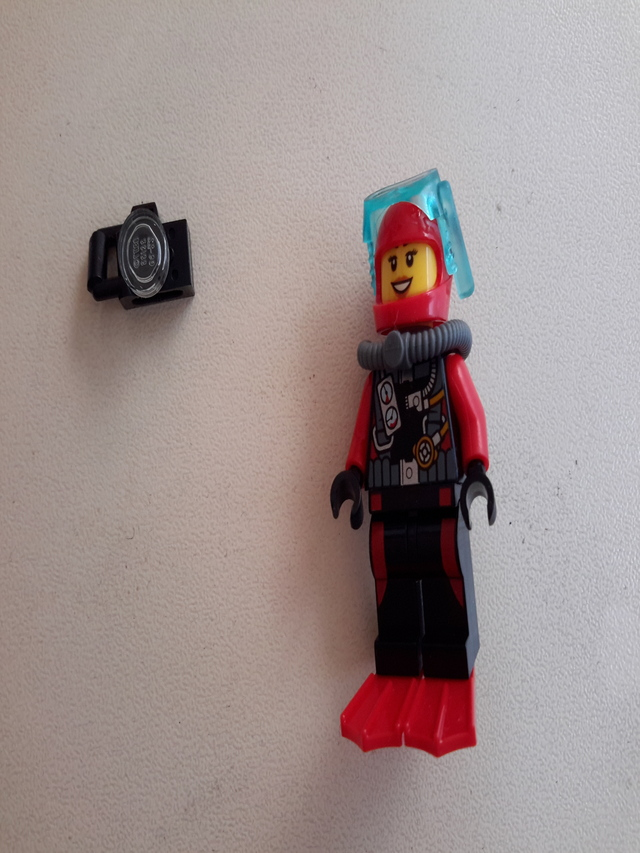](https://www.freelug.org/IMG/jpg/20180722_101801.jpg)

[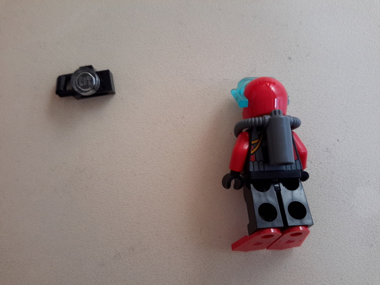](https://www.freelug.org/IMG/jpg/20180722_101812.jpg)

La figurine sans bouteille et casque. Dans le dos la sérigraphie continue, en cohérence avec l’avant. Rien sur les jambes en revanche.

[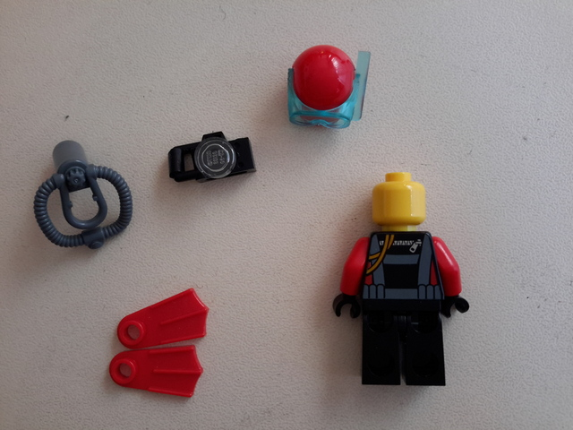](https://www.freelug.org/IMG/jpg/20180722_101851.jpg)

[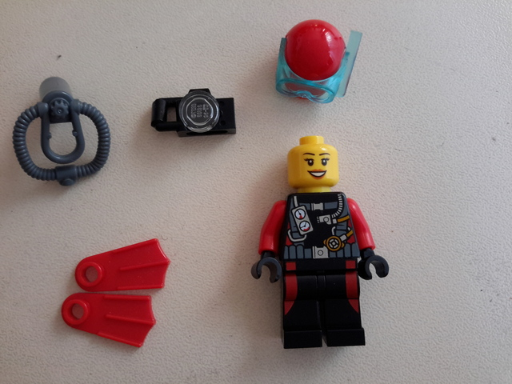](https://www.freelug.org/IMG/jpg/20180722_101858.jpg)

Le second plongeur est identique, au visage près. Il a un appareil sans doute pour se repérer — c’est un talkie-walkie avec une plaque sérigraphiée, mais le son, sous l’eau, ce n’est pas vraiment ça...

[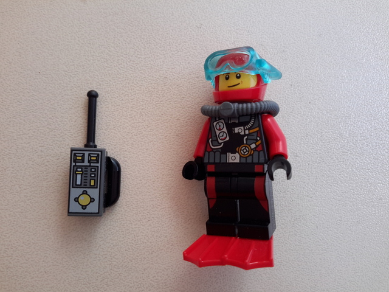](https://www.freelug.org/IMG/jpg/20180722_101920.jpg)

[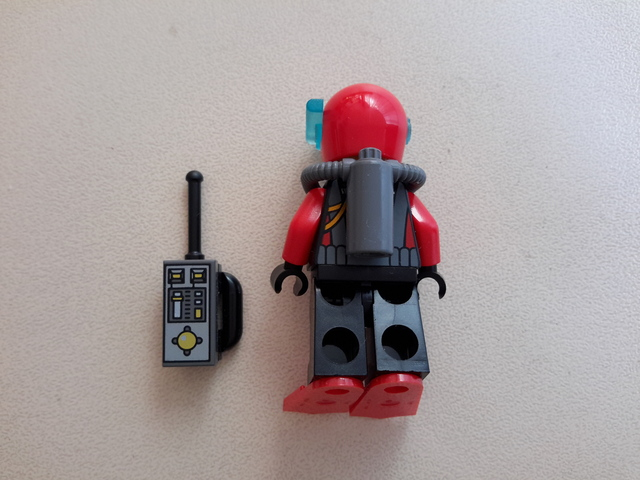](https://www.freelug.org/IMG/jpg/20180722_101934.jpg)

Le troisième personnage est un scaphandrier. Il affiche une belle barbe sous son joli casque transparent — qui me rappelle celui d’un astronaute dans une série de figurines. La sérigraphie montre quelques sangles et harnais, et détail d’importance les poids aux pieds, pour qu’il aille bien au fond de l’océan. Son accessoire est un pied-de-biche, pour forcer le coffre trouvé.

[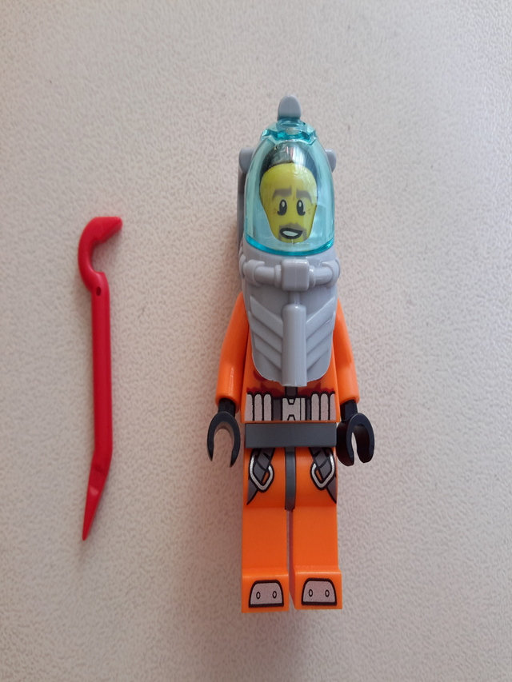](https://www.freelug.org/IMG/jpg/20180722_102000.jpg)

[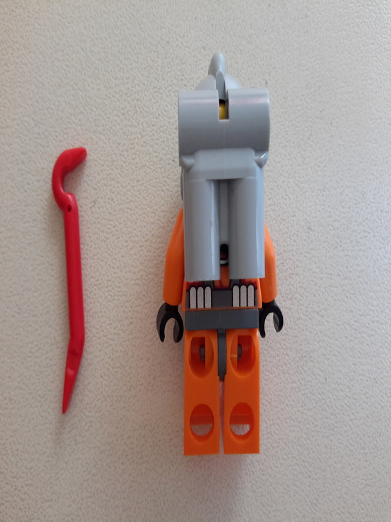](https://www.freelug.org/IMG/jpg/20180722_102010.jpg)

Sans équipement, la sérigraphie apparaît dans toute sa splendeur — elle est assez adaptée, je trouve.

[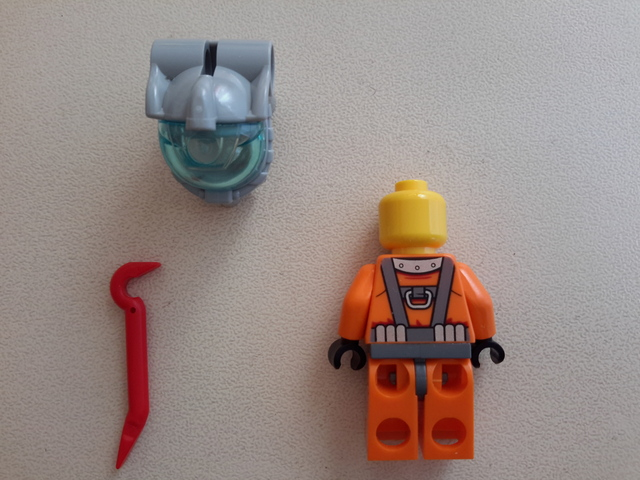](https://www.freelug.org/IMG/jpg/20180722_102031.jpg)

[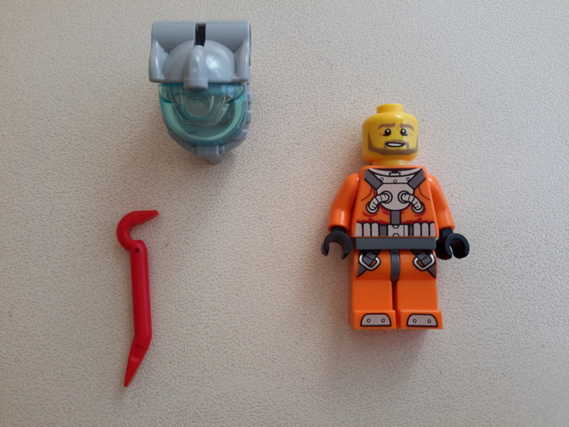](https://www.freelug.org/IMG/jpg/20180722_102041.jpg)

Enfin dernier personnage, mais pas le moindre, le requin ! Composé de deux pièces, il peut ouvrir la gueule pour menacer les inconscients s’approchant trop près de lui.

[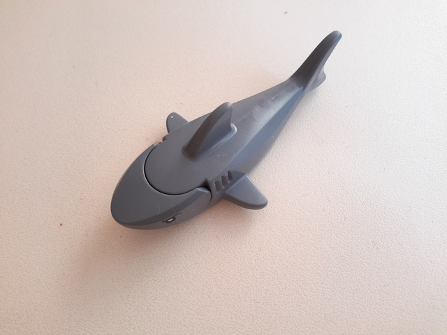](https://www.freelug.org/IMG/jpg/20180722_102051.jpg)

[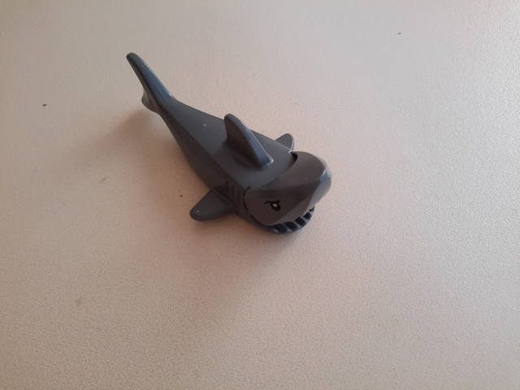](https://www.freelug.org/IMG/jpg/20180722_102058.jpg)

Toutes ces figurines et animal apparaissent dans d’autres sets, rien d’unique donc.

* * *

Passons à la construction du décor et du bathyscaphe — rien de compliqué, je vous rassure.

Le petit décor comporte un coffre au trésor caché par une plante. Il se pose sur une plaque 4x4, bordée d’une pièce en or. Le coffre est posé sur une plaque 2x2 à jumper, afin sans doute de pouvoir être retiré simplement.

[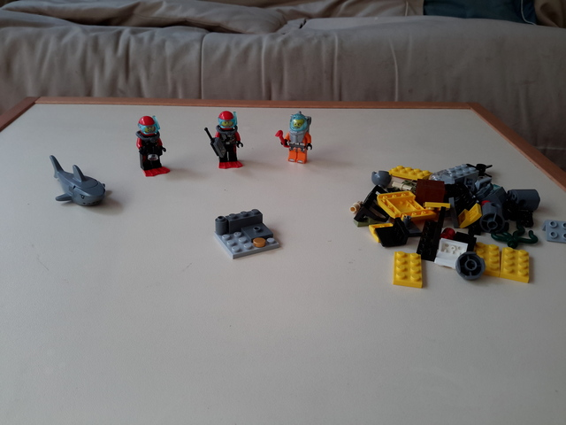](https://www.freelug.org/IMG/jpg/20180722_110413.jpg)

Deux petites pentes, et le coffre.

[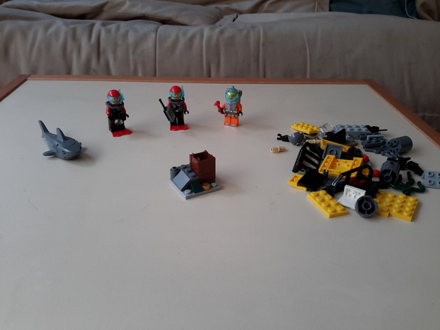](https://www.freelug.org/IMG/jpg/20180722_110502.jpg)

On place une petite pince, sur laquelle viendra se fixer la plante, ce qui permet de la faire pivoter.

[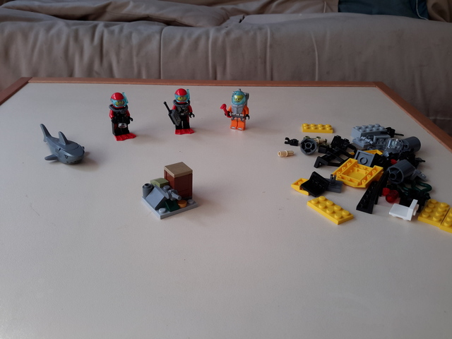](https://www.freelug.org/IMG/jpg/20180722_110553.jpg)

Et voici le morceau de décor, avec deux magnifiques plantes sous-marines. Rien d’exceptionnel, mais ça tient la route, le coffre est dissimulé.

[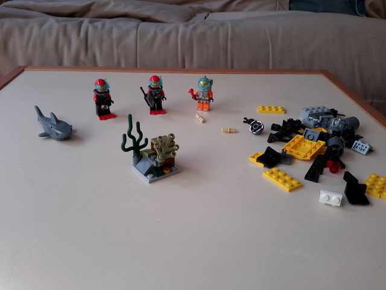](https://www.freelug.org/IMG/jpg/20180722_110615.jpg)

Le bathyscaphe pour sa part est basé sur deux plaques 2x4 prenant en sandwich une brique 2x4, plus quelques angles noirs.

[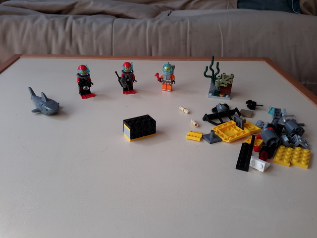](https://www.freelug.org/IMG/jpg/20180722_110717.jpg)

On rajoute un toit un peu courbe, et à l’avant une coupole avec sans doute une lampe pour éclairer — ou est-ce une caméra ?

[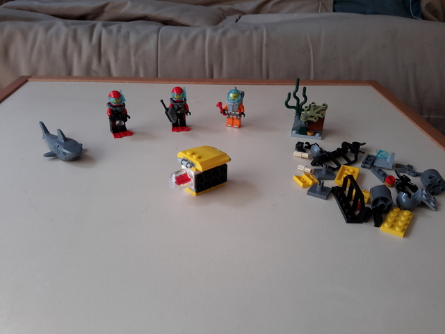](https://www.freelug.org/IMG/jpg/20180722_110813.jpg)

On rajoute une lampe blanche — donc c’était peut-être bien une caméra, finalement ! — puis on passe aux supports des propulseurs latéraux. C’est une construction symétrique, avec des grilles.

[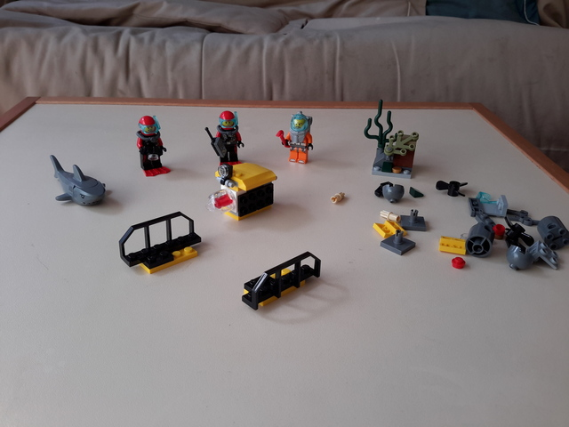](https://www.freelug.org/IMG/jpg/20180722_110930.jpg)

On rajoute quelques points de fixation. Rien ne pourra pivoter cependant, le propulseur est coincé.

[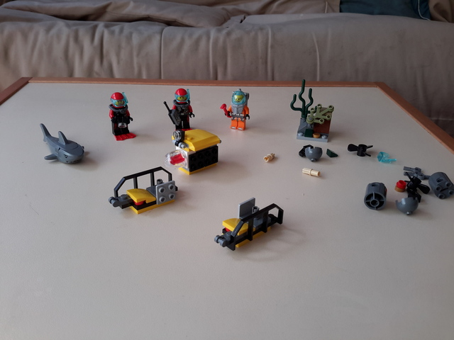](https://www.freelug.org/IMG/jpg/20180722_111032.jpg)

On assemble les supports, et on passe aux propulseurs proprement dits. Ils sont identiques, avec quatre pièces chacun. Les hélices peuvent tourner, c’est le minimum.

[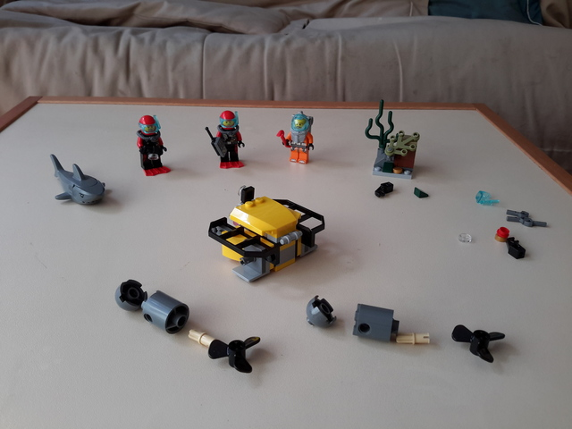](https://www.freelug.org/IMG/jpg/20180722_111155.jpg)

On assemble les propulseurs, on rajoute sur le devant des pinces afin de pouvoir saisir des objets, et la construction est terminée.

[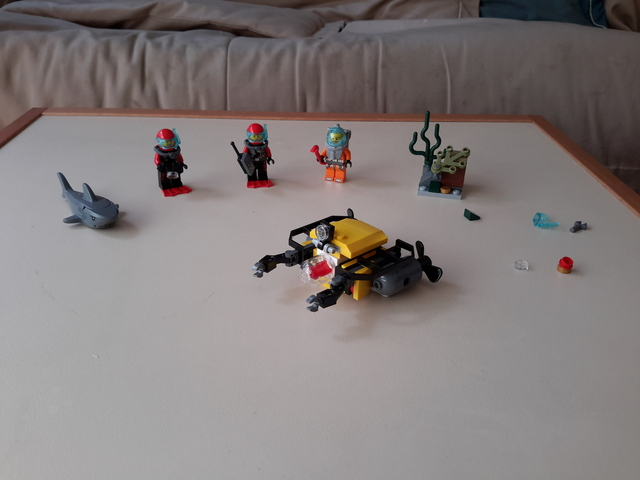](https://www.freelug.org/IMG/jpg/20180722_111301.jpg)

Voici tous les éléments mis en scène.

[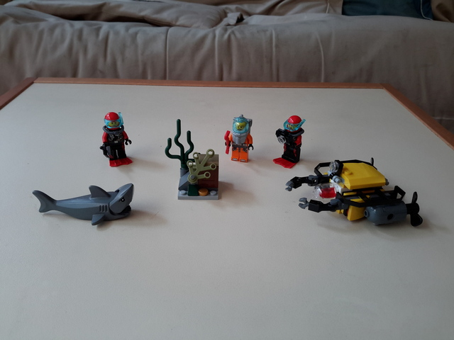](https://www.freelug.org/IMG/jpg/20180722_101622.jpg)

[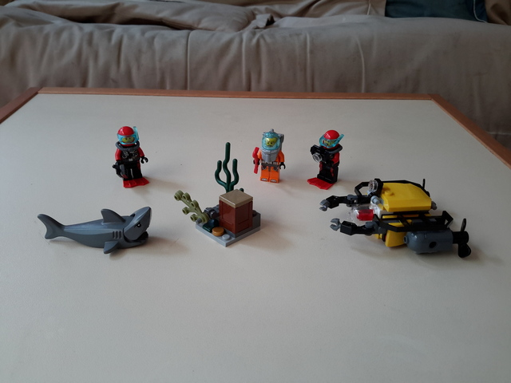](https://www.freelug.org/IMG/jpg/20180722_101640.jpg)

Et voici les quelques pièces bonus, six, pas négligeable pour la taille de l’ensemble. Un masque, une pince, quelques plaques rondes et une pente.

[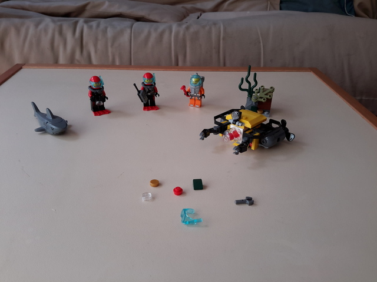](https://www.freelug.org/IMG/jpg/20180722_111316.jpg)

* * *

**Avis :** rien de bien révolutionnaire, mais une petite boîte sympathique quand même. Elle fait le boulot, sans fioritures, et je trouve le rendu honnête. Bref, je suis satisfait de ce petit set, qui n’a rien d’indispensable, évidemment !

**Bonus :** animation de toutes les étapes de construction (cliquer pour lancer).

