Aujourd’hui je vous propose une revue rapide de la boîte _60100_, l’_Ensemble de démarrage de l’aéroport_.

Sortie en 2016, cette boîte comporte 81 pièces pour 9,99 €, soit un ratio de 12 centimes par pièce. Quatre figurines sont présentes dans la boîte, ce qui rend ce ratio pas trop mauvais à mon sens.

L’avant présente le contenu mis en scène, avec un hélicoptère, une boîte aux lettres, et des personnages avec accessoires. Le logo CITY est uniforme, pas encore dans le nouveau style que l’on voit dorénavant pour les boîtes minières par exemple. La mention « Starter kit » en bas à droite pose bien les règles, c’est un ensemble de base.

[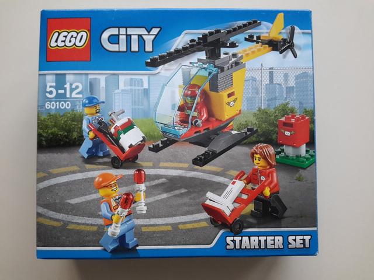](https://www.freelug.org/IMG/jpg/20180225_115908.jpg)

L’arrière présente les quatre personnages, ainsi que les quelques éléments avec lesquels jouer dans cette boîte, mettre ou relever du courrier et faire tourner les pales de l’hélicoptère — rien de vraiment surprenant vu le contenu.

[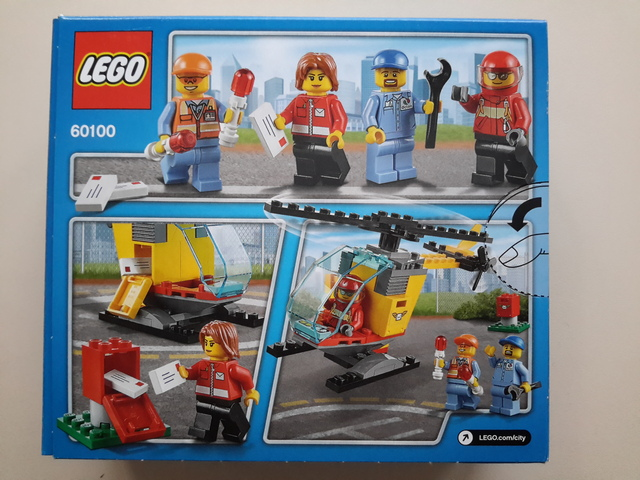](https://www.freelug.org/IMG/jpg/20180225_115932.jpg)

Voici une vue d’ensemble de la boîte montée selon les instructions. À noter que c’est la jeune femme à uniforme de poste qui tient les bâtons lumineux tandis que le personnage à combinaison orange pousse le chariot à lettres. C’est soit une inversion dans le manuel, soit un indice que l’on peut passer outre pour imaginer n’importe quelle scène, avec seulement son imagination pour limite.

À noter la présence d’autocollants sur la boîte aux lettres rouge et sur l’hélicoptère.

[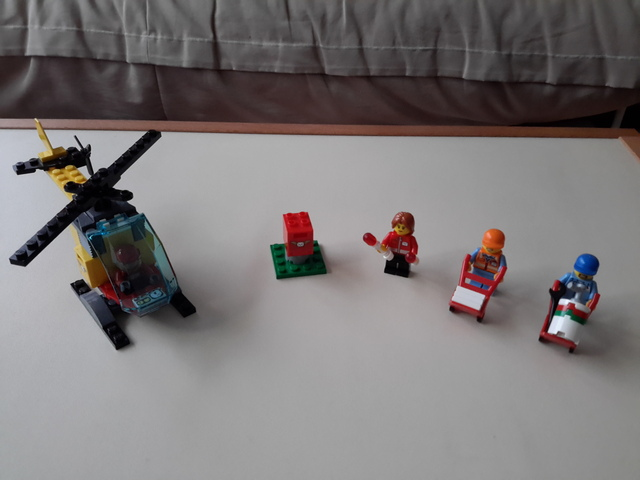](https://www.freelug.org/IMG/jpg/20180225_115115.jpg)

Une vue un peu plus proche, avec au fond à droite les pièces bonus — un embout de sabre laser, un robinet et une visière de casque.

[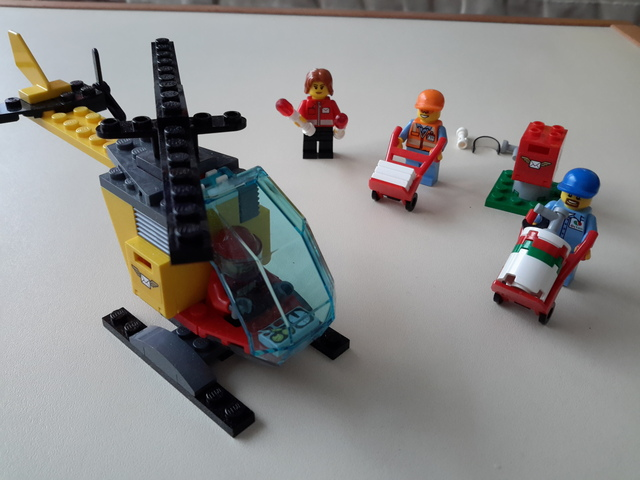](https://www.freelug.org/IMG/jpg/20180225_115313.jpg)

Juste par esprit de contrariété, voici la scène correspondant à l’avant de la boîte, avec inversion des deux personnages précédents.

[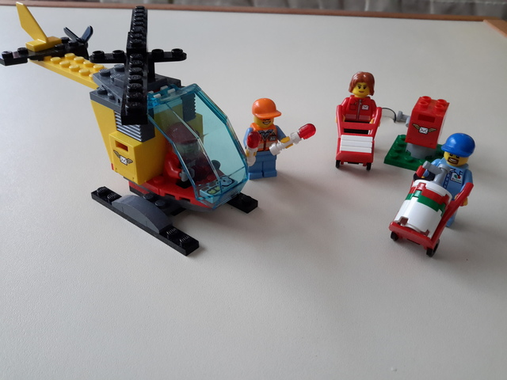](https://www.freelug.org/IMG/jpg/20180225_115414.jpg)

Je passe sur l’hélicoptère et sa construction, rien de passionnant à dire dessus — j’ai cependant été surpris car il m’a fallu appuyer très fortement pour assembler correctement les deux pièces arrière en pente inversée.

La première figurine est celle du pilote d’hélicoptère. Il a évidemment un casque à visière, sous lequel il porte des lunettes de soleil et aborde un petit sourire, le résultat donnant un air cool et détendu. Le torse montre quelques harnais et poches, tandis que les mains sont probablement gantées. En revanche les jambes sont uniformes.

[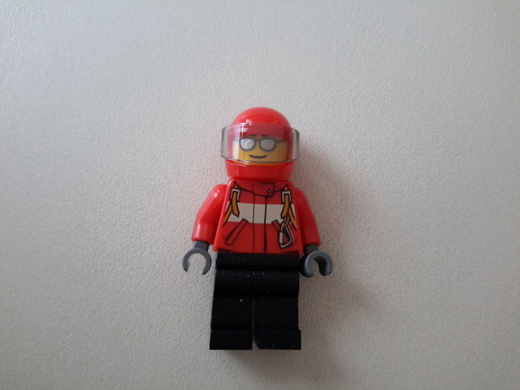](https://www.freelug.org/IMG/jpg/20180225_115601.jpg)

Le dos continue les harnais et la rayure horizontale blanche, plus quelques plis.

[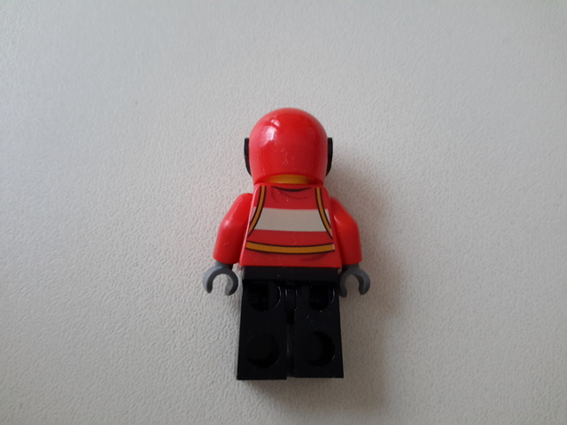](https://www.freelug.org/IMG/jpg/20180225_115622.jpg)

La postière a comme il se doit un uniforme avec une lettre, et une poche contenant un stylo pour corriger des erreurs. Une fermeture éclair ferme ledit uniforme. L’expression est entre souriante et neutre, les cheveux somme toute pas si longs. Le chariot est en une pièce, avec trois lettres posées dessus. Les jambes sont unicolores.

[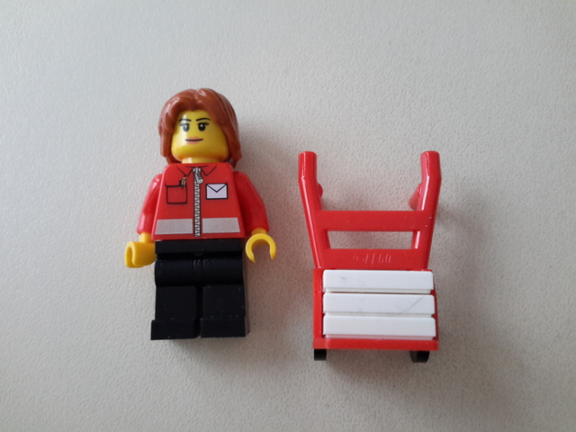](https://www.freelug.org/IMG/jpg/20180225_115642.jpg)

Au dos rien à signaler, aucun motif. Les lettres sont les standard que l’on trouve dans de nombreuses boîtes.

[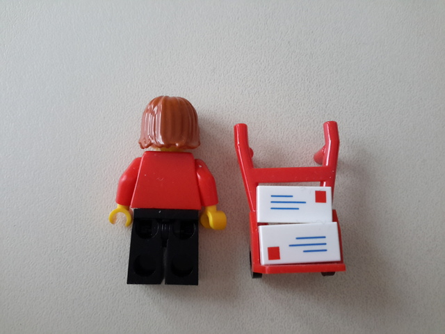](https://www.freelug.org/IMG/jpg/20180225_115741.jpg)

La troisième figurine est celle du mécanicien chargé de ravitailler l’hélicoptère en carburant. Il a forcément sur sa chemise le logo « Octan » (« essence ») visible dans les gammes LEGO depuis des années, et également une poche dont dépassent un stylo et un morceau de papier. La chemise a le col légèrement entrouvert sur un t-shirt blanc. Il porte une barbe marron bien fournie autour de la bouche, assortie à ses sourcils. Jambes uniformes une fois encore. Son chariot contient une bonbonne (sans doute) de carburant, aux couleurs du logo Octan, et une clé anglaise, certainement indispensable pour ouvrir le réservoir ou faire quelque ajustement.

[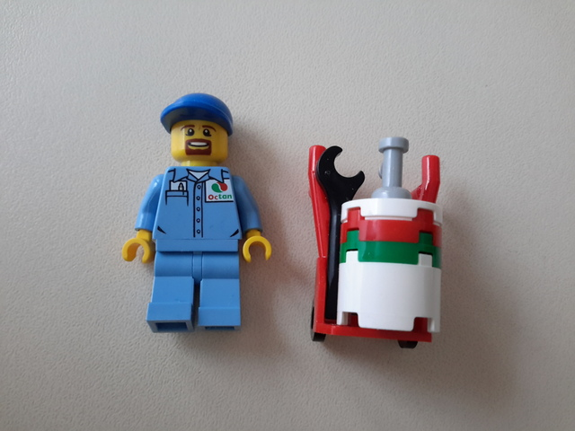](https://www.freelug.org/IMG/jpg/20180225_115654.jpg)

De dos on retrouve un gros logo Octan et des plis, sans fioriture supplémentaire.

[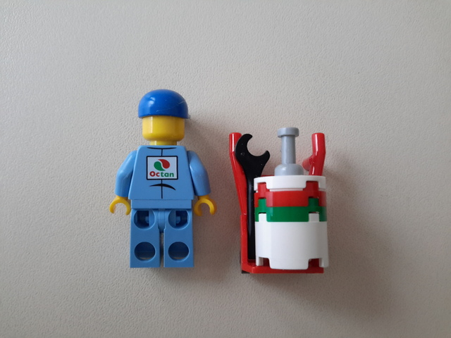](https://www.freelug.org/IMG/jpg/20180225_115753.jpg)

La quatrième figurine est un parqueur [^1], avec une combinaison orange à bandes blanches. Il porte un badge (pour la sécurité sans doute) et a un stylo accroché autour du cou par une cordelette. Il porte des lunettes de sécurité, et affiche un grand sourire. Une casquette orange complète sa tenue. Toujours des jambes uniformes. Les deux bâtons lumineux sont des manches de sabre laser avec une pièce transparente, donnant un rendu simple mais efficace.

[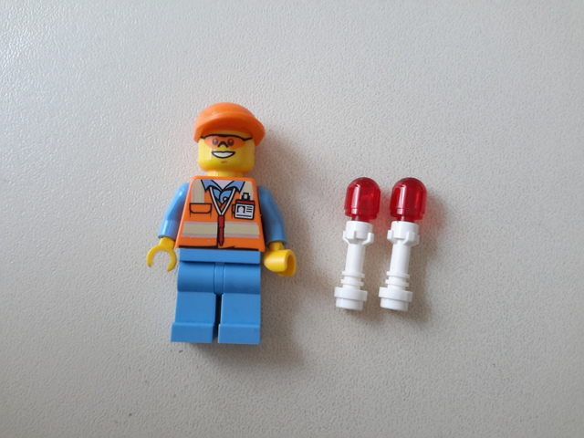](https://www.freelug.org/IMG/jpg/20180225_115706.jpg)

Le dos reprend la combinaison et les bandes blanches, avec un peu de relief autour du cou et de la taille.

[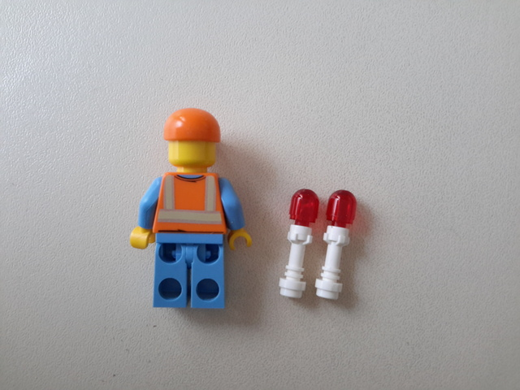](https://www.freelug.org/IMG/jpg/20180225_115806.jpg)

* * *

**Avis :** une petite boîte sympathique. Je regrette les jambes uniformes des personnages, mais les torses ont un bon rendu, et ma foi, pour ce prix, c’est très raisonnable. Bien sûr les possibilités de jouer sont un peu limitées, peu d’éléments bougent, mais la boîte fournit des éléments pour agrémenter une scène plus grande, voire pour bien s’amuser en laissant libre cours à son imagination — chiche que l’on peut recycler l’hélicoptère en vaisseau spatial ?

[^1]: C’est apparemment le terme approprié, si j’en crois une recherche rapide.
