Pour continuer dans les boîtes CITY, voici un aperçu de la boîte _60127_, _L’ensemble de démarrage de la prison en haute mer_.

Cette boîte comportant 92 pièces est sortie en 2016 au prix de 9,99 €, ce qui fait un ratio de 11 centimes. Elle comporte quatre personnages, comme la plupart des ensembles de démarrage.

L’avant comporte l’habituel logo « CITY », la mention « Starter kit », et met en scène des bandits s’emparant d’un trésor et essayant de s’enfuir en hors-bord, poursuivis comme il se doit par la police, ici un policier et une policière.

[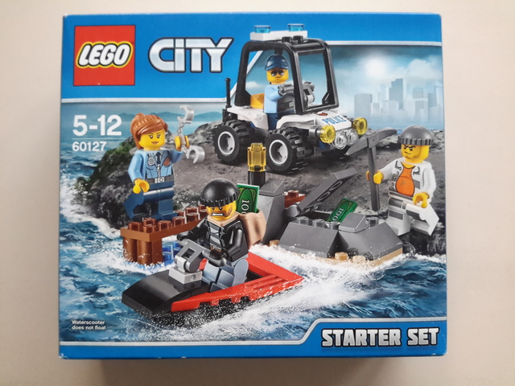](https://www.freelug.org/IMG/jpg/20180225_122125.jpg)

L’arrière montre les quatre personnages alignés, présentation classique des ensembles de démarrage, et en bas les bandits tentant de fuir mais heureusement arrêtés — la justice triomphe toujours !

[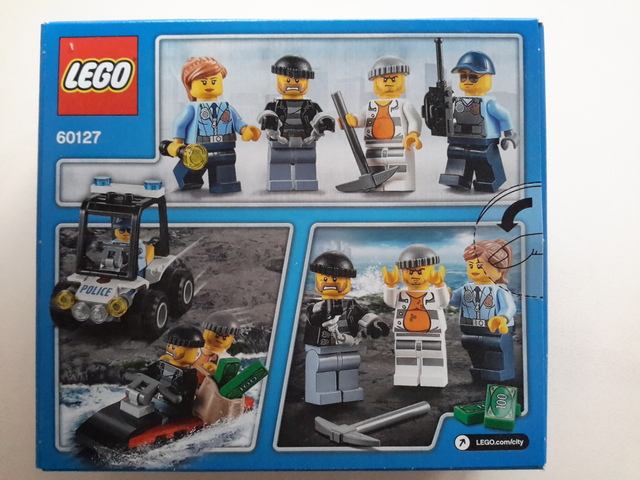](https://www.freelug.org/IMG/jpg/20180225_122149.jpg)

* * *

Voici la boîte montée avec la scène telle que décrite dans le manuel, qui présente des variations avec l’avant, encore une fois — le bandit au sac s’enfuit en hors-bord tandis que celui avec la pioche trouve le trésor.

La boîte comporte donc un hors-bord, un tout-terrain de police et un bout de ponton comportant une cache au trésor, ici ouverte. Les véhicules sont simples mais rendent bien.

[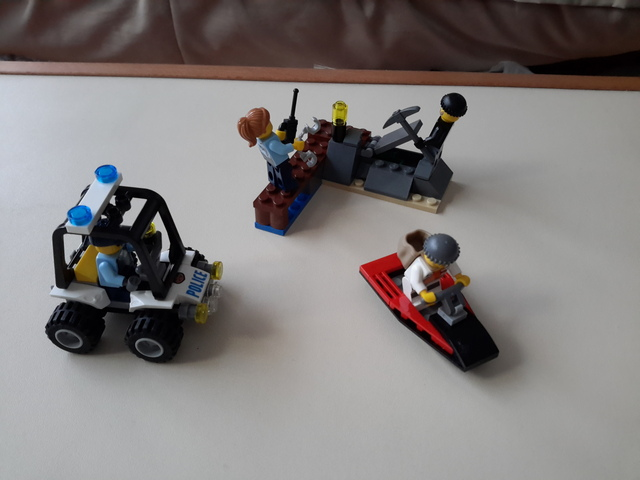](https://www.freelug.org/IMG/jpg/20180225_122258.jpg)

[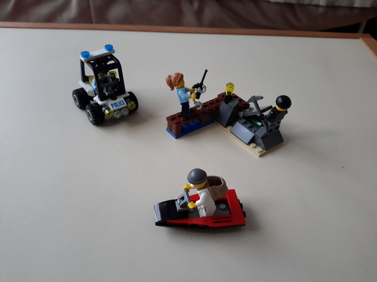](https://www.freelug.org/IMG/jpg/20180225_122323.jpg)

Un gros plan sur la cachette des bandits, qui comporte quelques billets — même pas de pierres précieuses, incroyable !

[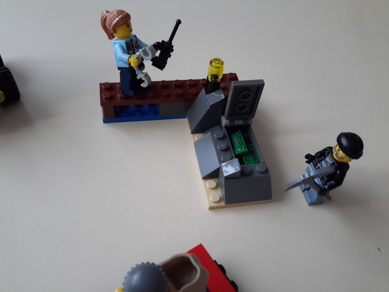](https://www.freelug.org/IMG/jpg/20180225_122421.jpg)

Voici les personnages contemplant les pièces bonus, dont un manche de sabre laser et une paire de menottes — une petite pile sympathique.

[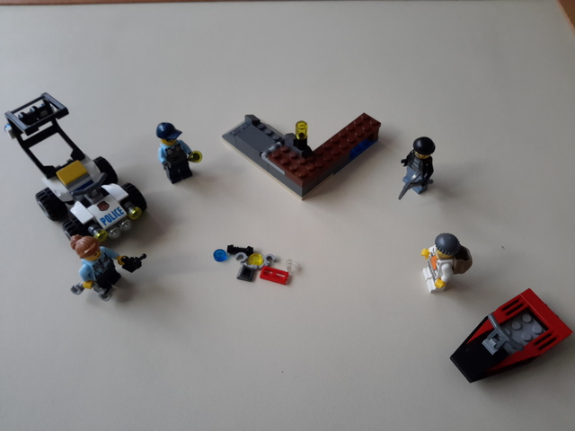](https://www.freelug.org/IMG/jpg/20180225_122642.jpg)

Voici le premier voleur, qui a une pioche. Il porte un gilet ouvert sur un uniforme rayé — il s’est sans doute échappé de quelques prisons — avec des plis, une ceinture du plus bel effet. Quelques marques suggèrent les fermetures dudit gilet et de quoi l’ajuster. Ce voleur a un air entre déçu et énervé, une barbe pas très bien rasée, et porte une sorte de béret sur la tête. Comme quoi être en fuite n’est pas la panacée. La pioche est une pièce tout à fait standard.

[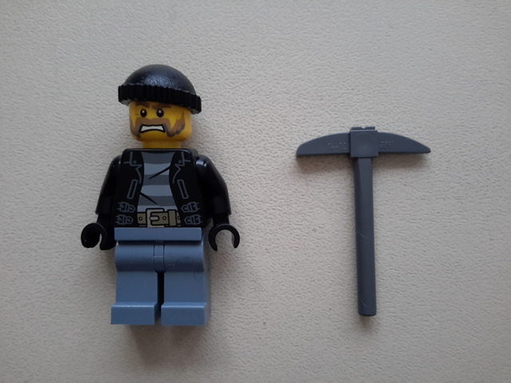](https://www.freelug.org/IMG/jpg/20180225_122748.jpg)

De dos les attaches de réglage sont reprises, avec quelques plis pour le col.

[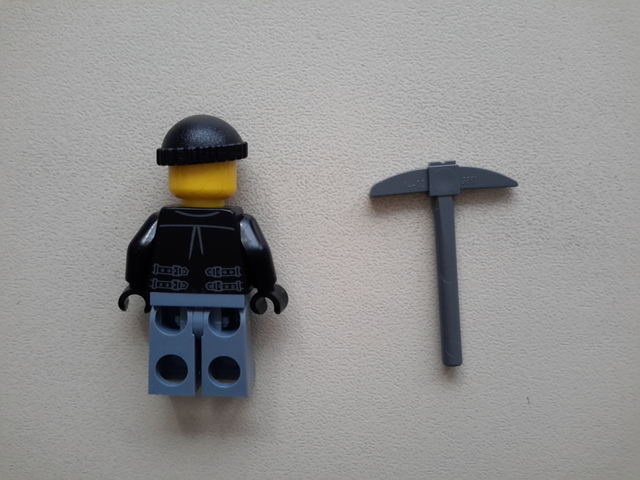](https://www.freelug.org/IMG/jpg/20180225_122939.jpg)

Son acolyte a manifestement de l’embonpoint sous sa chemise orange. L’uniforme est rayé également mais ouvert. Il affiche un air déterminé et buté, il ne souhaite manifestement pas se rendre. Les jambes reprennent les bandes de l’uniforme de prisonnier. Sur la tête un béret, mais gris foncé. Le sac est une pièce standard.

[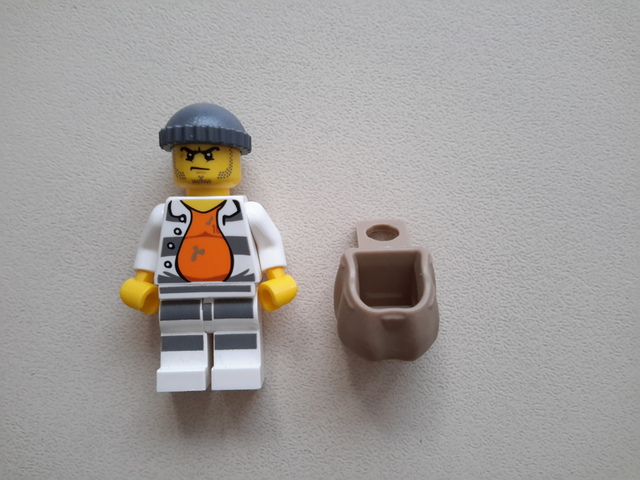](https://www.freelug.org/IMG/jpg/20180225_122808.jpg)

De dos l’uniforme continue avec les bandes de couleur et le numéro de prisonnier — j’ignore s’il a une quelconque signification. En revanche les jambes sont unies.

[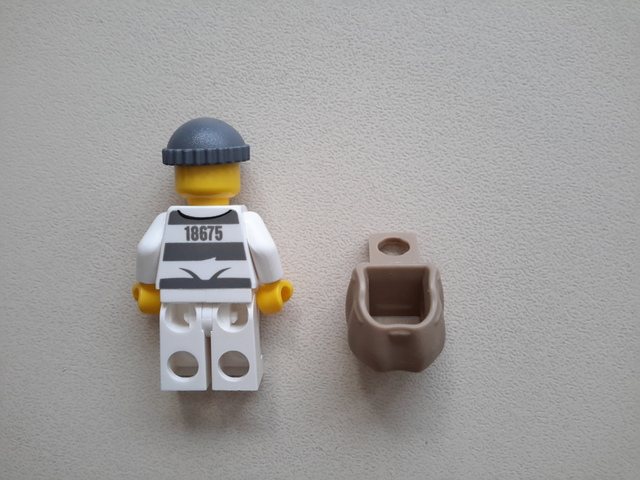](https://www.freelug.org/IMG/jpg/20180225_122952.jpg)

Troisième figurine, la policière a une coupe bien faite sur le côté, et a un air sûre d’elle sans être agressive. Son uniforme est joliment rendu, avec micro et insigne sur les épaules, une ceinture à sacoches. Les jambes sont bleu foncé. Ses accessoires sont un talkie-walkie et une paire de menottes.

[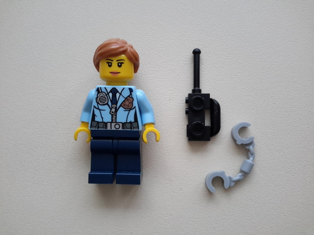](https://www.freelug.org/IMG/jpg/20180225_122824.jpg)

De dos, le fil du micro continue et rentre dans une sacoche de ceinture, un détail sympathique. Elle aborde fièrement un logo « police », et a une queue de cheval.

[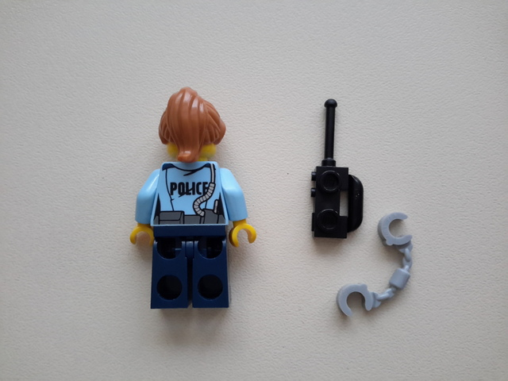](https://www.freelug.org/IMG/jpg/20180225_122926.jpg)

Enfin le second policier porte un gilet de sauvetage avec, comme sa collègue, micro et insigne. Il a des lunettes de soleil bas sur le nez, et un petit sourire en coin, très sûr de lui. Une casquette assortie à ses jambes complète ses vêtements. Ses tons sont donc les mêmes que sa collègue, bleu et bleu foncé, il a d’ailleurs les mêmes jambes. Son accessoire est une lampe de poche, manche de sabre laser noir plus pièce jaune transparent.

[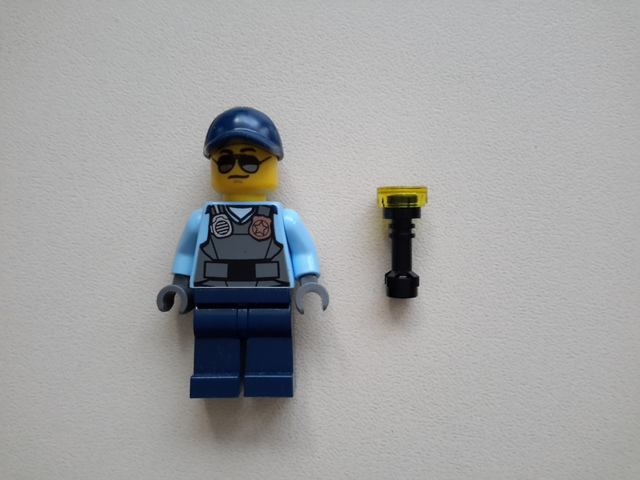](https://www.freelug.org/IMG/jpg/20180225_122841.jpg)

De dos le gilet continue, ainsi que le fil du micro qui se range dans une poche arrière. Comme sa collègue il a droit à un logo « police ».

[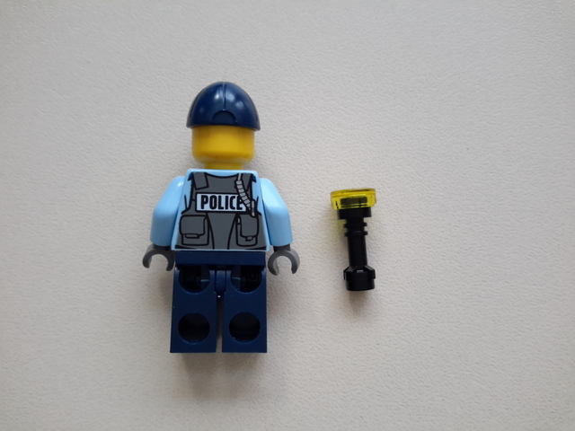](https://www.freelug.org/IMG/jpg/20180225_122915.jpg)

* * *

**Avis :** j’aime bien les différentes sérigraphies, et les quelques éléments — voiture, hors-bord, ponton — rendent bien avec peu de pièces. Comme souvent je regrette les jambes unies, avec exception spéciale pour le second prisonnier quand même.

Bref un petit ensemble que je trouve sympathique.
